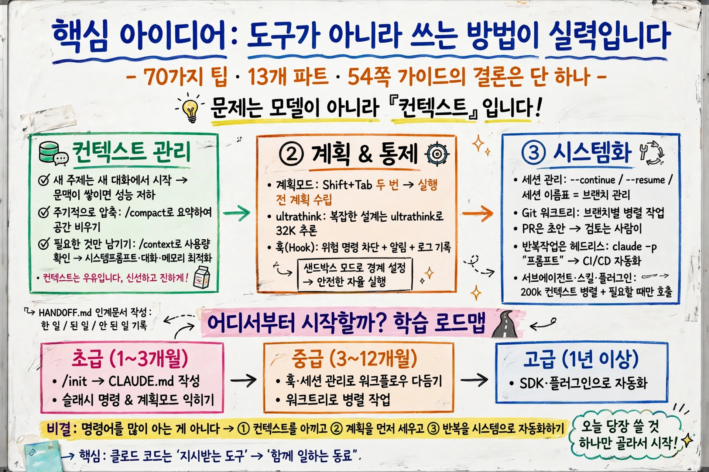
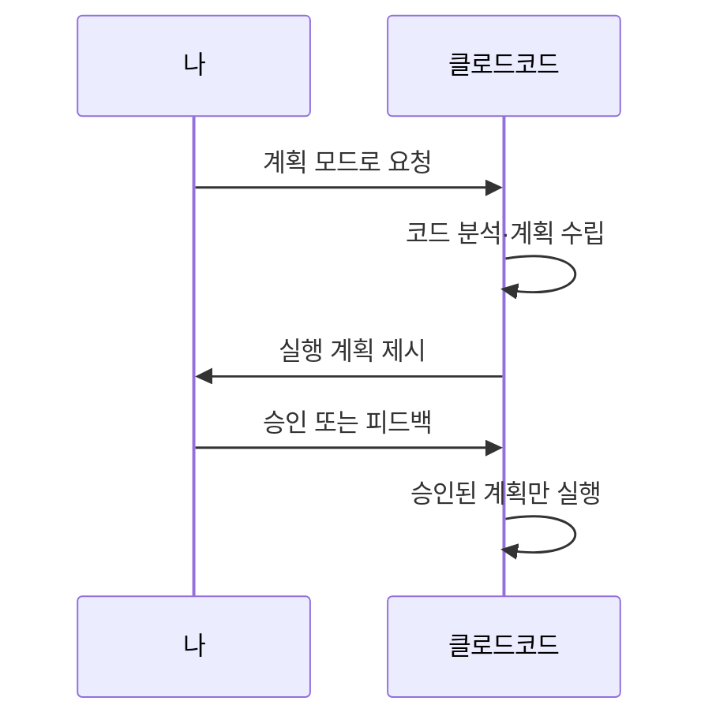
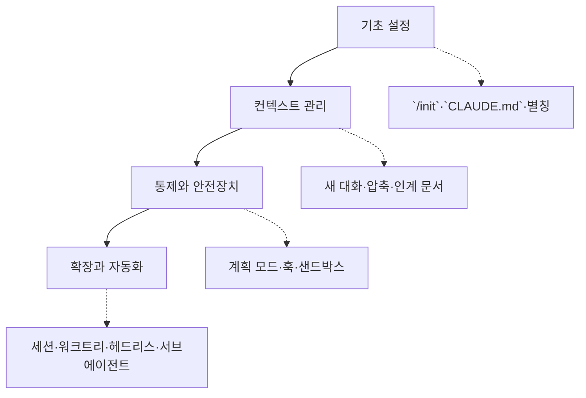

# Claude Code 70가지 팁, 핵심은 명령어가 아니라 컨텍스트입니다

> **Summary**
> 클로드 코드 70가지 팁을 13개 파트로 묶은 54쪽 가이드의 핵심은 컨텍스트 관리와 계획, 통제입니다. 새 대화로 시작하고 주기적으로 압축하며 계획 모드와 훅으로 통제하는 습관이 클로드 코드를 동료로 만드는 방법입니다.

---

- 클로드 코드 70가지 팁을 13개 파트로 묶은 54쪽 가이드의 결론은 하나입니다. 도구가 아니라 쓰는 방법이 실력입니다.
- 핵심은 컨텍스트 관리입니다. 대화를 새로 시작하고, 주기적으로 압축하고, 필요한 것만 남기는 게 성능을 좌우합니다.
- 계획 모드와 훅, 세션 관리까지 갖추면 클로드 코드는 지시받는 도구가 아니라 함께 일하는 동료가 됩니다.


터미널에 클로드 코드를 켜고 "이 기능 만들어줘"라고 했는데, 한참 뒤에 엉뚱한 파일을 건드리고 있는 걸 본 적 있으시죠? 분명히 시킨 건 하나인데, 대화가 길어질수록 답은 점점 흐려집니다. 왜 그럴까요? 70가지 팁을 모은 가이드가 던지는 답은 의외로 단순합니다. 문제는 모델이 아니라 컨텍스트입니다!

🎥 [동영상 보기](https://www.youtube.com/watch?v=6eBSHbLKuN0)

## 70가지 팁, 왜 이렇게 많을까요?

이 가이드는 두 개의 팁 모음을 묶어 정리한 것입니다. 하나는 해커톤 우승자가 쌓은 실전 팁 모음이고, 다른 하나는 12월 한 달간 매일 하나씩 공개된 팁 모음입니다. 합쳐서 70가지, 13개 파트, 54쪽 분량입니다.

다루는 범위가 넓습니다. 사고방식부터 환경 설정, 컨텍스트 관리, Git 워크플로우, MCP·훅·에이전트, 시스템 최적화, 브라우저 연동, 실전 사례, 학습 로드맵까지 이어집니다. 각 팁마다 실제로 쓸 수 있는 명령어와 설정 파일이 붙어 있습니다. 읽는 게 아니라 따라 하는 가이드입니다!

## 컨텍스트는 우유입니다, 신선하고 진하게!

가이드에서 가장 먼저 강조하는 건 컨텍스트입니다. 대화가 길어질수록 성능이 떨어진다는 겁니다. 새 대화에서는 가장 잘 돌아가는데, 맥락이 쌓일수록 점점 흐려집니다. 그래서 새 주제는 새 대화에서 시작하는 게 원칙입니다.

컨텍스트가 차오르면 압축합니다. `/compact` 명령으로 대화를 요약해 공간을 비웁니다. 자동 압축을 끄고 직접 타이밍을 정하는 게 낫다는 조언도 있습니다. 새로 시작하기 전에는 `HANDOFF.md` 같은 인계 문서를 남깁니다. 지금까지 한 일, 된 일, 안 된 일을 적어두면 다음 대화가 빈손으로 시작하지 않습니다.

뭐가 컨텍스트를 잡아먹는지 보려면 `/context`를 씁니다. 시스템 프롬프트, MCP 프롬프트, 메모리 파일, 스킬, 대화 기록이 각각 얼마나 차지하는지 보여줍니다. 숫자를 보면 무엇을 덜어낼지 바로 보입니다.

```mermaid
flowchart LR
    A[새 주제로 새 대화 시작] --> B[작업 진행]
    B --> C{컨텍스트가 차오르면?}
    C -->|압축| D[/compact로 요약]
    D --> E[인계 문서 남기기]
    E --> A
    C -->|계속| B
```

## 계획부터 세우고, 통제는 내가 합니다

클로드 코드의 강점은 계획 모드입니다. `Shift+Tab`을 두 번 누르면 계획 모드가 됩니다. 코드를 읽고 구조를 분석하고 실행 계획을 짜지만, 승인하기 전까지는 파일을 건드리지 않습니다. 생각은 두 번, 실행은 한 번입니다!

어려운 설계 결정에는 `ultrathink`라는 단어를 씁니다. 내부 추론에 최대 32,000토큰을 쓰게 해서 표면적인 답이 아니라 진짜 통찰을 끌어냅니다. 복잡한 아키텍처 결정이나 까다로운 디버깅에서 차이가 난다고 합니다.

통제는 훅이 맡습니다. 훅은 정해진 시점에 도는 셸 명령입니다. 위험한 명령을 막고, 알림을 보내고, 로그를 남깁니다. 확률적인 AI 위에 결정적인 규칙을 얹는 방식입니다. 여기에 샌드박스 모드로 경계를 정해두면, 허락한 범위 안에서만 자유롭게 움직입니다. 권한을 매번 묻는 게 지겹다면 위험 모드도 있지만, 이름에 위험이 들어간 데는 이유가 있습니다. 격리된 환경에서만 쓰는 게 안전합니다.



## 반복되는 일은 시스템으로 만듭니다

세션 관리도 팁의 큰 축입니다. 터미널을 실수로 닫아도 `--continue`로 바로 이어갑니다. `--resume`으로 지난 세션을 골라서 돌아갑니다. 세션에 이름을 붙여두면 브랜치처럼 관리할 수 있습니다. 기본 보관 기간은 30일입니다.

Git 작업은 워크트리로 병렬화합니다. 브랜치마다 작업 공간을 나눠서 여러 작업을 동시에 굴립니다. PR은 초안으로 만들어서 검토한 뒤에 공개합니다. 커밋 메시지는 클로드 코드가 대신 쓰고, 검토는 사람이 합니다.

반복 작업은 헤드리스 모드로 빼냅니다. `claude -p "프롬프트"`로 대화 없이 실행하고, 결과를 파이프로 넘깁니다. CI/CD에 그대로 들어갑니다. 여기에 서브에이전트, 스킬, MCP, 플러그인을 얹으면 확장이 됩니다. 서브에이전트는 각자 200k 컨텍스트 창을 갖고 병렬로 돕니다. 스킬은 필요할 때만 불러오는 전문 지식이고, 플러그인은 명령어·에이전트·스킬·훅·MCP를 한 묶음으로 나눕니다.



## 어디서부터 시작할까요?

가이드는 학습 로드맵도 제시합니다. 초급(1~3개월)은 `/init`으로 `CLAUDE.md`를 만들고, 슬래시 명령어와 계획 모드를 익히는 단계입니다. 중급(3~12개월)은 훅과 세션 관리, 워크트리로 워크플로우를 다듬습니다. 고급(1년 이상)은 SDK와 플러그인으로 자동화를 만듭니다.

70가지 팁을 한 번에 외울 필요는 없습니다. 오늘 당장 쓸 것 하나만 골라서 써보는 게 시작입니다. 클로드 코드를 잘 쓰는 사람의 비결은 명령어를 많이 아는 게 아닙니다. 컨텍스트를 아끼고, 계획을 먼저 세우고, 반복되는 일을 시스템으로 만드는 습관입니다!

