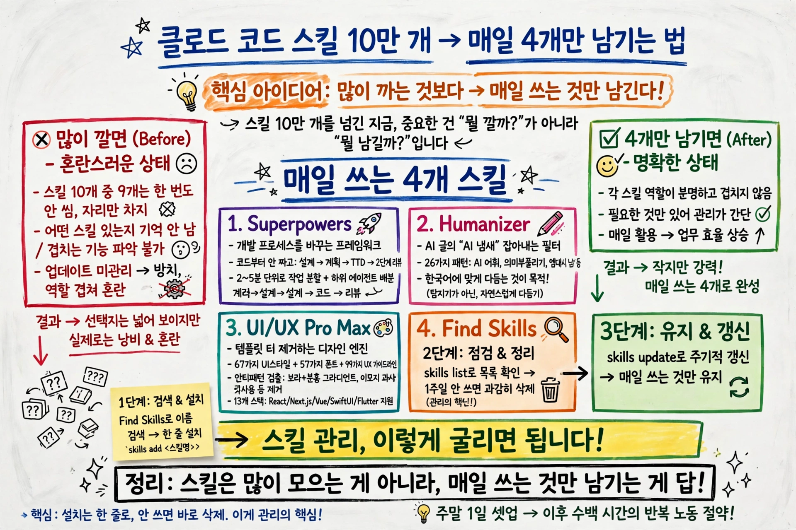
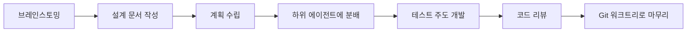
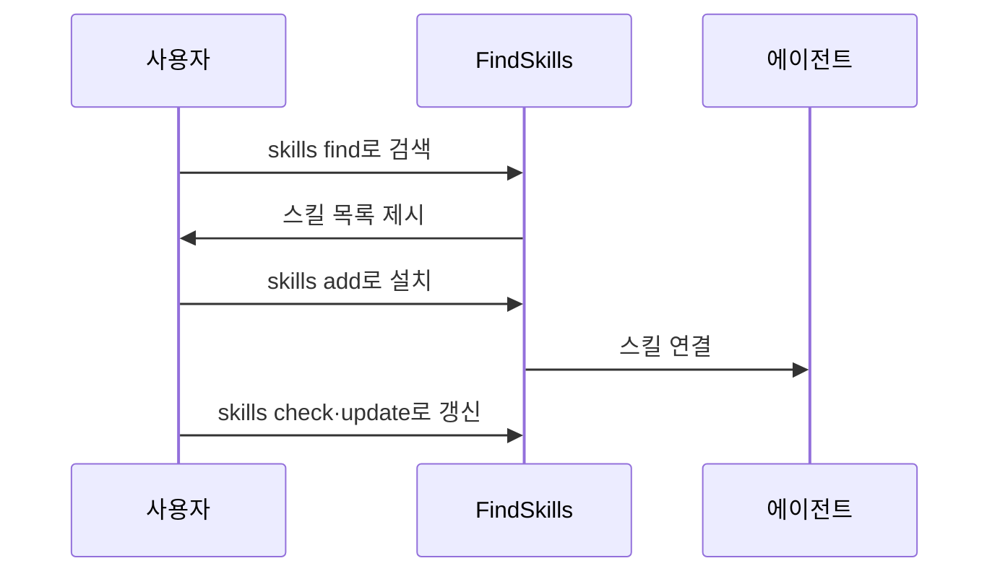
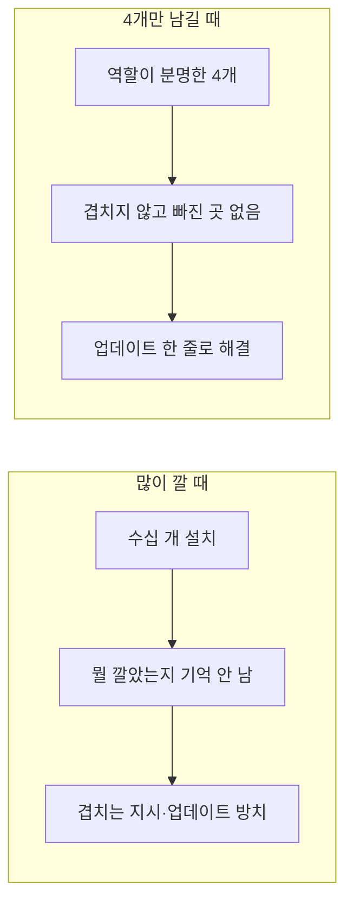

# Claude Code 스킬 10만 개 중 살아남은 4개, 기준은 매일 쓰는지입니다

> **Summary**
> 클로드 코드 스킬은 많이 설치하기보다 매일 쓰는 것만 남기는 것이 중요합니다. 개발 프로세스를 개선하는 Superpowers, AI 글을 자연스럽게 다듬는 Humanizer, 화면의 템플릿 느낌을 줄이는 UI/UX Pro Max, 스킬을 검색·설치·관리하는 Find Skills를 소개하며, 일주일 동안 쓰지 않은 스킬은 삭제하고 남은 스킬을 주기적으로 업데이트하라고 제안합니다.

---

- 클로드 코드 스킬이 10만 개를 넘으면서, 많이 까는 것보다 매일 쓰는 것만 남기는 게 중요해졌습니다.
- 실제로 매일 쓰는 4개 스킬을 골랐습니다. 개발 프로세스를 바꾸는 Superpowers, AI 글의 냄새를 잡아내는 Humanizer, 템플릿 티를 없애는 UI/UX Pro Max, 스킬을 검색·설치·관리하는 Find Skills입니다.
- 설치는 이름으로 검색해 한 줄로 끝내고, 안 쓰는 스킬은 과감히 지우는 것. 그게 스킬 관리의 핵심입니다.

## 좋아 보이는 스킬, 일단 깔아본 적 있으시죠?

클로드 코드 스킬 목록을 보다 보면 손이 먼저 갑니다. "이건 유용하겠다" 싶어서 설치하고, 다음 스킬도 설치하고, 또 설치합니다. 그런데 일주일 뒤에 보면 어떨까요? 설치한 스킬 중 실제로 쓴 건 몇 개 안 됩니다. 10개 중 9개는 한 번도 안 쓰고 자리만 차지합니다. 이런 적 있으시죠?

스킬이 10만 개를 넘긴 지금, 문제는 "뭘 깔까"가 아니라 "뭘 남길까"입니다!

🎥 [동영상 보기](https://www.youtube.com/watch?v=fOxC44g8vig)

## 스킬 10만 개, 왜 고르는 게 일이 됐을까요?

스킬은 폴더 하나입니다. 안에 `SKILL.md`라는 설명 파일이 들어 있고, 에이전트는 필요할 때만 그 파일을 읽습니다. 그래서 스킬을 많이 깔아도 토큰 부담이 크지 않습니다. 시작할 때는 이름과 설명만 스캔하고, 관련 있을 때만 본문을 읽는 구조니까요.

그런데 문제는 다른 곳에 있습니다. 스킬이 많아지면 관리가 일이 됩니다. 어떤 스킬이 있는지, 어떤 게 최신인지, 어떤 게 서로 겹치는지 파악이 안 됩니다. 그래서 기준이 필요합니다. 매일 쓰는지, 안 쓰는지. 그게 전부입니다.

## Superpowers: 코드부터 짜지 않게 만드는 방법론

첫 번째는 Superpowers입니다. 단순한 코드 생성 보조가 아니라, 에이전트의 소프트웨어 개발 프로세스 자체를 바꾸는 프레임워크입니다. 깃허브 스타가 30만 개가 넘는, 스킬 생태계에서 가장 많이 쓰이는 방법론입니다.

설치하면 에이전트가 코드부터 짜지 않습니다. 먼저 "뭘 만들려는 건지" 묻고, 설계 문서를 작성한 뒤에야 코딩을 시작합니다. 브레인스토밍부터 계획 수립, 테스트 주도 개발, 코드 리뷰, Git 워크트리 관리까지 이어지는 워크플로우가 내장되어 있습니다. 작업을 2~5분 단위로 쪼개서 독립된 하위 에이전트에 배분하고, 2단계 자동 리뷰까지 수행합니다.

이 장면이 저는 가장 인상 깊었습니다. 에이전트가 오랜 시간 자율적으로 작업하면서도 계획에서 벗어나지 않는다는 점입니다. 계획이 먼저 있고 코드가 뒤에 오는 구조라, 고칠수록 어긋나는 일이 줄어듭니다.

## Humanizer: AI 냄새를 잡아내는 필터

두 번째는 Humanizer입니다. AI가 쓴 글에서 "AI 냄새"를 잡아내는 필터입니다. 위키피디아 AI 정리 프로젝트 팀이 수천 건의 AI 생성 텍스트를 분석해서 만든 패턴을 기반으로 동작합니다.

잡아내는 패턴은 24가지에서 시작해 지금은 26가지까지 늘었습니다. "testament", "landscape", "showcasing" 같은 AI 특유 어휘, 의미 부풀리기, 세 단어 나열, 엠대시 남발, 이모지 오남용 같은 것들입니다. 패턴마다 수정 전후 예시가 들어 있어서, 왜 고쳐야 하는지 바로 이해할 수 있습니다.

여기서 한 가지는 짚고 넘어가야 합니다. 이 스킬은 탐지기를 속이는 도구가 아닙니다. 사람이 읽었을 때 자연스럽게 다듬는 게 목적입니다. 그리고 패턴이 영어 글 기준이라, 한국어에는 그대로 적용하기 어렵습니다. 원리를 이해하고 한국어에 맞게 옮겨 쓰는 게 필요합니다!

## UI/UX Pro Max: 템플릿 티를 없애는 디자인 엔진

세 번째는 UI/UX Pro Max입니다. AI가 만든 화면에서 템플릿 티를 없애주는 디자인 엔진입니다. 67가지 UI 스타일, 57가지 폰트 조합, 99가지 UX 가이드라인, 13개 기술 스택을 통째로 내장하고 있습니다.

"뷰티 스파 랜딩페이지 만들어줘" 한 마디면 업종에 맞춘 디자인 시스템 전체를 자동 생성합니다. 색상, 타이포그래피, 레이아웃 패턴은 물론 "이 업종에서 하면 안 되는 것" 목록까지 제공합니다. `React`, `Next.js`, `Vue`, `SwiftUI`, `Flutter` 등 13개 스택별 가이드라인을 지원합니다.

가장 큰 차이는 안티패턴 검출입니다. AI가 만든 UI에서 가장 티 나는 보라+분홍 그라디언트, 이모지 아이콘, 기본 템플릿 레이아웃을 정확히 잡아내고 대안을 제시합니다. 템플릿처럼 보이는 화면이, 업종에 맞는 화면으로 바뀌는 겁니다!

## Find Skills: 스킬을 관리하는 스킬

네 번째는 Find Skills입니다. 10만 개 스킬 생태계를 한 줄로 검색하고 설치하는 도구입니다. 스킬이 많아질수록 진가를 발휘하는 관리 도구입니다.

`npx skills find`로 키워드를 검색하고, `npx skills add`로 즉시 설치합니다. `npx skills list`로 설치 목록을 보고, `npx skills check`으로 업데이트를 확인하고, `npx skills update`로 일괄 갱신까지 자동화합니다. 지원하는 에이전트만 75개가 넘습니다. 스킬 설치 정보를 `skills-lock.json`에 기록해두면, 다른 환경에서도 같은 스킬 구성을 재현할 수 있습니다.

이 도구 하나가 스킬 설치, 검색, 업데이트를 전부 해결해줍니다. 스킬 관리 자체를 하나의 워크플로우로 만들어주는 셈입니다.

## 많이 깔 때와 4개만 남길 때, 뭐가 다를까요?

많이 깔면 선택지가 넓어 보입니다. 그런데 실제로는 반대입니다. 어떤 스킬이 있는지 기억이 안 나고, 겹치는 스킬이 서로 다른 지시를 내리고, 업데이트도 안 챙기게 됩니다. 스킬이 많을수록 에이전트가 뭘 써야 할지 헷갈립니다.

4개만 남기면 다릅니다. 각 스킬의 역할이 분명합니다. 개발 프로세스는 Superpowers, 글 다듬기는 Humanizer, 화면 디자인은 UI/UX Pro Max, 관리는 Find Skills. 겹치지 않고, 빠진 곳이 없고, 업데이트도 한 줄로 끝납니다!

## 스킬 관리, 이렇게 굴리면 됩니다

정리하면 흐름은 단순합니다. Find Skills에서 이름으로 검색해 설치하고, `skills list`로 목록을 확인하고, `skills update`로 주기적으로 갱신합니다. 새 스킬이 눈에 띄면 어떻게 할까요? 일단 깔아보고, 일주일 안에 안 쓰면 지웁니다. 매일 쓰는 것만 남기는 겁니다.

주말 하루를 셋업에 쓰는 건 아깝지 않습니다. 1주일, 1개월, 1년의 업무를 위한 도구를 갖추는 데 쓴 하루가, 이후 수백 시간의 반복 노동을 없애주니까요. 스킬은 많이 모으는 게 아니라, 매일 쓰는 것만 남기는 게 답입니다!

