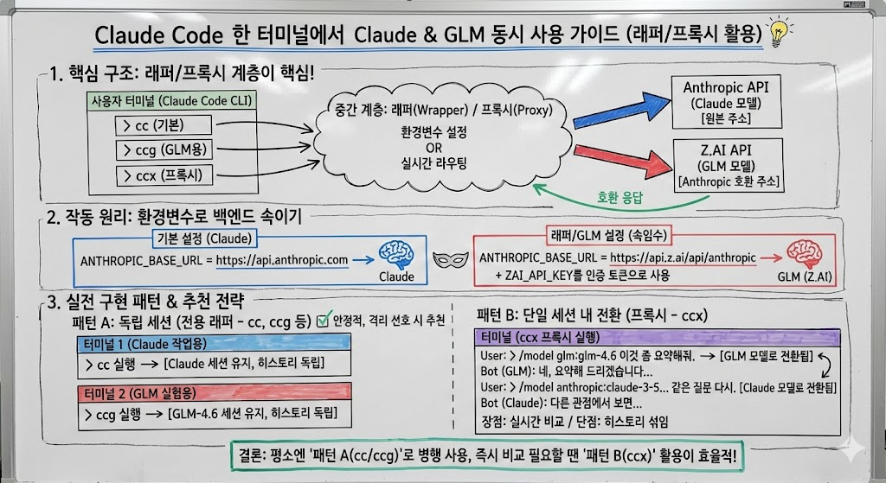
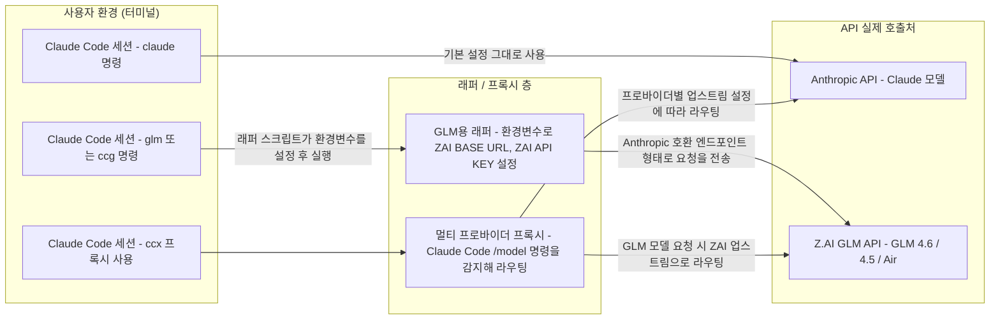

# Claude Code에서 GLM 과 Claude를 동시에 사용해보자

> **Summary**
> Claude Code에서 GLM 모델과 Claude 모델을 동시에 사용하기 위해서는 래퍼 스크립트와 프록시 도구를 활용하여 환경변수를 설정하고, 여러 세션을 동시에 열어 사용할 수 있다. 기본적으로는 각 모델에 대해 별도의 터미널을 열어 독립적으로 작업하며, ccx 프록시를 사용하면 한 세션 내에서 모델을 자유롭게 전환할 수 있다. 이를 통해 사용자는 Anthropic Claude와 Z.AI GLM을 효율적으로 병행하여 활용할 수 있다.

---



[https://www.reddit.com/r/ClaudeCode/comments/1o8yst9/how_do_i_use_glm_46_and_claude_on_claude_code/](https://www.reddit.com/r/ClaudeCode/comments/1o8yst9/how_do_i_use_glm_46_and_claude_on_claude_code/)

[https://github.com/JoeInnsp23/claude-glm-wrapper](https://github.com/JoeInnsp23/claude-glm-wrapper)

---

# 요약 정리

- Claude Code 자체에는 “Claude 모델과 GLM 모델을 한 세션 안에서 공식으로 토글”하는 기능은 없다.
- 하지만 다음 두 종류의 접근을 조합하면, 사실상 한 터미널 환경에서 두 모델을 매끄럽게 함께 쓸 수 있다.
  - (1) Z.AI의 GLM API를 Claude Code처럼 보이게 만드는 래퍼 스크립트와 환경변수 라우팅
  - (2) 여러 모델/프로바이더를 하나의 로컬 프록시로 묶어서, 한 세션 안에서 모델만 바꿔 쓸 수 있는 ccx 같은 프록시 도구
- WSL/Linux 환경에서는
  - 기본: claude (Anthropic)
  - GLM: glm, ccg, ccg45, ccf 같은 별도 실행 명령
  - 멀티 프로바이더: ccx 프록시 + /model 명령
조합으로 “터미널 두 개 + 필요한 만큼 세션”을 두어 병행 사용하는 패턴이 현실적으로 가장 단순하고 안정적이다.
아래에서는 먼저 논리적/구조적 배경을 설명하고, Reddit에서 논의된 패턴과 claude-glm-wrapper(래퍼+프록시)의 구조를 합쳐서, 단계별 설정과 실사용 방법을 정리한다.

## 1. 전체 구조 – “한 터미널에서 Claude + GLM 함께 쓰기”의 개념도

먼저 전체 그림을 그리면 다음과 같다.

사용자는 기존 Claude Code 클라이언트는 그대로 두고, 중간에 “래퍼/프록시 층”을 두어 실제 호출이 어디로 갈지만 바꾼다.



- 사용자 입장에서는 “claude, glm, ccg, ccx” 같은 명령만 다르게 입력할 뿐, Claude Code UI/UX는 동일하다.
- 실제 요청이 Anthropic으로 갈지 Z.AI로 갈지는 래퍼/프록시가 환경변수나 업스트림 URL 설정을 통해 결정한다.
- “동시에”라는 요구는 정확히는 “같은 터미널 창 내에서 여러 Claude Code 세션을 열어 두고, 각 세션이 서로 다른 모델을 사용하도록 구성”하는 형태로 실현된다.
이제 구체적으로 어떤 방법들이 있고, 어떤 논리로 결합하면 좋은지를 단계별로 본다.

## 2. Claude Code에서 모델/프로바이더를 바꾸는 기본 원리

Claude Code CLI는 기본적으로 Anthropic API(또는 공식 엔드포인트)를 사용하도록 설정되어 있다.

이 설정은 보통 다음 환경변수들에 의해 결정된다(이름은 구현에 따라 약간씩 다를 수 있음).

- ANTHROPIC_BASE_URL: API 베이스 URL
- ANTHROPIC_AUTH_TOKEN 또는 ANTHROPIC_API_KEY: 인증 토큰/키
- ANTHROPIC_MODEL 또는 그에 준하는 모델 이름 변수
- CLAUDE_HOME 또는 그에 준하는 설정/히스토리 경로
여기서 핵심 아이디어는 두 가지다.

1. 환경변수만 바꾸면 실제 API 호출처가 바뀐다.
  - Z.AI는 “Anthropic 호환” 엔드포인트(예: [https://api.z.ai/api/anthropic](https://api.z.ai/api/anthropic))를 제공한다.
  - 이 주소를 ANTHROPIC_BASE_URL으로 설정하고, Z.AI에서 받은 API 키를 ANTHROPIC_AUTH_TOKEN으로 넣어주면,
Claude Code 입장에서는 “마치 Anthropic에 요청을 보내는 것처럼” 행동하면서 실제로는 [Z.AI](http://z.ai/) GLM이 응답하게 된다.【turn4fetch0】
1. Claude Code 실행 전에 환경변수만 미리 설정해 주면, “세션 단위로 모델/프로바이더”를 고정할 수 있다.
  - 예를 들어 GLM용 터미널에서만 ANTHROPIC_BASE_URL을 Z.AI로 설정하고 claude를 실행하면, 그 세션은 “GLM 백엔드를 쓰는 Claude 세션”처럼 동작한다.
  - 반면 다른 터미널에서는 아무런 환경변수 조작 없이 claude를 실행하면, 기존대로 Anthropic Claude를 쓰게 된다.
즉, Claude Code 자체를 수정하는 것이 아니라 “Claude Code를 띄우기 전에 환경을 어떻게 세팅하느냐”만 다루는, 격리된 wrapper 방식이 가능해진다. 이것이 Reddit과 GitHub 쪽에서 공통으로 사용하는 논리적 기반이다.【turn8fetch0】【turn4fetch0】

## 3. Reddit 패턴 정리 – 환경변수 + alias/스크립트로 GLM과 Claude 분리

Reddit 토론에서는 크게 세 가지 패턴이 자주 언급된다. 이 중 WSL/Linux를 기준으로 가장 직관적인 방식부터 설명한다.

### 3.1 [Z.AI](http://z.ai/) 프록시 + alias로 모델 분리 (WSL/Linux)

개념은 다음과 같다.

- [Z.AI](http://z.ai/) API 키를 환경변수에 저장해 둔다.
- GLM용 alias를 만들어, 해당 alias를 실행할 때만 [Z.AI](http://z.ai/) 쪽 엔드포인트와 모델을 사용하도록 환경변수를 덮어쓴 뒤 claude를 실행한다.
예시 흐름은 다음과 같다(이름은 사용자 환경에 맞게 조정 가능).

1. ~/.zshrc(또는 ~/.bashrc) 열기
1. [Z.AI](http://z.ai/) 관련 환경변수 추가
- Z.AI의 GLM용 엔드포인트와 API 키를 미리 변수에 저장해 두고, 여러 alias에서 재사용한다.
```bash
export ZAI_BASE_URL="<https://api.z.ai/api/anthropic>"
export ZAI_API_KEY="여기에_본인_API키"

```

1. GLM용 alias 정의
- glm이라는 명령을 치면, Anthropic 대신 Z.AI로 요청이 가도록 환경변수를 설정하고 claude를 실행한다.
```bash
alias glm="ANTHROPIC_MODEL=GLM-4.6 \\
  ANTHROPIC_BASE_URL=${ZAI_BASE_URL} \\
  ANTHROPIC_AUTH_TOKEN=${ZAI_API_KEY} \\
  claude --dangerously-skip-permissions"

```

1. 적용 후 사용
- 변경을 반영한 뒤:
```bash
source ~/.zshrc

```

- 그 다음:
```bash
claude  # 기존 Claude Code 세션 (Anthropic Claude)
glm     # GLM-4.6을 백엔드로 쓰는 Claude Code 세션

```

- 두 터미널을 각각 열어 두고, 한쪽은 claude, 다른 한쪽은 glm을 실행해 두면,
“같은 터미널 환경 안에서 Claude와 GLM을 동시에 띄워놓고 번갈아 쓰는” 상태가 된다.
이 방식의 장점은:

- 별도의 외부 도구 설치 없이, 쉘과 환경변수만으로 원리를 이해하기 쉽다.
- 기존 Claude 설정(~/.claude 등)을 전혀 건드리지 않아 안전하다.
- 원하면 alias 안에서 모델 버전(4.5, 4.5-Air 등)을 더 세분화할 수도 있다.
단점은:

- 세션 내에서 실시간으로 모델을 바꾸는 것은 불가능하다. 세션마다 처음부터 “Claude용/GLM용”으로 결정해야 한다.
- Windows/macOS/WSL별로 alias 설정 방식이 조금씩 다르므로, 플랫폼 간에 설정을 공유하려면 추가 관리가 필요하다.
### 3.2 claude-glm-installer 기반 래퍼 (cc, ccg, ccg45, ccf)

위 방식을 더 “자동화 + 크로스 플랫폼”으로 만든 것이 GitHub의 claude-glm-wrapper 프로젝트다.

Reddit에서도 이 installer를 한 줄로 실행하면 cc, ccg, ccg45, ccf 같은 명령이 생긴다고 소개하고 있다.【turn8fetch0】【turn4fetch0】

핵심만 정리하면 다음과 같다.

1. 설치 (Node.js가 있으면 가장 간단)
```bash
npx claude-glm-installer

```

- 설치 과정에서:
  - OS 자동 감지
  - Claude Code 설치 여부 확인
  - [Z.AI](http://z.ai/) API 키 입력
  - 각 플랫폼에 맞는 래퍼 스크립트 생성 및 쉘/프로필에 alias 추가
가 이루어진다.【turn4fetch0】
1. 변경 사항 반영
- macOS / Linux:
```bash
source ~/.zshrc   # 또는 ~/.bashrc

```

- Windows PowerShell:
```powershell
. $PROFILE

```

1. 생성되는 주요 명령
- cc: 기존처럼 Anthropic Claude를 쓰는 Claude Code 세션
- ccg: GLM-4.6(최신)을 백엔드로 쓰는 Claude Code 세션
- ccg45: GLM-4.5 세션
- ccf: GLM-4.5-Air(빠르고 저렴한 모델) 세션
- ccx: 멀티 프로바이더 프록시(뒤에서 자세히 설명)【turn4fetch0】
이들의 동작 원리는 앞서 설명한 “환경변수 + alias” 패턴과 본질적으로 같다.

차이점은:

- 사용자가 직접 alias를 짤 필요 없이, 설치기가 다음을 자동으로 만들어 준다는 점:
  - 적절한 환경변수를 설정하는 래퍼 스크립트(bash 또는 PowerShell)
  - 이 스크립트를 간단한 이름(ccg, ccg45 등)으로 호출할 수 있는 alias 또는 PATH 구성
- 각 모델마다 별도 설정 디렉터리(~/.claude-glm, ~/.claude-glm-45, ~/.claude-glm-fast 등)를 사용해, 서로 충돌하지 않는다.【turn9fetch0】
예시 사용 흐름:

```bash
ccg       # GLM-4.6 세션 열기
ccg45     # GLM-4.5 세션 열기
ccf       # GLM-4.5-Air 세션 열기
cc        # 일반 Claude Code 세션 열기

```

- 각 명령은 독립적인 Claude Code 프로세스이므로, 여러 터미널 탭에서 각각 다른 모델 세션을 열어 두고 병행 사용할 수 있다.
- 히스토리/설정도 디렉터리 단위로 격리되어, 한쪽에서 바뀐 설정이 다른 쪽에 영향을 주지 않는다.【turn9fetch0】
따라서 “단순한 병행 사용” 목적이라면 이 패턴이 가장 실용적이고, Reddit에서도 “먼저 이 방식부터 추천한다”는 의견이 많다.【turn1search3】

### 3.3 단순 스크립트로 use-glm / use-claude 만들기

Reddit에서는 조금 더 “수동적이지만 유연한” 패턴으로, 모델 전환용 쉘 스크립트를 만드는 방법도 언급된다. 예를 들면:

- use-glm:
  - GLM용 환경변수나 설정 파일(.env 등)을 덮어쓰고,
  - 그 상태에서 claude를 실행하는 스크립트
- use-claude:
  - 다시 원래 Claude 설정으로 롤백하는 스크립트
맥 사용자 중에서는 다음처럼 간단히 구현하는 사례도 있다.

- glm이라는 명령어를 만들어,
  - GLM용 환경변수를 설정하고
  - 그 뒤에 claude를 실행하도록 스크립트 작성
- 결과적으로 alias 패턴과 유사하지만, 스크립트 파일로 분리해 두면 내용을 더 자유롭게 고칠 수 있다.
이 방식의 논리적 의의는:

- “세션 시작 시점에만 환경을 결정한다”는 원칙을 그대로 유지하면서,
- 사용자가 원하는 어떤 형태로든 스위칭 로직을 직접 제어할 수 있다는 점이다.
- 다만, cc/ccg/ccx 같은 잘 만들어진 도구를 쓰는 것이 중복 작업을 줄이는 측면에서는 더 효율적이다.
## 4. [Z.AI](http://z.ai/) GLM API로 요청을 라우팅하는 래퍼 스크립트의 동작 원리

claude-glm-wrapper의 래퍼 스크립트와 앞서 본 alias 패턴은 내부적으로 거의 같은 원리를 사용한다. 여기서는 조금 더 체계적으로 정리해 본다.

### 4.1 래퍼 스크립트의 역할

래퍼 스크립트는 보통 다음 순서로 동작한다.

1. 필요한 환경변수 설정
  - ANTHROPIC_BASE_URL을 [Z.AI](http://z.ai/) GLM용 엔드포인트로 설정
  - ANTHROPIC_AUTH_TOKEN(또는 API_KEY)을 [Z.AI](http://z.ai/) API 키로 설정
  - ANTHROPIC_MODEL을 GLM-4.6, GLM-4.5, GLM-4.5-Air 등으로 설정
  - CLAUDE_HOME을 이 모델 전용 설정 디렉터리(예: ~/.claude-glm)로 설정
1. 그 상태에서 claude(실제 Claude Code CLI)를 실행
  - 래퍼 스크립트 입장에서는 “환경변수만 바꾸고 실제 바이너리는 실행만 해 주는” 얇은 층이다.
1. 종료 시
  - 실제 시스템 전역 환경변수는 건드리지 않기 때문에, 세션이 끝나면 원래 상태로 자동 복구된다.
claude-glm-wrapper의 README에서도 각 모델용 래퍼가 ~/.local/bin 또는 %USERPROFILE%\.local\bin 아래에 작은 bash/PowerShell 스크립트로 설치된다고 설명한다.【turn9fetch0】

### 4.2 환경변수와 [Z.AI](http://z.ai/) 엔드포인트

래퍼와 프록시 모두 [Z.AI](http://z.ai/) 쪽에서 “Anthropic 호환” 형태를 제공한다는 점을 이용한다.

README의 ccx 설정 예시를 보면 다음과 같은 형태가 나온다.【turn4fetch0】

- GLM 관련:
```bash
GLM_UPSTREAM_URL=https://api.z.ai/api/anthropic
ZAI_API_KEY=...

```

- Anthropic 관련:
```bash
ANTHROPIC_UPSTREAM_URL=https://api.anthropic.com
ANTHROPIC_API_KEY=sk-ant-...

```

이는 곧:

- Z.AI가 [https://api.z.ai/api/anthropic](https://api.z.ai/api/anthropic) 라는 엔드포인트를 통해, Anthropic API와 유사한 인터페이스를 제공한다.
- 래퍼/프록시는 이 “업스트림 URL”과 “각 프로바이더별 API 키”만 가지고 요청을 적절히 포워딩한다.
따라서 사용자 관점에서는:

- Claude Code 클라이언트는 여전히 “동일한 프로토콜/요청 포맷”을 사용한다.
- 중간에 있는 래퍼/프록시가 실제 요청을 어디로 보낼지만 결정한다.
- 이로 인해 “클라이언트는 그대로 두고 백엔드만 갈아끼우는” 구조가 가능하다.
## 5. 프록시 도구(ccx)를 활용한 한 세션 내에서의 모델 스위칭

여기까지는 “세션 단위로 모델을 고정”하는 방식이었다.

Reddit과 GitHub에서는 이를 한 단계 더 나아가, “한 세션 안에서 모델을 자유롭게 바꾸는” 프록시 ccx도 소개한다.【turn4fetch0】【turn9fetch0】

### 5.1 ccx의 개념

- ccx는 로컬에서 도는 프록시 프로세스다.
- Claude Code는 이 프록시를 API 서버인 것처럼 바라보고, ccx는 실제 요청을 설정된 여러 프로바이더(OpenAI, OpenRouter, Gemini, GLM, Anthropic 등)로 라우팅한다.【turn4fetch0】
- 사용자는 Claude Code 대화 내에서 `/model` 명령을 사용해, provider:model 형식으로 모델을 바꾼다.
  - 예:
    - /model glm:glm-4.6
    - /model openai:gpt-4o
    - /model anthropic:claude-3-5-sonnet-20241022【turn9fetch0】
### 5.2 ccx 설치와 초기 설정

1. 설치는 앞서와 동일하다.
```bash
npx claude-glm-installer

```

1. ccx 전용 API 키 설정
- 처음에 다음 명령을 실행하면 설정 파일이 생성된다.
```bash
ccx --setup

```

- 이 과정에서 ~/.claude-proxy/.env(macOS/Linux) 또는 %USERPROFILE%\.claude-proxy\.env(Windows) 파일이 만들어진다.【turn4fetch0】
1. .env 파일 편집
- 예시 내용은 다음과 같다(실제 키는 본인 것으로 교체).【turn4fetch0】
```bash
# OpenAI
OPENAI_API_KEY=sk-...

# OpenRouter
OPENROUTER_API_KEY=sk-or-...

# Gemini
GEMINI_API_KEY=AIza...

# Z.AI GLM
GLM_UPSTREAM_URL=https://api.z.ai/api/anthropic
ZAI_API_KEY=...

# Anthropic (프록시를 통해 Anthropic도 라우팅하고 싶은 경우)
ANTHROPIC_UPSTREAM_URL=https://api.anthropic.com
ANTHROPIC_API_KEY=sk-ant-...

```

### 5.3 ccx 실행 및 /model 사용 흐름

1. 프록시 실행
```bash
ccx

```

- 이 명령을 치면:
  - 로컬 프록시가 백그라운드에서 실행되고,
  - Claude Code는 이 프록시에 연결된 상태로 세션이 시작된다.【turn4fetch0】
1. 모델 전환
- 이후 대화 중에 다음처럼 /model 명령을 쓰면 실제 백엔드 모델이 바뀐다.【turn9fetch0】
```plain text
/model openai:gpt-4o
/model gemini:gemini-1.5-pro
/model glm:glm-4.6
/model anthropic:claude-3-5-sonnet-20241022

```

1. ccx의 특징과 장점
- 단일 세션: 종료 없이 모델 전환 가능
- 컨텍스트 유지: 채팅 기록은 그대로 유지된 채로 모델만 바뀌므로, 이전 맥락을 기반으로 다른 모델에게 계속 질문할 수 있다.
- 쉬운 비교: 같은 질문을 다른 모델에 던져 답변 비교가 가능하다.
- 다중 프로바이더: OpenAI, OpenRouter, Gemini, GLM, Anthropic을 한 세션에서 모두 사용할 수 있다.【turn9fetch0】
1. 한계와 trade-off
- 프록시 프로세스가 추가로 도는 오버헤드가 있다.
- 전역 환경변수가 아니라 .env 기반 설정이므로, 키 관리가 한 곳으로 집중된다.
- 여러 모델의 히스토리가 섞이므로, “모델별로 완전히 격리된 기록”을 원하는 경우에는 ccg/ccg45/ccf 같은 전용 래퍼가 더 낫다.【turn9fetch0】
README에서도 “ccx는 세션 내 유연성이 중요할 때, ccg/ccg45/ccf는 모델별 히스토리 분리가 중요할 때”라고 구분해서 권장하고 있다.【turn9fetch0】

## 6. 실무 관점에서의 구성 전략 – 논리적인 흐름으로 정리

지금까지 살펴본 내용을 바탕으로, “하나의 Claude Code 터미널 환경에서 Claude와 GLM을 동시에 활용”하기 위해 실제로 추천할 수 있는 논리 흐름을 정리하면 다음과 같다.

### 6.1 기본 전략: 전용 래퍼 + 멀티 터미널 병행

가장 단순하고 안정적인 패턴은:

- cc: 기본 Claude Code 세션 (Anthropic)
- ccg(또는 glm): GLM-4.6 세션
- 필요에 따라 ccg45, ccf로 세분화
이 구성으로 “여러 터미널 탭/창을 열어 두고 각각 다른 모델 세션을 사용”하는 것이다.【turn4fetch0】【turn8fetch0】
논리적 장점:

- 각 모델마다 독립된 설정과 히스토리를 가지므로,
  - GLM에서 실험하다가
  - Claude에서 최종 검증
하는 식의 워크플로우가 자연스럽다.
- 래퍼/프록시 오류가 발생해도, Anthropic 쪽 원본 세션(cc)에는 영향이 없다.
예시 워크플로우:

1. 테스트/탐색: GLM-4.6(ccg)로 비교적 저렴하게 자주 질의
1. 빠른 피드백이 필요한 작업: GLM-4.5-Air(ccf)로 속도 우선
1. 중요한 리팩터링/설계 검토: Claude(cc)로 품질 우선
### 6.2 높은 유연성이 필요할 때: ccx 프록시 추가

만약 “세션 내에서 모델을 자주 바꾸면서 비교”하는 패턴이 주가 된다면:

- 기본 cc/ccg 세션들은 큰 작업 단위로 유지
- 세부 아이디어 비교/반복 실험이 필요할 때는 ccx 세션을 따로 열어 두고 /model로 모델만 수시로 바꾸는 방식이 좋다.
장점:

- 같은 맥락에서 “GLM-4.6으로 답변 받고, 바로 Claude 3.5 Sonnet로도 같은 질문을 던져 비교”하는 식의 흐름이 자연스럽다.
- 여러 터미널을 열어 두되, 각 터미널이 역할(예: A창=ccg, B창=ccx)을 가지게 할 수 있다.
단점:

- 모델별로 히스토리가 섞이므로, “이 모델이 했던 과거 추론만 보고 싶다”는 식의 정리가 조금 더 어렵다.
### 6.3 Windows/macOS/WSL 혼합 환경에서의 전략

Reddit에서 언급되는 또 다른 패턴은 “환경 자체를 분리”하는 것이다. 예를 들어:

- Windows PowerShell: GLM 4.6용 Claude Code 세션
- WSL: Claude(Sonnet 4.5 등)용 Claude Code 세션
- IDE(WebStorm, VS Code 등) 내장 터미널을 열어, 사용 중인 프로젝트나 작업 성격에 따라 두 세션 중 하나를 선택해 사용
논리적으로는:

- OS/터미널마다 다른 스크립트나 설정을 적용해 두고,
- 사용자는 “어떤 작업을 어느 환경에서 할지”를 고수준으로만 선택한다.
이 패턴은 “한 기계 안에서 여러 OS/환경을 이미 쓰고 있는 경우”에 추가 설정이 거의 없이 유용하다.

## 7. 정리 –Claude와 GLM을 “하나의 Claude Code 터미널 환경”에서 동시에 쓰는 현실적인 방법

정리하면, 다음과 같이 구성하는 것이 논리적이고 실무적이다.

1. 가장 먼저 할 것: claude-glm-installer로 cc, ccg, ccg45, ccf, ccx 설치
  - 한 줄 명령으로 플랫폼에 맞는 래퍼/alias가 자동 생성된다.
  - 이후 설정 파일과 히스토리가 모델별로 격리되어, 기존 Claude 설정을 보존하면서 GLM을 쓸 수 있다.【turn4fetch0】【turn8fetch0】
1. 기본 병행 사용 패턴
  - 터미널 A: cc → Anthropic Claude 세션
  - 터미널 B: ccg(또는 glm) → GLM-4.6 세션
  - 필요에 따라 ccg45, ccf를 추가로 사용
→ 두 세션을 동시에 띄워 두고 작업하므로, 사실상 “동시에 두 모델 활용”이 가능해진다.【turn4fetch0】【turn9fetch0】
1. 세션 내 모델 스위칭이 필요할 때
  - 별도 터미널에서 ccx 실행 후,
  - 대화 중 `/model glm:glm-4.6`, `/model anthropic:claude-3-5-sonnet-20241022` 등으로 모델을 자유롭게 변경하며 비교 및 혼합 사용.【turn9fetch0】
1. 더 커스텀한 흐름이 필요하다면
  - 앞서 설명한 Z.AI_BASE_URL/ZAI_API_KEY 환경변수와 alias 패턴을 직접 응용해,
  - use-glm/use-claude 같은 자신만의 스크립트를 만들어 사용하면 된다.
  - 이 경우 내부 동작 원리는 claude-glm-wrapper와 동일하다.
결국, “Claude Code 자체를 고치는 것이 아니라, 실행 환경(Claude를 어떤 설정/어떤 백엔드로 띄우느냐)만 분리”하면,

한 터미널 안에서도 Anthropic Claude와 [Z.AI](http://z.ai/) GLM을 상황에 맞춰 자유롭게, 그리고 논리적으로 함께 쓸 수 있는 환경을 만들 수 있다.

