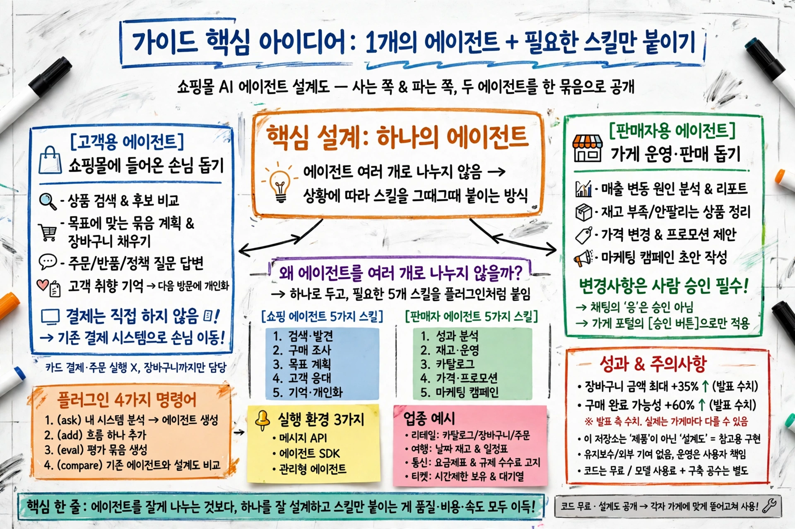
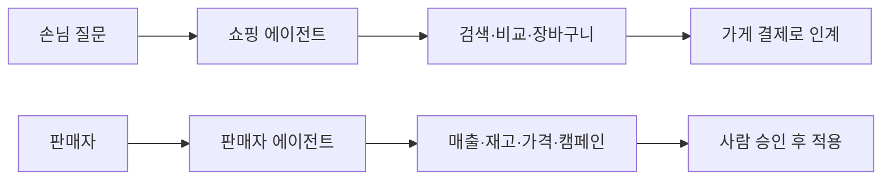
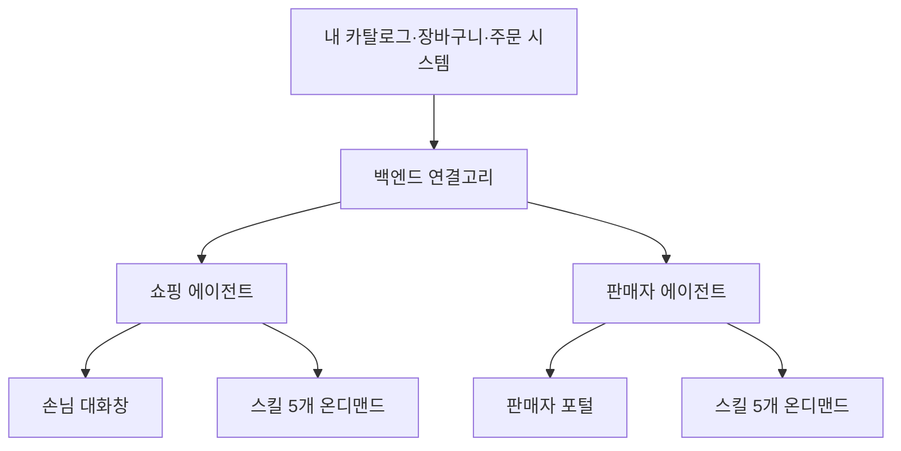

# Claude Commerce Agents: 쇼핑 AI 에이전트, 사는 쪽과 파는 쪽 두 개를 한 번에 만듭니다

> **Summary**
> Claude Commerce Agents는 쇼핑객을 돕는 에이전트와 판매자를 돕는 에이전트를 함께 제공하며, 하나의 에이전트가 필요한 스킬을 상황에 맞게 불러오는 구조를 택합니다. 쇼핑 에이전트는 상품 검색과 비교, 장바구니 구성까지 맡고 결제는 기존 시스템으로 넘기며, 판매자 에이전트는 매출·재고·가격·캠페인을 분석하고 제안하되 변경은 사람의 별도 승인을 거쳐야 합니다. 코드는 참고용 설계도로 공개됐으며, 발표된 성과 수치는 실제 매장마다 다를 수 있고 모델 사용료와 운영은 별도로 고려해야 합니다.

---

- 쇼핑몰에 들어간 손님을 돕는 에이전트와, 가게 뒤에서 장사를 돕는 에이전트, 두 개가 한 묶음으로 공개됐습니다.
- 핵심 설계는 에이전트를 여러 개로 나누는 방식이 아니라, 하나의 에이전트에 필요한 스킬만 그때그때 붙이는 방식입니다.
- 결제와 주문은 에이전트가 직접 하지 않고, 가게의 변경 사항은 사람이 승인해야만 적용됩니다.

쇼핑몰에 들어가서 "이거랑 비슷한데 조금 더 싼 거 없어요?"라고 물어본 적 있으시죠? 잘하는 직원은 카탈로그를 뒤져서 몇 개를 골라주고, 장바구니까지 챙겨줍니다. 이번에 공개된 설계도는 그 직원의 일을 AI 에이전트에게 맡기는 방법을 통째로 보여줍니다. 그것도 코드까지 전부요!

🎥 [동영상 보기](https://www.youtube.com/watch?v=YRQOEsD7nDA)

## 두 개의 에이전트, 뭐가 다를까요?

먼저 손님 쪽 에이전트입니다. 상품을 검색하고, 후보를 비교하고, 목표에 맞는 묶음을 계획하고, 장바구니를 채웁니다. 주문 상태나 반품, 정책 질문에도 답하고, 손님이 알려준 취향은 다음 방문에도 기억합니다. 그런데 딱 한 곳에서 멈춥니다. 결제입니다! 장바구니를 채운 뒤에는 가게의 기존 결제로 손님을 넘깁니다. 에이전트가 직접 주문을 넣거나 카드를 긁지 않는다는 뜻입니다.

다음은 판매자 쪽 에이전트입니다. 매출이 왜 움직였는지 설명하고, 재고가 부족한 상품과 안 팔리는 상품을 아침마다 정리해서 보여줍니다. 가격을 바꾸거나 프로모션을 걸자고 제안하고, 캠페인 초안까지 씁니다. 다만 여기서도 한 가지 원칙이 있습니다. 어떤 변경이든 사람이 승인해야만 적용됩니다. 채팅창에 "응"이라고 치는 걸로는 승인이 안 됩니다. 가게 포털의 버튼으로 따로 확인해야 합니다!

## 왜 에이전트를 여러 개로 나누지 않았을까요?

에이전트를 잘게 나누는 방식도 있습니다. 검색 담당, 비교 담당, 장바구니 담당처럼 말이죠. 그런데 공개된 설계도는 정반대로 갔습니다. 에이전트 하나가 중심에 서고, 필요한 스킬을 그때그때 불러오는 방식입니다. 쇼핑 에이전트에는 다섯 가지 스킬이 붙습니다. 검색과 발견, 구매 조사, 목표 계획, 고객 응대, 기억과 개인화입니다. 판매자 에이전트에도 다섯 가지가 있습니다. 성과 분석, 재고와 운영, 카탈로그, 가격과 프로모션, 마케팅 캠페인입니다.

자주 쓰는 규칙은 시스템 프롬프트에 두고, 가끔 쓰는 전문 지식만 스킬로 빼는 구조입니다. 이렇게 하니 품질과 비용, 속도 세 가지가 모두 더 나았다는 설명입니다. 이 장면이 저는 가장 인상 깊었습니다. 에이전트를 많이 만드는 게 능사가 아니라, 하나를 잘 설계하는 게 먼저라는 말이니까요!

## 내 가게에 붙이려면 어떻게 할까요?

설계도는 세 가지 실행 환경에서 돌아갑니다. 메시지 API, 에이전트 SDK, 그리고 관리형 에이전트입니다. 예제는 리테일, 여행, 통신, 티켓 네 가지 업종으로 나옵니다. 여행은 날짜가 있는 재고와 일정표를, 통신은 요금제 표와 규제 수수료 고지를, 티켓은 시간 제한 보유와 대기열을 다룹니다. 업종이 달라도 뼈대는 같습니다. 내 카탈로그와 장바구니, 주문 시스템에 백엔드 연결고리 하나만 만들면 됩니다.

직접 만들기 어렵다면 플러그인도 있습니다. 네 가지 명령어가 스캐폴딩부터 평가까지 이어줍니다. 내 시스템에 대해 물어보고 에이전트를 만들어주는 명령어, 흐름 하나를 추가하는 명령어, 평가 묶음을 만드는 명령어, 이미 돌리는 에이전트를 설계도와 비교해주는 명령어입니다. 파일 하나씩 뜯어보지 않아도 시작할 수 있는 구조입니다.

## 숫자는 어디까지 믿을까요?

발표에서 나온 숫자가 있습니다. 쇼핑 에이전트를 쓰는 가게에서는 장바구니 금액이 최대 35% 커지고, 구매를 끝까지 마칠 가능성이 60% 높아졌다고 합니다. 솔깃한 숫자입니다. 다만 이건 발표 측이 밝힌 수치라는 점을 짚고 넘어가야 합니다. 내 가게에서도 같은 결과가 나올 거라고 장담할 수는 없습니다.

또 하나 짚을 점이 있습니다. 이 저장소는 제품이 아니라 설계도입니다. 참고용 구현이라서, 공개 측이 계속 유지보수하지 않고 외부 기여도 받지 않는다고 밝혔습니다. 가져다 쓰는 건 자유롭지만, 그 뒤의 운영은 내 몫이라는 뜻입니다. 무료라는 말도 같은 맥락입니다. 코드는 무료지만, 모델 사용료와 붙이는 공수는 따로 듭니다.

쇼핑 에이전트의 시대는 "챗봇이 상품을 찾아준다"에서 한 걸음 더 나아갔습니다. 이제는 사는 쪽과 파는 쪽, 양쪽 일을 한 설계도로 풀어주는 단계입니다. 설계도를 통째로 공개했다는 건, 각자 자기 가게에 맞게 뜯어고쳐 쓰라는 초대장이기도 합니다!

