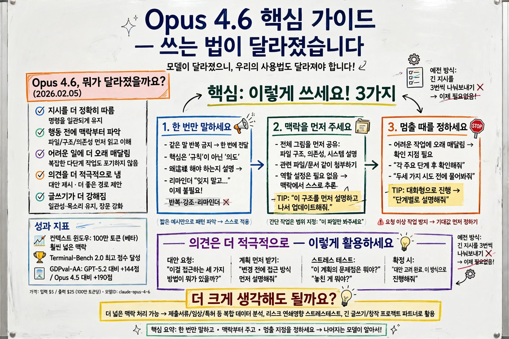
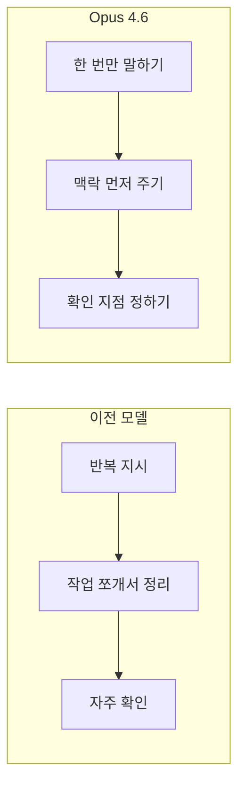
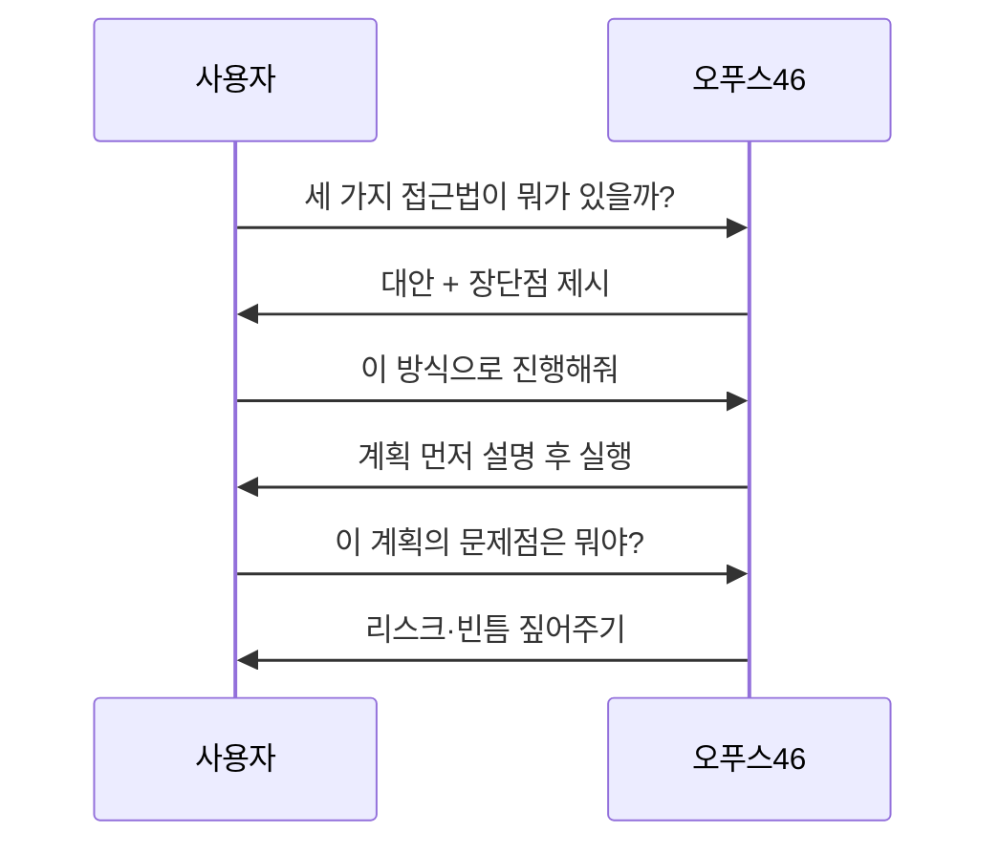

# Claude Opus 4.6 쓰는 법: 한 번만 말하고, 맥락부터 주고, 멈출 때를 정하세요

> **Summary**
> Opus 4.6은 지시를 더 정확히 따르고 행동 전에 맥락부터 읽는 모델이라, 쓰는 법도 달라집니다. 한 번만 말하고 맥락을 먼저 주고 멈출 지점을 정하면, 대안 제안과 긴 작업까지 더 크게 맡길 수 있습니다.

---

- Opus 4.6은 지시를 더 정확히 따르고, 행동 전에 맥락부터 읽고, 어려운 일에 더 오래 매달립니다.
- 그래서 쓰는 법이 달라집니다. 한 번만 말하고, 맥락을 먼저 주고, 멈출 지점을 정하는 게 핵심입니다.
- 의견도 더 적극적으로 내니까, 대안을 물어보고 계획을 먼저 보여달라고 하는 게 좋습니다.

## 긴 지시를 세 번씩 나눠 보낸 적 있으시죠?

모델이 지시를 흘릴까 봐, 같은 말을 강조하고 또 강조하고, "잊지 말고" 리마인더까지 덧붙이던 습관 말이에요. 긴 작업은 잘게 쪼개서 하나씩 확인하고요. 익숙한 풍경이죠?

Opus 4.6은 그 습관을 버려도 되는 모델입니다!

🎥 [동영상 보기](https://www.youtube.com/watch?v=dPn3GBI8lII)

## Opus 4.6, 뭐가 달라졌을까요?

2026년 2월 5일에 나온 Opus 4.6은 다섯 가지 행동이 달라졌습니다. 지시를 더 정확히 따르고, 행동 전에 맥락부터 파악하고, 어려운 작업에 더 오래 매달리고, 의견을 더 적극적으로 내고, 글쓰기가 더 강해졌습니다.

숫자로도 확인됩니다. 컨텍스트 윈도우는 베타로 100만 토큰까지 열렸고, 에이전트 코딩 평가인 Terminal-Bench 2.0에서 최고 점수를 받았습니다. 경제적으로 가치 있는 지식 작업 평가인 GDPval-AA에서는 GPT-5.2보다 144점, 전작인 Opus 4.5보다 190점 높았습니다. 가격은 입력 100만 토큰당 5달러, 출력 25달러로 그대로입니다. API에서는 `claude-opus-4-6` 모델 ID로 쓸 수 있습니다.

## 쓰는 법 1: 한 번만 말하세요

같은 말을 반복할 필요가 없어졌습니다. 긴 세션에서도 지시가 흐트러지지 않고 유지됩니다. 예시도 몇 개면 충분합니다. 적은 예시에서 패턴을 파악하고 이후에 더 효과적으로 적용하거든요.

여기서 핵심은 규칙이 아니라 의도입니다. "이렇게 해줘"만 말하지 말고, 왜 그렇게 해야 하는지까지 설명하세요. 의도를 알면 좁은 범위를 따르는 게 아니라 넓은 범위에 적용할 수 있는 맥락을 갖게 됩니다. "그리고 잊지 말고…" 같은 리마인더는 이제 불필요합니다!

## 쓰는 법 2: 맥락을 먼저 주세요

Opus 4.6은 변경하기 전에 전체 그림부터 파악합니다. 파일 구조, 기존 패턴, 의존성, 각 요소가 어떻게 연결되는지 먼저 읽어요. 그래서 처음에 공유하는 정보의 품질이 출력의 품질을 직접 좌우합니다. 관련 파일을 공유하고, 연관 문서를 연결하고, 더 넓은 시스템을 설명하세요.

역할 설정은 건너뛰어도 됩니다. "전문가로서 행동해" 같은 말은 필요 없어요. 제공된 작업과 맥락에서 적절한 전문성 수준을 스스로 추론하니까요. 다만 간단한 작업은 범위를 좁혀주세요. 모든 작업에 전체 그림이 필요한 건 아니니까요. "이 파일만 봐주세요"처럼 정확히 어디를 봐야 하는지 알려주면 됩니다.

이 장면이 저는 가장 인상 깊었습니다! 모델이 먼저 이해한 내용을 보여달라고 하면, 사각지대를 일찍 발견할 수 있거든요. "이 구조가 어떻게 되어 있는지 설명해주고 나서 업데이트해줘." 이렇게요.

## 쓰는 법 3: 멈출 때를 정하세요

Opus 4.6은 어려운 작업에 더 오래 매달립니다. 복잡한 다단계 작업이 첫 번째 시도에서 성공할 가능성이 높아졌어요. 그런데 확인하기 전에 여러 접근법을 시도하니까, 작업이 더 오래 걸릴 수도 있습니다. 가끔 요청받은 것 이상을 제공할 때도 있고요. 필요 이상으로 자세한 응답을 하거나, 요청하지 않은 추가 파일을 만들기도 합니다.

그래서 확인 지점을 정하는 게 중요합니다. "각 주요 단계 후에 확인해줘" 또는 "두세 가지 이상의 접근법을 시도하기 전에 물어봐줘." 이렇게요. 같은 접근법의 변형을 진전 없이 반복하고 있다면, 구체적인 대안을 제시하며 개입하세요. 계속 관여하고 싶은 작업이면 처음부터 기대를 정하세요. "이걸 대화형으로 작업하자. 단계별로 나에게 설명해줘."

## 의견은 적극적으로, 그럼 어떻게 받나요?

Opus 4.6은 방향을 더 빠르게 결정하고, 다른 경로가 보이면 대안을 더 기꺼이 제안합니다. 이전 모델들은 다른 접근법이 더 나았을 수 있는 상황에서도 사용자의 틀에 맞추는 경향이 있었거든요.

이걸 활용하려면 대안 탐색을 직접 요청하세요. "이걸 접근하는 세 가지 방법이 뭐가 있을까?" 변경하기 전에 계획을 공유받고 싶으면 미리 말하세요. "변경하기 전에 접근 방식을 먼저 설명해줘." 결정이 끝났으면 직접적으로 말하는 것도 중요합니다. "대안은 이미 고려했어. 이 접근 방식으로 진행해줘." 그리고 의도적으로 스트레스 테스트를 해보세요. "이 계획의 문제점은 뭐야?" 또는 "내가 놓치고 있는 게 뭐야?" 아키텍처 결정이나 잘못된 가정을 일찍 발견하는 데서 실질적인 시간을 아낄 수 있습니다!

## 더 크게 생각해도 될까요?

Opus 4.6은 더 많은 것을 처리하니까, 더 크게 생각할 수 있습니다. 기업을 평가할 때는 제출 서류, 임상시험, 특허를 두루 읽고 나서 내러티브와 모순되는 것을 찾아냅니다. 연결된 도구 전체에서 단서를 추적해 단일 소스에서는 보이지 않는 것을 찾아내어 발표자료로 구성합니다. 재무 계획은 시나리오 전반에 걸쳐 스트레스 테스트하고, 각 리스크가 나머지에 어떻게 연쇄적으로 영향을 미치는지 추적합니다.

글쓰기도 마찬가지입니다. 스타일 매칭, 긴 글에서의 목소리 유지, 복잡한 문서의 일관성과 구조 유지가 더 강해졌습니다. 예시로 시작하고, 피해야 할 것을 명시하고, 글쓰기 파트너로 활용해보세요. 더 길고 야심찬 창작 프로젝트도 맡길 수 있습니다.

모델이 달라졌으니, 쓰는 쪽도 달라지면 됩니다. 한 번만 말하고, 맥락부터 주고, 멈출 때를 정하세요. 나머지는 모델이 알아서 합니다!

