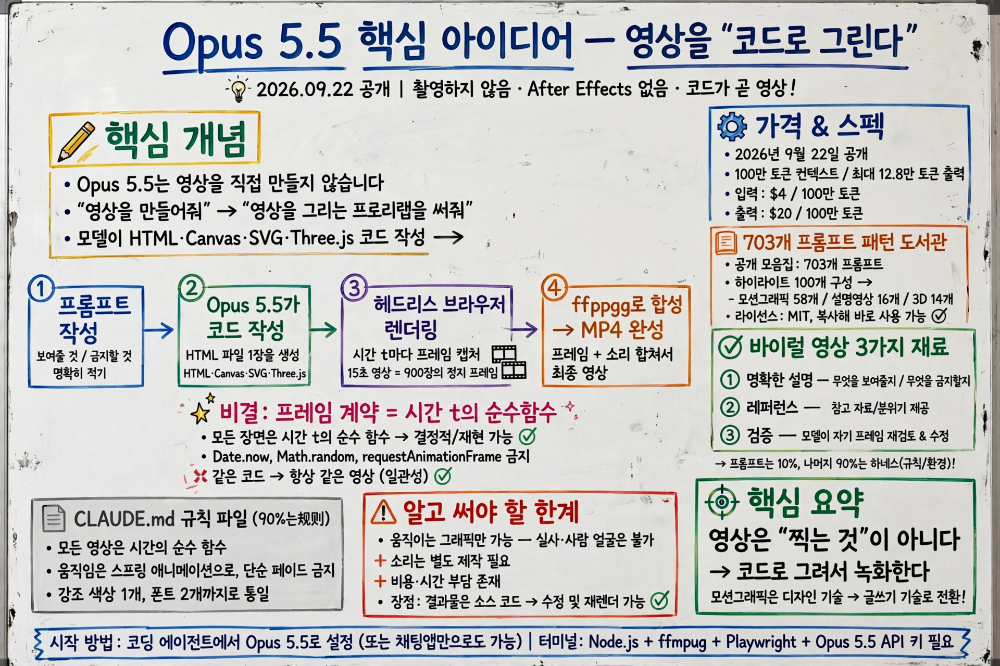
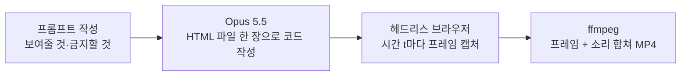
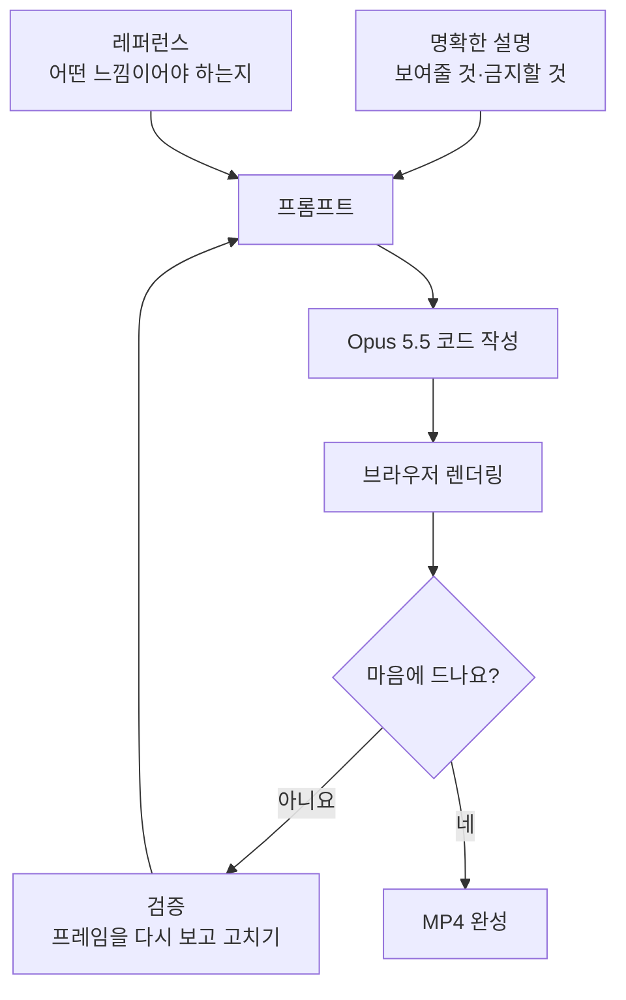

# Claude Opus 5.5: 영상은 찍는 게 아닙니다. 코드로 그려서 녹화합니다

> **Summary**
> Opus 5.5는 영상을 직접 생성하는 대신 시간에 따라 결정적으로 장면을 그리는 코드를 작성하고, 브라우저가 프레임을 렌더링해 MP4로 만듭니다. 명확한 지시, 레퍼런스, 프레임 검증이 좋은 결과의 핵심이며, 공개된 703개 프롬프트 모음집은 제작 패턴을 익히는 데 활용할 수 있습니다. 이 방식은 수정이 쉽고 모션 그래픽에 적합하지만, 실사 영상과 소리는 별도로 다뤄야 합니다.

---

- Opus 5.5는 영상을 찍지 않습니다. 애니메이션을 코드로 쓰고, 브라우저가 그려내고, 녹화로 MP4가 됩니다.
- 비결은 프레임 계약입니다. 모든 장면이 시간 `t`의 순수 함수라서, 프레임을 순서대로 찍어 붙이면 영상이 됩니다.
- 바이럴 영상 703개의 프롬프트가 공개된 모음집이 있어서, 하나를 골라 복사하면 같은 방식으로 시작할 수 있습니다.

런칭 영상을 하나 봤습니다. 깔끔한 타이포, 부드러운 움직임, 에이전시가 돈을 받고 만들었을 법한 완성도였는데요. 그런데 아무도 촬영하지 않았습니다. 에프터이펙트도 열지 않았습니다. 모델이 코드를 쓰고, 브라우저가 그렸을 뿐입니다. 어떻게 된 일일까요?

🎥 [동영상 보기](https://www.youtube.com/watch?v=cDb-wPq0Iyk)

## 영상인데, 픽셀을 만들지 않습니다?

Opus 5.5는 2026년 9월 22일에 공개된 모델입니다. 100만 토큰 컨텍스트에 최대 12만 8천 토큰 출력, 입력 100만 토큰당 4달러·출력 20달러라는 가격표가 붙었습니다. 그런데 이 모델은 텍스트만 뱉습니다. 픽셀 한 장 직접 만들지 못합니다!

그래서 방식이 뒤집혔습니다. "영상을 만들어줘"가 아니라 "영상을 그리는 프로그램을 써줘"가 됩니다. 모델이 HTML·Canvas·SVG·`Three.js` 코드를 쓰면, 브라우저가 그 코드를 실행해 화면을 그리고, 그 화면을 녹화해서 MP4로 만듭니다. 촬영도, 렌더팜도 없습니다. 코드가 곧 영상입니다!

Threads 원문은 로그인 벽에 막혀 직접 읽지 못했습니다. 그래서 공개된 프롬프트 모음집의 README와 관련 가이드를 1차 원본으로 삼아 재구성했습니다.

## 프롬프트에서 MP4까지, 네 단계면 됩니다

순서는 단순합니다. 프롬프트를 쓰고, 모델이 장면 하나를 통째로 담은 HTML 파일을 받고, 헤드리스 브라우저가 프레임을 한 장씩 찍고, `ffmpeg`이 붙여서 MP4로 만듭니다. 15초짜리 영상은 900장의 정지 사진이 빠르게 지나가는 플립북입니다. 달라진 건 그 900장을 사람이 그리지 않았다는 점뿐입니다.

핵심은 **결정성**입니다. 장면은 반드시 시간 `t`의 순수 함수여야 합니다. 7.3초를 물으면 7.3초의 그림이 정확히 나와야 하고, 400번째 프레임을 399번째보다 늦게 찍어도 같은 그림이 나와야 합니다. 그래서 `Date.now`도, `Math.random`도, `requestAnimationFrame`도 쓰지 않습니다. 같은 코드면 같은 영상이 나오는 약속이 렌더링의 전제입니다.

## 바이럴 영상 세 가지 재료는 무엇일까요?

화제가 된 영상들을 뜯어보면 세 가지가 공통으로 있었습니다. **명확한 설명, 레퍼런스, 검증**입니다. 무엇을 보여줄지, 무엇을 금지할지 분명히 적고, 어떤 느낌이어야 하는지 참고를 주고, 모델이 자기 프레임을 다시 보고 고치게 합니다. 프롬프트가 전부가 아닙니다. 한 튜토리얼은 프롬프트가 결과의 10%이고 나머지 90%는 하네스라고 말했습니다!

규칙을 적어두는 파일도 등장했습니다. 프로젝트 폴더에 두는 `CLAUDE.md`에 "모든 영상은 시간의 순수 함수", "움직임은 스프링으로, 그냥 페이드 금지", "강조 색상 하나, 폰트 두 개까지", "그라데이션 위 가운데 제목 금지" 같은 규칙을 적어두면, 모델이 매번 같은 기준으로 일합니다. 규칙 없는 모델은 다 똑같이 생긴 영상을 만듭니다. 가운데 글자에 그라데이션, 전부 페이드인, 마지막에 로고, 그 패턴 말입니다.

## 703개 프롬프트, 패턴 도서관입니다

이 현상을 한곳에 모은 공개 모음집이 있습니다. Opus 5.5로 만든 바이럴 영상들을 프롬프트와 함께 정리한 저장소입니다. 2026년 10월 12일 기준으로 프롬프트 703개, 그중 418개는 원본과 실시간 리메이크를 나란히 볼 수 있는 갤러리에 연결돼 있습니다. 100개가 하이라이트로 골라져 있는데, 모션 그래픽 58개, 설명 영상 16개, 3D 장면 14개, 게임·인터랙티브 12개입니다. 라이선스는 MIT입니다.

쓰는 법은 단순합니다. 프롬프트 파일 하나를 열어 복사하고, Opus 5.5가 돌아가는 코딩 에이전트나 채팅 앱에 붙여넣고, 결과를 HTML 파일 한 장으로 받으면 됩니다. 각 항목은 원본 포스트로 연결돼 있어서, 누가 만들었는지 확인할 수 있습니다. 프롬프트만 따라 하는 게 아니라, 어떤 설명이 어떤 화면을 만들었는지 패턴을 읽는 게 진짜 공부입니다!

## 따라 해보려면 무엇이 필요할까요?

터미널 방식이면 준비물은 네 가지입니다. Node.js와 `ffmpeg`, 헤드리스 브라우저를 다루는 Playwright, 그리고 Opus 5.5를 부를 수 있는 API 키입니다. 코딩 에이전트에서 모델을 Opus 5.5로 맞추고, 새 영상은 높은 노력(effort) 설정으로 시작하는 것이 안내돼 있습니다. 작은 수정은 중간 설정으로도 충분합니다.

터미널이 부담스러우면 채팅 앱만으로도 됩니다. 유료 요금제 이상에서는 디자인 출력으로 애니메이션 페이지를 만들 수 있고, 팀·기업 요금제에서는 모션 출력으로 MP4까지 내보낼 수 있습니다. 코딩 에이전트 방식의 장점은 따로 있습니다. 렌더링한 프레임을 모델이 직접 보고 고칠 수 있다는 점입니다. 채팅 앱은 코드를 쓰지만, 렌더링하고 보고 고치는 순환은 코딩 에이전트에서 돌아갑니다.

## 알고 써야 할 한계는 무엇일까요?

이 방식이 만드는 것은 움직이는 그래픽입니다. 슬라이드, 키네틱 타이포, 전환 효과, 3D 장면이 주무대입니다. 실사 영상이나 사람 얼굴은 만들지 못합니다. 글자와 숫자는 코드라서 나중에 고치기 쉽다는 게 장점이지만, 반대로 실제 촬영 같은 질감은 기대하기 어렵습니다.

소리도 따로 만들어야 합니다. 화면과 소리를 같은 타임라인에 맞추는 작업이 필요합니다. 코드로 소리를 합성하거나, 음성 합성으로 내레이션을 붙이거나, 음악의 박자에 맞춰 큰 전환을 배치하는 식입니다. 음소거한 채로 보면 마법이 깨지는 영상이 많습니다. 박자를 놓치면 컷이 음악과 어긋나니까요.

비용과 시간도 만만치 않습니다. 한 번의 시도가 몇 분 만에 끝나는 마법이 아니고, 첫 영상은 API 키 발급과 첫 수정까지 30분에서 1시간이 걸릴 수 있습니다. 그래도 결과물은 소스 파일과 함께 남습니다. 글자 하나 바꾸고 싶으면 코드를 고쳐서 다시 렌더링하면 됩니다. 타임라인을 다시 여는 일이 없습니다.

## P320·P321·P336과 뭐가 다를까요?

비슷한 주제의 글 세 편과 각도가 다릅니다. P320은 7단계 게이트를 두는 제작 지침서, P321은 12개 파이프라인을 갖춘 시스템, P336은 디자인 작업 공간 안에 들어간 모션 기능이었습니다. 이 글은 그 앞단, 현상 자체입니다. Opus 5.5가 코드를 쓰고 브라우저가 그리는 방식이 왜 바이럴이 됐는지, 그리고 그 프롬프트 703개가 어떻게 패턴 도서관이 됐는지를 다뤘습니다. 지침서도, 시스템도, 기능도 아닌, 시작점이 되는 이야기입니다.

영상은 찍는 게 아닙니다. 코드로 그려서 녹화하는 것입니다. 그 문장 하나가 바뀌면, 모션 그래픽은 디자인 기술에서 글쓰기 기술로 옮겨갑니다!

