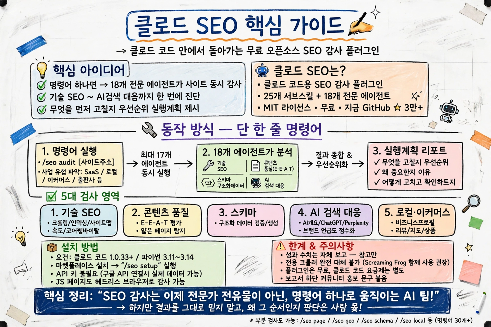
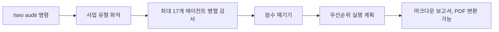
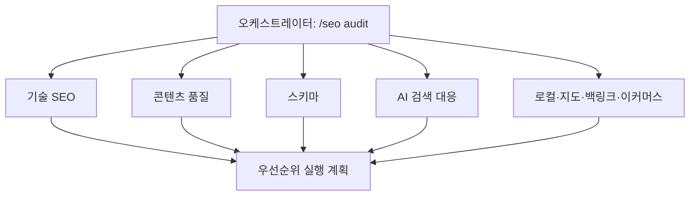
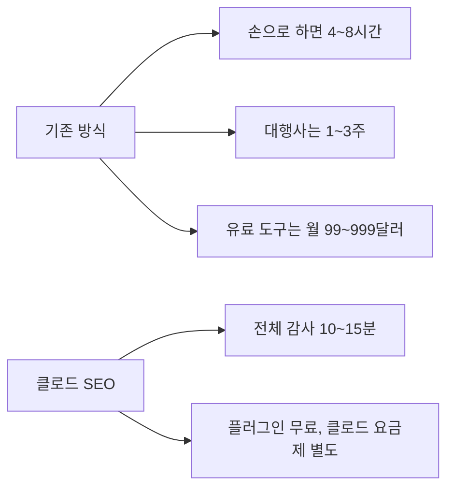

# Claude SEO: 명령어 하나로 18개 에이전트가 사이트를 감사합니다

> **Summary**
> 클로드 SEO는 클로드 코드에서 명령어 하나로 여러 전문 에이전트가 기술 SEO, 콘텐츠, 스키마, AI 검색 대응 등을 감사하고 우선순위별 실행 계획을 제시하는 무료 오픈소스 플러그인입니다. 다만 클로드 코드 요금제가 별도로 필요하며, 전용 크롤러를 완전히 대체하지는 못하므로 결과를 검토하고 함께 활용하는 것이 좋습니다.

---

- 클로드 SEO는 클로드 코드 안에서 돌아가는 무료 오픈소스 SEO 감사 플러그인입니다. 명령어 하나면 전문 에이전트 18개가 사이트를 동시에 훑습니다.
- 기술 SEO부터 콘텐츠 품질, 스키마, AI 검색 대응, 백링크까지 한 번에 보고, 무엇을 먼저 고칠지 순서까지 정해줍니다.
- 감사 자체는 무료이지만 클로드 코드 요금제는 따로 필요합니다. 전용 크롤러를 완전히 대신하지는 못합니다.

사이트를 운영하다 보면 이런 순간이 있습니다. 검색 순위가 떨어졌는데, 어디가 문제인지 모르겠는 거죠. 속도 때문일까요? 아니면 AI 검색이 내 페이지를 인용하지 않아서일까요?

🎥 [동영상 보기](https://www.youtube.com/watch?v=1VQvcKMcVsk)

## 클로드 SEO, 도대체 뭘까요?

클로드 SEO는 클로드 코드용 SEO 감사 플러그인입니다. 25개 서브 스킬과 18개 전문 에이전트로 이루어졌고, MIT 라이선스라 무료로 쓸 수 있습니다. 소개 당시 1.4만 개였던 스타는 지금 3만 개를 넘겼습니다. 에이전트도 20개까지 늘었습니다!

핵심은 명령어 하나입니다. `/seo audit` 뒤에 사이트 주소를 붙이면 감사가 시작됩니다. 먼저 사업 유형을 파악합니다. SaaS인지, 로컬 매장인지, 이커머스인지, 출판사인지, 대행사인지에 따라 검사 항목이 달라집니다. 그다음 최대 17개 에이전트가 동시에 흩어져서 사이트를 봅니다. 결과는 경고 목록이 아니라 우선순위가 매겨진 실행 계획으로 나옵니다. 무엇을 고쳐야 하는지, 왜 중요한지, 어떻게 고쳤는지 확인하는지까지 함께 적혀 있습니다.

## 에이전트 18개, 각자 맡은 일이 다릅니다?

에이전트마다 역할이 정해져 있습니다. 기술 SEO를 이끄는 담당, 콘텐츠를 다듬는 편집자, 구조화 데이터를 만드는 엔지니어, AI 검색을 분석하는 담당, 에이전트 대응을 보는 분석가, 로컬·지도·백링크·이커머스 전문가까지, 한 명이 다 하는 게 아니라 팀이 나눠서 봅니다.

모델도 역할에 따라 다릅니다. 판단이 많이 필요한 다섯 개 에이전트는 상위 모델로, 나머지는 가벼운 모델로 돕니다. 그래서 전체 감사는 부분 검사보다 클로드 요금제를 더 씁니다. 이 장면이 저는 가장 인상 깊었습니다. "AI가 사이트를 본다"는 말이 추상적으로 들렸는데, 역할표 하나로 구체적인 팀이 되니까요!

## 무엇을 검사할까요?

검사 범위는 다섯 갈래입니다.

**기술 SEO**는 크롤링, 인덱싱, 사이트맵, `robots.txt`, 리다이렉트, 속도, 코어 웹 바이탈을 봅니다. **콘텐츠 품질**은 경험·전문성·권위·신뢰(E-E-A-T)를 기준으로 얇은 페이지와 주제 커버리지를 따집니다. **스키마**는 구조화 데이터를 찾아서 검증하고, 없으면 직접 만들어주기까지 합니다.

**AI 검색 대응**이 요즘 가장 눈에 띄는 부분입니다. 구글 AI 개요, 챗GPT, 퍼플렉시티, 제미나이가 내 페이지를 인용할 가능성을 점수로 매깁니다. AI 크롤러가 페이지에 닿을 수 있는지, 브랜드가 위키백과·레딧·유튜브·링크드인에 언급되는지도 봅니다. **로컬·이커머스**는 비즈니스 프로필, 리뷰, 지도 노출, 상품 페이지를 다룹니다.

전체 감사 말고 부분 검사도 됩니다. `/seo page`는 한 페이지를 깊게 보고, `/seo geo`는 AI 검색 준비도만, `/seo schema`는 스키마만, `/seo local`은 로컬만 봅니다. 명령어는 30개까지 늘었습니다.

## 설치 방법

클로드 코드 1.0.33 이상과 파이썬 3.11~3.14가 필요합니다. 마켓플레이스에서 검색해 설치한 뒤 `/seo setup`을 실행하면, 격리된 파이썬 환경과 헤드리스 브라우저를 알아서 준비해줍니다. 자바스크립트로 그려지는 페이지도 방문자가 보는 그대로 감사할 수 있습니다!

API 키는 필요 없습니다. 구글 API를 연결하면 실제 현장 데이터까지 볼 수 있지만, 키는 내 컴퓨터에만 머뭅니다. 직접 내려받아 설치하는 방법도 있고, 그럴 땐 설치 스크립트를 먼저 읽어보는 게 안전합니다.

## 한계도 알고 쓰세요

좋은 점만 있는 건 아닙니다. README에 나온 성과 수치는 자체 보고입니다. 이를테면 자체 사이트의 12주 검색 클릭 1만 800건 같은 기록 말이죠. 참고만 하세요.

전용 크롤러를 완전히 대신하지도 못합니다. 스크리밍 프로그 같은 도구가 더 빠르고 깊게 훑는다는 건 README도 인정하는 부분입니다. 그래서 둘을 같이 쓰는 사람이 많습니다. 이 도구의 강점은 측정이 아니라 설명입니다. 무엇을 찾았고, 왜 중요하고, 어느 순서로 고칠지, 그걸 말로 풀어준다는 점이죠.

보고서 하단에 커뮤니티 홍보 문구가 붙는다는 점도 알고 쓰세요. 로컬 설치본에서 해당 문구를 지우고 쓰면 됩니다. 비용도 짚고 넘어가야 합니다. 플러그인 자체는 무료지만, 클로드 코드 요금제는 별도입니다. 전체 감사는 부분 검사보다 요금제를 더 쓰니, 처음엔 한 페이지 검사부터 시작하는 게 좋습니다.

SEO 감사는 이제 전문가의 전유물이 아닙니다. 명령어 하나면 팀이 움직입니다. 다만 결과를 그대로 믿기보다, 왜 그 순서인지 따져보는 눈은 여전히 사람의 몫입니다!

