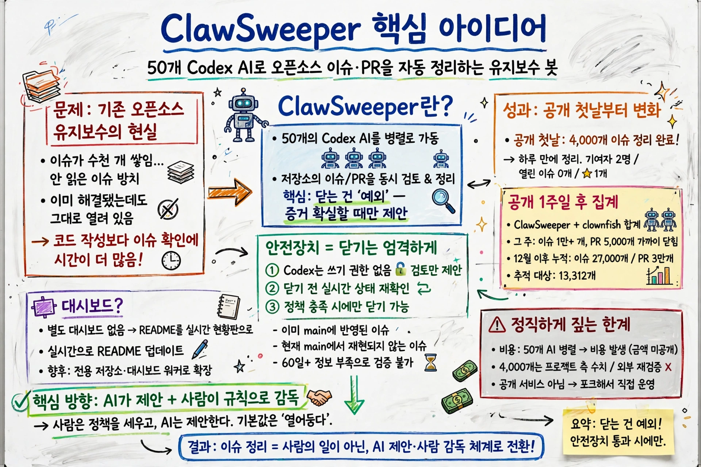
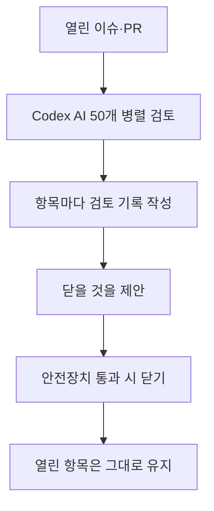
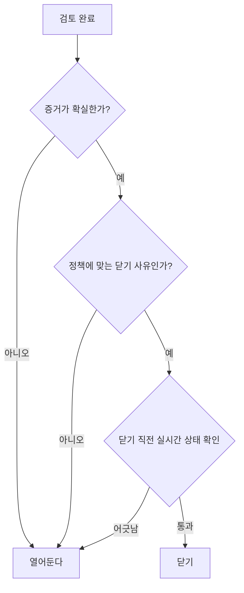
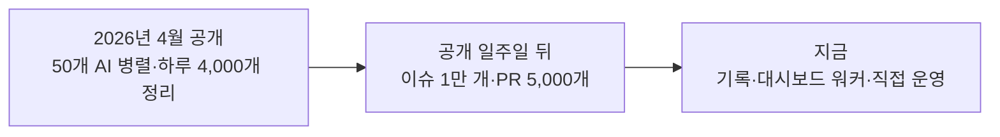

# ClawSweeper: AI 50개를 병렬로 돌리면, 쌓인 이슈 4,000개가 하루 만에 정리됩니다

> **Summary**
> ClawSweeper는 Codex AI 50개를 병렬로 활용해 오픈소스 저장소의 이슈와 PR을 검토하고, 확실한 근거와 안전장치가 있는 경우에만 종료를 제안·실행하는 유지보수 봇입니다. 공개 첫날 불필요한 이슈 4,000개를 정리했으며, 검토 기록과 실시간 상태 확인으로 오작동을 막습니다. 다만 비용은 공개되지 않았고, 성과 수치는 프로젝트 측 집계입니다.

---

- ClawSweeper는 50개의 Codex AI를 병렬로 돌려 오픈소스 저장소의 이슈와 PR을 검토하고 정리하는 유지보수 봇입니다.
- 닫는 게 기본이 아니라 예외입니다. 증거가 확실한 경우에만 닫을 것을 제안하고, 실제 닫기는 안전장치를 통과해야 합니다.
- 공개 첫날 4,000개가 정리됐습니다. 코드 짜는 시간보다 이슈 확인에 더 많은 시간을 쓰던 구조가 바뀌고 있습니다.

오픈소스 저장소의 이슈 탭을 열어본 적 있으시죠? 안 읽은 이슈가 수천 개 쌓여 있고, 어떤 건 이미 고쳐졌는데 그대로 열려 있고, 어떤 건 재현도 안 되는데 닫히지 않았습니다. 읽고, 확인하고, 닫는 일에만 하루가 갑니다. 코드를 짜는 시간보다 쌓인 이슈를 확인하는 시간이 더 길어지는 순간이 옵니다!

🎥 [동영상 보기](https://www.youtube.com/watch?v=a5eNiaMQzws)

## 50개 AI가 동시에 이슈를 읽습니다?

ClawSweeper는 OpenClaw 프로젝트에서 공개한 유지보수 봇입니다. 저장소에 열린 이슈와 PR을 Codex AI 50개가 병렬로 훑습니다. 각 항목이 이미 해결됐는지, 오류가 없는 리포트인지 판단하고, 닫을 수 있는 항목은 간결한 설명과 함께 골라냅니다. 공개 첫날, 하루 만에 4,000개의 불필요한 이슈가 정리됐습니다!

방식은 단순합니다. 스캔하고, 판단하고, 닫을 것을 제안합니다. 사람이 하나씩 열어보던 일을 AI 50개가 나눠서 동시에 처리합니다. 공개 당시 저장소 스냅샷이 보여준 모습도 인상 깊었습니다. 기여자 2명, 열린 이슈 0개, 별 1개. 막 태어난 프로젝트가 첫날부터 4,000개를 정리한 겁니다.

## 닫는 게 예외라고요?

여기가 핵심입니다. ClawSweeper는 아무거나 닫는 봇이 아닙니다. 검토는 제안만 하고, 실제 닫기는 엄격한 안전장치를 통과해야 합니다. 검토 단계에서 Codex는 쓰기 권한을 받지 않습니다. 닫기 직전에는 저장소의 실시간 상태를 다시 확인합니다. 조건이 하나라도 어긋나면 닫지 않습니다!

닫을 수 있는 경우는 정책 문서에 정해져 있습니다. 이미 `main`에 반영된 이슈, 현재 `main`에서 재현되지 않는 이슈, 60일이 넘도록 정보가 부족해 검증할 수 없는 이슈 같은 경우입니다. 그 외는 전부 열어둡니다. 기본값이 "닫는다"가 아니라 "열어둔다"는 점이 이 봇의 성격입니다.

검토 기록도 남습니다. 항목마다 `records/<repo-slug>/items/<number>.md` 형태의 마크다운 기록이 생기고, 이슈마다 공개 검토 댓글 하나가 제자리에서 계속 업데이트됩니다. 댓글이 수십 개로 늘어나는 대신, 하나의 댓글이 최신 상태를 보여줍니다. 유지보수자는 댓글 명령으로 다시 검토하거나, 설명을 듣거나, 멈출 수 있습니다.

## 공개 일주일 뒤, 숫자는 어떻게 됐을까요?

공개 일주일 뒤 전해진 집계에 따르면, ClawSweeper와 자매 봇인 clownfish를 합쳐서 그 주에만 이슈 1만 개 넘게, PR 5,000개 가까이가 닫혔습니다. 12월 이후 누적으론 이슈 2만 7,000개, PR 3만 개에 가깝다고 합니다. 공개 당일 `README`에서 읽힌 추적 대상만 해도 열린 항목 1만 3,312개였습니다. 숫자가 커지는 속도가 이 봇이 왜 나왔는지를 설명합니다.

## 대시보드가 없어도 될까요?

공개 당시에는 별도 대시보드 화면이 없었습니다. 대신 저장소의 `README` 파일이 실시간으로 업데이트되며 작업 현황을 중계했습니다. 대시보드를 새로 만들지 않고, 개발자가 이미 보는 파일을 현황판으로 쓴 겁니다!

지금은 규모가 커져서 기록이 전용 저장소와 대시보드 워커로도 흘러갑니다. 대상은 OpenClaw 프로젝트의 저장소들입니다. 다만 이 봇은 누구나 쓸 수 있는 공개 서비스가 아닙니다. 자기 프로젝트에 쓰고 싶으면 저장소를 포크해서 직접 운영하는 방식입니다.

## 정직하게 짚을 점은 없을까요?

첫 번째로 나온 질문은 비용이었습니다. "한 번 돌리는 데 얼마죠?" 50개 AI를 병렬로 돌리는 일은 공짜가 아닙니다. 공개 글에는 비용이 나와 있지 않습니다. 규모가 커질수록 요금표가 먼저 궁금해지는 건 당연합니다.

또 하나, 4,000개라는 숫자는 프로젝트 쪽에서 전한 수치입니다. 닫기 제안이 안전장치를 통과해 실제로 적용된 결과라는 점은 구조상 분명하지만, 외부에서 재검증한 숫자는 아닙니다. 그래도 방향은 분명합니다. 이슈 정리는 사람이 일일이 할 일이 아니라, AI가 제안하고 사람이 규칙으로 감독하는 일이 됐습니다!

