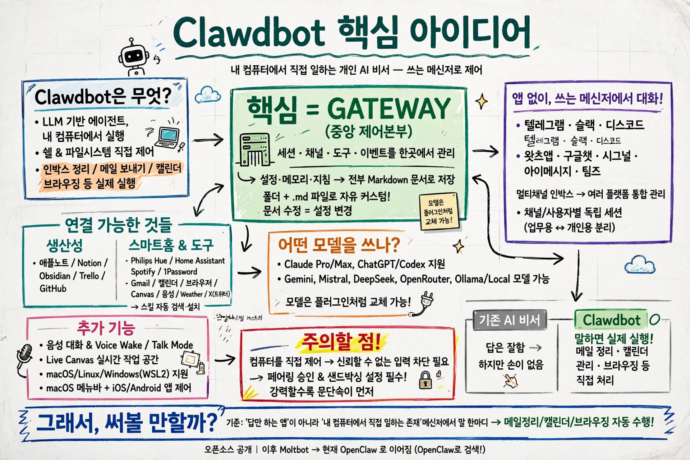
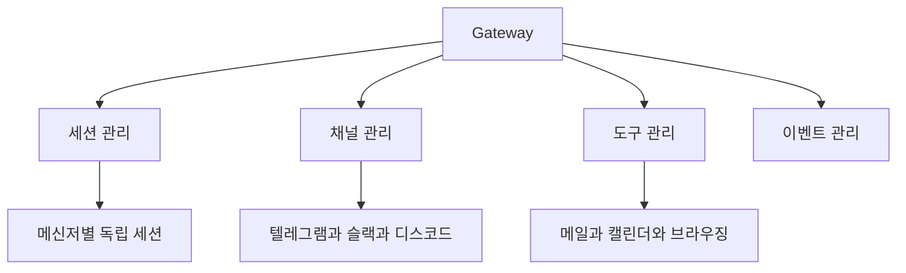
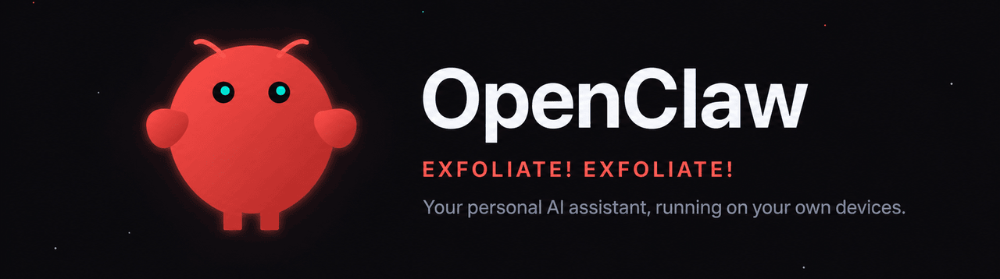
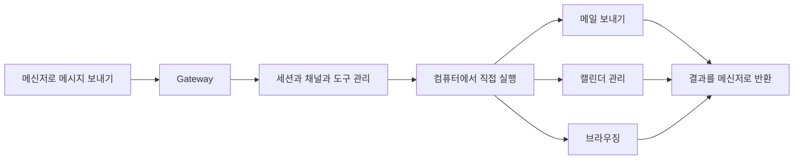
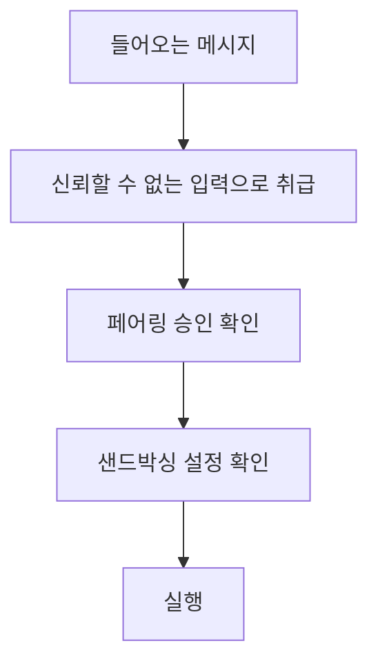

# Clawdbot: 메신저로 말하면 컴퓨터가 알아서 일한다

> **Summary**
> Clawdbot은 컴퓨터에서 실행되는 오픈소스 AI 비서로, 메신저를 통해 말로 지시하면 메일·캘린더·브라우징 등 실제 작업을 수행합니다. Gateway가 세션과 채널, 도구를 관리하며 다양한 모델과 생산성·스마트홈 서비스를 지원하고, 설정은 Markdown 문서로 자유롭게 바꿀 수 있습니다. 컴퓨터를 직접 제어하므로 메시지 승인과 샌드박싱 등 보안 설정이 중요합니다.

---

- Clawdbot은 내 컴퓨터에서 돌아가는 개인 AI 비서입니다. 별도 앱 없이 텔레그램·슬랙·디스코드 같은 쓰는 메신저로 대화하며 컴퓨터를 제어합니다.
- 핵심은 Gateway 하나입니다. 세션·채널·도구를 한곳에서 관리하고, 설정·메모리·지침은 전부 Markdown 문서로 저장해 자유롭게 바꿉니다.
- 음성 대화와 실시간 Canvas 작업 공간, 20개 넘는 메시징 채널, 생산성·스마트홈 연동까지 갖추고 오픈소스로 공개됐습니다.

AI 비서한테 "이메일 정리해줘"라고 말했는데, 방법만 알려주고 실제로는 아무것도 안 해준 적 있으시죠? 대부분의 AI 비서는 답은 잘하는데, 손이 없습니다. 그런데 Clawdbot은 다릅니다. 내 컴퓨터에서 직접 돌아가면서, 메일 보내기부터 캘린더 정리, 브라우징까지 실제로 해줍니다!

🎥 [동영상 보기](https://www.youtube.com/watch?v=7rzYDM6vMtI)

## Clawdbot, 도대체 뭘까요?

Clawdbot은 사용자 컴퓨터에서 실행되는 LLM 기반 에이전트입니다. 쉘과 파일 시스템에 접근할 수 있고, 컴퓨터를 직접 제어합니다. 인박스 정리, 메일 보내기, 캘린더 관리, 브라우징까지, 말로 시키면 실제로 해줍니다. 이게 핵심입니다!

중심에는 Gateway가 있습니다. 세션, 채널, 도구, 이벤트를 한곳에서 관리하는 중앙 제어 역할입니다. Gateway 하나가 Clawdbot의 본부라고 보면 됩니다.

## 앱 없이, 쓰는 메신저에서 부린다?

Clawdbot의 가장 큰 특징은 별도 앱이 필요 없다는 점입니다. 이미 쓰고 있는 메시징 플랫폼으로 대화합니다. 텔레그램, 슬랙, 디스코드, 왓츠앱, 그리고 구글 챗, 시그널, 아이메시지, 팀즈까지. 멀티 채널 인박스가 여러 플랫폼을 하나로 통합 관리합니다.

멀티 에이전트 라우팅도 됩니다. 채널·계정·사용자별로 독립 세션을 운영합니다. 일용 메신저와 업무용 메신저를 나눠서 쓰는 분이라면, 각각 다른 세션으로 굴릴 수 있다는 뜻입니다.

## 설정이 전부 Markdown 문서라는 건 뭘까요?

모든 설정·선호도·사용자 메모리·지침이 폴더와 Markdown 문서로 저장됩니다. 그래서 자유롭게 커스터마이징할 수 있습니다. 설정 파일 하나를 열어서 고치면, Clawdbot의 행동이 바뀝니다. 설정 변경 자체도 Clawdbot에게 요청할 수 있습니다.

이게 왜 중요할까요? AI 비서의 행동 방식을 바꾸려면 보통 설정 화면을 뒤져야 합니다. 그런데 Clawdbot은 설정이 그냥 문서입니다. 문서를 고치는 게 곧 설정입니다!

## 어떤 모델을 쓰나요?

Anthropic Claude Pro/Max와 OpenAI ChatGPT/Codex 모델을 지원합니다. Gemini, xAI, OpenRouter, Mistral, DeepSeek, GLM도 됩니다. Ollama나 LM Studio 같은 로컬 모델도 쓸 수 있습니다. 모델은 플러그인처럼 갈아끼울 수 있습니다.

동작 환경은 macOS, Linux, Windows(WSL2)입니다. macOS 메뉴바 앱과 iOS/Android 노드 앱으로도 제어할 수 있습니다. macOS, iOS, Android에서는 음성 대화와 청취 기능도 지원합니다. Voice Wake와 Talk Mode로 항상 대기 중인 음성 인터페이스를 제공합니다. Live Canvas와 A2UI로는 시각적 작업 공간을 실시간으로 조작할 수 있습니다.

## 뭐랑 연결되나요?

생산성 도구부터 스마트홈까지, 연결되는 게 많습니다. 애플 노트, 애플 알림, Things 3, Notion, Obsidian, Bear Notes, Trello, GitHub. 음악은 Spotify, Sonos, Shazam. 스마트홈은 Philips Hue, 8Sleep, Home Assistant.

도구와 자동화도 있습니다. 브라우저, Canvas, 음성, Gmail, Cron, Webhooks, 1Password, Weather. 미디어는 이미지 생성, GIF 검색, 스크린 캡처, 카메라까지 지원합니다. 소셜은 X(트윗·리플라이·검색)와 이메일 전송·읽기를 다룹니다. ClawdHub 스킬 레지스트리를 통해 스킬을 자동으로 검색하고 설치할 수도 있습니다.

## 주의할 점은 없을까요?

한 가지는 짚고 넘어가야 합니다. Clawdbot은 컴퓨터를 직접 제어합니다. 쉘과 파일 시스템에 접근한다는 뜻입니다. 그래서 들어오는 메시지를 신뢰할 수 없는 입력으로 다뤄야 합니다. 모르는 사람이 메시지를 보내면, 함부로 실행하지 않도록 페어링 승인과 샌드박싱 설정이 필요합니다. 강력한 도구일수록, 문단속이 먼저입니다!

참고로 이 프로젝트는 이후 Moltbot을 거쳐 지금은 OpenClaw라는 이름으로 이어지고 있습니다. 찾는 분은 OpenClaw로 검색하면 됩니다.

## 그래서, 써볼 만할까요?

기준은 하나입니다. 개인 AI 비서는 "답을 잘하는 앱"이 아니라 "내 컴퓨터에서 직접 일하는 존재"입니다. 쓰는 메신저에서 말 한마디면, 메일 정리부터 캘린더 관리까지 알아서 처리해주는 비서입니다. 그게 Clawdbot이 보여준 모습입니다!

