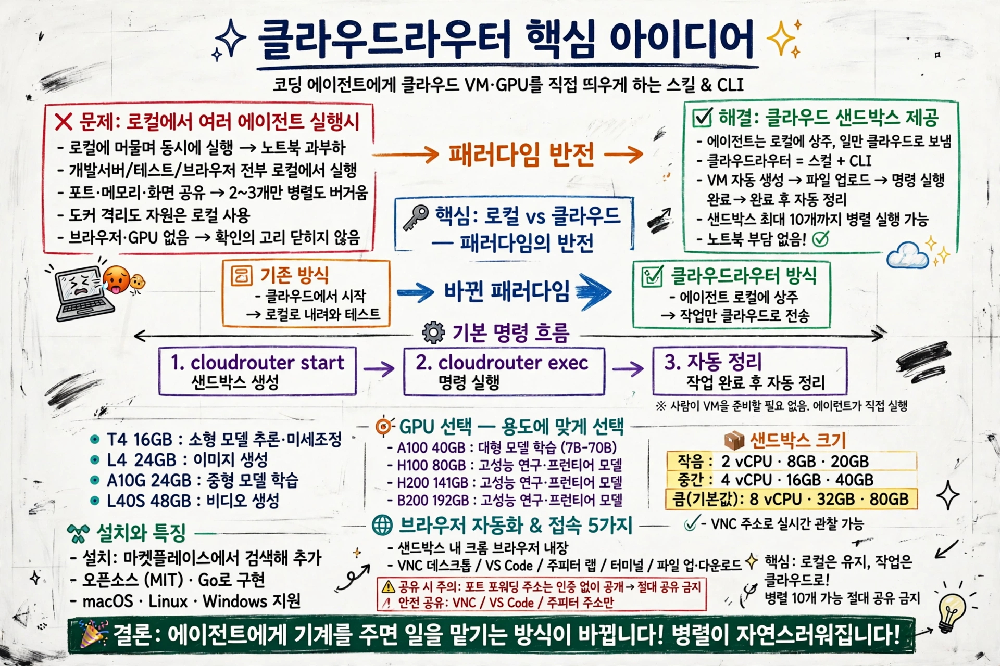
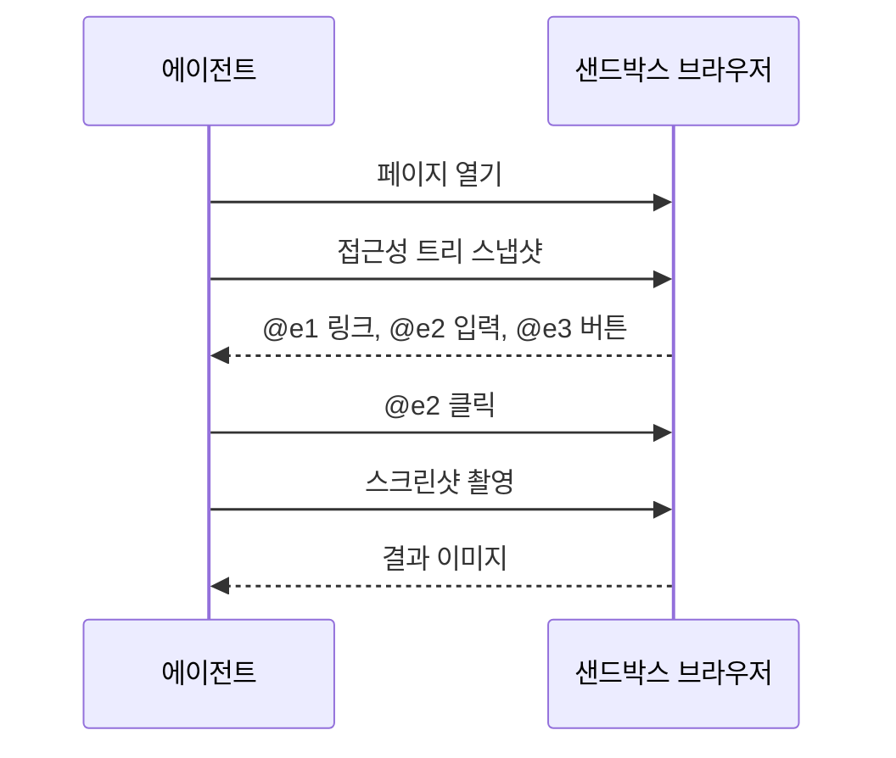

# CloudRouter: 에이전트는 로컬에 두고, 일은 클라우드 VM·GPU로 보냅니다

> **Summary**
> 클라우드라우터는 코딩 에이전트에게 클라우드 VM·GPU를 직접 띄우게 해주는 스킬이자 CLI로, 에이전트는 로컬에 머물고 일만 클라우드로 보내는 구조입니다. start와 exec 명령만으로 샌드박스를 만들고 명령을 실행하며, --gpu 옵션으로 T4부터 B200까지 GPU를 골라 쓸 수 있고 최대 10개까지 병렬로 돌릴 수 있습니다. VM마다 VNC 데스크톱과 VS Code, 주피터 랩이 붙고 크롬 브라우저 자동화까지 되지만, 인증 없이 공개되는 포트 포워딩 주소는 절대 공유하면 안 됩니다.

---

- 코딩 에이전트에게 클라우드 VM·GPU를 직접 띄우게 해주는 스킬이자 CLI, 클라우드라우터입니다. 로컬 프로젝트 폴더에서 샌드박스를 만들고, 파일을 올리고, 명령을 실행하고, 끝나면 정리합니다.
- GPU가 필요하면 `--gpu` 옵션 하나면 됩니다. T4부터 B200까지, 용도에 맞게 고르면 됩니다.
- 에이전트는 로컬에 머물고 일만 클라우드로 보내는 구조라, 여러 작업을 병렬로 돌려도 노트북이 버거워지지 않습니다.


## 에이전트 여러 개를 동시에 돌리면, 노트북이 먼저 지치지 않으시나요?

코딩 에이전트에게 일을 맡겼습니다. 개발 서버를 띄우고, 테스트를 돌리고, 브라우저로 결과를 확인합니다. 그런데 이 모든 일이 노트북 위에서 일어납니다. 포트도, 메모리도, 화면도 나눠 씁니다. 에이전트를 두세 개만 병렬로 돌리면 금방 어수선해집니다!

도커로 격리하면 나아질까요? 격리는 되지만 노트북 자원을 쓰는 건 마찬가지입니다. 브라우저, 데스크톱, GPU가 없어서 확인의 고리를 끝까지 닫지 못합니다. 이럴 때 필요한 건 격리가 아니라, 에이전트에게 자기 기계를 주는 것입니다.

🎥 [동영상 보기](https://www.youtube.com/watch?v=SCkkzxKBcPE)

## 에이전트에게 기계를 주면 뭐가 달라질까요?

클라우드라우터는 스킬이자 CLI입니다. 코딩 에이전트가 명령줄에서 클라우드 샌드박스를 직접 만들고 제어하게 해줍니다. 로컬 프로젝트 폴더에서 VM을 띄우고, 파일을 올리고, 명령을 실행하고, 끝나면 정리합니다. GPU가 필요하면 요청하면 됩니다. 이게 전부입니다.

```bash
cloudrouter start ./my-project
cloudrouter start --gpu B200 ./my-project
cloudrouter exec cr_abc123 "npm install && npm run dev"
```

명령은 간단합니다. `start`로 샌드박스를 만들고, `exec`로 명령을 실행합니다. 끝나면 정리합니다. 에이전트가 직접 이 과정을 밟습니다. 사람이 중간에 기계를 준비할 필요가 없습니다.


## 로컬에 두는 것과 클라우드로 보내는 것, 뭐가 다를까요?

대부분의 클라우드 개발 도구는 클라우드에서 시작해서 로컬로 테스트하러 내려옵니다. 클라우드라우터는 반대입니다. 에이전트는 로컬에 머물고, 일만 클라우드로 보냅니다. 에이전트가 하던 일은 그대로입니다. 개발 서버를 띄우고, 브라우저를 다루는 일 말입니다. 다만 그 일이 일어나는 장소가 VM으로 바뀌었을 뿐입니다.

이 반전이 저는 가장 인상 깊었습니다. 에이전트가 일하는 모습을 지켜보고 로컬 제약을 걱정하지 않게 되니, 병렬로 돌리는 작업이 자연스럽게 늘어났습니다!


## GPU는 어떻게 고르면 될까요?

GPU가 필요하면 `--gpu` 옵션 하나면 됩니다. 용도별로 고르면 됩니다.

| GPU | 메모리 | 용도 |
| --- | --- | --- |
| T4 | 16GB | 소형 모델 추론·미세조정 |
| L4 | 24GB | 이미지 생성 |
| A10G | 24GB | 중형 모델 학습 |
| L40S | 48GB | 비디오 생성 |
| A100 | 40GB | 대형 모델 학습(7B–70B) |
| H100 / H200 / B200 | 80GB / 141GB / 192GB | 고성능 연구·프런티어 모델 |

샌드박스 크기도 고를 수 있습니다. 작음은 2개 vCPU·8GB 메모리·20GB 디스크, 중간은 4개 vCPU·16GB·40GB, 큼은 8개 vCPU·32GB·80GB입니다. 기본값은 큼입니다. 동시에 띄울 수 있는 샌드박스는 최대 10개입니다.

## 브라우저 자동화는 어떻게 할까요?

샌드박스마다 크롬 브라우저가 들어 있습니다. 접근성 트리 기반으로 요소를 찾아 클릭하고, 입력하고, 스크린샷을 찍습니다. 에이전트가 직접 브라우저를 다뤄서 결과를 확인합니다. VNC 주소로 열면 에이전트가 브라우저를 다루는 모습을 실시간으로 볼 수도 있습니다!

```bash
cloudrouter browser open cr_abc123 "http://localhost:3000"
cloudrouter browser snapshot -i cr_abc123
cloudrouter browser click cr_abc123 @e2
cloudrouter browser screenshot cr_abc123 result.png
```



## 접속 방법, 다섯 가지가 있습니다

VM마다 VNC 데스크톱, VS Code, 주피터 랩이 붙어 있습니다. 모두 인증이 걸린 주소 뒤에 있습니다. 터미널 세션도 열 수 있습니다. 파일은 올리고 내릴 수 있고, `--watch` 옵션을 켜면 바뀔 때마다 자동으로 다시 올립니다. 목록 확인, 상태 확인, 일시 중지, 재개, 삭제까지 명령으로 관리합니다.

## 공유할 때 조심할 점이 있을까요?

주의할 점이 하나 있습니다. 포트 포워딩 주소는 인증 없이 공개되므로 절대 공유하면 안 됩니다! 대신 VNC, VS Code, 주피터 주소만 안전하게 공유할 수 있습니다. 개발 서버에 들어갈 때도 VNC로 들어가는 게 안전합니다.

## 설치는 두 가지 방법입니다

스킬은 마켓플레이스에서 이름으로 검색해 추가하면 됩니다. 독립 실행형 CLI로 쓸 때는 npm 패키지를 전역으로 설치한 뒤 로그인합니다.

```bash
npm install -g @manaflow-ai/cloudrouter
cloudrouter login
```

오픈소스(MIT)이고 Go로 만들었습니다. macOS, Linux, Windows에서 쓸 수 있습니다.

## 맺음말

에이전트에게 기계를 주는 건, 일을 맡기는 방식을 바꾸는 일입니다. 노트북이 버거워서 못 하던 병렬 작업을, 클라우드에서 그냥 돌리면 됩니다. GPU가 필요하면 요청하면 됩니다. 이 단순한 원시 기능이, 에이전트와 일하는 방식을 바꿉니다!

