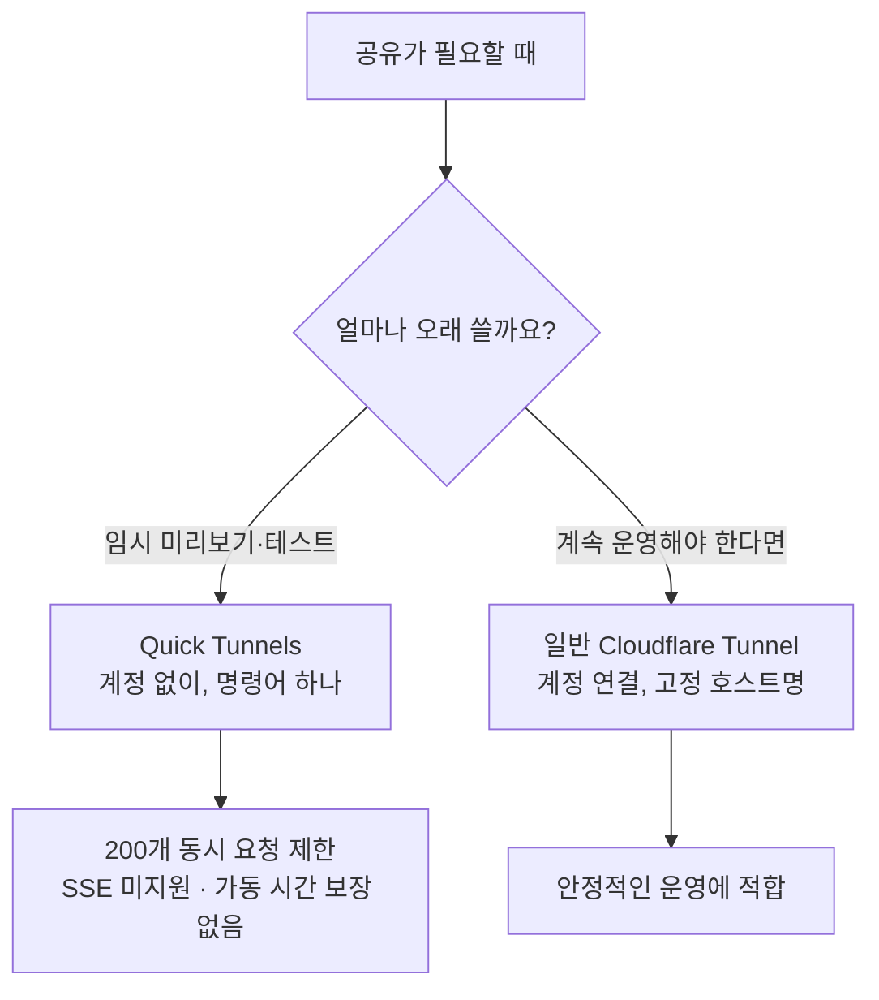

# Cloudflare Quick Tunnels: 계정 없이, 명령어 하나로 로컬 서버를 인터넷에 공개합니다

> **Summary**
> Cloudflare Quick Tunnels는 계정 가입 없이 로컬 서버를 임시 HTTPS 주소로 공개하는 무료 서비스로, 명령어 하나면 팀과 바로 공유할 수 있습니다. 내 컴퓨터에서 나가는 연결을 쓰기 때문에 외부 포트를 열 필요가 없고, HTTPS와 DDoS 방어는 Cloudflare가 처리합니다. 링크만 아는 사람은 누구나 들어올 수 있지만, 이메일 일회용 PIN으로 초대장처럼 제한할 수도 있습니다. 프로세스를 멈추면 터널도 사라지고 호스트명도 매번 바뀌며, 동시 요청 200개 제한과 SSE 미지원 같은 제약이 있어 임시 미리보기와 테스트용이고, 상시 운영에는 계정 기반 일반 터널을 써야 합니다.

---

- 로컬에서 돌고 있는 화면을 팀원에게 보여주려면, 배포부터 해야 할까요? 명령어 하나면 링크 하나로 바로 보여줄 수 있습니다.
- Cloudflare Quick Tunnels는 계정 없이 로컬 서버를 임시 HTTPS 주소로 공개하는 무료 서비스입니다. 가입도, 도메인도, 포트 열기도 필요 없습니다.
- 프로세스를 멈추면 터널도 사라집니다. 임시 미리보기와 테스트에 딱 맞는 도구입니다.


개발 중인 화면을 팀원에게 보여주려고, 배포부터 한 적 있으시죠? 로컬에서 이미 잘 돌아가는데 말이죠. 공유기 설정까지 건드려야 한다면, 보여주기 전에 기운이 다 빠집니다. 그런데 명령어 하나면, 로컬 서버가 그대로 인터넷 주소가 됩니다!

🎥 [동영상 보기](https://www.youtube.com/watch?v=etluT8UC-nw)

## 로컬 서버, 링크 하나로 공개할 수 있을까요?

Quick Tunnels는 로컬에서 돌고 있는 웹사이트나 API를 임시 HTTPS 주소로 외부에 공유하는 무료 서비스입니다. 주소는 `trycloudflare.com` 도메인으로 나옵니다. 계정 가입이 필요 없습니다. 로그인도 필요 없습니다. 도메인과 DNS 설정도 필요 없습니다.

핵심은 연결 방향입니다. 외부에서 내 컴퓨터로 들어오는 연결이 아닙니다. 내 컴퓨터에 있는 `cloudflared`가 Cloudflare 쪽으로 나가는 연결을 만듭니다. 그래서 외부 접속용 포트를 열 필요가 없습니다. HTTPS 인증서, 라우팅, DDoS 방어는 Cloudflare가 알아서 처리합니다. 내 컴퓨터는 문을 열지 않고, 밖으로 손을 내미는 셈입니다.

## 명령어 하나로 끝납니다

순서는 세 단계입니다. 먼저 플랫폼에 맞는 `cloudflared` CLI를 설치합니다. 패키지 관리자나 공식 다운로드 페이지에서 받으면 됩니다. 다음으로 로컬 서버를 원하는 포트에서 실행합니다. 마지막으로 터미널에서 명령어 하나를 실행합니다.

```javascript
cloudflared tunnel --url http://localhost:8080
```

그러면 터미널에 `trycloudflare.com` 주소가 뜹니다. 이 주소를 팀과 공유하면 끝입니다! 팀원은 실시간 미리보기를 보고, 디자인 검토 의견을 바로 남길 수 있습니다. 자동화된 QA 피드백 과정에도 그대로 쓸 수 있습니다.


## 링크만 가진 사람은 누구나 들어옵니다. 그래도 될까요?

기본 동작은 그렇습니다. 주소를 아는 사람은 누구나 내 로컬 서비스에 접속할 수 있습니다. 그래서 이 도구는 임시 공유용입니다. 그런데 초대가 필요한 상황도 있지요? 이럴 때는 이메일 제한을 걸면 됩니다.

`--allowed-mail` 옵션을 붙이면, 방문자는 이메일 주소를 입력하고 일회용 PIN을 받아야 들어올 수 있습니다. 방문자는 Cloudflare 계정이 필요 없습니다. 여러 명을 허용하려면 옵션을 반복하거나 쉼표로 나열하면 됩니다. 도메인 전체를 허용하는 방법도 있습니다. `*@example.com`처럼 쓰면 해당 도메인 주소는 모두 들어옵니다.

이 부분이 저는 가장 인상 깊었습니다. 계정 가입 없이도 초대장처럼 쓸 수 있다는 게, 임시 공유의 본질을 정확히 짚은 느낌이니까요! 다만 접근 대상을 바꾸려면 프로세스를 멈추고 새 터널을 만들어야 합니다. 프로세스가 멈추면 모두의 접근도 함께 끝납니다.

## 어디까지 쓸 수 있을까요?

미리보기 말고도 쓸 곳이 많습니다. 웹훅을 받아야 할 때, 외부 서비스가 내 로컬 API를 호출하게 하면 됩니다. 스크린샷 서비스나 코딩 에이전트의 테스트에도 활용할 수 있습니다. 호스트명과 연결 상태를 JSON으로 출력하는 기능도 있습니다. 자동화 스크립트에서 터널 주소를 바로 받아 쓸 수 있다는 뜻입니다.

하지만 한계도 분명합니다. 어디까지나 개발과 테스트용입니다. 프로세스를 종료하면 터널도 사라집니다. 호스트명은 만들 때마다 바뀝니다. 가동 시간 보장도 없습니다. 동시에 처리 중인 요청은 최대 200개까지이고, 넘으면 HTTP `429` 응답이 돌아옵니다. Server-Sent Events(SSE)는 지원하지 않습니다. 이메일 인증은 인터랙티브 브라우저에서만 동작합니다.



상시 운영이 필요하다면 계정을 연결하는 일반 Cloudflare Tunnel을 쓰면 됩니다. 고정된 호스트명과 안정적인 운영이 필요할 때의 선택지입니다. 임시냐, 상시냐. 용도에 따라 갈리는 지점입니다!

배포가 아니라 공유가 필요할 때, 명령어 하나면 됩니다. 다만 임시라는 걸 잊지 마세요. 터미널을 닫는 순간, 그 주소는 사라집니다!

