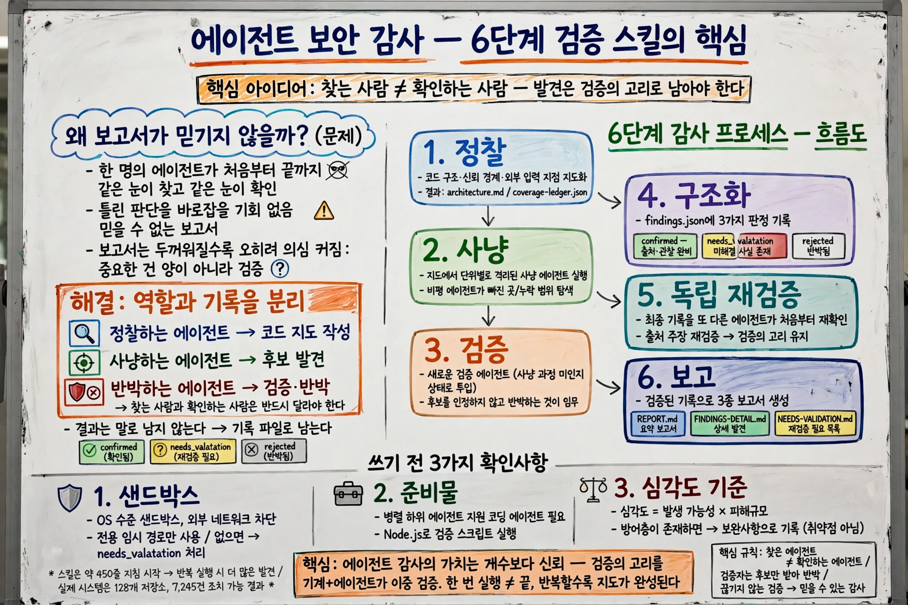
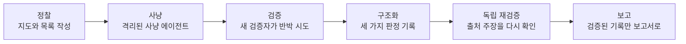
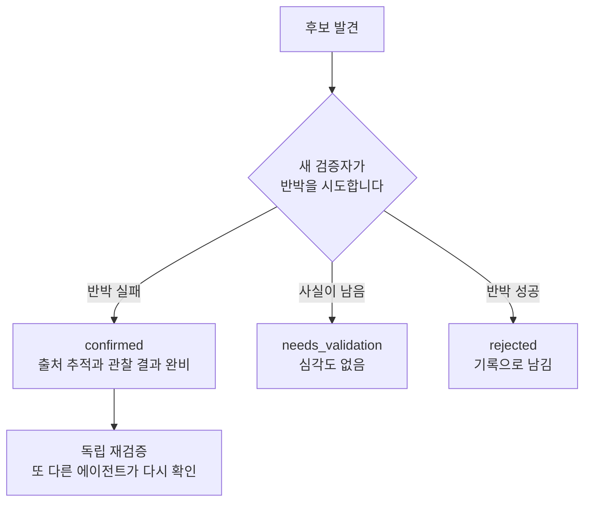

# Cloudflare Security Audit Skill: 에이전트 보안 감사는 말이 아니라 검증된 기록으로 남깁니다

> **Summary**
> Cloudflare Security Audit Skill은 발견과 검증을 서로 다른 에이전트에 맡기고, 감사를 여섯 단계로 나눠 결과를 confirmed, needs_validation, rejected로 기록해 검증 가능한 보고서를 만듭니다. 대상 코드는 샌드박스에서 실행해야 하며, 한 번의 실행으로 모든 취약점을 찾기 어려우므로 반복 감사로 지도를 보완하는 것이 중요합니다.

---

- 에이전트에게 보안 검토를 맡기면 보고서는 그럴듯하게 나옵니다. 문제는 그 보고서가 진짜인지, 누가 확인했는지 알 수 없다는 점입니다.
- 이 스킬은 감사 과정을 여섯 단계로 쪼개고, 찾은 에이전트와 확인하는 에이전트를 끝까지 분리합니다. 확인을 통과하지 못한 발견은 보고서에 오르지 못합니다.
- 결과는 말로 남지 않습니다. `confirmed`, `needs_validation`, `rejected` 세 가지 판정이 적힌 기록 파일로 남고, 그 기록이 다시 검증됩니다.

에이전트에게 코드 보안 검토를 맡겨본 적 있으시죠? 보고서는 몇 페이지씩 나옵니다. 그런데 마지막 페이지를 덮고 나면 이런 질문이 남습니다. 이 중에서 진짜가 몇 개일까요?

🎥 [동영상 보기](https://www.youtube.com/watch?v=5SFqgejV73Y)

## 보고서가 두꺼울수록 믿음이 안 가는 이유가 뭘까요?

에이전트 한 명이 처음부터 끝까지 검토하면, 같은 눈이 찾고 같은 눈이 확인합니다. 틀린 판단을 바로잡을 기회가 없습니다. 그래서 보고서가 길수록 오히려 의심이 커집니다. 양이 아니라 검증이 문제입니다.

이 스킬은 그래서 일을 나누는 데서 출발합니다. 한 에이전트가 모든 걸 맡지 않습니다. 정찰하는 에이전트, 사냥하는 에이전트, 반박하는 에이전트가 따로 움직입니다. 각 단계가 끝날 때마다 남는 것은 문장이 아니라 기록입니다.

## 여섯 단계, 무엇이 어떻게 이어질까요?

감사는 여섯 단계로 진행됩니다.

1. **정찰** — 코드 구조와 신뢰 경계, 외부 입력이 들어오는 지점을 지도처럼 그립니다. `architecture.md`와 `coverage-ledger.json`에 남깁니다.
1. **사냥** — 지도에서 뽑은 단위마다 격리된 사냥 에이전트를 붙입니다. 사냥이 끝난 뒤에는 빠진 곳을 찾는 비평가가 따로 돕니다.
1. **검증** — 후보마다 새로운 검증 에이전트를 붙입니다. 이 검증자의 임무는 후보를 인정하는 것이 아니라 반박하는 것입니다!
1. **구조화** — 결과를 `findings.json`에 세 가지 판정으로 적습니다. `confirmed`, `needs_validation`, `rejected`입니다.
1. **독립 재검증** — 최종 기록의 출처 주장을 또 다른 에이전트가 처음부터 다시 확인합니다.
1. **보고** — 검증된 기록과 지도에서 보고서 세 종을 뽑아냅니다. `REPORT.md`, `FINDINGS-DETAIL.md`, `NEEDS-VALIDATION.md`입니다.

## 찾은 사람과 확인하는 사람이 왜 달라야 할까요?

이 스킬의 규칙은 한 줄로 정리됩니다. **발견을 확인하는 에이전트는 그 발견을 찾은 에이전트와 달라야 합니다!**

검증자는 사냥 과정을 모른 채 후보만 받습니다. 후보를 뒤집는 것이 임무입니다. 뒤집히지 않은 후보만 다음 단계로 갑니다. 판정도 세 가지로 나뉩니다. `confirmed`는 출처 추적과 관찰 결과가 모두 갖춰진 경우입니다. `needs_validation`은 풀리지 않은 사실이 하나라도 남아 있는 경우이고, 심각도는 매기지 않습니다. `rejected`는 반박된 후보입니다.

기록 파일은 기계가 검사합니다. 의존성 없는 작은 검증 스크립트 두 개가 `findings.json`과 `coverage-ledger.json`의 형식을 확인합니다. 내용이 맞는지는 사람이 아니라 또 다른 에이전트가 봅니다. 검증의 고리가 끊기지 않는 구조입니다.

## 숫자는 어디까지가 스킬이고, 어디까지가 하네스일까요?

이 부분은 헷갈리기 쉬워서 정확히 짚고 넘어가야 합니다. 이 스킬은 약 450줄짜리 지침 묶음에서 시작했습니다. 그 지침이 씨앗이 돼서, 여섯 주 만에 128개 저장소를 스캔하는 함대 규모 시스템으로 자랐습니다. 그 시스템이 남긴 숫자는 이렇습니다. 후보 20,799건 중 12,057건이 검증을 통과했고, 최종적으로 조치 가능한 발견 7,245건이 남았습니다. 약 3만 줄짜리 저장소 하나에서는 3시간 만에 서로 다른 버그 80개 안팎이 나왔습니다.

그런데 **7,245건은 공개된 스킬의 숫자가 아닙니다!** 함대 전체 시스템의 숫자입니다. 스킬 하나로 같은 결과를 기대하면 실망합니다. 스킬은 그 시스템의 시작점이자 핵심 원칙을 담은 묶음입니다. 공개된 저장소에는 교차 저장소 추적 단계나 수십 개 에이전트의 작업 대기열이 없습니다.

또 하나, 한 번 돌린다고 끝이 아닙니다. 내부 실험에서는 한 번의 실행이 여러 번 실행해 찾은 취약점의 절반 정도만 찾았습니다. 반복할수록 지도는 빈틈을 메우고, 다음 실행은 지난 실행이 놓친 곳을 겨냥합니다. 감사는 한 번의 이벤트가 아니라 쌓이는 과정입니다.

## 쓰기 전에 확인할 세 가지가 있습니다!

첫째, **샌드박스**입니다. 대상 코드가 빌드하고 테스트하고 브라우저를 띄우는 작업은 운영체제 수준의 샌드박스 안에서만 합니다. 외부 네트워크는 막고, 쓸 수 있는 경로도 정해진 임시 경로로 한정합니다. 이 조건이 없으면 스킬은 대상 코드를 실행하지 않고, 해당 건을 `needs_validation`으로 남깁니다.

둘째, **준비물**입니다. 도구 사용과 병렬 하위 에이전트를 지원하는 코딩 에이전트, 그리고 검증 스크립트를 돌릴 `Node.js`가 필요합니다. 설치는 스킬 마켓플레이스에서 스킬 이름으로 검색해 설치합니다.

셋째, **심각도의 기준**입니다. 심각도는 체크리스트에서 얼마나 벗어났느냐가 아니라, 가능성과 피해의 곱으로 정합니다. 방어층 하나가 공격을 막고 있다면, 다른 층이 없다는 사실 자체는 취약점이 아니라 보완 사항으로 적습니다. 체크리스트와 취약점은 다릅니다.

## 감사 결과를 검증 가능한 기록으로 남긴다는 뜻

에이전트 보안 감사의 가치는 발견 개수가 아니라, 그 발견을 얼마나 믿을 수 있느냐에 달려 있습니다. 이 스킬은 그 믿음을 구조로 만듭니다. 찾는 사람과 확인하는 사람을 분리하고, 판정을 세 가지로 고정하고, 기록을 기계와 에이전트 두 번으로 검증합니다.

우리 코드에도 한 번 돌려볼 만합니다. 한 번의 실행으로 절반만 본다는 사실을 기억하고, 지도를 쌓아가는 마음으로 두 번, 세 번 돌려보는 것이 순서입니다. 보고서의 두께가 아니라 검증의 고리가 남는 감사가 진짜 감사입니다!

