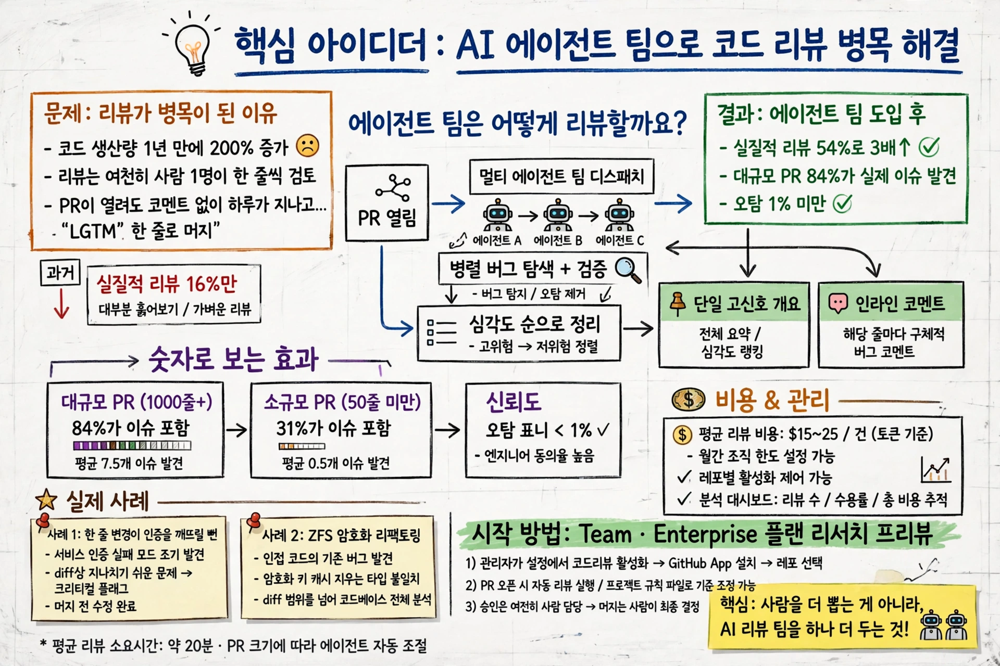
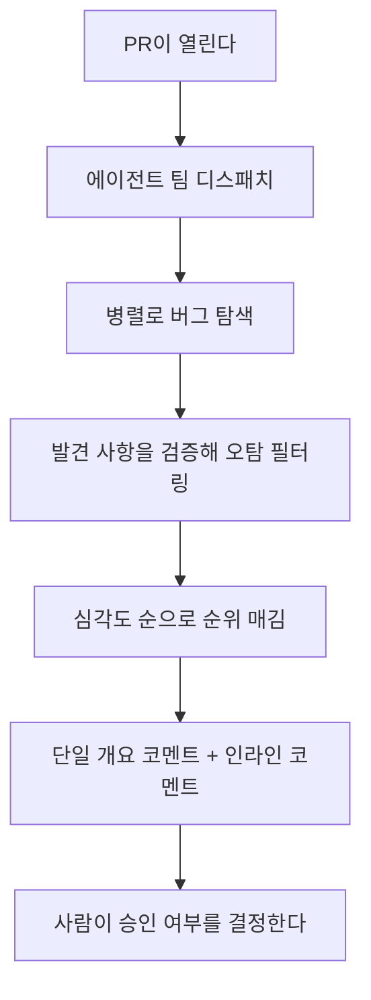
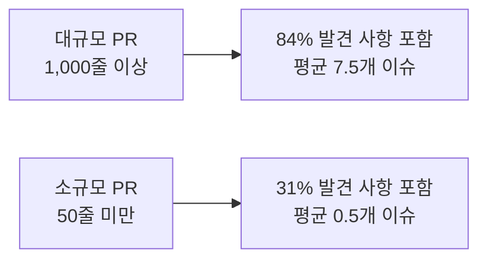
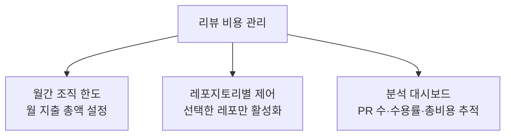

# Code Review: PR마다 에이전트 팀이 달리면, 훑어보기가 진짜 리뷰가 됩니다

> **Summary**
> 코드 생산량이 1년 만에 200% 늘면서 코드 리뷰가 병목이 됐습니다. PR이 열리면 멀티 에이전트 팀이 병렬로 버그를 찾고, 검증으로 오탐을 걸러 심각도 순으로 정리해 줍니다. 도입 전에는 PR의 16%만 실질적 리뷰를 받았는데, 도입 후 54%로 올랐고, 대규모 PR에서는 84%가 발견 사항을 포함했으며 오탐은 1% 미만이고, 승인은 여전히 사람이 맡으며 리뷰 한 건당 평균 $15~25의 토큰 비용이 들고 Team·Enterprise 플랜의 리서치 프리뷰로 제공됩니다.

---

- 코드 생산량이 1년 만에 200% 늘면서 코드 리뷰가 병목이 됐습니다. PR이 열리면 멀티 에이전트 팀이 병렬로 버그를 찾고, 검증으로 오탐을 걸러 심각도 순으로 정리해 줍니다.
- 도입 전에는 PR의 16%만 실질적 리뷰를 받았는데, 도입 후 54%로 올랐습니다. 대규모 PR에서는 84%가 발견 사항을 포함했고, 오탐으로 표시된 비율은 1% 미만입니다.
- 승인은 여전히 사람이 맡고, 리뷰 한 건당 평균 $15~25의 토큰 비용이 듭니다. Team·Enterprise 플랜의 리서치 프리뷰로 제공됩니다.

PR을 올리고 리뷰를 기다린 적 있으시죠? 하루가 지나도 코멘트 하나 안 달리고, 결국 "LGTM" 한 줄만 달랑 붙어서 머지됩니다. 코드 양은 1년 만에 200% 늘었는데, 리뷰하는 사람의 시간은 그대로니까요!

🎥 [동영상 보기](https://www.youtube.com/watch?v=0M7EXtYko04)

## 리뷰가 왜 병목이 됐을까요?

코드를 쓰는 속도와 코드를 읽는 속도가 벌어졌습니다. AI 도움을 받아 엔지니어 한 사람이 만드는 코드가 1년 만에 200% 늘었는데, 리뷰는 여전히 사람이 한 줄씩 읽는 방식 그대로였습니다. 그러다 보니 많은 PR이 깊은 리뷰 대신 훑어보기에 그쳤습니다.

이 문제는 한 회사만의 일이 아니었습니다. 다른 팀에서도 매주 같은 어려움을 호소했습니다. 개발자들이 과부하 상태에서 PR을 대충 넘기면, 버그가 프로덕션까지 그대로 들어갈 확률이 커집니다. 리뷰가 느려지는 게 아니라 리뷰가 얕아지는 게 진짜 문제였습니다!

## 에이전트 팀은 어떻게 리뷰할까요?

PR이 열리면 에이전트 팀이 디스패치됩니다. 여러 에이전트가 병렬로 버그를 탐색하고, 각자 찾은 것을 검증해 오탐을 걸러냅니다. 남은 발견 사항은 심각도 순으로 정리돼 PR에 전달됩니다. 결과는 두 가지 형태입니다. 전체를 한눈에 보여주는 단일 고신호 개요 코멘트, 그리고 특정 버그가 있는 줄마다 다는 인라인 코멘트입니다.

PR 크기에 따라 리뷰 규모도 자동으로 조절됩니다. 크고 복잡한 변경에는 더 많은 에이전트와 깊은 분석이 붙고, 사소한 변경에는 경량 패스가 적용됩니다. 테스트 기준 평균 리뷰 소요 시간은 약 20분입니다. 사람이 코드를 처음부터 끝까지 읽는 것과는 다른 속도입니다.

## 숫자가 말해주는 효과는?

도입 전에는 PR의 16%만 실질적 리뷰 코멘트를 받았습니다. 도입 후에는 54%로 올랐습니다. 세 배가 넘게 늘어난 셈입니다. 숫자가 말해주는 건 단순합니다. 리뷰가 "있었다"가 아니라 "제대로 됐다"는 PR이 늘어났다는 뜻입니다!

크기별로 보면 차이가 더 분명합니다. 1,000줄이 넘는 대규모 PR에서는 84%가 발견 사항을 포함했고, 평균 7.5개 이슈가 보고됐습니다. 50줄 미만 소규모 PR에서는 31%가 발견 사항을 포함했고, 평균 0.5개 이슈가 보고됐습니다. 큰 변경일수록 에이전트 팀이 더 많이 찾아낸다는 뜻입니다. 엔지니어들이 발견 사항에 대체로 동의했고, 오탐으로 표시된 비율은 1% 미만이었습니다.

## 한 줄 변경이 인증을 깨뜨릴 뻔했다고요?

숫자보다 와닿는 사례가 두 가지 있습니다. 첫 번째는 프로덕션 서비스의 한 줄 변경이었습니다. 겉보기에는 통상적으로 빠른 승인을 받을 수 있는 diff였는데, 코드 리뷰가 크리티컬로 플래그를 달았습니다. 해당 변경은 서비스의 인증을 깨뜨릴 수 있는 실패 모드였습니다. diff에서는 읽고 지나치기 쉬웠지만, 지적받으면 명백한 문제였습니다. 머지 전에 수정됐고, 담당 엔지니어는 혼자서는 잡지 못했을 것이라고 말했습니다.

두 번째는 오픈소스 미들웨어의 ZFS 암호화 리팩토링 PR이었습니다. 코드 리뷰가 PR이 건드린 코드가 아니라, 인접 코드에 숨어 있던 기존 버그를 발견했습니다. 매 동기화 시 암호화 키 캐시를 조용히 지우는 타입 불일치 문제였습니다. 변경 세트만 스캔하는 사람 리뷰어가 즉시 찾아보기 어려운 유형입니다. 이 장면이 저는 가장 인상 깊었습니다. 리뷰 범위가 diff를 넘어 코드베이스 전체로 넓어졌다는 게, 숫자로 드러나니까요!

## 비용은 얼마나 들고, 어떻게 조절할까요?

이 리뷰는 깊이 최적화돼 있습니다. 그래서 오픈소스 GitHub Action 같은 경량 솔루션보다 비용이 높습니다. 리뷰는 토큰 사용량 기준으로 과금되며, PR 크기와 복잡도에 따라 평균 $15~25 수준입니다. 모든 PR에 신뢰할 수 있는 리뷰어를 붙이는 대가라고 보면 됩니다.

비용 관리 기능도 함께 제공됩니다. 월간 조직 한도로 전체 리뷰에 걸친 월간 지출 총액을 정할 수 있고, 레포지토리별 제어로 선택한 레포지토리에서만 리뷰를 활성화할 수 있습니다. 분석 대시보드에서는 리뷰된 PR 수, 수용률, 총 리뷰 비용을 추적합니다. 비싸게 굴릴지, 꼭 필요한 곳에만 쓸지는 팀이 정하면 됩니다.

## 어떻게 시작하면 될까요?

Team 및 Enterprise 플랜 대상으로 리서치 프리뷰 형태로 제공됩니다. 관리자는 설정에서 코드 리뷰를 활성화하고, GitHub App을 설치한 뒤 리뷰를 실행할 레포지토리를 선택하면 됩니다. 개발자는 활성화 후 새 PR에 대해 자동으로 리뷰가 실행되며, 별도 설정이 필요 없습니다.

프로젝트 규칙 파일을 두면 리뷰 기준도 조정할 수 있습니다. 팀의 코딩 규칙과 아키텍처 결정을 파일에 적어두면, 에이전트 팀이 그 기준에 맞춰서 봅니다. 규칙이 바뀌면 파일만 고치면 됩니다.

승인은 여전히 사람이 담당합니다. 에이전트 팀은 버그를 찾아서 보여줄 뿐, 머지 버튼을 누르는 건 사람입니다. 리뷰어가 실제 출하되는 코드를 충분히 커버할 수 있도록 격차를 줄이는 게 이 기능의 역할입니다. 코드가 200% 늘어난 세상에서, 리뷰의 깊이를 지키는 방법은 사람을 더 뽑는 게 아니라 리뷰 팀을 하나 더 두는 것이었습니다!

