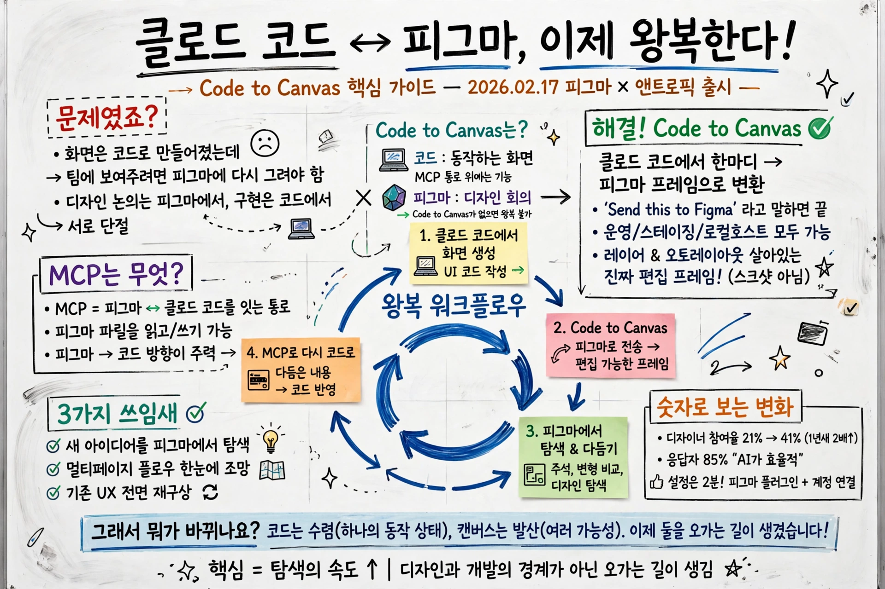
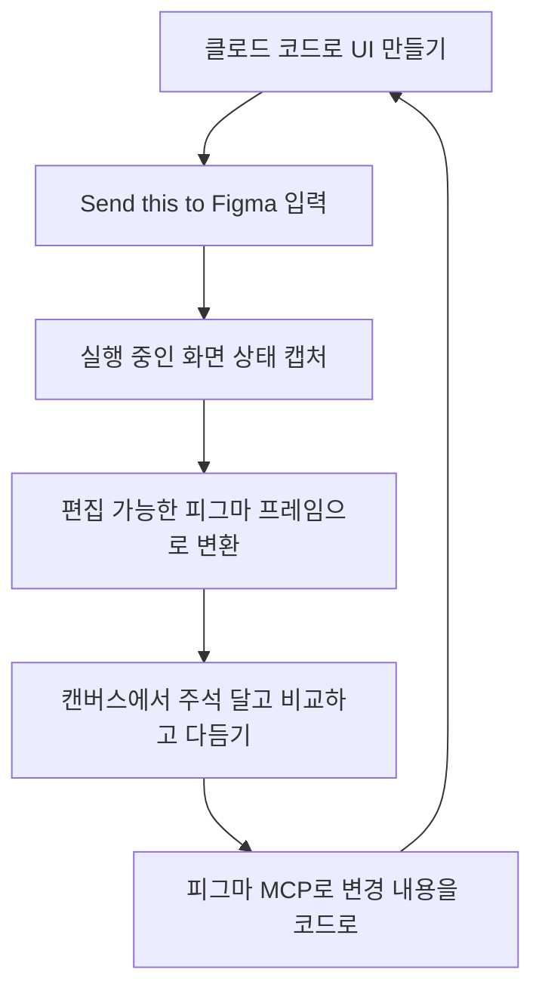
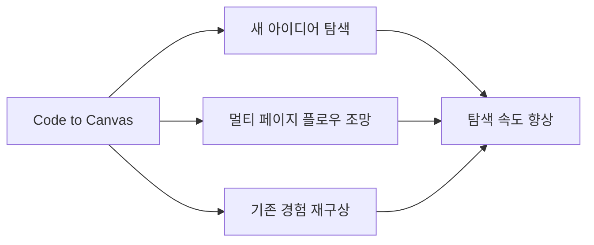

# Code to Canvas: 클로드 코드로 만든 화면, 피그마에서 편집 가능한 프레임이 됩니다

> **Summary**
> Code to Canvas는 클로드 코드로 만든 화면을 편집 가능한 피그마 프레임으로 가져와 아이디어와 여러 화면을 빠르게 탐색하게 합니다. 피그마 MCP를 통해 디자인 변경 사항을 코드로 다시 반영할 수 있어, 코드와 디자인 캔버스 사이의 왕복 작업을 지원합니다.

---

- 클로드 코드로 만든 화면을 "피그마로 보내기" 한마디로 편집 가능한 피그마 프레임으로 가져올 수 있게 됐습니다.
- MCP는 피그마와 클로드 코드를 잇는 통로이고, Code to Canvas는 그 통로 위에서 돌아가는 코드→디자인 기능입니다.
- 피그마에서 다듬은 내용은 다시 코드로 돌아가니까, 탐색은 피그마에서 하고 구현은 코드에서 하는 왕복이 됩니다.


화면 하나 만들려고 프롬프트를 몇 번이나 돌렸는데, 막상 팀원들한테 보여주려면 또 피그마에 다시 그려야 했던 적 있으시죠? 코드로는 돌아가는 화면이 있는데, 디자인 회의는 피그마에서 하니까요. 그 사이를 메우는 기능이 나왔습니다!

🎥 [동영상 보기](https://www.youtube.com/watch?v=C0fNUdjQxeY)

## Code to Canvas, 뭐가 달라졌을까요?

Code to Canvas는 2026년 2월 17일에 피그마와 앤트로픽이 함께 내놓은 기능입니다. 클로드 코드로 만든 UI를 편집 가능한 피그마 디자인 프레임으로 가져옵니다. 방법은 간단합니다. 클로드 코드에서 "Send this to Figma"라고 말하면, 지금 브라우저에 떠 있는 화면 상태가 그대로 피그마 프레임으로 변환됩니다. 운영 환경이든, 스테이징이든, 로컬호스트든 상관없습니다. 변환된 프레임은 레이어와 오토 레이아웃이 살아 있는 진짜 편집 가능한 프레임입니다. 스크린샷이 아닙니다! 팀원들이 그 위에서 주석을 달고, 변형을 나란히 놓고 비교하고, 다듬을 수 있습니다.

## MCP랑은 무엇이 다를까요?

MCP는 통로입니다. 피그마 MCP 서버는 클로드 코드가 피그마 파일을 구조적으로 읽고 쓸 수 있게 해주는 연결고리입니다. 프레임 링크를 주면 컴포넌트와 디자인 토큰을 읽어서 코드로 만들어줍니다. Code to Canvas는 그 통로 위에서 돌아가는 기능 하나입니다. 방향이 반대입니다! MCP가 주로 피그마→코드 방향이었다면, Code to Canvas는 코드→피그마 방향입니다. 클로드 코드가 만든 살아 있는 화면을 피그마로 가져오는 거죠. 그리고 피그마에서 다듬은 내용은 MCP를 통해 다시 코드로 돌아갑니다. 그래서 둘은 경쟁이 아니라 한 쌍입니다. MCP가 없으면 Code to Canvas도 없고, Code to Canvas가 없으면 왕복이 안 됩니다.



## 데모로 보면 감이 옵니다

데모를 보면 감이 옵니다. 터미널에서 `generate_figma_design(Welcome)`이라고 치면 웰컴 화면이 피그마 프레임으로 생깁니다. 가입, 이메일 인증, 프로필 설정, 팀 초대 화면까지 이어서 만들면 온보딩 플로우 전체가 피그마 캔버스에 펼쳐집니다. 이 장면이 저는 가장 인상 깊었습니다! 화면을 하나하나 그리는 게 아니라, 돌아가는 앱에서 화면을 통째로 가져오니까요.

공식 안내에 나온 쓰임새는 세 가지입니다. 새로운 아이디어를 피그마에서 탐색하는 것, 멀티 페이지 플로우를 캔버스 위에서 한눈에 조망하는 것, 기존 사용자 경험을 완전히 새롭게 재구상하는 것. 핵심은 '탐색의 속도'입니다.



## 숫자로 보면 더 확실합니다

피그마의 2026년 AI 보고서에 따르면 개발에 참여하는 디자이너 비율이 1년 새 21%에서 41%로 두 배 가까이 늘었습니다. 응답자의 85%는 AI가 일을 더 효율적으로 만든다고 답했습니다. 설정은 2분이면 됩니다. 권장 방식은 피그마 플러그인을 설치한 뒤 클로드 코드에서 계정을 연결하는 것입니다. 직접 추가하려면 터미널에서 이렇게 입력합니다.

```javascript
claude mcp add --transport http figma https://mcp.figma.com/mcp
```

그러면 클로드 코드가 피그마 파일을 읽고 쓸 수 있게 됩니다.

## 그래서 뭐가 바뀌나요?

코드는 수렴하는 데 강하고, 캔버스는 발산하는 데 강합니다. 피그마의 표현을 빌리면 그렇습니다. 코드로는 하나의 동작하는 상태로 좁혀가고, 캔버스에서는 여러 가능성을 펼쳐놓고 비교합니다. 이제 그 둘이 왕복합니다. 클로드 코드에서 화면을 만들고, 피그마에서 방향을 정하고, 다시 코드로 돌아가서 구현합니다. 디자인과 개발의 경계가 흐려지는 게 아니라, 오가는 길이 생긴 겁니다!

