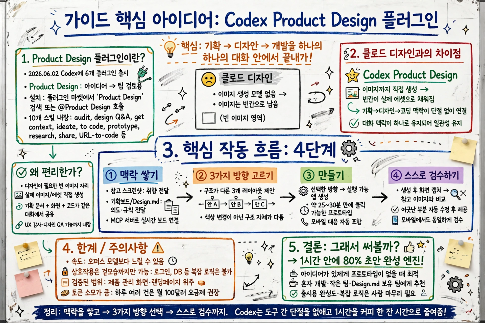
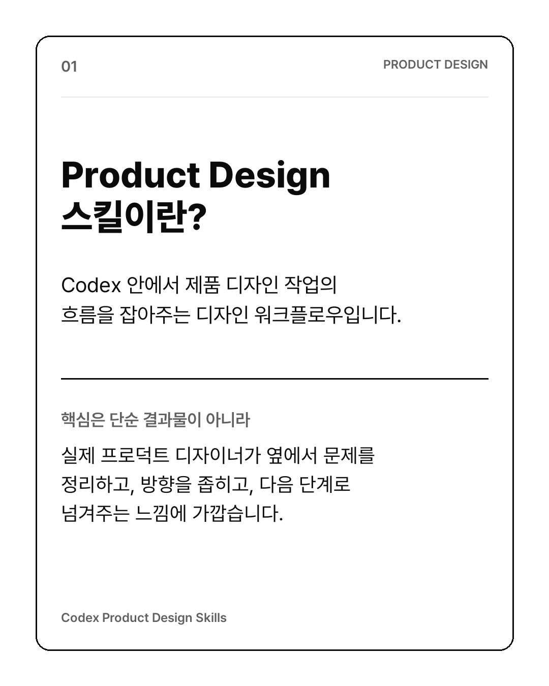
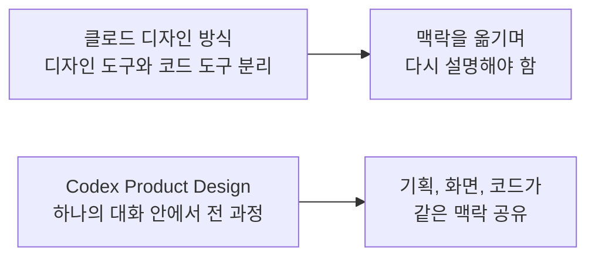
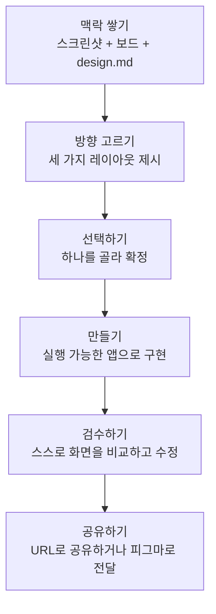
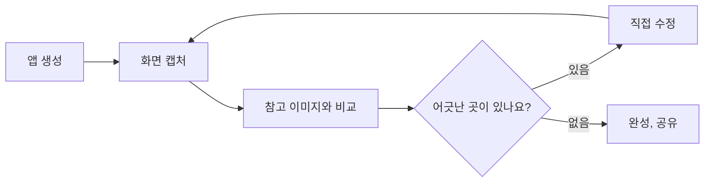

# Codex Product Design: 기획부터 디자인, 개발까지 한 대화로 끝냅니다

> **Summary**
> Codex의 Product Design 플러그인은 기획부터 프로토타입 제작과 검수까지 한 대화에서 이어 주며, 이미지 에셋 생성과 세 가지 디자인 방향 제시, 자동 화면 비교·수정이 강점입니다. 초기 아이디어를 빠르게 클릭 가능한 앱으로 만들기에 유용하지만, 복잡한 로직과 출시 수준의 완성도는 사람의 보완이 필요합니다.

---

- Codex에 Product Design 플러그인이 나왔습니다. 기획부터 디자인, 개발까지 한 대화 안에서 이어집니다.
- 클로드 디자인과 달리 이미지까지 직접 만들어서, 빈칸으로 남던 자리가 채워집니다.
- 맥락을 쌓고 세 가지 방향을 받아 고른 뒤, 스스로 검수까지 마치는 흐름이 핵심입니다.

디자인 도구로 화면을 만들었는데, 이미지가 들어갈 자리가 회색 박스로 남았던 적 있으시죠? 화면은 나왔는데, 그 화면을 실제 제품으로 이어가려면 다시 다른 도구를 열어야 했던 경험도요. Codex의 Product Design 플러그인은 그 두 가지 불편을 한 번에 건드립니다!

🎥 [동영상 보기](https://www.youtube.com/watch?v=_9ImjmzAyus)

## Product Design 플러그인, 뭘까요?

2026년 6월 2일, Codex에 역할별 플러그인 여섯 가지가 나왔습니다. 데이터 분석, 크리에이티브 제작, 세일즈, 프로덕트 디자인, 주식 투자, 투자 은행용입니다. 여섯 개를 합치면 앱 62개, 스킬 110개가 들어갑니다. 그중 Product Design 플러그인은 초기 아이디어를 팀이 검토할 수 있는 프로토타입으로 바꾸는 역할을 맡았습니다.

설치는 간단합니다. Codex의 플러그인 마켓플레이스에서 "Product Design"을 검색해 설치하거나, 대화에서 `@Product Design`이라고 부르면 됩니다. 플러그인 안에는 스킬 10개가 들어 있습니다. `audit`, `design Q&A`, `get context`, `ideate`, `to code`, `product design`, `prototype`, `research`, `share`, `URL-to-code context`입니다. 각 스킬은 독립된 지시문 덩어리라서, 다른 에이전트에 그대로 옮겨 쓸 수도 있습니다.

## 왜 클로드 디자인과 다를까요?

클로드 디자인이 나온 뒤로 "디자인이 수작업에서 프롬프트로 이동한다"는 말이 업계 화두가 됐습니다. 그런데 클로드 디자인을 쓰다 보면 아쉬운 지점이 하나 있었습니다. 이미지 생성 모델이 없어서, 이미지가 들어가야 할 자리는 빈칸으로 남아야 했다는 지적입니다. Codex 플러그인은 이 빈칸을 채우는 데서 출발합니다. 아바타, 빈 화면 일러스트 같은 실제 에셋을 직접 만들어 넣습니다.

차이는 빈칸만이 아닙니다. 클로드 코드와 클로드 디자인은 분리돼 있어서, 그 사이에서 오가는 대화와 문서의 맥락을 공유하는 게 매끄럽지 않습니다. 프로덕트 디자인은 브레인스토밍부터 기획, 와이어프레임, UI 디자인까지 단계를 밟아야 하는데, 도구가 나뉘면 맥락도 나뉩니다. Codex는 이 전 과정을 하나의 대화 안에서 해결합니다. 기획 문서, 화면, 코드가 같은 대화를 공유합니다.

여기에 덤이 하나 더 있습니다. 단순히 화면만 그려주는 게 아니라, UX 감사와 디자인 QA 같은 서브 스킬을 함께 제공합니다. 실제 UX 디자이너가 옆에서 흐름을 잡아주는 느낌에 가깝습니다. 화면을 그리고 나서 "이 흐름, 사용자가 헤매지 않을까요?"라고 물어보는 역할까지 플러그인 안에 들어 있습니다.

## 어떻게 돌아갈까요?

흐름은 네 단계입니다. 맥락 쌓기, 방향 고르기, 만들기, 검수하기입니다.

첫 단계가 전부라고 해도 과언이 아닙니다. 프롬프트 한 줄로 맡기는 게 아니라, 실제 맥락을 쌓습니다. 참고할 화면 스크린샷, 기획 보드, `design.md` 파일까지 함께 건넵니다. 보드는 MCP 서버로 연결해 실시간 캔버스 그대로 읽습니다. 스크린샷이 취향을, 보드가 의도를, `design.md`가 규칙을 전해줍니다. 세 겹이 모여야 결과가 달라집니다.

두 번째 단계에서는 세 가지 방향을 받습니다. 색만 바꾼 세 가지가 아니라, 구조 자체가 다른 세 가지 레이아웃입니다. 한 테스트에서는 이슈 트래커 앱을 두고 9분 만에 서로 다른 내비게이션, 다른 콘텐츠 묶음, 다른 버튼 논리를 가진 세 가지 안이 나왔습니다. 고르는 일이 곧 디자인 결정이 됩니다!

세 번째 단계에서는 고른 방향을 실행 가능한 앱으로 만듭니다. 한 테스트에서는 빈 폴더에서 출발해 약 25~30분 만에 클릭 가능한 앱이 나왔습니다. 이슈를 만들고, 레이아웃을 오가고, 드롭다운을 여는 흐름까지 동작했습니다. 모바일 대응도 따로 시키지 않아도 들어갔습니다. 처음부터 끝까지 45분 안쪽이면 충분했다는 게 테스트의 결론입니다.

## 스스로 검수까지 한다고요?

이 플러그인에서 가장 인상적인 부분은 검수입니다. 앱을 만든 뒤, Codex가 스스로 화면을 캡처해 원래 참고 이미지와 비교합니다. 의도와 결과 사이에 어긋난 곳이 있는지 확인하고, 모바일 화면에서도 같은 검사를 돌립니다. 어긋난 부분을 찾으면 보여주기 전에 고칩니다.

이 장면이 저는 가장 인상 깊었습니다. 검수는 원래 사람의 몫이었는데, 그 고리가 생성 단계 안으로 들어왔으니까요! 물론 완벽한 검수는 아닙니다. 레이아웃이 틀어지거나 모바일 화면이 깨지는 큰 어긋남은 잡아내지만, 베테랑 디자이너가 지적할 섬세한 문제는 놓칠 수 있습니다. 그래도 "도구가 자기 모바일 화면이 틀어진 걸 알고 고쳐서 보여줬다"는 기준 자체가 달라진 겁니다.

## 어디까지 믿으면 될까요?

좋은 소식만 있는 건 아닙니다. 한계도 분명히 짚고 넘어가야 합니다.

첫째, 속도입니다. 한 테스트에서는 프로토타입을 만드는 속도가 오퍼스 모델 기반 작업보다 느리게 느껴졌다고 합니다. Codex는 오픈AI의 코딩 모델로 돌아가는데, 빠른 변형이 계속 추가되고 있으니 속도 이야기는 계속 바뀔 수 있습니다.

둘째, 상호작용의 깊이입니다. 호버 효과, 드롭다운, 화면 이동은 동작하지만, 로그인, 데이터베이스, 복잡한 상태 같은 깊은 로직까지는 만들지 않습니다. 클릭 가능한 겉모습은 훌륭하지만, 출시용 앱은 아닙니다. 첫 초안 엔진으로 보는 게 맞습니다.

셋째, 검증된 범위가 좁습니다. 테스트에서 확인된 건 제품 관리 화면과 랜딩 페이지, 두 가지 부류입니다. 데이터가 빽빽한 대시보드나 복잡한 결제 흐름, 열두 가지 화면에 걸친 디자인 시스템은 아직 검증되지 않았습니다.

넷째, 토큰입니다. 맥락 쌓기, 세 가지 방향, 전체 빌드, 검수까지 한 번의 흐름이 토큰을 많이 씁니다. 가끔 돌리는 정도면 월 20달러 요금제로 충분하지만, 하루에 여러 번 여러 건을 돌린다면 월 100달러 요금제가 현실적인 하한이 된다는 게 테스트의 조언입니다.

## 그래서, 써볼까요?

정리하면 이렇습니다. Product Design 플러그인은 디자이너나 프론트엔드 개발자를 대신하려는 도구가 아닙니다. "참고 자료와 아이디어가 있는데, 클릭해볼 수 있는 선택지가 아직 없다"는 가장 느리고 재미없는 구간을 압축하는 도구입니다. 그 구간이 하루에서 커피 한 잔 마실 시간으로 줄었습니다. 검수까지 딸려오니 말이죠.

혼자 만드는 사람, 작은 팀, `design.md`로 기준을 이미 적어둔 팀이라면 바로 써볼 만합니다. 반대로 출시용 로직, 픽셀 단위 완성도, 복잡한 상태 관리가 필요하다면 첫 초안으로 쓰고 마무리는 사람의 손으로 가져가면 됩니다. 1시간 안에 80%까지 가는 초안 엔진, 나머지 20%는 여전히 여러분의 몫입니다!

