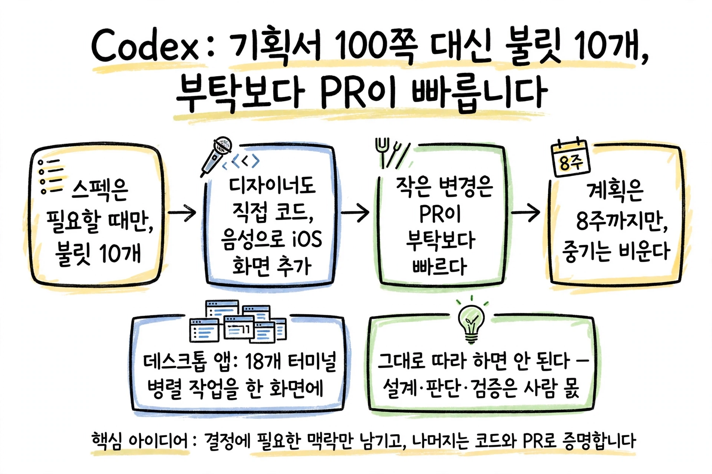
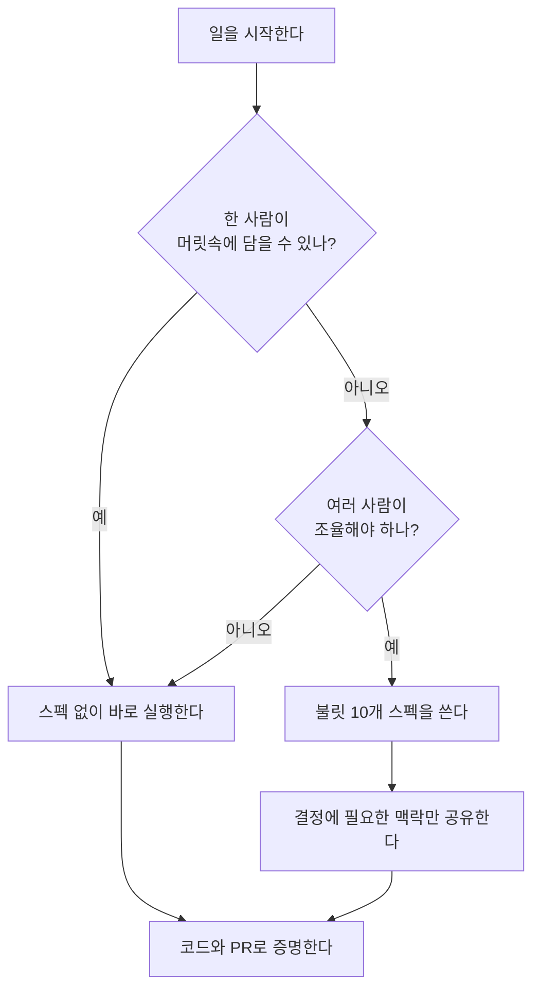
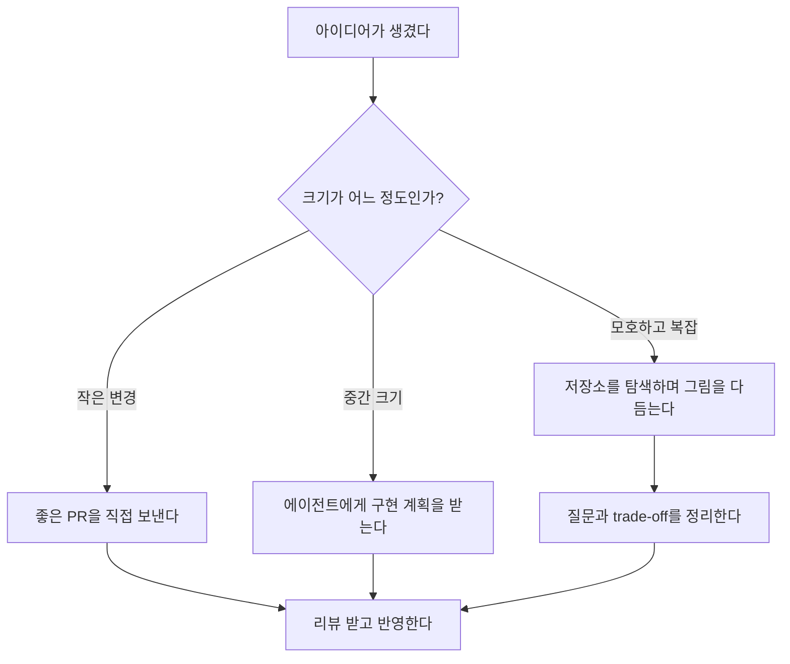
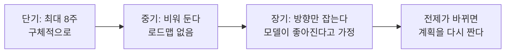

# Codex: 기획서 100쪽 대신 불릿 10개, 부탁보다 PR이 빠릅니다

> **Summary**
> Codex 팀은 문서가 필요한 경우에만 불릿 10개 안팎으로 핵심 맥락을 정리하고, 작은 변경은 직접 PR을 보내며 중간 규모 작업은 에이전트의 계획을 검토합니다. 모델이 빠르게 바뀌므로 구체적인 계획은 최대 8주까지만 세우고, 코드와 PR로 아이디어를 검증합니다. 에이전트가 많은 코드를 작성해도 설계와 판단, 검증과 책임은 사람의 몫이며, 이런 방식은 사용자와 가깝고 기술에 익숙한 팀에서 특히 효과적입니다.

---

- Codex 팀은 기획서를 거의 쓰지 않습니다. 필요할 때 스펙은 불릿 10개면 충분합니다.
- 디자이너가 직접 코드를 고치고, 작은 변경은 부탁하는 대신 PR을 보내는 편이 더 빠릅니다.
- 계획은 8주까지만 구체적으로 세웁니다. 모델이 바뀌면 중기 로드맵은 시작 전에 만료되기 때문입니다.

기획서 쓰느라 일주일을 보낸 적 있으시죠? 요구사항을 정리하고, 검토 회의를 잡고, 결재를 기다리다 보면 정작 코드를 짤 시간은 줄어듭니다. 그런데 43분짜리 영상 하나가 그 순서를 뒤집어 놓았습니다. 기획서가 아니라 코드와 PR이 먼저 나오는 팀이 있습니다!

🎥 [동영상 보기](https://www.youtube.com/watch?v=9qXc-THAvc0)

### 스펙은 왜 10개면 될까요?

팀의 원칙은 단순합니다. 스펙은 문제가 한 사람이 머릿속에 담기 어려워질 때, 또는 여러 사람이 조율해야 할 때만 씁니다. 그 외에는 스펙을 쓰지 않습니다. 필요해도 길게 쓰지 않습니다. "불릿 10개 정도"면 끝입니다.

여기서 한 가지는 짚고 넘어가야 합니다. "제품 전체 스펙이 10개"라는 말은 사실과 다릅니다. 영상에서 나온 말은 "필요할 때 10개 정도"입니다. 문서를 안 쓰는 게 아니라, 문서가 필요한 순간을 미루는 방식입니다. 한 사람이 에이전트와 함께 이해하고 실행할 수 있는 범위 안에서는 문서보다 코드가 빠릅니다.

데모가 이를 보여줍니다. 계획 모드에서 에이전트에게 iOS 프로젝트를 가리키고 다음에 무엇을 만들지 물으면, 에이전트는 템플릿을 꺼내는 대신 코드베이스를 직접 뒤집니다. 지금 상태에 근거해 방향을 제안합니다. 계획은 회의실에서 정해지는 게 아니라 코드와 테스트 앞에서 검증됩니다.

### 디자이너가 코드를 고치면 무슨 일이 생길까요?

영상에서 가장 놀라운 대목은 디자이너입니다. 디자이너가 지금 쓰는 코드량이 6개월 전 엔지니어 한 명이 쓰던 양보다 많다고 합니다. 정확한 측정값이 아니라 팀 내부의 체감이지만, 방향은 분명합니다. 코드를 만드는 일이 쉬워지면 역할 경계가 움직입니다.

음성 프롬프트 하나로 iOS 새 화면을 추가하는 데모가 같은 이야기를 합니다. 말로 시키고, 에이전트가 코드를 고치고, 사람은 결과를 검토합니다. 손이 아니라 판단이 남는 자리입니다!

제품 담당자의 일도 세 가지로 나뉩니다. 작은 변경은 부탁하는 대신 좋은 PR을 보내는 편이 빠릅니다. 중간 크기 변경은 에이전트에게 구현 계획을 받아 검토합니다. 모호하고 복잡한 아이디어는 저장소를 탐색하며 머릿속 그림을 먼저 다듬습니다. 마지막 방식이 가장 중요합니다. 결과물이 코드가 아닐 때도 있기 때문입니다. 더 좋은 질문, 더 분명한 trade-off, 방향을 설명할 근거가 남습니다.

> "PR을 보내는 게 누군가에게 부탁하는 것보다 빠릅니다."

이 문장이 저는 가장 인상 깊었습니다. 부탁은 우선순위를 협상하는 일이고, PR은 검토받을 결과물을 내놓는 일입니다. 둘은 같은 일을 하는 게 아닙니다!

### 8주까지만 계획하는 이유는 뭘까요?

팀은 단기와 장기만 계획합니다. 단기는 최대 8주까지 구체적으로 세우고, 장기는 방향만 잡습니다. 그 사이, 중기 로드맵은 없습니다. 모델 동작이 빠르게 바뀌는데 6개월짜리 순서를 세세하게 정해 두면, 일을 시작하기도 전에 전제가 만료되기 때문입니다.

데스크톱 앱이 이 원칙의 결과물입니다. 파워유저들은 세 대의 디스플레이에 18개쯤 되는 터미널을 띄워 여러 에이전트를 동시에 돌렸습니다. 팀은 그 패턴을 앱으로 만들었습니다. 여러 작업을 위임하고 진행 상황을 한눈에 보는 화면 말입니다. 모델이 좋아지자 위임이 길어졌고, 사용자는 한 번에 더 많은 일을 맡기기 시작했습니다. 2025년 12월 18일 공개된 새 모델 이후 사용량은 두 배가 되었고, 2026년 2월 2일 맥용 앱이 나왔습니다. 그해 3월 19일 기준 주간 활성 사용자는 200만 명을 넘겼습니다.

팀 규모는 50~100명쯤 됩니다. 제품 담당자는 최근에야 두 명이 됐습니다. "해적선"처럼 돌아간다는 표현이 나올 만큼 조율은 적고 보고 체계는 단순합니다. 실행 모드에서는 피드백을 읽고 저장소를 뒤지며 출시를 돕고, 조율 모드에서는 방향과 trade-off를 정합니다.

### 그대로 따라 하면 될까요?

아닙니다. 팀 스스로도 대부분의 코드가 에이전트 생성물이라고 말하면서도, 이를 "그냥 맡기면 된다"는 식으로 포장하지 않았습니다. 시스템 설계와 판단, 검증과 책임은 여전히 사람의 몫입니다. 이 방식이 먹히는 조건도 있습니다. 만드는 사람이 사용자와 가깝고, 팀이 기술에 익숙하며, 저장소에 직접 손댈 수 있어야 합니다.

제품 담당자 역할에 대한 답도 마찬가지입니다. 역할이 사라진다는 게 아니라 빈자리를 메우는 역할로 바뀐다는 뜻입니다. 사용자를 오래 만나고 시장을 아는 사람, 큰 조직에서 조율을 맡는 사람은 여전히 필요합니다. 모든 문제에는 주인이 필요합니다. 그 주인이 꼭 제품 담당자 직함을 달 필요는 없을 뿐입니다.

문서를 줄이는 게 목표가 아닙니다. 결정에 필요한 맥락만 남기고, 나머지는 코드와 PR로 증명하는 방식입니다! 여러분 팀의 기획서는 지금 몇 쪽인가요?

