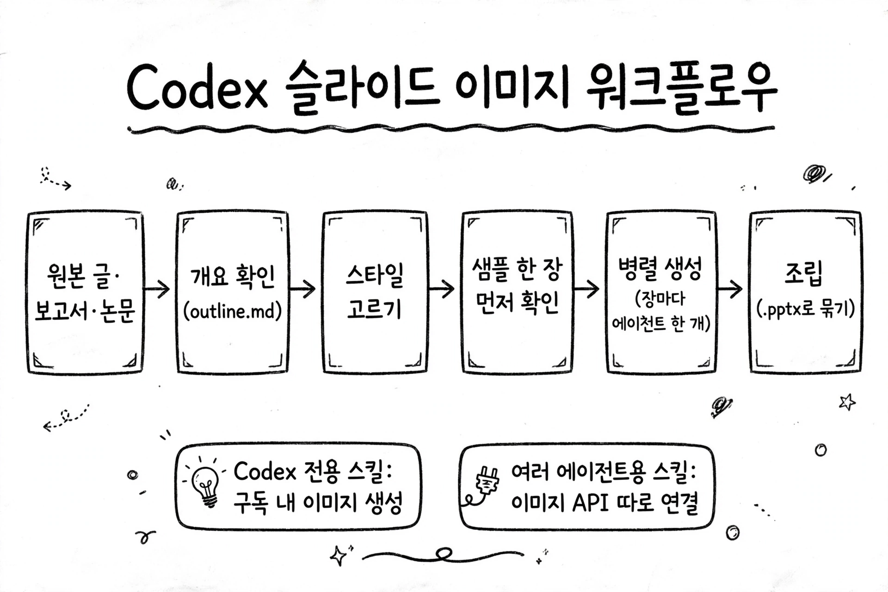
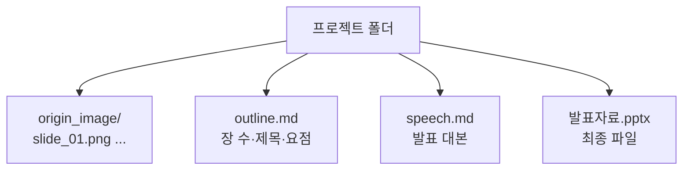
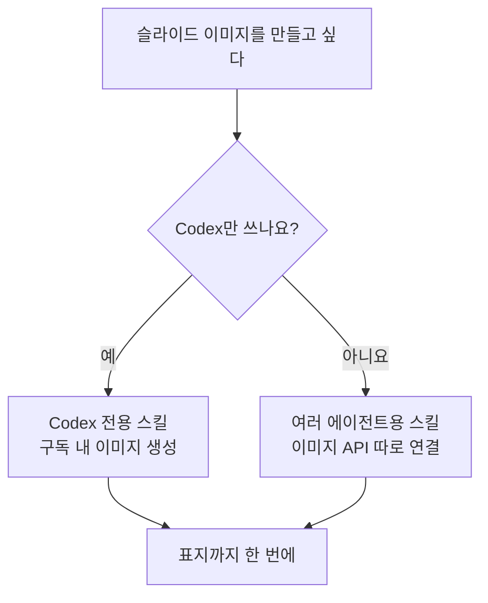

# Codex: 슬라이드, 직접 만들지 않습니다. 시키면 한 장씩 그려줍니다

> **Summary**
> Codex의 이미지 생성 기능과 슬라이드 제작 스킬을 활용하면 개요와 스타일을 확인한 뒤 슬라이드 이미지를 병렬로 만들고 .pptx로 묶을 수 있습니다. 추가 API 비용 없이 빠르게 디자인된 발표 자료를 만들 수 있지만, 각 장이 통이미지라 글자를 직접 편집할 수 없고 장마다 생성 시간과 사용량이 듭니다.

---

- Codex 안에서 슬라이드 이미지를 직접 만들 수 있습니다. 이미지 API를 따로 결제하지 않아도 됩니다.
- 개요와 스타일을 먼저 정하고 샘플 한 장을 확인한 뒤, 나머지 장을 병렬로 뽑아 `.pptx`로 묶는 흐름입니다.
- 다만 슬라이드 한 장이 통이미지라서, 글자를 나중에 고치려면 그 장을 다시 만들어야 합니다.

발표 전날 밤, 빈 타이틀 슬라이드 앞에서 커서만 깜빡이던 적 있으시죠? 내용은 머릿속에 있는데, 장표로 옮기는 손이 따라주지 않습니다. 이럴 때 Codex에게 슬라이드를 맡기면, 이제는 글자만 늘어놓지 않습니다. 한 장 한 장을 그림으로 그려서 묶어줍니다!

🎥 [동영상 보기](https://www.youtube.com/watch?v=czNkgUazQRw)

### 왜 이미지로 만들까요?

코딩 에이전트에게 슬라이드를 맡기면 보통 텍스트와 도형을 코드로 배치합니다. 깔끔하지만, 어딘가 밋밋합니다. 이미지로 만들면 다릅니다. 표지부터 내용 장까지 한 장이 통째로 디자인된 그림이 됩니다. 색감과 레이아웃, 글꼴이 장마다 따로 노는 일이 없습니다.

비결은 Codex 안에 들어 있는 이미지 생성 기능입니다. 구독에 이미 포함돼 있어서, 슬라이드용 이미지를 뽑을 때 API를 따로 결제하지 않아도 됩니다. 이 기능을 스킬이 감싸서, 개요부터 조립까지 한 흐름으로 굴려줍니다.

### 준비물은 두 가지입니다

슬라이드 이미지를 만드는 스킬은 크게 두 갈래입니다. 첫 번째는 글과 보고서, 논문, 강의 노트를 통이미지 슬라이드로 바꾸는 스킬입니다. 내장 스타일이 12종이나 있어서, 프롬프트를 잘 쓰지 못해도 고르기만 하면 됩니다. 11월 현재 별이 8,000개가 넘습니다. 두 번째는 Codex 전용으로, 이미지 생성 기능만으로 PPT와 커버 이미지까지 만드는 스킬입니다. 한 문장만 던지면 10장짜리 덱이 나온다는 게 내세우는 말입니다.

두 스킬의 차이는 뭘까요? 첫 번째는 여러 에이전트에서 돌아갑니다. Codex가 아니어도 쓸 수 있지만, 그럴 땐 이미지 생성 API를 따로 연결해야 합니다. 두 번째는 Codex에서만 돌아갑니다. 대신 구독 안에 든 이미지 생성 기능을 그대로 쓰니 추가 비용이 없습니다!

### 워크플로우는 다섯 단계입니다

흐름은 두 스킬이 비슷합니다. 먼저 원본을 읽고 개요를 짭니다. `outline.md`에 장 수와 제목, 장마다 들어갈 요점을 적어두고, 이 단계에서 확인을 받습니다. 개요가 흔들리면 열 장이 통째로 흔들리니까요.

다음은 스타일입니다. 2~3개 옵션을 보여주고 하나를 고릅니다. 마음에 드는 이미지나 기존 PPT를 올리면, 색감과 레이아웃, 글꼴을 분석해서 같은 느낌으로 만들기도 합니다. 그다음 샘플 한 장을 먼저 뽑습니다. 글자 선명도와 레이아웃 리듬, 스타일을 여기서 판단합니다. 샘플이 마음에 들면 나머지를 병렬로 뽑습니다. 장마다 서브 에이전트 하나가 맡아서, 글자 선명도와 스타일 일관성, 내용 누락을 스스로 점검합니다.

마지막은 조립입니다. 뽑은 이미지를 로컬 스크립트가 `.pptx`로 묶어줍니다. 발표 대본도 함께 만들어져서, 장마다 노트에 들어갑니다.

### 뭐가 나오나요?

결과물은 폴더 하나에 깔끔하게 모입니다. 최종 슬라이드 이미지는 `origin_image/`에 장 순서대로 쌓이고, 개요는 `outline.md`, 발표 대본은 `speech.md`에 들어갑니다. 대본은 `.pptx`의 장 노트에도 같이 박힙니다.

여기서 한 가지 재미있는 장치가 있습니다. 마음에 드는 스타일은 개인 스타일 라이브러리에 저장해 둘 수 있습니다. 스킬 설치 폴더 밖에 두기 때문에, 스킬을 업데이트하거나 다시 설치해도 사라지지 않습니다. 다음 발표 때는 저장한 스타일을 바로 꺼내 쓰면 됩니다!

### 두 스킬, 어떻게 고를까요?

고르는 기준은 간단합니다. Codex만 쓰고, 추가 비용 없이 이미지를 뽑고 싶으면 Codex 전용 스킬이 맞습니다. 표지 이미지까지 한 번에 뽑는 길도 네 갈래로 열려 있습니다. 반대로 Claude Code나 다른 에이전트에서도 같은 흐름을 쓰고 싶으면, 첫 번째 스킬이 맞습니다. 이미지 생성 API만 따로 연결하면 됩니다.

### 언제 쓰면 안 될까요?

이미지형 슬라이드에는 분명한 한계가 있습니다. 한 장이 통이미지라서, PowerPoint에서 글자를 클릭해 고칠 수 없습니다. 오타 하나를 고치려면 그 장을 다시 만들어야 합니다. 물론 한 장만 다시 만드는 건 됩니다. 전체를 다시 뽑을 필요는 없습니다.

글자를 꼭 나중에 고쳐야 한다면, 편집 가능한 형태로 바꾸는 길이 따로 있습니다. Codex 전용 스킬에는 편집 가능한 형태로 바꾸는 경로가 있고, 통이미지를 편집 가능한 PPT로 변환해 주는 스킬도 있습니다. 다만 이 경우엔 이미지형의 맛이 조금 빠집니다.

시간과 비용도 봐야 합니다. 이미지 한 장 한 장이 생성 호출이라서, 열 장이면 열 번의 생성이 쌓입니다. 이슈 게시판에는 열 장 남짓 만드는 데 시간 한도에 걸렸다는 보고도 있습니다. 급한 발표라면 장 수를 먼저 줄이는 게 낫습니다!

### 그래서, 뭐부터 하면 될까요?

발표 자료가 필요할 때, 빈 슬라이드부터 채우지 마세요. 원본 글 하나를 Codex에 건네고, 개요부터 확인해 보세요. 개요가 서면, 나머지 장은 스킬이 알아서 그려줍니다. 슬라이드는 만드는 게 아니라, 시키면 그려주는 시대가 됐습니다!

