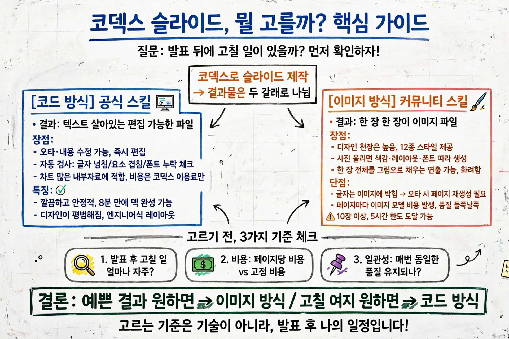
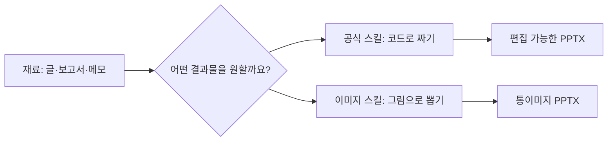
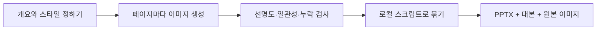
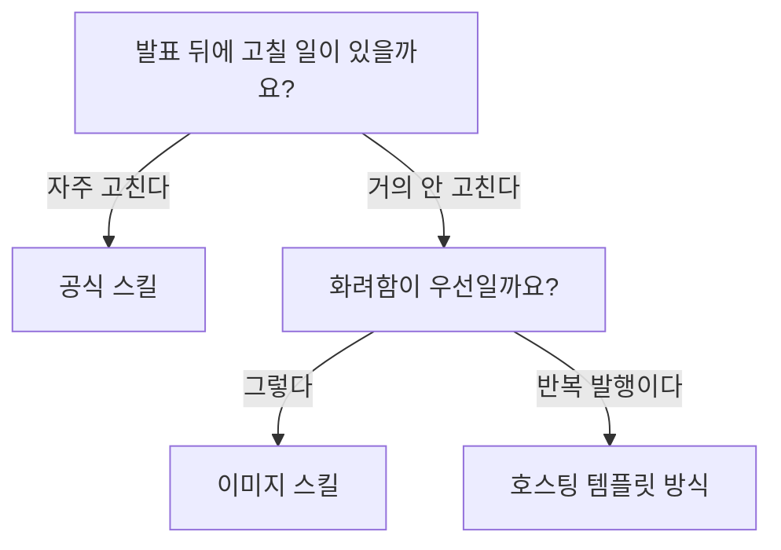

# Codex: 슬라이드 이미지, 예쁘게 뽑는 길과 고쳐 쓰는 길은 다릅니다

> **Summary**
> 코덱스로 슬라이드를 만들 때는 발표 후 수정 빈도와 디자인 요구에 따라 방식을 선택해야 합니다. 코드 기반 공식 스킬은 편집과 검수에 유리하고 추가 비용이 없지만 디자인이 평범할 수 있으며, 이미지 기반 스킬은 더 화려한 결과물을 내지만 수정 시 재생성이 필요하고 비용과 품질 변동이 따릅니다. 반복 발행에는 일관된 템플릿 방식도 적합합니다.

---

- 코덱스로 슬라이드를 만들 때, 결과물은 두 갈래로 나뉩니다. 텍스트가 살아 있는 편집 가능한 파일과, 한 장 한 장이 통째로 이미지인 파일입니다.
- 이미지 방식은 화려하지만 글자를 고치려면 다시 만들어야 하고, 코드 방식은 깔끔하지만 디자인이 평범해지는 편입니다.
- 그래서 고르기 전에, 발표 뒤에 고칠 일이 있을지를 먼저 물어봐야 합니다.

발표 자료 하나 만들어달라고 했는데, 받아든 파일을 열어보니 글자 하나 고치려고 다시 처음부터 만들어야 했던 적 있으시죠? 슬라이드를 만드는 일 자체는 쉬워졌습니다. 어려운 건 그 다음입니다. 만든 뒤에 고칠 수 있느냐는 질문입니다!

🎥 [동영상 보기](https://www.youtube.com/watch?v=srNeZzdn7ik)

### 두 가지 준비, 뭐가 준비된 걸까요?

슬라이드 이미지와 관련한 두 가지 준비가 끝났다는 소식이었습니다. 원문 게시글은 로그인 화면 뒤에 있어 전문을 직접 읽지는 못했습니다. 그래서 두 가지 준비는 그 무렵 확인되는 두 갈래 길로 정리했습니다. 하나는 코덱스에 딸려 오는 공식 슬라이드 스킬이고, 다른 하나는 커뮤니티에서 만든 이미지 기반 스킬입니다. 둘 다 같은 재료에서 출발합니다. 글, 보고서, 메모를 넣으면 슬라이드가 나옵니다. 그런데 나오는 결과물은 완전히 다릅니다.

### 결과물, 뭐가 다를까요?

공식 스킬은 자바스크립트 코드로 덱을 짭니다. `PptxGenJS`로 슬라이드를 만들고, 렌더링해서 글자 넘침과 요소 겹침, 빠진 폰트를 검사한 뒤에 넘겨줍니다. 결과는 텍스트 상자가 살아 있는 네이티브 파일입니다. 차트가 많은 내부 자료에 잘 맞습니다. 코덱스 이용료 외에 추가 비용도 없습니다.

이미지 스킬은 순서가 다릅니다. 개요와 시각 스타일을 먼저 정하고, 페이지마다 서브 에이전트가 이미지를 한 장씩 병렬로 만든 뒤, 로컬 스크립트로 묶습니다. 발표 대본인 `speech.md`와 원본 이미지가 담긴 `origin_image/` 폴더도 함께 나옵니다. 이 장면이 저는 가장 인상 깊었습니다. 슬라이드를 만드는 과정 자체가 하나의 파이프라인처럼 돌아간다는 게, 대본과 원본 이미지가 따로 나오는 모습으로 증명되니까요!

### 이미지 방식, 어디까지 예쁠까요?

이미지 방식의 천장은 높습니다. 내장 스타일 12종이 있고, 마음에 드는 이미지나 PDF를 올리면 색감과 레이아웃, 글꼴을 분석해서 같은 느낌으로 새 자료를 만듭니다. 한 장 전체를 그림으로 채우는 연출은 코드로 짜는 레이아웃이 흉내 내기 어려운 영역입니다. 그래서 보기만 하면 이미지 방식이 이긴 것처럼 느껴집니다.

하지만 글자는 이미지에 박혀 있습니다. 오타 하나 고치려면 해당 페이지를 다시 만들어야 합니다. 편집이 필요하면 별도의 변환 도구를 거쳐야 합니다. 이미지 모델 비용도 페이지마다 쌓이고, 실행마다 품질이 들쭉날쭉합니다. 10여 장 분량에서 5시간 한도에 닿았다는 보고도 있습니다. 예쁜 만큼, 손이 많이 가는 방식입니다!

### 고칠 수 있는 쪽은 어디까지 갈까요?

공식 스킬의 강점은 검사 루프입니다. 렌더링한 뒤에 스스로 확인하니, 글자가 상자를 넘치는 고전적인 실패를 그 자리에서 잡습니다. 한 사례에서는 8분 만에 덱이 나왔고, 마지막에 매 슬라이드 스크린샷을 찍어 눈으로 검토했습니다. 결과는 편집 가능한 텍스트 상자였습니다. 고칠 수 있다는 건, 발표 전날 밤에 오타를 고칠 수 있다는 뜻입니다.

다만 디자인은 한계가 있습니다. 코드로 레이아웃을 짜다 보니 엔지니어처럼 조합하게 되고, 깔끔하지만 평범한 쪽으로 기울기 쉽습니다. 차트 많은 업무용 덱은 잘 맞고, 시각 스토리텔링이 중요한 덱은 아쉬울 수 있습니다. 그럴 땐 템플릿을 호스팅에서 받아오는 방식도 있습니다. 빠른 모드는 디자인이 잡힌 템플릿에 내용을 채워 편집 가능한 파일을 돌려주고, 신규 가입 크레딧 500개면 빠른 모드 50쪽 정도를 만들 수 있습니다.

### 뭘 조심해야 할까요?

고를 때 기준은 세 가지입니다. 첫째, 발표 뒤에 고칠 일이 얼마나 자주 생길지입니다. 자주 고치면 이미지 방식은 매번 재생성이라는 대가를 치릅니다. 둘째, 비용입니다. 공식 스킬은 추가 비용이 없고, 이미지 방식은 페이지마다 이미지 모델 비용이 붙고, 호스팅 방식은 크레딧을 씁니다. 셋째, 일관성입니다. 공식 스킬은 모델에 따라 달라지고, 이미지 방식은 모델과 이미지 모델 둘 다에 따라 달라집니다. 템플릿 기반 호스팅은 40번째 실행도 첫 번째와 비슷하게 나옵니다. 매주 반복 발행하는 자료라면 이 차이가 큽니다!

예쁜 결과물을 원하면 이미지에 맡기고, 고칠 여지를 남기려면 코드에 맡기면 됩니다. 둘 다 코덱스 안에서 돌아가니, 고르는 기준은 기술이 아니라 발표 뒤의 내 일정입니다.

