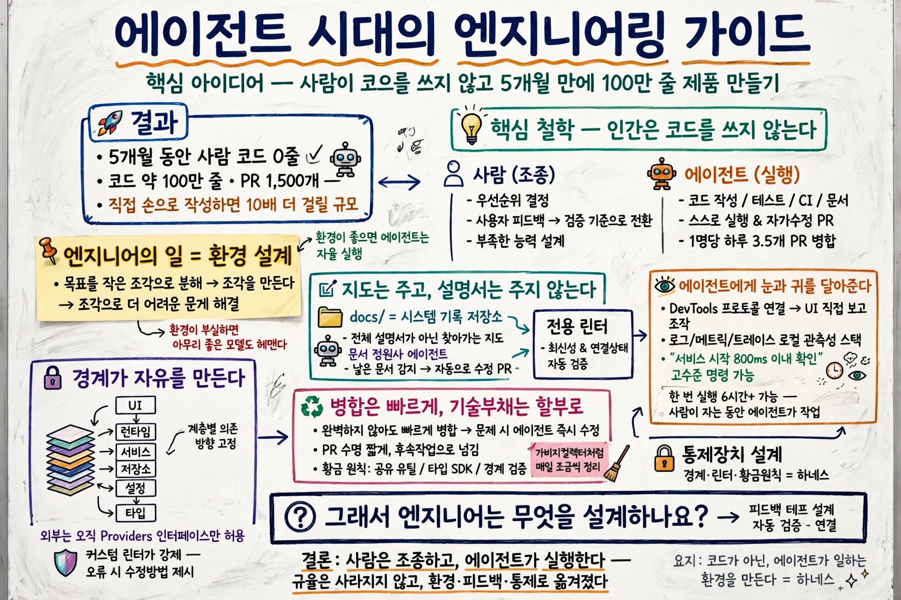
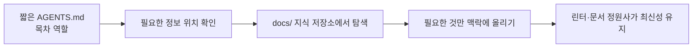
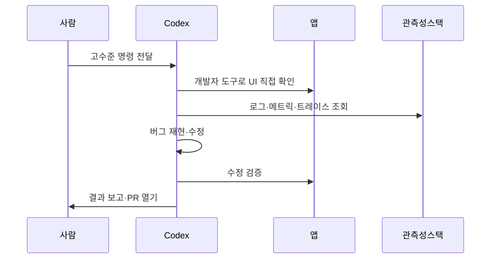
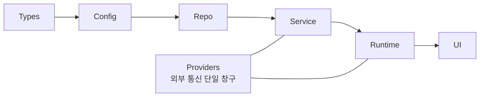

# Codex: 인간은 코드를 쓰지 않습니다, 환경을 설계합니다

> **Summary**
> 5개월간 약 100만 줄의 코드와 1,500개의 PR을 에이전트가 작성한 사례는 엔지니어의 역할이 코딩에서 환경 설계와 의도 명세로 바뀌고 있음을 보여줍니다. 짧은 안내서와 구조화된 지식 저장소, 에이전트가 직접 활용하는 관측성 도구, 린터와 명확한 규칙이 자율적이고 안정적인 작업을 뒷받침합니다. 핵심은 코드를 직접 만드는 대신 에이전트가 잘 만들 수 있는 환경과 피드백·통제 체계를 설계하는 것입니다.

---

- 5개월 동안 사람이 코드를 한 줄도 쓰지 않고 제품을 만들었습니다. 약 100만 줄의 코드, 1,500개의 PR, 전부 에이전트가 썼습니다.
- 엔지니어의 일은 코딩에서 환경 설계와 의도 명세로 바뀌었습니다. 사람이 조종하고, 에이전트가 실행합니다.
- 비결은 지도가 되는 짧은 설명서, 에이전트가 직접 보고 듣는 관측성, 그리고 경계를 강제하는 린터와 황금 원칙입니다.

## 에이전트에게 맡기고, 결국 사람이 고친 적 있으시죠?

AI 코딩 도구에게 기능 하나를 맡겼습니다. 돌아오니 동작은 하는데, 손대야 할 곳이 여기저기 보입니다. 결국 사람이 직접 고치는 게 빠르다고 느끼신 적 있으시죠? 그런데 5개월 동안 사람이 코드를 한 줄도 쓰지 않고 제품을 끝까지 만든 팀이 있습니다. 약 100만 줄의 코드, 1,500개의 PR, 전부 에이전트가 썼습니다. 직접 손으로 짰다면 10배는 더 걸렸을 거라는 게 이 팀의 계산입니다!

🎥 [동영상 보기](https://www.youtube.com/watch?v=HFM3se4lNiw)

## 핵심 철학, 인간은 코드를 쓰지 않습니다

이 팀의 규칙은 하나였습니다. 사람이 직접 코드를 쓰지 않는다. 처음부터 빈 저장소에서 시작했습니다. 첫 커밋은 2025년 8월 말이었습니다. 앱 로직, 테스트, CI 설정, 문서, 관측성, 내부 도구까지 모든 줄을 에이전트가 썼습니다. 심지어 에이전트에게 일하는 법을 알려주는 설명서 파일까지 에이전트가 썼습니다. 엔지니어 한 명당 하루 3.5개의 PR이 병합됐고, 나중에는 팀이 3명에서 7명으로 늘었는데도 속도는 오히려 올랐습니다.

역할이 갈렸습니다. 사람이 조종하고, 에이전트가 실행합니다. 사람은 우선순위를 정하고, 사용자 피드백을 검증 기준으로 바꾸고, 결과를 확인합니다. 에이전트가 막히면 "더 열심히 해"가 아니라 "무슨 능력이 부족한가?"를 묻습니다. 부족한 능력을 만들어주는 게 사람의 일입니다. 이 장면이 저는 가장 인상 깊었습니다. 문제를 고치는 게 아니라, 문제를 고칠 능력을 심어주는 방향으로 일이 바뀌니까요!

## 엔지니어의 일, 환경 설계가 됐습니다

처음에는 진도가 생각보다 느렸습니다. 에이전트가 못해서가 아니었습니다. 일할 환경이 부족했기 때문입니다. 도구도, 추상화도, 내부 구조도 없었습니다. 그래서 팀은 깊이 파고드는 방식으로 일했습니다. 큰 목표를 작은 조각으로 나누고, 조각을 하나씩 만들게 하고, 그 조각으로 더 어려운 일을 풀었습니다.

이게 엔지니어링의 진화 방향입니다. 직접 만드는 것에서, 만드는 시스템을 만드는 것으로. 환경이 잘 설계돼 있으면 에이전트는 스스로 일합니다. 환경이 부실하면 아무리 좋은 모델도 헤맵니다. 무엇을 만들지가 아니라, 어떤 환경에서 만들지를 설계하는 게 엔지니어의 일이 됐습니다.

## 지도는 주고, 설명서는 주지 않는다?

문맥은 희소한 자원입니다. 에이전트에게 방대한 문서를 한 번에 던지면 오히려 노이즈가 됩니다. 그래서 이 팀은 거대한 설명서 파일 하나를 버렸습니다. 대신 구조화된 지식 저장소를 만들었습니다. `docs/` 디렉토리가 시스템의 기록이 됐습니다. 짧은 `AGENTS.md`는 목차 역할만 합니다. 대략 100줄, 전체 지도가 아니라 어디에 무엇이 있는지 알려주는 목차입니다.

에이전트는 필요한 순간에 필요한 정보만 찾습니다. 점진 공개입니다. 전용 린터가 지식 저장소의 최신성과 연결 상태를 검사하고, 문서 정원사 에이전트가 낡은 문서를 찾아 고치는 PR을 엽니다. 이 구조가 저는 가장 와닿았습니다. 설명서를 두껍게 만드는 게 아니라, 찾아갈 지도를 얇게 만드는 게 답이니까요!

## 에이전트에게 눈과 귀를 달아줍니다

사람의 개입을 줄이려면 에이전트가 앱 상태를 스스로 파악해야 합니다. 이 팀은 브라우저 개발자 도구 프로토콜을 에이전트 런타임에 연결했습니다. 에이전트가 UI를 직접 보고 조작합니다. 로그, 메트릭, 트레이스도 에이전트가 쿼리할 수 있는 로컬 관측성 스택을 만들었습니다.

그래서 "서비스 시작 시간이 800ms 이내인지 확인하라" 같은 고수준 명령이 그대로 통합니다. 에이전트가 버그를 재현하고, 수정을 검증합니다. 한 번의 실행이 6시간 넘게 이어지는 경우도 흔합니다. 사람이 자는 동안 에이전트가 일하는 구조입니다. 에이전트가 보지 못하는 것은 존재하지 않는 것과 같습니다. 문서나 채팅, 사람의 머릿속에만 있는 지식은 에이전트에게 닿지 않습니다. 그래서 맥락을 저장소 안으로 계속 끌어오는 게 중요해집니다.

## 경계가 자유를 만듭니다

모든 코드를 에이전트가 쓴다고 무질서가 되는 건 아닙니다. 오히려 명확한 경계와 규칙 안에서 에이전트는 더 잘 돌아갑니다. 이 팀은 업무 영역마다 고정된 계층을 정했습니다. 타입, 설정, 저장소, 서비스, 런타임, UI 순서로만 의존할 수 있습니다. 외부 통신은 `Providers`라는 하나의 인터페이스로만 들어옵니다. 나머지는 기계적으로 막힙니다.

사람의 취향도 문서나 리뷰에만 남기지 않았습니다. 검증 가능한 규칙으로 만들었습니다. 구조화된 로깅, 네이밍 규칙, 파일 크기 제한 같은 것들입니다. 커스텀 린터가 이를 강제하고, 오류 메시지에 바로 고치는 방법까지 담아줍니다. 제약이 자율성을 보장하는 역설이 여기서 나옵니다. 경계 안에서는 자유롭게, 경계 밖으로는 나가지 못하게. 이게 플랫폼 팀이 하는 일과 닮았습니다.

## 병합은 빠르게, 기술 부채는 할부로

에이전트의 속도가 사람을 압도하면서 병합 관습도 바뀌었습니다. 수정은 저렴하고 기다림은 비쌉니다. 완벽하지 않은 코드라도 빠르게 병합하고, 문제가 생기면 에이전트가 바로 고칩니다. PR 수명은 짧아졌고, 테스트 실패는 무한정 기다리지 않고 후속 작업으로 넘깁니다.

기술 부채도 같은 방식입니다. 한 번에 갚는 일시불이 아니라, 아주 빠른 속도로 나눠 갚는 할부입니다. 에이전트가 기존 패턴을 복제하면서 나쁜 패턴까지 퍼뜨리는 문제를 막기 위해 황금 원칙을 정했습니다. 공유 유틸리티를 쓰고, 데이터 경계를 검증하고, 타입 있는 SDK에 기대는 식입니다. 백그라운드 에이전트가 이를 어긴 코드를 찾아 정리하는 PR을 엽니다. 예전에는 금요일마다, 일주일의 20%를 이런 정리에 썼습니다. 이제는 가비지 컬렉터처럼 매일 조금씩 치웁니다!

## 그래서, 엔지니어는 무엇을 설계하나요?

하나의 프롬프트로 끝까지 가는 단계에 이미 와 있습니다. 코드 상태를 확인하고, 버그를 재현하고, 영상으로 기록하고, 고치고, 검증하고, PR을 열고, 피드백에 답하고, 병합까지. 사람이 나서는 건 판단이 필요할 때뿐입니다.

아직 모르는 것도 있습니다. 수년이 지나면 에이전트가 만든 시스템의 구조가 어떻게 변할지, 사람의 판단이 가장 큰 힘을 내는 지점이 어디인지 말입니다. 분명한 건 하나입니다. 소프트웨어를 만드는 규율은 사라지지 않았습니다. 다만 코드가 아니라, 코드를 둘러싼 환경과 피드백 루프, 통제 장치로 자리를 옮겼습니다. 에이전트 시대의 엔지니어링, 그 중심에는 하네스가 있습니다!

