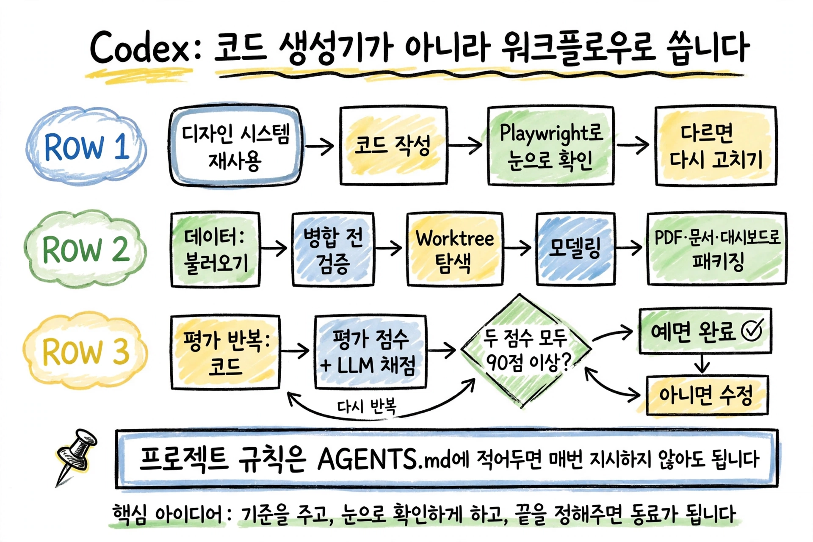
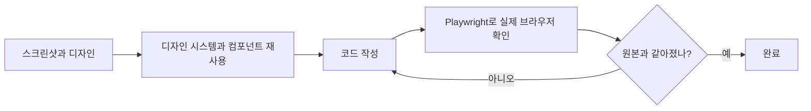
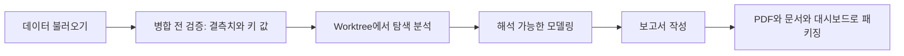
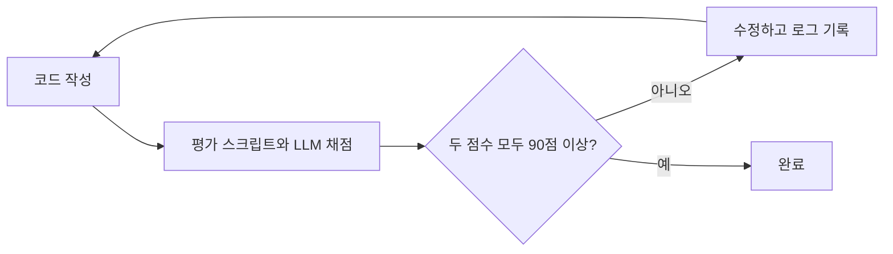

# Codex: 코드 생성기로 쓰면 손해입니다. 워크플로우로 써야 생산성이 됩니다

> **Summary**
> Codex의 생산성을 높이려면 코드 생성만 맡기지 말고, 기존 디자인 시스템 재사용, 브라우저에서의 시각적 검증, 데이터 분석 절차, 평가 점수와 종료 조건을 포함한 반복 워크플로우로 활용해야 합니다. 프로젝트 규칙을 AGENTS.md에 기록하면 맥락과 기준을 매번 설명하지 않아도 일관되게 작업할 수 있습니다.

---

- Codex를 코드 생성기로만 쓰면 흔한 결과만 나옵니다. 워크플로우로 써야 생산성이 달라집니다.
- 핵심은 세 가지입니다. 기존 디자인 시스템 재사용, 눈으로 직접 확인하는 검증 루프, 끝을 정해두는 평가 반복입니다.
- 여기에 프로젝트 규칙을 문서로 적어두면, 매번 지시하지 않아도 맥락을 아는 실무자처럼 움직입니다.

스크린샷 하나 던져주고 "이대로 만들어 줘"라고 했는데, 어디서 본 듯한 기본 UI가 나왔던 적 있으시죠? 버튼은 멀쩡한데, 우리 서비스 같지가 않습니다. 문제는 모델 실력이 아니라 시키는 방식입니다!

🎥 [동영상 보기](https://www.youtube.com/watch?v=hhdpnbfH6NU)

## 코드만 짜게 시키면, 왜 흔한 UI만 나올까요?

스크린샷이나 디자인 링크를 던져주고 "코드로 만들어 줘"라고만 하면, 흔한 기본 UI가 나오기 십상입니다. 모델은 참고할 기준이 없으니 평균적인 답을 내는 거죠.

올바른 순서는 다릅니다. 먼저 기존 프로젝트의 디자인 시스템과 컴포넌트를 재사용하도록 강제합니다. 그 다음에 코드를 짜게 합니다. 그리고 여기서 끝이 아닙니다. `Playwright`로 코드가 짠 화면을 실제 브라우저에서 띄우고, 원본 이미지와 시각적으로 비교하게 합니다. 모바일, 데스크톱, 해상도별로 확인하면서 완벽해질 때까지 스스로 레이아웃을 고치게 만드는 겁니다!

이 장면이 가장 인상 깊었습니다. 검증까지 맡기면, 코드 생성기가 아니라 화면을 책임지는 동료가 되니까요.

## 데이터 작업, 순서가 따로 있을까요?

데이터 작업에도 정해진 루프가 있습니다. 데이터를 불러온 뒤, 병합하기 전에 먼저 결측치와 키 값을 프로파일링합니다. 합치고 나서 문제를 발견하면 이미 늦으니까요!

시각화나 가설 검증은 별도의 `Git Worktree`를 파서 진행합니다. 메인 코드가 오염되지 않게 하려는 겁니다. 탐색이 끝나면 해석 가능한 모델링으로 정리하고, 마지막에 결과 보고서를 씁니다.

최종 결과물도 중요합니다. 일회성 노트북 뷰가 아니라, 경영진이 볼 수 있는 PDF나 문서 리포트, 혹은 배포 가능한 대시보드 형태로 패키징하도록 지시하는 게 핵심입니다.

## 한 번에 다 시키면 안 될까요?

올바른 출발점은 좁고 명확한 한 가지 사용자 목표입니다. 핵심 도구는 3~5개면 충분합니다. 목표가 넓으면 에이전트도 헤맵니다.

작업은 잘게 쪼개서 지시합니다. 기획, 뼈대 코드 작성, 익명·읽기 전용 테스트, 꼭 필요한 곳에만 `OAuth` 추가, 배포 및 검토 순서로 말이죠. 한 번에 구현하려 하면 어디서 틀어졌는지 알 수 없습니다.

그리고 낡은 문법 실수를 막는 장치가 있습니다. `$openai-docs` 스킬을 연결하면, Codex가 최신 API 문서를 먼저 읽고 코드를 짭니다. 문서부터 읽게 하면 오래된 패턴을 가져오는 실수가 줄어듭니다!

## 정답이 없는 문제는 어떻게 시키죠?

단번에 정답이 나오지 않는 최적화 문제나, 주관적인 품질 평가가 필요한 작업은 평가 기반 반복 루프로 해결합니다. 점수를 잴 수 있는 평가 스크립트와 LLM 기반 채점 기준을 Codex에게 주고, 두 점수가 모두 90점을 넘을 때까지 계속 고치라고 명확한 종료 조건을 주는 겁니다!

각 반복마다 무엇이 변했고 점수가 어떻게 달라졌는지 로그를 남기게 하면, 작업이 오래 걸려도 방향을 잃지 않습니다. 끝이 정해져 있으니, 무한 반복에 빠질 걱정도 없습니다.

## 규칙은 매번 말해야 할까요?

아닙니다. 프로젝트의 헌법 같은 규칙을 `AGENTS.md` 파일에 적어두면 됩니다. 팀의 파이썬 환경, 데이터 저장 폴더 규칙, 코드 리뷰 기준 같은 것들이죠. "절대 원본 데이터를 덮어쓰지 말 것", "보안 위협은 P0로 분류" 같은 규칙이 여기에 들어갑니다.

Codex는 매번 프롬프트로 지시하지 않아도 이 파일을 읽고 프로젝트의 맥락과 팀의 규칙을 따르며 자율적으로 움직입니다. 규칙을 문서로 적는 한 번의 수고가, 매번 설명하는 수고를 없애줍니다.

코드 생성기와 워크플로우의 차이는, 무엇을 시키느냐가 아니라 어떻게 시키느냐에 있습니다. 기준을 주고, 눈으로 확인하게 하고, 끝을 정해주면, Codex는 지시받는 도구가 아니라 함께 일하는 동료가 됩니다.

