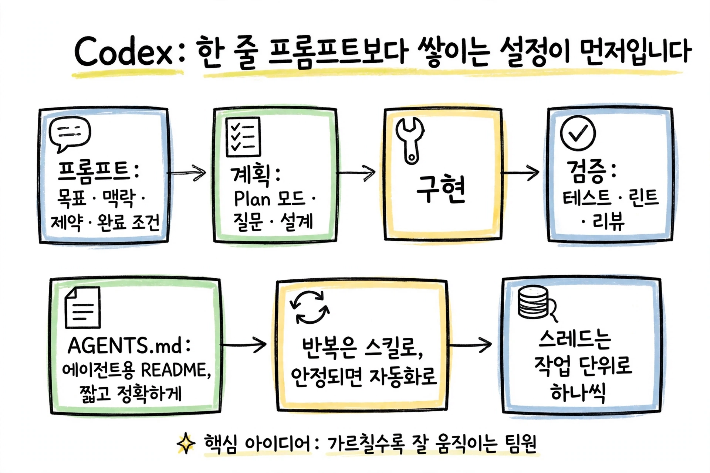
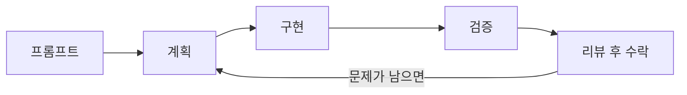
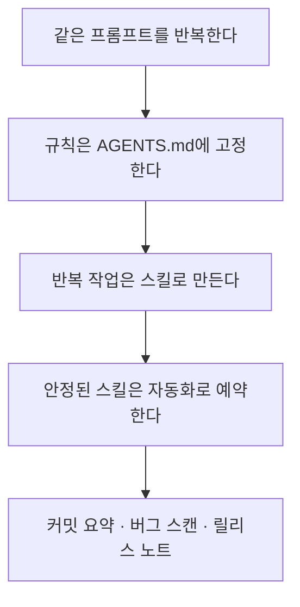
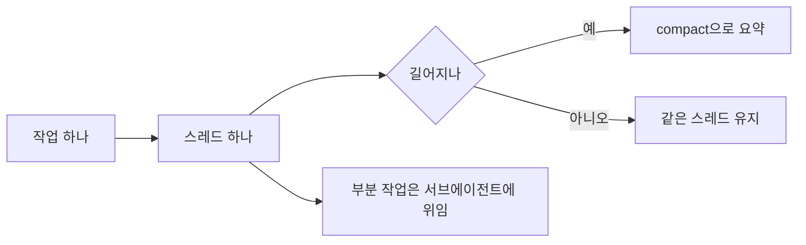

# Codex: 한 줄 프롬프트보다 쌓이는 설정이 먼저입니다

> **Summary**
> Codex는 터미널·에디터·앱에서 활용하는 코딩 에이전트로, 목표·맥락·제약·완료 조건을 명확히 제시하고 AGENTS.md에 규칙을 쌓아 일관된 결과를 얻을 수 있습니다. 복잡한 작업은 계획부터 세우고 테스트·린트·리뷰까지 검증하며, 반복 작업은 스킬로 묶고 충분히 신뢰할 수 있을 때 자동화하세요. 권한은 신중히 관리하고 스레드는 작업별로 나누는 것이 중요합니다.

---

- Codex는 터미널·에디터·앱 세 곳에서 돌아가는 코딩 에이전트입니다. 코드만 짜는 도구가 아니라, 계획하고 검증하고 리뷰까지 맡기는 팀원 쪽에 가깝습니다.
- 잘 쓰는 비결은 프롬프트 한 줄이 아니라 쌓이는 설정입니다. 목표·맥락·제약·완료 조건을 주고, `AGENTS.md`로 규칙을 고정하고, 반복되는 일은 스킬과 자동화로 넘기면 됩니다.
- 처음에는 권한을 조이게 두고, 검증 루프를 끝까지 돌리는 게 먼저입니다. 테스트·린트·리뷰까지 확인하고 나서야 결과를 받아들이면 됩니다.

새 기능 하나 부탁했는데, 엉뚱한 파일만 건드리고 테스트도 안 돌린 채 "완료했습니다"라고 말하는 장면, 본 적 있으시죠? 문제는 모델 실력이 아닐 때가 많습니다. 시키는 방법이 문제인 경우가 훨씬 많습니다!

🎥 [동영상 보기](https://www.youtube.com/watch?v=hhdpnbfH6NU)

## Codex, 어디까지 쓰는 도구일까요?

Codex는 얼굴이 세 개입니다. 터미널에서 쓰는 CLI, 에디터 안에서 쓰는 IDE 확장, 그리고 Codex 앱입니다. 세 곳이 설정을 공유해서, 한 곳에서 다듬은 방식이 다른 곳에서도 그대로 이어집니다.

쓰임새도 코드 작성에만 머물지 않습니다. 스프레드시트를 합치고 대시보드를 만드는 데이터 분석, 주간 요약과 의사결정 메모 같은 문서 작업, 회의 준비와 일정 정리, 이메일 백로그 정리까지 맡길 수 있습니다. 웹 개발·게임·네이티브 앱·보안·금융·교육처럼 분야별 모음도 따로 마련돼 있습니다.

그래서 출발점부터 달라져야 합니다. 일회성 비서로 부르는 게 아니라, 설정하고 개선해 가는 팀원으로 대하는 겁니다. 이 전환이 안 되면, 아무리 좋은 모델을 써도 결과는 제자리입니다.

## 프롬프트는 네 가지만 챙기면 될까요?

복잡한 저장소에서 가장 큰 차이를 만드는 건 맥락입니다. 프롬프트에 네 가지만 담으면 됩니다. 목표, 맥락, 제약, 완료 조건입니다. 바꿀 파일과 참고할 문서는 `@`로 콕 집어 주고, 재현 단계와 검증 명령까지 함께 주면, 결과는 훨씬 검증하기 쉬워집니다!

난이도에 따라 추론 수준도 고릅니다. 빠르고 범위가 좁은 일은 Low, 복잡한 변경이나 디버깅은 Medium이나 High, 긴 호흡의 에이전트 작업은 Extra High가 맞습니다. 무작정 높게 두는 게 능사가 아닙니다. 작업에 맞는 수준을 골라서 써 보는 게 먼저입니다.

맥락을 넣는 속도가 아쉬우면, 앱 안에서 음성 받아쓰기로 말하듯 지시하는 방법도 있습니다. 타이핑보다 말이 빠를 때가 있으니까요.

## 코딩 전에 계획을 세우게 하면 뭐가 달라질까요?

복잡하거나 애매한 일은 코드부터 짜게 하지 말고, 계획부터 세우게 하면 됩니다. 가장 쉬운 방법은 Plan 모드입니다. `/plan`이나 `Shift+Tab`으로 켜면, 맥락을 모으고 질문을 던진 뒤 계획을 세우고 나서 구현합니다.

아이디어가 아직 흐릿하면 인터뷰를 시키면 됩니다. 질문을 던지게 하고, 가정을 따지게 해서, 흐릿한 생각을 구체적인 작업으로 바꾸는 겁니다. 긴 작업에는 `PLANS.md` 같은 실행 계획서 템플릿을 정해 두면, 여러 단계를 밟아도 방향을 잃지 않습니다.

계획이 좋은 이유는 단순합니다. 계획이 있으면 검토할 기준이 생기고, 기준이 있으면 결과물을 믿을 수 있습니다.

## `AGENTS.md`는 왜 에이전트용 README일까요?

프롬프트 패턴이 자리 잡으면, 매번 반복하지 말고 파일에 고정하면 됩니다. `AGENTS.md`는 에이전트용 README입니다. 자동으로 맥락에 실려서, 저장소 구조·실행법·빌드·테스트·린트 명령·규칙·하지 말아야 할 일·완료 기준을 매번 알려줍니다.

처음 만들 때는 `/init` 명령으로 초안을 뽑고, 팀이 실제로 일하는 방식에 맞게 다듬으면 됩니다. 파일은 계층이 있습니다. 개인 기본값은 전역 파일, 팀 규칙은 저장소 루트, 세부 규칙은 하위 디렉터리에 두고, 가장 가까운 파일의 지시가 이깁니다.

여기서 핵심은 짧고 정확하게! 긴 모호한 규칙보다 짧은 규칙이 훨씬 낫습니다. 규칙은 실수가 반복될 때만 추가하고, 같은 실수가 두 번 나오면 회고를 시켜서 원인을 규칙에 반영하면 됩니다. 파일이 커지면 세부 내용은 다른 문서에 두고 참조만 남기면 됩니다.

## 검증은 누가 하나요?

변경만 시키고 끝내면 안 됩니다. 테스트를 만들고, 관련 스위트를 돌리고, 린트·포맷·타입 검사를 확인하고, 동작이 맞는지 보고, diff를 리뷰하는 것까지가 한 번의 일입니다. 이 검증 루프는 프롬프트나 `AGENTS.md`에 "좋다"는 기준이 적혀 있을 때만 제대로 돕니다.

리뷰는 `/review` 명령으로 갈래를 나눠서 맡길 수 있습니다. 기준 브랜치 대비 PR식 리뷰, 미커밋 변경 리뷰, 커밋 리뷰, 맞춤 지시 리뷰가 있습니다. 팀 리뷰 기준을 `code_review.md`에 적어 `AGENTS.md`에서 참조하면, 리뷰 방식이 저장소마다 달라지지 않습니다.

공식 사례도 있습니다. 내부에서는 모든 PR을 Codex가 리뷰합니다. GitHub 연동으로 자동 리뷰를 켜거나, PR에서 멘션으로 부를 수 있습니다. 코드만 짜는 도구가 아니라, 검증까지 책임지는 팀원이라는 말이 괜히 나온 게 아닙니다.

## 외부 도구와 반복 작업은 어떻게 맡길까요?

필요한 맥락이 저장소 밖에 있으면 MCP를 씁니다. 외부 도구와 시스템을 연결하는 표준이라, 정보를 복사해 붙여넣는 수고를 덜어줍니다. 단, 처음부터 모든 도구를 연결하지는 않습니다. 자주 반복하는 수작업을 없애 주는 도구 한두 개부터 시작하는 게 맞습니다.

반복되는 프롬프트는 스킬로 묶습니다. `SKILL.md`에 방법·맥락·자산을 담아두면, CLI·IDE·앱 어디서든 같은 방식으로 돕니다. 설명문이 가장 중요합니다. 스킬이 뭘 하고 언제 쓰이는지, 실제로 쓸 법한 말로 적어야 합니다. 로그 분류·릴리스 노트 초안·PR 체크리스트 리뷰·마이그레이션 계획처럼 되풀이되는 일이 좋은 재료입니다.

일이 손으로 돌려서 믿을 만해지면, 자동화로 예약합니다. 커밋 요약·버그 스캔·릴리스 노트 초안·CI 실패 확인·스탠드업 요약을 정해진 주기로 백그라운드에서 돌리는 겁니다. "스킬은 방법을, 자동화는 일정을 정합니다." 다만 손으로 돌려서 믿을 만해지기 전에는 자동화하지 않습니다!

## 흔히 하는 실수, 뭐가 있을까요?

공식 가이드가 꼽은 실수는 일곱 가지입니다. 프롬프트에 고정 규칙을 몰아넣기, 빌드·테스트 명령을 안 알려주기, 여러 단계 작업에서 계획 생략하기, 워크플로를 이해하기도 전에 모든 권한 열어주기, 같은 파일에서 스레드를 나란히 돌리기, 손으로 믿을 만해지기 전에 자동화 걸기, 스레드를 프로젝트 단위로 쓰기입니다.

스레드 관리가 특히 중요합니다. 스레드는 작업 단위로 하나씩 쓰는 게 원칙입니다. 길어지면 `/compact`으로 요약하고, 갈라지면 `/fork`로 나누고, 부분 작업은 서브에이전트에 넘기면 됩니다. 스레드를 프로젝트 단위로 쓰면 맥락이 부풀어서 결과가 점점 나빠집니다.

결론은 단순합니다. Codex는 시키는 대로 움직이는 도구가 아니라, 가르칠수록 잘 움직이는 팀원입니다. 스레드는 작업 단위로 하나씩! `AGENTS.md` 한 장부터 시작하면 됩니다.

