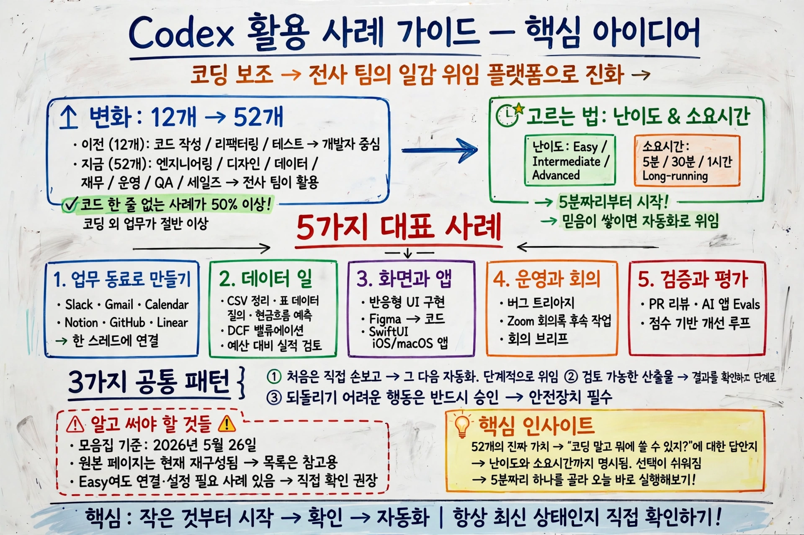
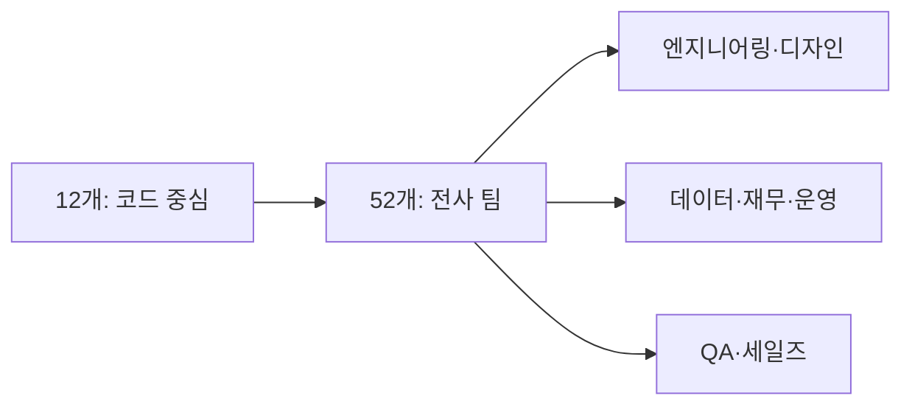
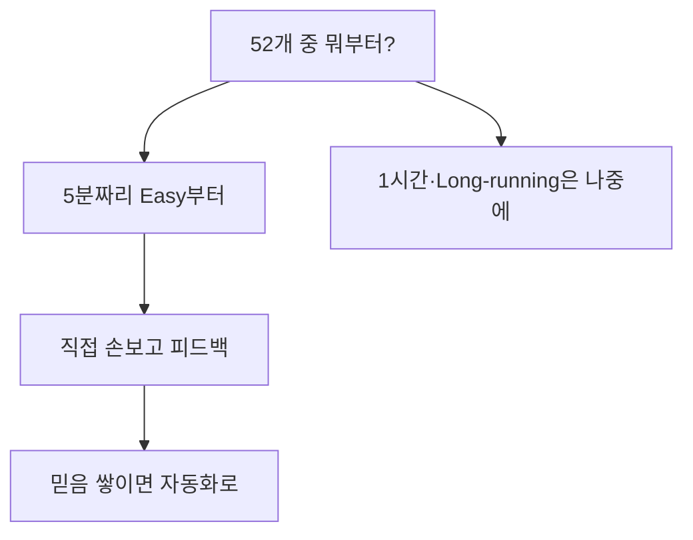
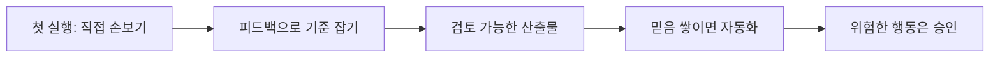

# Codex: 활용 사례가 12개에서 52개로 늘었습니다. 코딩 도구가 아니라 팀 전체의 일감 창구가 됩니다

> **Summary**
> Codex 활용 사례 모음이 12개에서 52개로 늘며, 코딩 보조를 넘어 엔지니어링·디자인·데이터·재무·운영·QA·세일즈까지 전사 팀이 일감을 위임하는 플랫폼으로 바뀌었습니다. 사례마다 난이도와 소요시간이 붙어 있어 5분짜리부터 골라 시작하면 되고, 처음은 직접 손보고 믿음이 쌓이면 자동화로 넘기는 순서가 반복됩니다. 다만 모음집은 2026년 5월 기준이고 원본 페이지는 이미 다시 정리됐으니, 목록은 참고용으로 보고 지금 쓸 수 있는지는 직접 확인하는 게 안전합니다.

---

- Codex 활용 사례 모음이 12개에서 52개로 늘었습니다. 코딩 보조를 넘어 전사 팀이 일감을 위임하는 플랫폼으로 바뀌었습니다.
- 사례마다 난이도와 소요시간이 적혀 있어, 5분짜리부터 골라 시작하면 됩니다. 처음은 직접 손보고, 믿음이 쌓이면 자동화로 넘기는 순서입니다.
- 다만 모음집은 2026년 5월 기준이고 원본 페이지는 이미 다시 정리됐습니다. 목록은 참고용으로 보고, 지금 쓸 수 있는지는 직접 확인하는 게 안전합니다.

코딩 에이전트라고 하면 코드 짜는 도구라고만 생각하기 쉽죠? 그런데 어느 날 열어본 활용 사례 모음이 52개까지 늘어나 있었습니다. 그 안에 코드 한 줄 안 나오는 일이 절반이 넘게 들어 있었습니다!

🎥 [동영상 보기](https://www.youtube.com/watch?v=MavnuV0NRwU)

## 52개, 뭐가 달라졌을까요?

예전 모음은 12개였습니다. 코드 작성, 리팩터링, 테스트 같은 개발자 일 중심이었습니다. 지금 모음은 다릅니다. 엔지니어링, 디자인, 데이터, 재무, 운영, QA, 세일즈까지 전사 팀이 쓰는 일감 창구로 포지셔닝이 옮겨갔습니다.

사례는 갈래별로 정리됐습니다. 업무 자동화와 연동, 데이터와 지식 작업, 프론트엔드와 디자인, 엔지니어링과 코드, iOS와 macOS, 평가와 품질 같은 갈래입니다. 갈래만 봐도 Codex가 어디까지 닿는지 감이 옵니다.

이 장면이 저는 가장 인상 깊었습니다. 코딩 도구가 "팀 전체의 일감 창구"가 됐다는 선언 자체가, AI 에이전트의 쓰임새가 바뀌고 있다는 신호니까요!

## 고르는 법이 있을까요? 난이도와 시간부터 봅니다

52개를 처음부터 다 읽을 필요는 없습니다. 사례마다 난이도와 소요시간이 붙어 있습니다. 난이도는 Easy, Intermediate, Advanced 세 단계입니다. 소요시간은 5분, 30분, 1시간, Long-running 네 가지입니다.

5분짜리부터 시작하면 됩니다. 지저분한 데이터 정리, 받은편지함 관리, PR 리뷰, 작은 UI 변경 같은 일입니다. 5초짜리도 있습니다. PR 리뷰는 연결만 해두면 5초 만에 첫 신호가 옵니다!

30분짜리는 피드백 정리, 데이터 질의, 슬라이드 덱, 회의 브리프 같은 일입니다. 1시간짜리는 프론트엔드 구현, 버그 트리아지, iOS 앱, DCF 모델 같은 일입니다. Long-running은 업무 동료 설정, 브라우저 게임, `/goal` 장기 작업처럼 몇 시간씩 이어지는 일입니다.

## 대표 사례, 다섯 갈래로 묶어봤습니다

**첫째, 업무 동료로 만들기입니다.** Slack, Gmail, Calendar, Notion, GitHub, Linear를 한 스레드에 연결하면 Codex가 업무 맥락을 아는 동료처럼 움직입니다. 첫 실행에서는 놓치기 쉬운 요청과 묻힌 결정을 찾아오게 하고, 유용한 것과 노이즈를 피드백합니다. 그 다음부터 같은 스레드에 자동화를 걸어 정기적으로 확인하게 만듭니다.

**둘째, 데이터 일입니다.** 지저분한 CSV와 스프레드시트는 원본을 보존한 채 정리된 사본을 만듭니다. 표 형식 데이터에 질문을 던지면 컬럼을 확인하고 계산과 차트를 만들고, HTML 시각화까지 열어볼 수 있습니다. 현금흐름 예측, DCF 밸류에이션, 예산 대비 실적 검토처럼 재무 모델도 편집 가능한 `.xlsx`로 만들어 줍니다.

**셋째, 화면과 앱입니다.** 스크린샷과 디자인 브리프를 주면 기존 디자인 시스템에 맞춰 반응형 UI를 만들고, Playwright로 직접 브라우저를 열어 확인하며 고칩니다. Figma 디자인을 코드로 옮기는 사례도 있고, SwiftUI로 iOS와 macOS 앱을 만드는 사례도 있습니다.

**넷째, 운영과 회의입니다.** 버그 신호가 모이는 곳을 순회하며 트리아지 목록을 만들고, Zoom 회의록을 후속 이메일과 CRM 업데이트 초안으로 바꿉니다. 회의 브리프는 캘린더 초대만으로 부족한 맥락을 Drive와 Slack, Gmail에서 모아 정리합니다.

**다섯째, 검증과 평가입니다.** PR 리뷰는 `AGENTS.md`에 기준을 적어두면 저장소에 맞게 돌아갑니다. AI 앱에는 Promptfoo로 Evals를 붙여 회귀를 잡습니다. 어려운 문제는 점수 스크립트와 중단 규칙을 두고 개선 루프를 돌립니다.

## 세 가지 공통 패턴이 보입니다

사례 52개를 훑어보면 같은 모양이 반복됩니다. 첫째, **처음은 직접 손보고, 그 다음 자동화**입니다. 받은편지함 관리도, 버그 트리아지도, 업무 동료 설정도 첫 실행은 캘리브레이션입니다. 어떤 메일은 무시해야 하는지, 어떤 신호가 노이즈인지 피드백한 뒤에야 정기 자동화로 넘어갑니다.

둘째, **검토 가능한 산출물**입니다. 피드백은 시트나 문서로, 데이터 분석은 차트와 보고서로, 회의 후속 작업은 초안으로 남깁니다. Codex가 만든 결과를 사람이 확인할 수 있는 형태로 받는 구조입니다.

셋째, **되돌리기 어려운 행동은 승인**입니다. 결제, 주문, 예약 확정, 초대 발송 같은 일은 Codex가 멈추고 승인을 받도록 지시하게 돼 있습니다. 메시지에서 나온 작업을 처리하는 사례에도 이 규칙이 명시돼 있습니다.

## 그 전에, 알고 써야 할 것들

한 가지 짚고 넘어갈 점이 있습니다. 이 모음집은 2026년 5월 26일 기준입니다. 원본 페이지를 직접 열어보니 같은 주소가 지금은 "ChatGPT use cases"라는 다른 페이지로 바뀌어 있었습니다. 52개 목록이 그대로 유지되는지는 지금 기준으로 확인이 안 됩니다. 목록은 방향을 잡는 참고용으로 보고, 실제 기능은 현재 공식 안내에서 확인하는 게 안전합니다.

또 하나, 사례 중에는 별도 준비가 필요한 것도 있습니다. Figma 연동, Mac 앱 플러그인, 시뮬레이터 도구 같은 것들입니다. Easy라고 적혀 있어도 연결과 설정이 먼저인 사례가 있습니다. 그리고 5초 PR 리뷰는 첫 신호까지의 시간입니다. 리뷰 자체를 다 읽고 판단하는 시간은 따로 듭니다!

52개 목록의 진짜 가치는 개수가 아닙니다. "코딩 말고 뭐에 쓸 수 있지?"라는 질문에, 난이도와 시간까지 적힌 답안지가 생겼다는 점입니다. 5분짜리 하나를 골라 오늘 직접 돌려보는 것부터 시작하면 됩니다. 그 한 번이, Codex를 코드 도구에서 업무 동료로 바꾸는 첫걸음이 됩니다.

