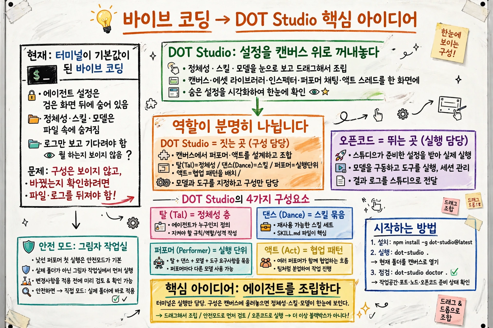
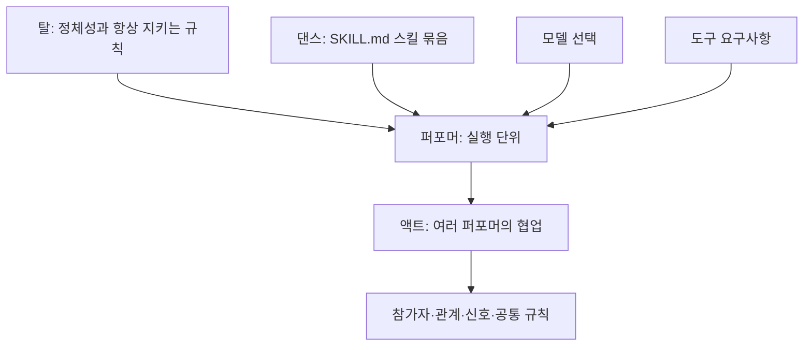
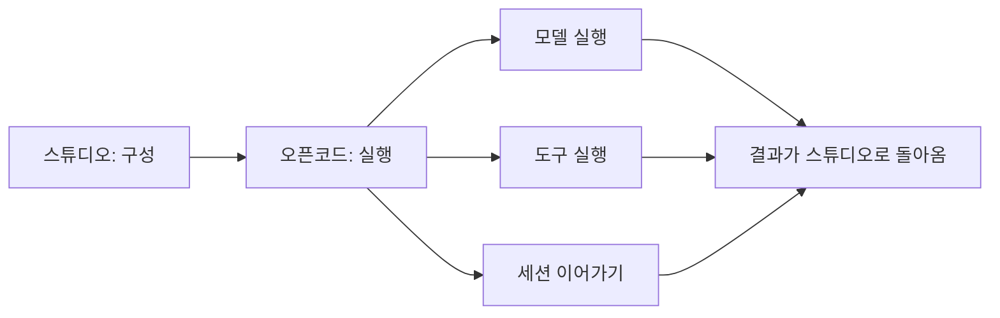
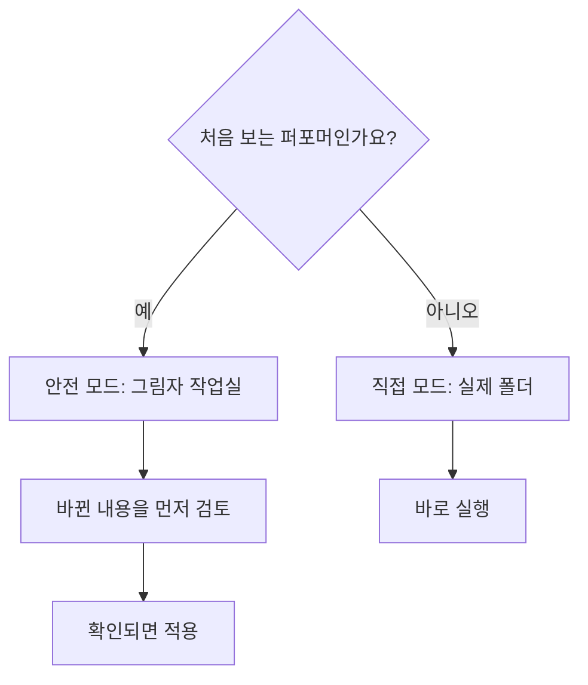

# DOT Studio: 터미널이 아니라 캔버스에서 에이전트를 조립하면 됩니다

> **Summary**
> DOT Studio es una herramienta visual local que permite configurar agentes de IA en un lienzo, combinando identidad, habilidades, modelos y herramientas en unidades de trabajo colaborativo. OpenCode se encarga de ejecutar las tareas, mientras que el modo seguro permite revisar los cambios en un entorno aislado antes de aplicarlos.

---

- 터미널이 기본값이 된 바이브 코딩, 에이전트 설정은 검은 화면 뒤에 숨어 있습니다.
- DOT Studio는 그 설정을 캔버스 위로 꺼내놓습니다. 정체성·스킬·모델을 눈으로 보고 드래그해서 조립합니다.
- 실행은 오픈코드가 맡고 스튜디오는 구성만 맡습니다. 낯선 조합은 안전 모드로 그림자 작업실에서 먼저 검토합니다.

터미널에 명령어 한 줄을 치고, 에이전트가 뭘 하는지 로그만 보고 기다려본 적 있으시죠? 잘 돌아가면 다행이지만, 뭘 기준으로 움직이는지, 어떤 스킬을 붙였는지, 모델은 뭘 쓰는지, 화면에는 안 보입니다. 설정은 어딘가 파일 속에 있고, 파일은 터미널 뒤에 숨어 있습니다. 이게 지금 바이브 코딩의 기본 풍경입니다!

🎥 [동영상 보기](https://www.youtube.com/watch?v=XCJRIXcQufY)

## 터미널이 전부였던 이유가 뭘까요?

코딩 에이전트는 터미널에서 태어났습니다. 클로드 코드, 코덱스, 오픈코드 모두 검은 화면이 무대입니다. 빠르고, 키보드만으로 돌릴 수 있고, 자동화와도 잘 맞습니다. 그런데 설정은 보이지 않습니다. 에이전트의 정체성, 붙인 스킬, 고른 모델, 쓸 수 있는 도구가 각각 다른 파일에 흩어져 있습니다. 뭘 바꿨는지 알려면 파일을 뒤져야 하고, 뭘 잘못 건드렸는지 알려면 로그를 읽어야 합니다. 터미널은 실행에는 강하지만, 구성에는 약합니다!

## DOT Studio는 뭘 보여줄까요?

DOT Studio는 댄스 오브 탈(Dance of Tal) 시스템을 눈으로 보고 만지는 로컬 작업 공간입니다. 프로젝트 폴더를 열면 퍼포머와 액트가 캔버스 위에 놓입니다. 캔버스, 에셋 라이브러리, 인스펙터, 퍼포머 채팅, 액트 스레드, 초안 편집기가 한 화면에 모입니다. 프롬프트 상자 뒤에 숨은 설정을 꺼내서 보여주는 게 이 도구의 출발점입니다!

구성 요소는 네 가지입니다. 탈(Tal)은 에이전트가 누구인지, 어떤 규칙을 항상 지키는지 적는 정체성 층입니다. 댄스(Dance)는 필요할 때 붙이는 재사용 스킬 묶음으로, `SKILL.md` 파일이 핵심입니다. 퍼포머(Performer)는 탈과 댄스, 모델, 도구 요구사항을 묶은 실행 단위입니다. 액트(Act)는 여러 퍼포머가 함께 일하는 협업 패턴입니다.

## 실행은 누가 맡을까요?

스튜디오가 직접 실행하지는 않습니다. 실행은 오픈코드가 맡습니다. 스튜디오가 준비한 설정을 오픈코드가 받아서 모델을 돌리고 도구를 실행하고 세션을 이어갑니다. 역할이 딱 나뉩니다. 스튜디오는 짓는 곳, 오픈코드는 뛰는 곳입니다.

모델도 퍼포머마다 따로 고릅니다. 화면을 만드는 퍼포머와 품질을 검증하는 퍼포머가 다른 모델을 쓸 수 있습니다. 예전에는 앞단은 한 도구로, 검사는 다른 도구로 옮겨 다니며 작업했습니다. 이제는 한 캔버스에 두 퍼포머를 놓고 각각 다른 모델을 붙이면 됩니다. 도구 갈아타기가 줄어드는 지점이 바로 여기입니다!

## 안전 모드는 왜 필요할까요?

낯선 퍼포머를 처음 돌릴 때는 안전 모드가 기본값입니다. 안전 모드는 그림자 작업실에서 실행하고, 바뀐 내용을 적용하기 전에 먼저 보여줍니다. 큰 편집, 리팩터링, 여러 파일을 건드리는 작업에 씁니다. 작고 믿을 만한 작업은 직접 모드로 실제 폴더에서 바로 돌립니다. 실행 엔진은 같고, 대상 작업실만 바뀝니다.

## 시작은 어떻게 할까요?

설치는 한 줄입니다. `npm install -g dot-studio@latest`로 받고, `dot-studio .`로 현재 폴더를 엽니다. 폴더에 작업 공간이 없으면 자동으로 준비합니다. `dot-studio doctor .`로 작업 공간, 포트, 노드, 오픈코드 준비 상태를 점검할 수 있습니다.

레지스트리에서 퍼포머나 액트를 가져와서 캔버스에 놓고, 부품을 뜯어본 뒤, 안전 모드로 돌려보고, 안정되면 초안을 저장하거나 발행합니다. 발행은 터미널 명령으로 합니다. 댄스는 깃허브 내보내기·가져오기 흐름을 씁니다. 작업 공간은 로컬에 남고, 발행은 별도 동작입니다.

터미널이 나쁜 도구는 아닙니다. 다만 구성까지 터미널에 맡기면, 에이전트가 뭘 보고 움직이는지 아무도 모르게 됩니다. 캔버스에 올려놓으면 정체성과 스킬과 모델이 한눈에 들어옵니다. 에이전트를 조립한다는 감각, 그게 이 도구가 던지는 제안입니다.

