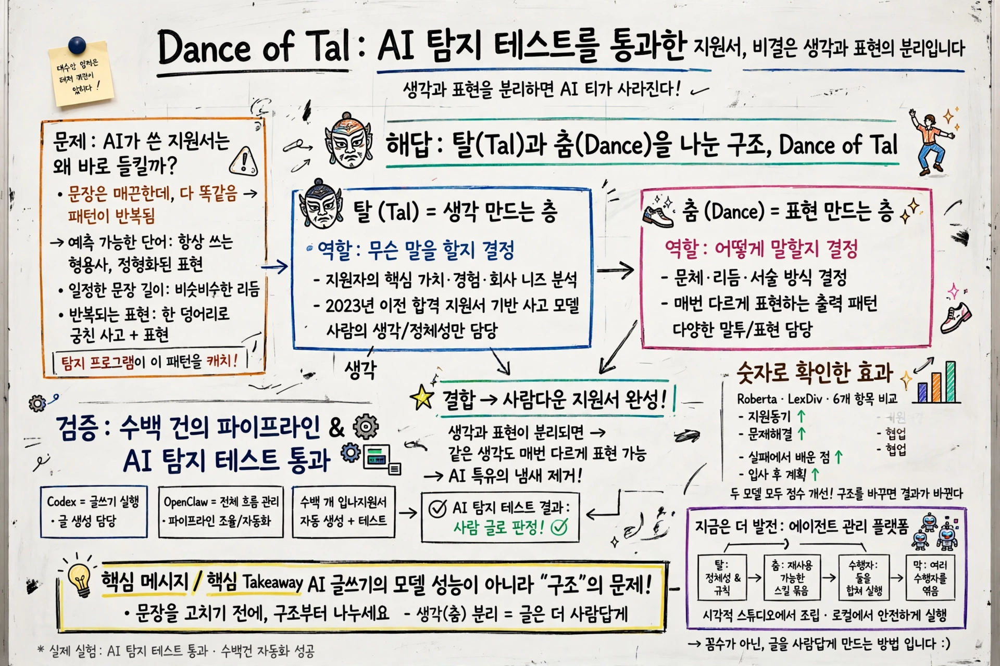
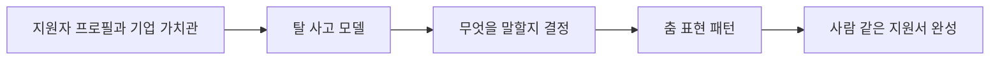
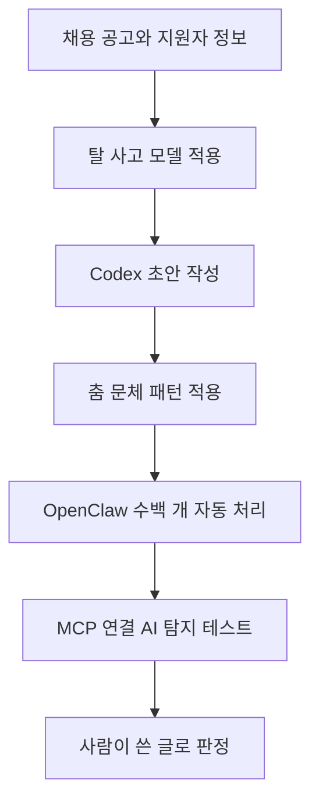
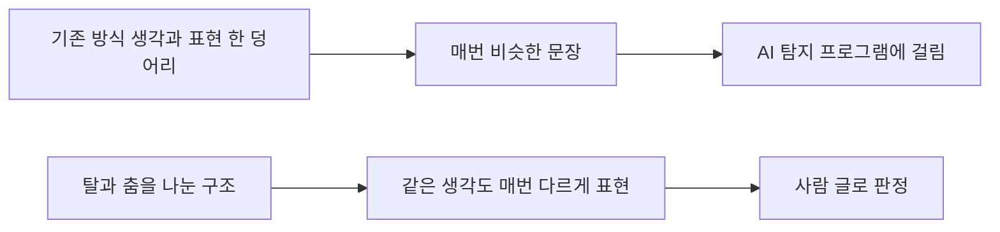

# Dance of Tal: AI 탐지 테스트를 통과한 지원서, 비결은 생각과 표현의 분리입니다

> **Summary**
> Dance of Tal은 생각을 만드는 층과 표현을 만드는 층을 분리해 AI가 쓴 지원서의 반복적인 문체를 줄이는 구조입니다. Codex와 OpenClaw로 수백 건의 지원서를 자동 작성하고 탐지 테스트를 진행했으며, 이 아이디어는 정체성과 스킬을 조합하는 에이전트 관리 플랫폼으로 확장됐습니다.

---

# Dance of Tal: AI 탐지 테스트를 통과한 지원서, 비결은 생각과 표현의 분리입니다

- Dance of Tal은 생각을 만드는 층과 표현을 만드는 층을 나눈 구조입니다.
- 생각을 담은 탈과 표현을 담은 춤이 따로 돌면서, AI가 쓴 글 특유의 냄새가 사라집니다.
- 이 구조로 수백 개의 입사지원서를 자동화했고, AI 탐지 테스트까지 통과했습니다.

지원서 한 장 쓰는 데 몇 시간 걸리던 시절이 있었습니다. 회사마다 문항이 다르고, 문장 하나하나 신경 쓰다 보면 밤이 깊어졌죠. 그런데 요즘은 AI가 대신 써준다고요? 문제는 그 다음입니다. 기업들이 AI 검사를 돌리기 시작했습니다!

🎥 [동영상 보기](https://www.youtube.com/watch?v=VS9hlevsIvg)

## AI가 쓴 글, 왜 바로 들킬까요?

AI가 쓴 지원서는 어딘가 밋밋합니다. 문장은 매끈한데, 읽다 보면 다 똑같아 보이죠. 왜 그럴까요? 생각과 표현이 한 덩어리로 뭉쳐 있기 때문입니다. 무슨 말을 할지와 어떻게 말할지를 한 번에 정하니, 매번 비슷한 문장이 나옵니다. 탐지 프로그램은 바로 그 패턴을 봅니다. 예측 가능한 단어, 일정한 문장 길이, 반복되는 표현. 이 세 가지가 모이면 AI 확률이 치솟습니다.

## 탈과 춤을 나눈 구조, Dance of Tal이란?

이름부터 재미있습니다. 한국의 탈춤에서 가져왔습니다. 탈은 인물의 정체성, 춤은 그 인물의 움직임이죠. 이 구조는 AI 글쓰기를 똑같이 나눕니다.

- **탈(Tal)**: 생각을 만드는 층입니다. 어떤 지원자가 어떤 가치를 가졌는지, 지원하는 회사가 무엇을 중요하게 여기는지. 2023년 이전 합격 지원서들에서 뽑아낸 사고 모델이 여기에 들어갑니다.
- **춤(Dance)**: 표현을 만드는 층입니다. 생각을 어떤 문체로 풀어낼지, 어떤 리듬으로 쓸지를 정하는 출력 패턴입니다.
생각과 표현이 분리되면, 같은 생각도 매번 다르게 쓸 수 있습니다. AI 티가 나는 이유가 사라지는 지점입니다!

## Codex와 OpenClaw, 수백 개를 돌린 파이프라인

이 구조를 실제로 돌린 조합이 있습니다. 글쓰기는 Codex가, 전체 흐름 관리는 OpenClaw가 맡았습니다. 국내외 수백 개의 입사지원서를 이 파이프라인으로 만들었습니다. 그리고 여기서 멈추지 않았습니다. 요즘 기업들이 AI 검사를 돌린다는 얘기가 있으니, 만든 지원서들을 AI 탐지 테스트에 직접 넣어봤습니다. Codex에 MCP를 붙여서 진행한 테스트였습니다. 결과는 어땠을까요? 실제로 효과가 있었습니다!

## 숫자로 확인한 효과는?

실험 결과도 함께 공개됐습니다. 두 개의 언어 모델인 Roberta와 LexDiv에 여섯 가지 항목(지원 동기, 문제 해결, 협업, 실패에서 배운 점, 입사 후 계획, 지원 이유)을 적용해 봤습니다. 기준 점수와 적용 후 점수를 비교하면, 대부분 항목에서 점수가 올랐습니다. 두 모델 모두에서요. AI 탐지 테스트에서도 사람 글로 판정받았습니다. 숫자가 말해주는 건 하나입니다. 구조를 바꾸면 결과가 바뀐다는 것!

## 지금은 더 커진 프로젝트입니다

이 아이디어는 여기서 멈추지 않았습니다. 지금은 에이전트 관리 플랫폼으로 자라났습니다. 정체성과 규칙을 담은 탈, 재사용 가능한 스킬 묶음인 춤, 둘을 합쳐 실행하는 수행자, 여러 수행자를 엮는 막까지. 시각적인 스튜디오에서 조립하고, 로컬에서 안전하게 돌릴 수 있습니다. 입사지원서에서 시작한 작은 실험이 에이전트 구조 전체를 다시 생각하는 출발점이 된 셈입니다.

## 그래서, 뭘 가져가면 좋을까요?

AI 글쓰기의 문제는 모델 성능이 아닐 수 있습니다. 구조의 문제일 수 있습니다. 생각을 정하는 층과 표현을 정하는 층을 나누면, 글은 사람 가까워집니다. 지원서를 쓰고 계신다면, 문장을 고치기 전에 구조부터 나눠보시면 어떨까요? AI 검사를 피하는 꼼수가 아니라, 글을 사람답게 만드는 방법입니다!

