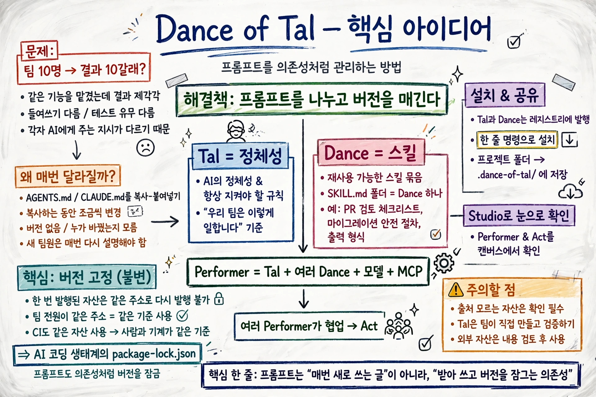
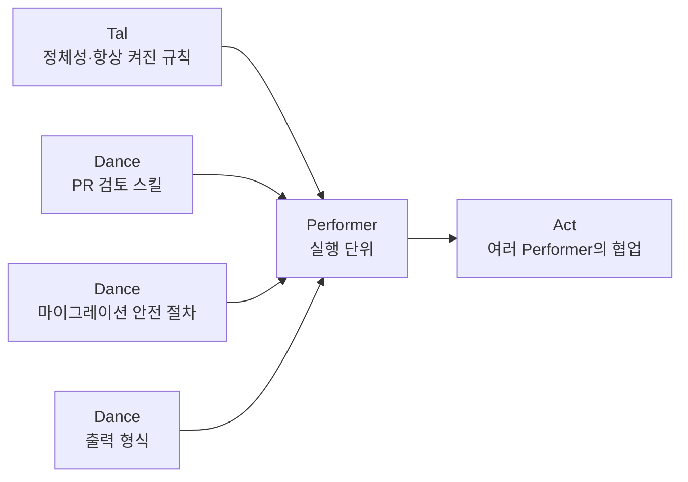
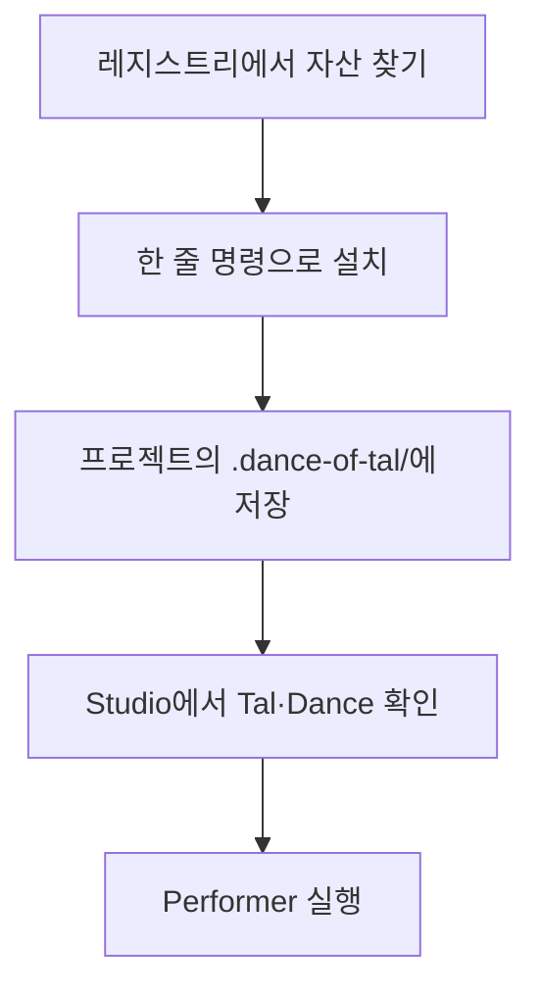
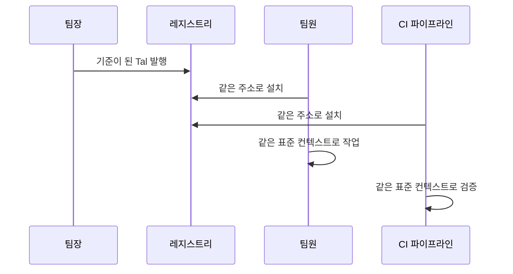

# Dance of Tal: 프롬프트는 매번 새로 쓰지 말고, 검증된 걸 받아 쓰면 됩니다

> **Summary**
> AI 프롬프트에도 의존성 주입과 패키지 매니저가 생겼습니다. Dance of Tal은 거대한 프롬프트를 정체성(Tal)과 스킬(Dance)로 쪼개 레지스트리에 올립니다. 한 줄 설치로 검증된 작업 방식을 내 프로젝트에 꽂을 수 있고, 팀 전원이 같은 버전의 표준 컨텍스트를 씁니다. 한 번 발행된 자산은 같은 주소로 다시 발행할 수 없어, 팀과 CI가 같은 기준을 공유합니다.

---

- AI 프롬프트에도 의존성 주입과 패키지 매니저가 생겼습니다. Dance of Tal은 거대한 프롬프트를 정체성(Tal)과 스킬(Dance)로 쪼개 레지스트리에 올립니다.
- 한 줄 설치로 검증된 작업 방식을 내 프로젝트에 꽂을 수 있고, 팀 전원이 같은 버전의 표준 컨텍스트를 씁니다.
- 한 번 발행된 자산은 같은 주소로 다시 발행할 수 없어, 팀과 CI가 같은 기준을 공유합니다.

## 팀 열 명이 AI에게 시켰는데, 결과가 열 갈래라면요?

팀에서 열 명이 AI 코딩 도구를 씁니다. 같은 기능을 맡겼는데, 열 명이 받은 코드가 제각각입니다. 들여쓰기도 다르고, 테스트를 붙이는 사람도 있고, 아예 안 붙이는 사람도 있습니다. 이런 적 있으시죠?

문제는 실력이 아닙니다. 각자 AI에게 건네는 지시가 다르기 때문입니다. 한 명은 세 줄짜리 요청을 던지고, 다른 한 명은 규칙을 잔뜩 적어 넣습니다. AI는 시키는 대로 일하니까, 지시가 다르면 결과도 달라집니다!

🎥 [동영상 보기](https://www.youtube.com/watch?v=FL0ONKo-kvc)

## 프롬프트가 매번 달라지는 이유가 뭘까요?

보통 규칙은 `AGENTS.md`나 `CLAUDE.md` 같은 파일 하나에 길게 적어 둡니다. 그런데 이 파일은 복사하고 붙여넣는 과정에서 조금씩 달라집니다. 팀원이 새로 오면 또 처음부터 설명해야 하고, 누가 언제 뭘 바꿨는지 알 수 없습니다. 버전도 없습니다. 결국 같은 팀인데도 각자 다른 지시로 일하게 됩니다.

이럴 때 필요한 건 더 긴 프롬프트가 아니라, 프롬프트를 나누고 버전을 매기는 방법입니다.

## Tal과 Dance는 뭐가 다른가요?

Dance of Tal은 거대한 프롬프트를 두 갈래로 쪼갭니다. Tal은 AI의 정체성과 항상 지켜야 할 규칙입니다. "이 팀은 이렇게 일합니다"라는 기준을 담습니다. Dance는 재사용 가능한 스킬 묶음입니다. `SKILL.md` 파일이 들어 있는 폴더 하나가 Dance 하나가 됩니다. PR 검토 체크리스트, 마이그레이션 안전 절차, 출력 형식 같은 것들이 Dance입니다.

Tal 하나에 Dance 여러 개, 모델, MCP를 묶으면 Performer가 됩니다. 실제로 실행하는 단위입니다. 여러 Performer가 함께 일하는 패턴은 Act라고 부릅니다.

## 설치는 어떻게 하나요?

Tal과 Dance는 레지스트리에 올라갑니다. 자산마다 `종류/@소유자/단계/이름` 형태의 고유 주소가 붙습니다. CLI를 설치한 뒤 레지스트리에서 원하는 자산을 골라 한 줄 명령으로 설치하면, 프로젝트 폴더 아래 `.dance-of-tal/`에 자산이 내려옵니다. Dance는 깃허브 저장소에 있는 스킬 폴더에서 가져올 수도 있습니다.

눈으로 보고 고르고 싶으면 Studio를 씁니다. 프로젝트를 열면 Performer와 Act가 캔버스에 보이고, 어떤 Tal과 Dance가 붙어 있는지 확인한 뒤 실행할 수 있습니다. 프롬프트 상자 뒤에 숨어 있던 설정이 눈앞에 펼쳐집니다!

## 팀 전원이 같은 기준을 쓰게 하려면요?

핵심은 버전 고정입니다. 한 번 발행된 자산은 같은 주소로 다른 내용을 다시 발행할 수 없습니다. 그래서 팀 전원이 같은 주소를 설치하면, 전원이 같은 내용으로 일합니다. CI 파이프라인도 같은 자산을 쓰면, 사람과 기계가 같은 기준을 공유합니다!

이게 바로 AI 코딩 생태계의 `package-lock.json`입니다. 프롬프트도 의존성처럼 버전을 잠그는 겁니다. 팀장이 기준을 정해두면, 팀원은 지시를 타이핑하는 실력에 상관없이 같은 출발선에 섭니다.

## 주의할 점은 없나요?

남이 만든 자산을 그대로 믿으면 안 됩니다. 스킬은 코드를 실행할 수 있어서, 출처를 모르는 자산은 내용을 읽어보고 써야 합니다. Tal은 AI의 정체성을 정하는 파일이라, 잘못된 Tal을 팀 전체가 쓰면 잘못된 방향으로 다 같이 갑니다. 팀에서 쓸 Tal은 팀이 직접 만들고, 외부 자산은 검증한 뒤에 들이는 게 안전합니다!

프롬프트는 이제 매번 새로 쓰는 글이 아니라, 받아 쓰고 버전을 잠그는 의존성입니다. 잘 만든 기준 하나가 팀 전체의 코드를 같은 방향으로 이끕니다!

