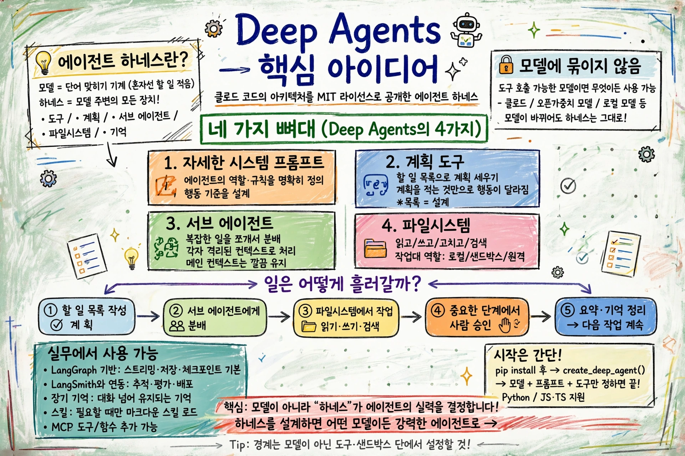
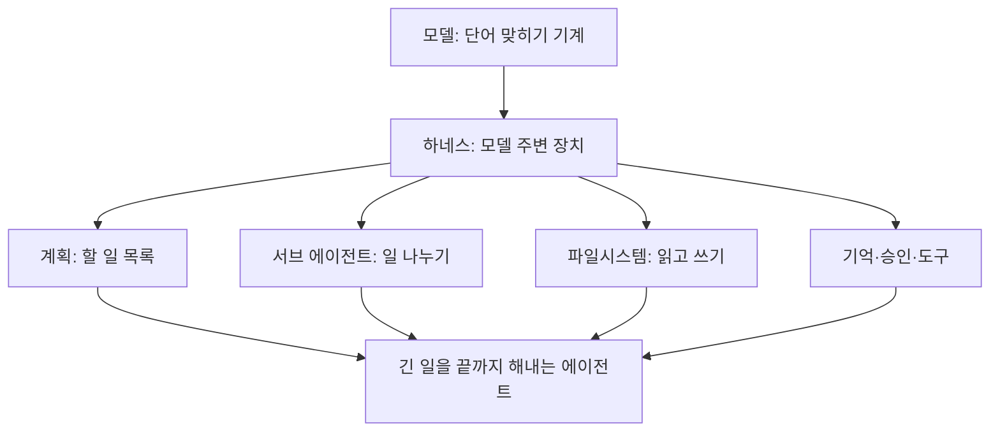
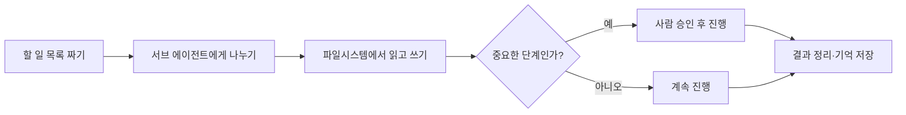
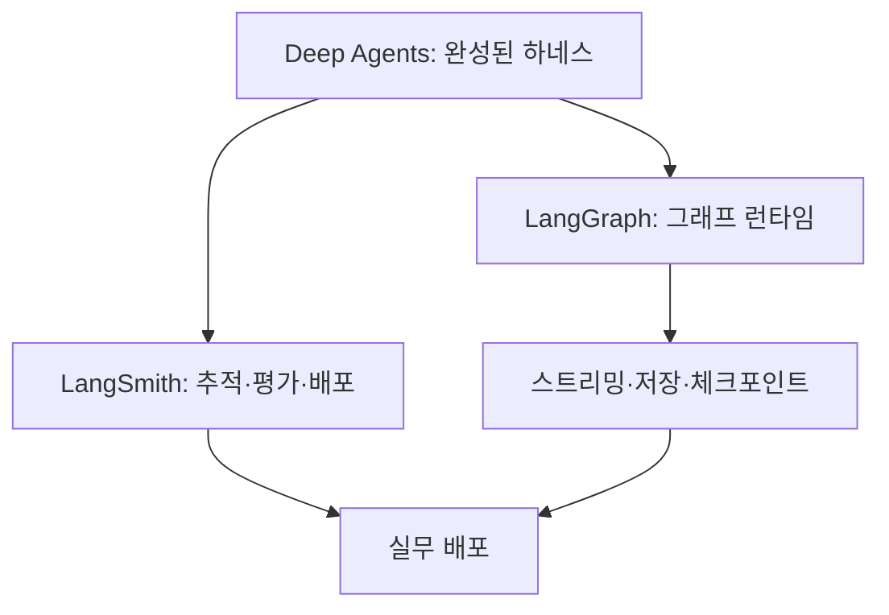

# Deep Agents: 클로드 코드의 설계도를 통째로 가져오면, 모델은 골라 쓸 수 있습니다

> **Summary**
> Deep Agents는 계획, 서브 에이전트, 파일시스템, 승인 절차를 갖춘 오픈소스 에이전트 하네스로, 특정 모델에 종속되지 않아 도구 호출이 가능한 다양한 모델을 사용할 수 있습니다. LangGraph 기반으로 장기 작업과 실무 배포를 지원하며, 도구와 샌드박스로 안전 경계를 설정할 수 있습니다.

---

- Deep Agents는 클로드 코드의 아키텍처를 MIT 라이선스로 공개한 에이전트 하네스입니다.
- 할 일 목록으로 계획을 세우고, 서브 에이전트에게 일을 나누고, 파일시스템을 직접 읽고 쓰면서, 중요한 단계에서는 사람의 승인을 받습니다.
- 모델에 묶이지 않아 도구 호출이 되는 모델이면 무엇이든 쓸 수 있고, LangGraph 기반이라 실무 배포까지 이어집니다.


코딩 에이전트를 써보셨나요? 잘 돌아가는데, 딱 한 가지가 마음에 걸립니다. 에이전트가 특정 모델에만 묶여 있다는 점입니다. 직접 에이전트를 만들어볼까 싶으면, 처음부터 다 짜야 한다는 벽이 앞에 섭니다. 계획도, 파일 다루기도, 기억도, 승인 절차도 전부 직접 만들어야 하니까요!

🎥 [동영상 보기](https://www.youtube.com/watch?v=EAwAJc0bD7o)

## 에이전트 하네스가 뭘까요?

모델은 단어 맞히기 기계입니다. 혼자서는 별로 할 수 있는 일이 없습니다. 에이전트는 모델에 하네스를 붙인 것입니다. 도구, 계획, 서브 에이전트, 파일시스템, 기억처럼 모델 주변을 감싸는 모든 장치가 하네스입니다. 하네스가 좋으면 같은 모델도 훨씬 긴 일을 끝까지 해냅니다!

클로드 코드가 잘 돌아가는 이유도 모델 성능만이 아닙니다. 그 주변의 하네스가 탄탄하기 때문입니다. Deep Agents는 그 하네스의 설계도를 통째로 가져와서, 누구나 쓸 수 있게 공개한 것입니다.



## 네 가지 뼈대는 뭘까요?

Deep Agents의 뼈대는 네 가지입니다. 자세한 시스템 프롬프트, 계획 도구, 서브 에이전트, 파일시스템입니다. 클로드 코드와 Manus, 딥 리서치 같은 에이전트를 뜯어보니 네 가지가 공통으로 들어 있었다고 합니다.

계획 도구가 가장 인상적입니다. 할 일 목록을 적는 도구인데, 실제로는 아무것도 실행하지 않습니다. 그저 계획이 컨텍스트에 남는 것만으로 에이전트의 행동이 달라집니다. 목록을 적는 행위가 곧 설계가 되는 셈입니다!

서브 에이전트는 복잡한 일을 쪼개서 맡기는 방식입니다. 각자 격리된 컨텍스트를 받아서 일합니다. 메인 에이전트의 컨텍스트가 지저분해지지 않습니다. 파일시스템은 에이전트의 작업대입니다. 읽고, 쓰고, 고치고, 검색하는 도구가 기본으로 들어 있습니다. 로컬 디스크, 샌드박스, 원격 백엔드 중에서 골라 쓸 수 있습니다.

## 일은 어떻게 흘러갈까요?

흐름은 단순합니다. 먼저 할 일 목록을 짭니다. 복잡한 일은 서브 에이전트에게 나눠줍니다. 파일시스템에서 직접 읽고 쓰면서 작업을 진행합니다. 중요한 단계에서는 사람이 승인해야 넘어갑니다. 대화가 길어지면 요약해서 컨텍스트를 정리하고, 도구 결과는 파일로 옮겨 둡니다.



이 문장이 저는 가장 와닿았습니다. 계획 도구는 아무것도 실행하지 않는데, 에이전트는 그 목록 때문에 길을 잃지 않는다는 점입니다.

## 모델은 바꿔 쓸 수 있을까요?

네, 그게 Deep Agents의 가장 큰 차이입니다. 클로드 코드는 클로드 모델에 묶여 있습니다. Deep Agents는 도구 호출이 되는 모델이면 무엇이든 씁니다. 대형 모델도, 오픈 가중치 모델도, 로컬에서 돌리는 모델도 됩니다. 모델이 바뀌어도 하네스는 그대로입니다!

터미널에서 바로 쓰는 코딩 에이전트도 함께 나왔습니다. 클로드 코드나 커서처럼 터미널에서 코드를 짜는 에이전트인데, 뒤에 붙는 모델은 골라 쓸 수 있습니다. 터미널 코딩 벤치마크(Terminal Bench 2.0)에서는 42.65%를 기록해, 같은 급 모델을 쓴 클로드 코드와 비슷한 수준이라는 평가가 있습니다.

## 실무에서 쓸 수 있을까요?

Deep Agents는 처음부터 실무를 겨냥했습니다. LangGraph 위에서 돌아가서 스트리밍, 저장, 체크포인트가 기본으로 들어 있습니다. 추적과 평가, 배포는 LangSmith와 이어집니다. 오래 도는 작업에 맞춰 기본값이 잡혀 있습니다.

기억도 이어집니다. 대화를 넘어서 유지되는 장기 기억이 들어 있습니다. 스킬도 필요할 때만 불러옵니다. 스킬은 마크다운 파일로 적어두고, 에이전트가 관련이 있다고 판단할 때만 전체 내용을 읽습니다. 도구도 직접 만든 함수나 MCP 서버를 붙이면 됩니다.



## 직접 써보려면 어떻게 할까요?

시작은 간단합니다. 패키지 하나를 추가하고, 모델과 시스템 프롬프트만 정하면 에이전트가 됩니다.

```python
from deepagents import create_deep_agent

agent = create_deep_agent(
    model="openai:gpt-6-astra",
    system_prompt="You are a research assistant.",
)
result = agent.invoke({"messages": "Research LangGraph and write a summary"})
```

`create_deep_agent`는 LangGraph 에이전트를 돌려줍니다. 여기에 도구를 더하고, 모델을 바꾸고, 프롬프트를 고치고, 서브 에이전트를 설정하면 됩니다. 파이썬뿐 아니라 자바스크립트·타입스크립트용 라이브러리도 있습니다.

한 가지 주의할 점도 있습니다. 이 하네스는 모델을 신뢰하는 구조입니다. 에이전트는 도구가 허락하는 일은 무엇이든 할 수 있습니다. 경계는 모델의 양심에 맡기지 말고, 도구와 샌드박스 단에서 정해야 합니다!

모델이 아니라 하네스가 에이전트의 실력을 정합니다. 설계도가 공개됐으니, 이제는 골라 쓰는 일만 남았습니다. 어떤 모델을 붙여볼까요?

