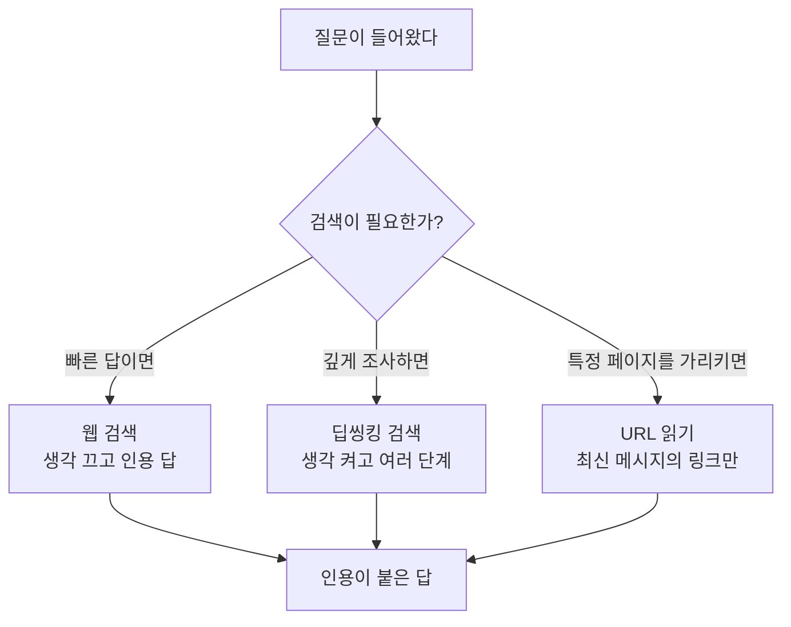

# DeepSeek: 앱 기능이 API로 풀렸습니다. 검색·파일·음성을 파라미터 몇 개로 켭니다

> **Summary**
> DeepSeek의 deepseek-flash API에서 웹·딥씽킹 검색, URL 읽기, 파일 파싱, OCR, 음성 처리 등 앱 기능을 도구로 사용할 수 있게 됐습니다. 서버가 검색과 파일 처리를 맡고 답변에 출처를 붙여 개발 부담을 줄이지만, 도구 사용료가 토큰 비용에 추가되며 모델이 도구를 항상 호출하는 것은 아닙니다. 오픈소스 챗 데모도 공개됐으며, 실제 서비스에서는 API 키를 백엔드에 보관하는 것이 안전합니다.

---

- 챗봇을 만들 때 제일 귀찮았던 검색·파일·음성 붙이기가, 이제 파라미터 몇 개로 켜집니다. 앱 기능이 통째로 API로 풀렸습니다.
- 웹검색·딥씽킹 검색·URL 읽기·파일 파싱·음성까지 서버가 대신 처리하고, 답에는 출처 인용까지 붙습니다. 오픈소스 챗 데모도 함께 공개됐습니다.
- 다만 `deepseek-flash` 모델에서만 되고, 토큰 값 외에 도구 사용료가 따로 붙습니다. 공짜가 아니라, 귀찮음을 돈으로 사는 구조입니다.

챗봇 하나 만들어보려고 하면, 막히는 지점은 모델이 아닙니다. 최신 정보를 어떻게 가져올지, 사용자가 올린 PDF는 어떻게 읽을지, 음성 입력은 어떻게 받을지 — 이런 주변 작업이 진짜 벽입니다. 검색 API를 따로 붙이고, 파일 파서 라이브러리를 붙이고, 음성 변환 서비스를 또 붙이다 보면, 챗봇 본체보다 주변부가 먼저 커집니다. 그런데 2026년 11월 13일, 공식 API 문서에 "챗봇 만들기" 안내가 새로 올라왔습니다. 앱에서 쓰던 기능이 통째로 API로 풀린 겁니다. 어떻게 달라졌을까요?

🎥 [동영상 보기](https://www.youtube.com/watch?v=ARqUwMzQleA)

## 앱 기능이 API로, 무엇이 풀렸을까요?

공식 안내가 여는 기능은 다섯 가지보다 많습니다. 웹 검색, 딥씽킹 검색, 파일 입력, URL 읽기, 그리고 모델 내용 안전성 검사까지 — 앱에서 쓰던 대화 기능이 그대로 API에 들어왔습니다. 여기에 대화 제목 자동 생성, 답을 음성으로 읽어주는 기능, 음성을 문자로 바꾸는 입력까지 붙습니다. 사용자는 질문만 던지면 됩니다. 검색하고, 페이지를 읽고, 파일을 파싱하는 일은 서버가 처리합니다!

핵심은 "누가 일하느냐"입니다. 예전에는 개발자가 검색 API를 호출하고, 결과를 잘라서 프롬프트에 넣고, 파일 파서를 돌려야 했습니다. 이제는 도구 이름만 선언하면 됩니다. `deepseek_web_search`를 켜면 모델이 필요할 때 스스로 검색하고, 인용까지 달아서 답합니다. `deepseek_read_url`을 켜면 사용자가 보낸 메시지의 링크를 모델이 직접 읽어옵니다. 클라이언트는 돌아온 블록을 화면에 보여주고, 다음 차례에 그대로 다시 넘기기만 하면 됩니다. 조립은 서버 몫이 됐습니다.

## 검색은 한 가지가 아닙니다. 생각하느냐가 갈립니다

검색 도구는 `thinking` 설정에 따라 얼굴이 바뀝니다. 생각을 끄고 `deepseek_web_search`를 켜면, 모델은 질문에 맞춰 웹이나 이미지를 검색하고 인용이 붙은 답을 내놓습니다. 생각을 켜면 딥씽킹 검색이 됩니다. 여러 번의 추론 단계에 걸쳐 검색하고, 링크를 열고, 내용을 확인하면서 답을 만듭니다. 복잡한 조사에는 이쪽이 맞습니다.

URL 읽기는 따로 쓸 수도 있습니다. 사용자가 특정 페이지를 가리키며 "이걸 읽고 답해줘"라고 할 때, 검색 없이 `deepseek_read_url`만 선언하면 됩니다. 단, 규칙이 하나 있습니다. URL 읽기는 가장 최근 사용자 메시지에 있는 링크만 봅니다. 오래된 대화 속 링크는 다시 보내줘야 합니다.

## 파일·음성도 단독 API로 따로 쓸 수 있습니다

챗봇 안에 묶인 기능 말고, 낱개로 부를 수 있는 도구도 열렸습니다. 검색, 페이지 가져오기, OCR, 음성 인식, 음성 합성이 각각 독립된 API로 제공됩니다. PDF나 워드, 파워포인트, 이미지 파일을 올리면 텍스트 추출이나 레이아웃을 살린 파싱을 거쳐 대화 맥락에 들어갑니다. 음성 입력은 문자로, 답은 음성으로 바꿀 수 있습니다. 자기 파이프라인을 직접 짜고 싶은 개발자는 필요한 조각만 가져가면 됩니다.

프로토콜도 세 가지로 열려 있습니다. `Messages` API, `Responses` API, `Chat Completions` API — 어느 쪽이든 모델은 `deepseek-flash`입니다. 기존에 쓰던 SDK 형태를 그대로 두고 도구만 얹을 수 있다는 뜻입니다.

## 공짜가 아닙니다. 도구 값은 따로 붙습니다!

여기서 한 번 멈춰볼까요? 토큰이 싸다고 해서 전체가 싼 건 아닙니다. 공식 요금표에 따르면, 도구 사용료는 토큰 값에 더해 따로 붙습니다. 검색과 페이지 가져오기는 1,000회당 0.75달러, 파일 파싱과 OCR은 1,000페이지당 0.225달러입니다. 음성 합성은 1만 자당 0.45달러, 음성 인식은 시간당 0.116달러 수준이고, 한정 기간 50% 할인 가격도 안내돼 있습니다. 토큰 자체는 비수기 기준 입력 100만 개당 0.15달러, 출력 0.60달러입니다. 검색이 잦은 챗봇이라면, 토큰보다 도구 값이 먼저 눈에 들어올 수 있습니다. 계산은 사용량 기준으로 따로 해봐야 합니다!

주의할 점이 몇 가지 더 있습니다. 도구를 선언했다고 해서 모델이 반드시 쓰는 건 아닙니다. 검색할지, 페이지를 열지는 모델이 판단합니다. 도구를 켜면 `temperature` 같은 일부 파라미터는 무시되기도 합니다. 그리고 공개 서비스라면 안전성 검사를 켜야 합니다. 입력과 출력이 검사되고, 위험이 감지되면 거부 표시가 돌아옵니다. 검토와 표시는 서비스 제공자의 몫입니다.

## 오픈소스 데모가 함께 나왔습니다. 하루면 시작됩니다?

공식 안내와 함께 오픈소스 챗 데모도 공개됐습니다. API 키를 넣으면 바로 쓸 수 있고, 앱에서 내보낸 대화 기록을 가져와서 이어서 쓸 수도 있습니다. 키와 대화는 브라우저에만 저장된다고 안내돼 있습니다. 어디까지나 시연용이라는 점은 기억해둘 만합니다. 실제 서비스에서는 키를 백엔드에 두는 게 맞습니다.

그래서 이 소식이 큰 이유는 단순합니다. 챗봇 만들기의 귀찮은 부분이 서버로 넘어갔기 때문입니다. 개인 개발자가 하루 만에 자기 챗봇 앱을 만드는 그림이, 과장이 아니라 절차로 보이기 시작했습니다. 다만 이건 무료 개방이 아니라, 유료 도구의 개방입니다. 무엇을 서버에 맡기고 무엇을 직접 할지, 요금표를 앞에 두고 정하는 게 먼저입니다. 다른 회사들도 앱 기능을 API로 푸는 경쟁에 더 세게 붙을 것으로 보입니다. 챗봇의 다음 경쟁은 모델이 아니라, 누가 주변 작업을 더 편하게 넘겨주느냐가 될 것 같습니다!

