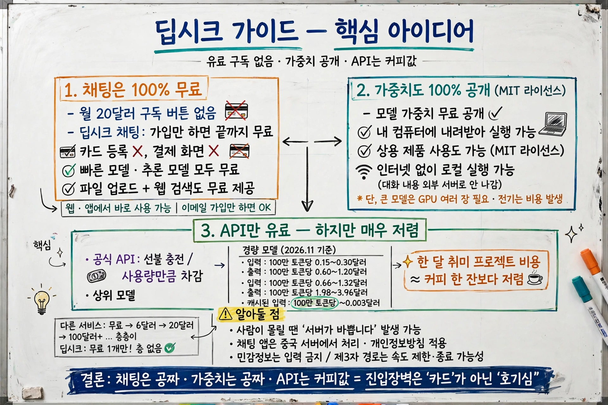
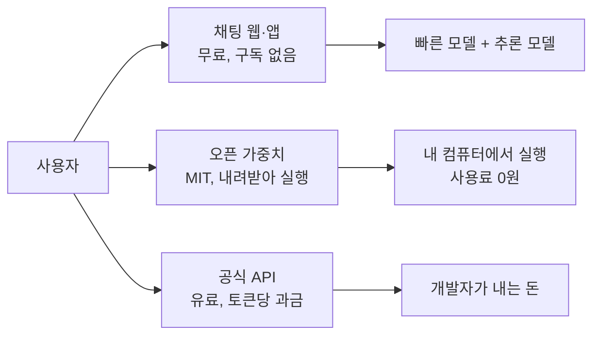
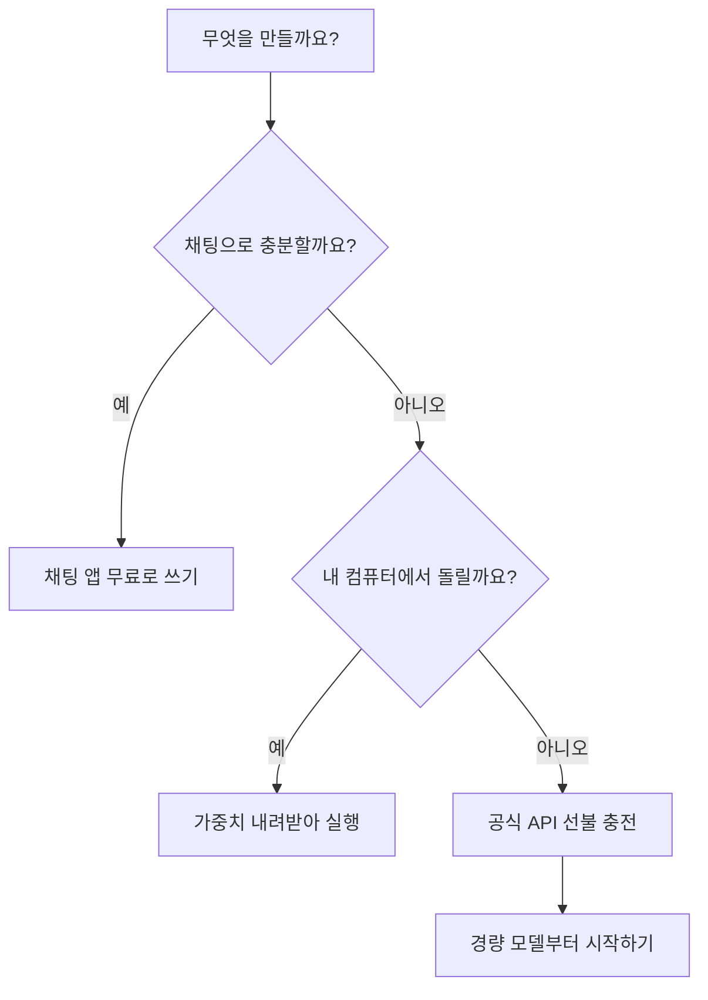

# DeepSeek: 월 20달러 구독이 없습니다. 채팅도, 가중치도 원래 공짜입니다

> **Summary**
> 딥시크 채팅과 MIT 라이선스로 공개된 가중치는 무료이며, API만 사용량에 따라 유료입니다. 채팅은 서버 혼잡과 개인정보 보호에 유의해야 하고, 민감한 정보를 다루려면 가중치를 직접 실행하는 방법이 더 안전합니다.

---

- 월 20달러짜리 구독 버튼이 없습니다. 딥시크 채팅은 가입만 하면 끝까지 무료입니다.
- 가중치도 MIT 라이선스로 공개돼 있습니다. 내려받아 내 컴퓨터에서 돌리면 사용료 자체가 없습니다.
- API만 유료입니다. 다만 가격이 워낙 낮아, 취미 프로젝트 한 달 비용이 커피 한 잔보다 쌉니다.

AI 채팅을 쓰려고 가격표를 열었는데, 무료라고 적힌 곳마다 "플러스 월 20달러"가 따라붙는 걸 본 적 있으시죠? 어느 날은 무료 대화 횟수가 다 찼다며 결제를 권하고, 어느 날은 빠른 모델은 유료라고 합니다. 그래서 "공짜 AI"라는 말이 광고 문구처럼 들리기 시작했습니다. 그런데 딥시크는 구조가 다릅니다. 유료 구독 상품 자체가 없습니다!

🎥 [동영상 보기](https://www.youtube.com/watch?v=lw3oxu0jxN4)

## 채팅은 왜 공짜일까요?

딥시크 채팅은 웹과 앱에서 무료로 쓸 수 있습니다. 이메일로 가입하면 바로 대화를 시작합니다. 카드 등록도 없고, 결제 화면도 없습니다. 빠른 모델과 추론 모델을 둘 다 무료로 씁니다. 파일 업로드와 웹 검색도 함께 쓸 수 있습니다.

경쟁 서비스와 비교하면 차이가 더 또렷해집니다. 2026년 11월 기준, 한 경쟁 서비스의 개인 요금제는 무료부터 월 6달러, 월 20달러, 월 100달러 이상까지 층층이 나뉩니다. 딥시크는 층이 없습니다. 무료가 유일한 요금제입니다. 광고도 없고, 앱 내 결제도 없습니다. 딥시크 스스로도 그렇게 설명합니다.

그럼 딥시크는 어디서 돈을 벌까요? 답은 채팅이 아니라 개발자용 API에 있습니다. 채팅은 무료로 열어두고, API 사용량으로 과금하는 구조입니다. 사용자가 아니라 개발자가 내는 돈으로 굴러가는 셈입니다. 그래서 채팅 사용자는 구독료를 낼 일이 없습니다!

## 가중치도 공짜입니다. 진짜 공짜의 뜻은?

"공짜"라는 말은 채팅에만 붙지 않습니다. 딥시크는 모델 가중치를 MIT 라이선스로 공개합니다. 내려받고, 실행하고, 상용 제품에 써도 됩니다. 허락을 받을 필요도 없고, 라이선스 비용도 없습니다.

내 컴퓨터에서 돌리는 방법도 어렵지 않습니다. `Ollama` 같은 도구를 쓰면 작은 크기의 추론 모델을 한 줄 명령으로 내려받아 실행할 수 있습니다. 인터넷 연결 없이도 돌아가고, 대화 내용이 외부 서버로 나가지 않습니다. 프라이버시를 중시하는 분께는 이 경로가 가장 든든합니다.

다만 "가중치가 무료"와 "실행이 무료"는 다른 말입니다. 큰 모델을 통째로 돌리려면 고성능 그래픽카드가 여러 장 필요합니다. 그래서 가중치 무료의 실속은 작은 크기의 모델을 내 컴퓨터에서 돌리거나, 클라우드 그래픽카드를 빌려 쓰는 쪽에서 나옵니다. 라이선스는 공짜지만, 전기는 공짜가 아닙니다.

## API만 유료입니다. 그런데 얼마나 쌀까요?

공식 API에는 상시 무료 티어가 없습니다. 선불로 잔액을 충전하고, 쓴 토큰만큼 차감되는 방식입니다. 처음부터 "API는 공짜"라고 생각하면 실망합니다. 그런데 가격을 보면 생각이 달라집니다.

2026년 11월 기준 공식 가격입니다. 경량 모델인 `deepseek-flash`는 백만 토큰당 입력 0.15~0.30달러, 출력 0.60~1.20달러입니다. 비수기에는 낮은 가격, 성수기에는 높은 가격이 적용됩니다. 상위 모델인 `deepseek-pro`는 입력 0.66~1.32달러, 출력 1.98~3.96달러입니다. 캐시에 걸린 입력은 백만 토큰당 0.003달러 수준까지 떨어집니다. 취미 프로젝트 한 달 비용이 커피 한 잔보다 싸다는 말이 과장이 아닙니다!

## 공짜에도 대가는 있습니다. 뭘까요?

무료라고 해서 단점이 없는 건 아닙니다. 먼저, 사람이 몰리는 시간에는 "서버가 바쁩니다"라는 메시지를 만날 때가 있습니다. 메시지 개수 상한이 공개된 건 아니지만, 서버 용량이 한계가 됩니다. 급한 작업 중이라면 속이 탑니다.

둘째, 채팅 앱은 중국에 있는 서버에서 돌아갑니다. 입력한 내용은 딥시크 서버에서 처리되고, 딥시크 개인정보 처리방침이 적용됩니다. 업무상 민감한 자료나 고객 정보는 채팅 앱에 넣지 않는 편이 안전합니다. 이럴 때는 내 컴퓨터에서 돌리는 가중치 경로가 답이 됩니다.

셋째, 무료로 쓸 수 있는 제3자 경로도 있습니다. 코딩 도구 안에 기간 한정으로 무료 제공되는 딥시크 모델이 있고, 라우터 서비스의 무료 등급도 있습니다. 다만 이런 경로는 속도 제한이 걸리거나, 어느 날 조용히 사라질 수 있습니다. 공식 채팅 앱과 오픈 가중치는 딥시크가 직접 운영하는 길이고, 제3자 경로는 빌려 쓰는 길입니다. 구분해서 쓰면 헷갈리지 않습니다.

## 그래서 "원래 공짜"라는 말이 맞을까요?

맞습니다. 다만 "어디까지 공짜인지"를 나눠서 봐야 합니다. 채팅은 공짜입니다. 가중치는 공짜입니다. API는 유료이지만 워낙 쌉니다. 이 세 가지를 한 덩어리로 "딥시크는 공짜"라고 말하면 반은 맞고 반은 틀립니다. 정확히는 "채팅과 가중치는 공짜, API는 커피값"입니다!

P358 글과 각도가 다릅니다. 그 글은 딥시크가 앱 기능을 API로 통째로 푼 개발자 소식을 다룹니다. 이 글은 그 API 이전의 질문, "딥시크를 무료로 쓰는 길은 어디까지일까"를 다룹니다. API 소식이 궁금하면 그 글을, 무료 사용법이 궁금하면 이 글을 보면 됩니다.

유료 구독이 없다는 건, AI를 쓰는 문턱이 카드가 아니라 호기심이라는 뜻입니다. 오늘 저녁, 가입하고 한 번 물어보시면 어떨까요? 답이 마음에 들면 그때부터가 진짜 시작입니다!

