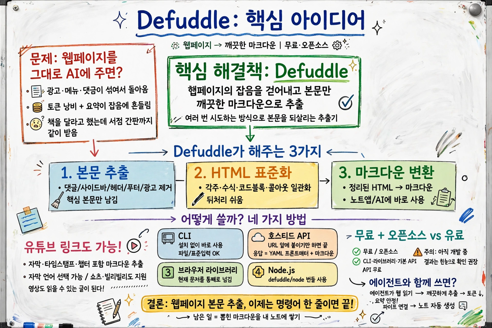
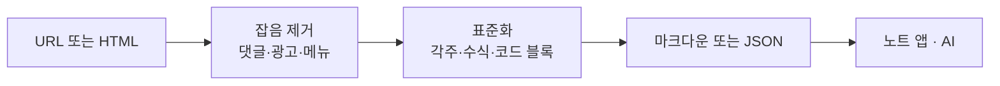
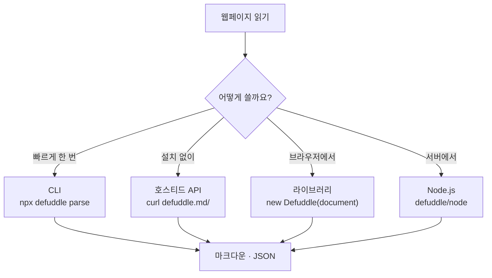
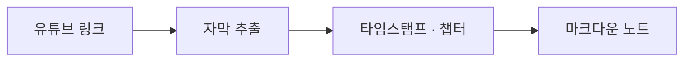

# Defuddle: 웹페이지 본문만 뽑아 마크다운으로 바꾸면, AI에게 읽힐 준비가 끝납니다

> **Summary**
> Defuddle는 웹페이지의 광고·메뉴·댓글 등을 제거하고 본문을 정돈해 마크다운으로 변환하는 무료 오픈소스 도구입니다. CLI, 브라우저·Node.js 라이브러리, 호스티드 API로 사용할 수 있으며 유튜브 자막도 추출합니다. 아직 개발 중이므로 중요한 결과는 직접 확인하는 것이 좋습니다.

---

- Defuddle는 웹페이지에서 광고·메뉴·댓글 같은 잡음을 걷어내고 본문만 깨끗한 마크다운으로 뽑아주는 무료 오픈소스 도구입니다.
- 브라우저·Node.js·CLI·호출 한 줄짜리 호스티드 API까지 네 가지 길로 쓸 수 있어, AI에게 읽힐 자료를 만드는 과정이 명령어 하나로 끝납니다.
- 유튜브 링크도 자막·타임스탬프·챕터가 담긴 마크다운으로 바꿔주지만, 아직 개발 중인 프로젝트라 결과를 한 번은 눈으로 확인하는 게 맞습니다.


좋은 글을 찾아 AI에게 요약해달라고 했는데, 광고 문구와 메뉴 이름이 섞여 돌아온 적 있으시죠? 복사한 본문에는 읽지도 않은 댓글이 붙어 있고, 토큰은 그만큼 더 듭니다. 웹페이지를 그대로 던지는 건, 책 한 권을 달라고 했는데 서점 간판까지 같이 받는 일과 비슷합니다!

🎥 [동영상 보기](https://www.youtube.com/watch?v=Vy1MdjickAI)

## 왜 웹페이지를 그대로 주면 안 될까요?

AI에게 줄 텍스트는 본문만 있으면 됩니다. 그런데 브라우저에서 복사하면 내비게이션, 광고, 댓글, 푸터까지 딸려옵니다. 토큰은 낭비되고, 요약은 잡음에 흔들립니다. 기존 추출기는 엄격하게 잘라내다 본문이 통째로 비어버리는 경우도 있었습니다. 이 지점에서 Defuddle가 나왔습니다. 여러 번 시도하는 방식으로 본문을 되살리는 추출기입니다.

## Defuddle는 뭘 해줄까요?

Defuddle는 세 가지를 합니다. 첫째, 본문을 추출합니다. 댓글, 사이드바, 헤더, 푸터, 광고 같은 잡음을 걷어내고 핵심만 남깁니다. 둘째, HTML을 표준화합니다. 각주, 수식, 코드 블록, 콜아웃을 일관된 형태로 다듬어 뒤처리가 쉬워집니다. 셋째, 마크다운으로 바꿉니다. 정리된 HTML을 그대로 쓰거나, 마크다운으로 변환해 노트 앱이나 AI에 바로 넘길 수 있습니다.



이 문장이 저는 가장 와닿았습니다. 목표가 "더 많이 잘라내는 것"이 아니라 "확신할 수 없는 건 남겨두는 것"이라는 점입니다! 그래서 오래된 추출기보다 관대한 편이고, 본문을 놓칠 확률이 낮아집니다.

## 어떻게 쓰면 될까요?

네 가지 길이 있습니다. 가장 빠른 길은 CLI입니다. 설치 없이 바로 씁니다.

```bash
npx defuddle parse https://example.com/article --markdown
```

파일도 되고, 표준 입력도 됩니다. `curl`로 받은 HTML을 파이프로 넘기면 마크다운이 나옵니다.

```bash
curl -L https://example.com/article | npx defuddle parse --markdown
```

설치 없이 쓰기 싫으면 호스티드 API가 있습니다. URL 앞에 붙이기만 하면 됩니다.

```bash
curl https://defuddle.md/example.com/article
```

응답은 YAML 프론트매터가 붙은 마크다운입니다. 많이 쓸 때만 요청 블록을 사면 됩니다. 라이브러리로 쓸 수도 있습니다. 브라우저에서는 현재 문서를 통째로 넘기고, Node.js에서는 `defuddle/node` 번들을 씁니다. Node.js에서는 `linkedom`이나 `jsdom` 같은 DOM 구현체를 함께 설치하고, `package.json`에 `"type": "module"`이 필요합니다.



옵션도 11개가 있습니다. 숨은 요소 제거, 점수 낮은 블록 제거, 작은 이미지 제거 같은 파이프라인 단계를 끌 수 있고, `contentSelector`로 본문 영역을 직접 지정할 수도 있습니다.

## 유튜브 링크도 된다고요?

유튜브 전용 추출기가 따로 있습니다. 영상 링크를 넣으면 자막을 타임스탬프와 챕터와 함께 마크다운으로 뽑아줍니다. `language` 옵션으로 자막 언어도 고릅니다. 쇼츠와 빌리빌리 자막도 지원합니다. 이 엔진이 웹 클리퍼의 리더 모드와 유튜브 자막 기능을 받치고 있습니다. 영상도 이제 "읽을 수 있는 글"이 됩니다!



자막이 없는 영상은 애초에 뽑아낼 대본이 없으니 결과가 비어 있을 수 있습니다. 이건 도구의 잘못이 아니라 원본의 한계입니다.

## 유료 서비스와 뭐가 다를까요?

가장 큰 차이는 가격입니다. 무료이자 오픈소스입니다. CLI도, 라이브러리도, 기본 API 호출도 돈이 안 듭니다. 유료 구독형 추출 서비스를 쓰던 사람이 바로 갈아탔다는 이야기가 나올 정도입니다. 대신 솔직한 단서도 있습니다. 저장소 첫머리에 "아직 개발 중"이라는 문구가 그대로 있습니다. 결과가 비거나 어긋날 수 있으니, 중요한 자료는 눈으로 한 번 확인하는 게 맞습니다.

## 에이전트와 같이 쓰면 어떻게 될까요?

공식 스킬 모음에도 Defuddle 스킬이 들어 있습니다. 에이전트가 웹페이지를 읽을 때, 잡음이 섞인 채로 가져오지 말고 Defuddle로 깨끗하게 뽑아서 쓰도록 시키는 겁니다. 토큰이 줄고, 요약이 안정됩니다. 템플릿 도구와 파이프로 연결하면 노트까지 한 번에 만들 수 있습니다.

```bash
npx defuddle parse https://example.com/article --markdown --json \
  | npx knap render template.md --data - --output note.md
```

웹페이지에서 본문만 뽑는 일, 이제는 명령어 한 줄이면 됩니다. 남은 일은 뽑힌 마크다운을 내 노트에 쌓는 것뿐입니다!

