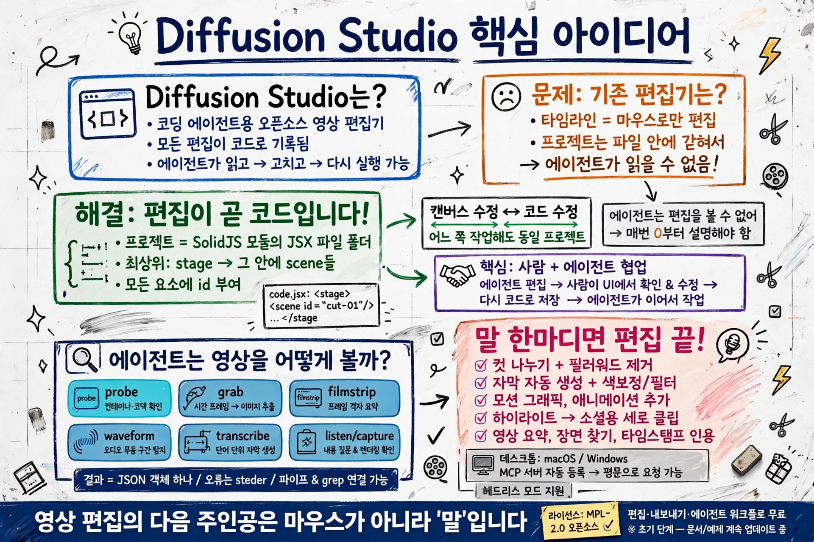
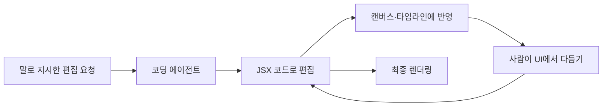
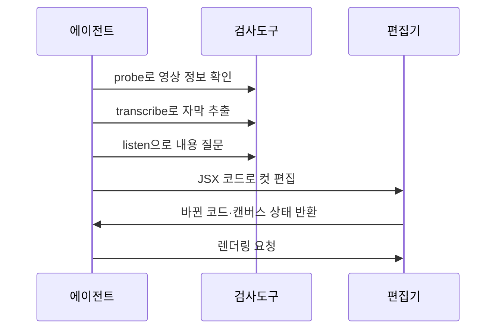

# Diffusion Studio: 에이전트에게 영상 편집을 맡기면, 타임라인이 코드가 됩니다

> **Summary**
> Diffusion Studio는 편집을 JSX 코드로 저장해 코딩 에이전트와 사람이 같은 프로젝트를 이어서 작업할 수 있는 오픈소스 영상 편집기입니다. 말로 요청하면 에이전트가 컷 편집, 필러 워드 제거, 자막과 모션 그래픽 제작, 영상 분석 및 렌더링을 수행하며, 아직 초기 단계라 사용 전 저장소 문서를 확인하는 것이 좋습니다.

---

- Diffusion Studio는 코딩 에이전트를 위해 만든 오픈소스 영상 편집기입니다. 모든 편집이 코드로 기록돼 에이전트가 읽고, 고치고, 다시 실행할 수 있습니다.
- 말로 지시하면 에이전트가 컷을 나누고, 필러 워드를 지우고, 자막과 모션 그래픽까지 만들어 렌더링합니다.
- 기존 편집기와 가장 큰 차이는 편집의 저장 방식입니다. 타임라인이 아니라 코드가 원본이라, 사람과 에이전트가 같은 프로젝트를 오가며 작업합니다.

유튜브 영상 하나를 편집하는 데 몇 시간이 걸리시나요? 말 더듬은 구간을 자르고, 자막을 달고, 소셜용 짧은 클립까지 뽑으려면 타임라인 앞에서 보내는 시간이 끝이 없습니다. 그런데 이 반복 작업을 말 한마디로 넘길 수 있다면 어떨까요?

🎥 [동영상 보기](https://www.youtube.com/watch?v=xTuL739hyWY)

## 에이전트는 왜 영상 편집을 못 했을까요?

코딩 에이전트는 이미 코드를 읽고, 고치고, 테스트까지 돌립니다. 그런데 영상 편집 앞에서는 멈췄습니다. 이유가 뭘까요? 기존 편집기는 프로젝트를 사람이 눈으로 보고 마우스로 만지는 형태로 저장하기 때문입니다. 에이전트가 읽을 수 있는 형태가 아니었습니다!

편집 결과를 에이전트에게 다시 설명하려면, 무엇이 어떻게 바뀌었는지 기록이 있어야 합니다. 그런데 타임라인에서 드래그한 결과는 파일 안에만 갇혀 있었습니다. 에이전트는 지난 편집을 볼 수 없으니, 이어서 작업할 수도 없었습니다. 매번 처음부터 설명해야 하는 셈입니다.

## 편집이 곧 코드입니다!

이 편집기의 답은 단순합니다. 편집 결과를 코드로 저장하는 것입니다. 프로젝트는 `SolidJS` 모듈로 이뤄진 `JSX` 파일들의 폴더입니다. 최상위에는 `<stage>`가 있고, 그 안에 자른 장면마다 `<scene>`이 들어갑니다. 모든 요소에는 `id`가 붙어 있습니다.

캔버스에서 사각형을 끌면 코드가 바뀝니다. 코드를 고치면 캔버스가 다시 그려집니다. 어느 쪽에서 작업해도 같은 프로젝트입니다. 이게 왜 중요할까요? 에이전트가 편집을 코드처럼 다루게 되기 때문입니다. 읽고, diff를 보고, 다시 실행할 수 있습니다!

사람이 에이전트의 결과를 UI에서 이어받을 수 있다는 점이 핵심입니다. 에이전트가 만든 편집을 사람이 눈으로 확인하고, 마음에 안 드는 부분만 손으로 고치면 그 결과가 다시 코드에 남습니다. 에이전트는 그 바뀐 코드를 보고 다음 작업을 이어갑니다.

## 에이전트는 영상을 어떻게 보고 들을까요?

에이전트는 눈이 없습니다. 영상을 보지 못하니, 볼 수 있게 해주는 도구가 필요했습니다. 그래서 이 프로젝트는 영상을 검사하는 명령어들을 함께 제공합니다.

- `probe`: 컨테이너와 코덱 정보를 확인합니다.
- `grab`: 지정한 시간의 프레임을 이미지로 뽑습니다.
- `filmstrip`: 영상 프레임을 격자로 모아 보여줍니다.
- `waveform`: 오디오 파형에서 무음 구간을 표시합니다.
- `transcribe`: 단어 단위 시간 정보가 있는 자막을 만듭니다.
- `listen`: 멀티모달 모델에게 영상의 내용을 질문합니다.
- `capture`: 실제 렌더링될 프레임을 장면별로 확인합니다.
결과는 모두 `JSON` 객체 하나입니다. 오류는 표준 오류 출력으로 나가고 종료 코드는 `1`입니다. 파이프와 `grep`에 바로 연결되도록 설계된 셈입니다. 에이전트가 다루기 쉬운 형태라는 뜻입니다!

## 말 한마디면 편집이 끝납니다

원본 영상이 담긴 폴더를 열고, 원하는 영상을 말로 설명하면 됩니다. 에이전트가 알아서 처리합니다. 컷 나누기, 필러 워드 제거, 자막, 색 보정과 필터, 애니메이션, 최종 렌더링까지 말입니다.

할 수 있는 일은 컷 편집에서 끝나지 않습니다. 설명 영상이나 프로모 같은 모션 그래픽도 만들고, 긴 영상에서 하이라이트를 뽑아 소셜용 세로 영상으로 바꾸는 클리핑도 합니다. 영상 내용을 요약하거나, 장면을 찾거나, 타임스탬프가 있는 인용을 뽑아내는 영상 이해도 가능합니다.

데스크톱 앱은 macOS와 Windows에서 쓸 수 있습니다. 앱이 `MCP` 서버를 에이전트에 등록해 주니, 평문으로 물어보기만 하면 됩니다. 헤드리스 모드도 있어 화면 없이 실행할 수도 있습니다.

## 어디까지 믿고 쓰면 좋을까요?

이 프로젝트는 `MPL-2.0` 라이선스의 오픈소스입니다. 편집, 내보내기, 에이전트 워크플로까지 무료로 쓸 수 있습니다. 다만 아직 초기 단계의 프로젝트라는 점은 알고 써야 합니다. 문서와 예제 구성이 계속 바뀌고 있으니, 시작 전에 저장소의 문서부터 확인하는 편이 좋습니다.

영상 편집의 다음 주인공은 마우스가 아니라 말입니다. 타임라인을 코드로 바꾸는 순간, 편집은 에이전트에게 맡길 수 있는 일이 됐습니다!

