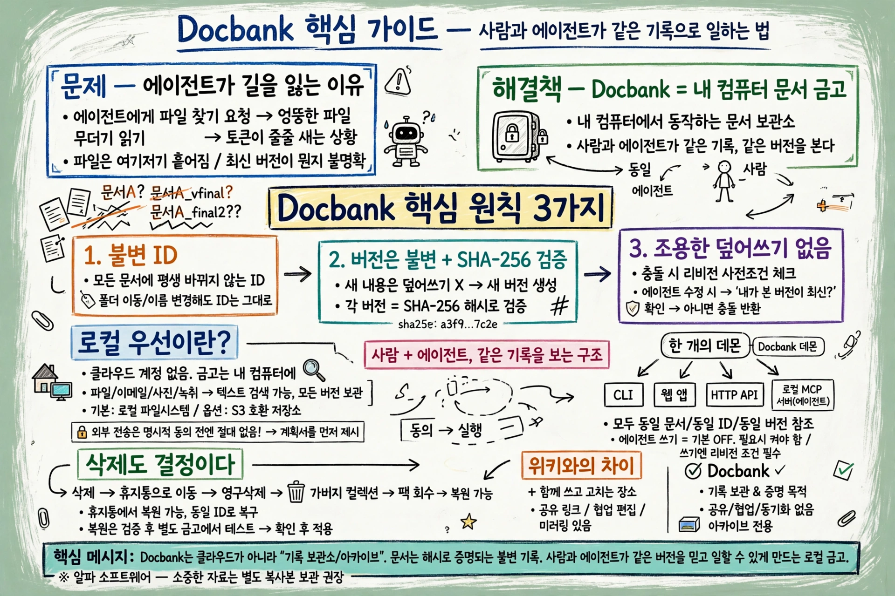
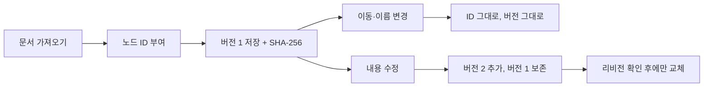
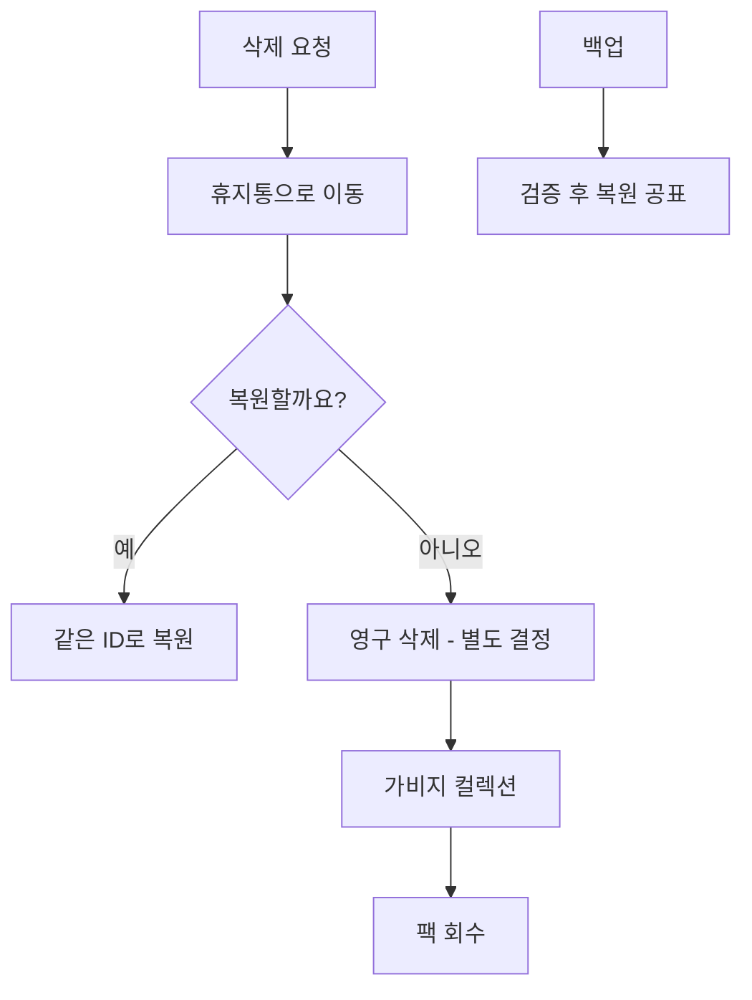
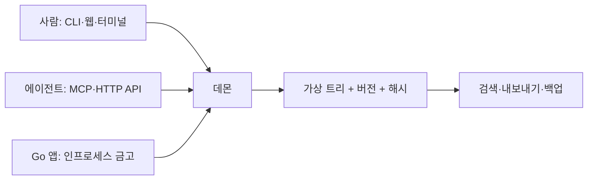

# Docbank: 내 컴퓨터에 두는 문서 금고, 사람과 에이전트가 같은 기록을 봅니다

> **Summary**
> Docbank는 내 컴퓨터에서 돌아가는 문서 금고로, 사람과 에이전트가 같은 문서, 같은 ID, 같은 버전을 보고 일합니다. 문서마다 평생 바뀌지 않는 노드 ID가 있고 모든 버전은 SHA-256 해시로 검증되며, 조용한 덮어쓰기 대신 리비전 사전조건으로 명시적 충돌을 만듭니다. 동기화·공유·협업 편집은 없는 아카이브 겸 기록 시스템으로, 삭제·백업·복원도 각각 별도의 결정과 검증을 거칩니다.

---

- Docbank는 내 컴퓨터에서 돌아가는 문서 금고입니다. 사람과 에이전트가 같은 기록을 보고, 같은 버전으로 일합니다.
- 문서마다 평생 바뀌지 않는 ID가 있고, 모든 버전은 SHA-256 해시로 검증됩니다. 조용한 덮어쓰기는 없습니다.
- 동기화·공유·협업 편집은 없습니다. 클라우드가 아니라 기록 보관소, 아카이브가 목적입니다.

에이전트한테 파일 하나 찾아달라고 했는데, 엉뚱한 파일을 잔뜩 읽고 토큰이 줄줄 새는 걸 본 적 있으시죠? 파일은 여기저기 흩어져 있고, 어떤 게 최신인지도 알 수 없고요. Docbank는 이 문제를 정면으로 파고든 도구입니다. 문서를 내 컴퓨터 금고에 모아두고, 사람과 에이전트가 같은 기록을 보게 만드는 겁니다.

🎥 [동영상 보기](https://www.youtube.com/watch?v=6-nWixqqJ5Q)

## 로컬 우선, 무슨 뜻일까요?

Docbank는 클라우드 계정이 없습니다. 금고는 내 컴퓨터에 있습니다. 파일, 이메일, 사진, 녹취까지 가져와서 텍스트를 검색할 수 있게 만들고, 저장한 버전은 전부 남깁니다. 기본 저장소는 로컬 파일시스템이고, 필요하면 S3 호환 저장소를 붙일 수도 있습니다. 단, 그 저장소가 문서 목록이 되는 건 아닙니다. 목록은 내 컴퓨터의 데이터베이스가 갖고 있습니다.

외부 서비스로 내용을 보내는 일은 동의 없이는 일어나지 않습니다! 텍스트 추출이나 임베딩을 하려면, Docbank가 먼저 계획서를 보여줍니다. 어느 업체에, 어디서 돌아가는지, 무엇을 받는지 적혀 있습니다. 동의하기 전에는 아무것도 나가지 않습니다. 로컬 도구를 쓰면 아예 나가지 않고요.

## 사람과 에이전트가 같은 기록을 본다고요?

여기가 Docbank의 심장입니다. CLI, 웹 앱, 터미널 브라우저, HTTP API, 로컬 MCP 서버가 전부 하나의 데몬과 대화합니다. 같은 문서, 같은 ID, 같은 버전을 봅니다. Go 애플리케이션은 데몬 없이 금고를 자기 프로세스 안에 품을 수도 있고요.

에이전트한테는 로컬 MCP 서버가 문을 열어줍니다. 다만 쓰기 기능은 기본으로 꺼져 있습니다. 처리, 보고서, 내보내기 쓰기는 따로 켜야 하고요. 에이전트가 문서를 고칠 때는 리비전 사전조건이 붙습니다. "내가 본 버전이 지금도 최신이냐"를 확인하고, 아니면 충돌로 돌려보냅니다. 조용히 덮어쓰는 일은 없습니다!

## 왜 덮어쓰기를 막을까요?

문서마다 평생 바뀌지 않는 노드 ID가 있습니다. 폴더를 옮기거나 이름을 바꿔도 ID는 그대로입니다. 폴더 트리 자체가 가상이라, 문서를 옮겨도 저장된 바이트는 움직이지 않거든요. 모든 콘텐츠 버전은 불변입니다. 새 내용을 저장하면 옛 버전 위에 덮는 게 아니라 새 버전이 하나 더 생깁니다. 각 버전은 SHA-256 다이제스트로 이름이 붙어서, 읽을 때마다 내용이 맞는지 검증합니다.

이 장면이 가장 인상 깊었습니다. "버전을 남긴다"는 게 단순한 백업이 아니라, 에이전트와 사람이 서로를 믿는 방법이라는 겁니다. 에이전트가 본 버전이 맞는지 해시로 증명하니까요!

## 지우는 일도 결정이라고요?

삭제도 한 번에 끝나지 않습니다. 휴지통으로 보내기, 영구 삭제, 가비지 컬렉션, 팩 회수가 각각 별도의 결정입니다. 지운 문서는 휴지통에서 복원할 수 있고, 이름을 누가 차지했어도 같은 ID로 돌아옵니다. 백업은 증분으로 만들고, 복원하기 전에 구조와 바이트를 검증합니다. 복원 결과를 공표하기 전에 말이죠. 검증이 끝나면 별도 금고에 복원해서 테스트해볼 수도 있습니다.

## 위키랑 뭐가 다를까요?

비슷해 보이지만 목적이 다릅니다. 위키는 함께 쓰고 고치는 곳입니다. Docbank는 기록을 보관하고 증명하는 곳입니다. 그래서 기기 간 폴더 미러링도, 공개 공유 링크도, 협업 편집도 없습니다. 이메일은 `MBOX`나 구글 테이크아웃으로 가져오고, 첨부파일은 별도 문서가 됩니다. 검색 결과는 날짜 범위로 세어 CSV로 내보내고, 증거 ZIP을 함께 묶습니다. 내보내기 전에 어떤 버전이 들어가는지 미리 보여주고, 파일마다 검증까지 마칩니다.

아직 알파 소프트웨어라는 점은 알아두셔야 합니다. 공식 안내도 "소중한 자료는 따로 복사본을 두라"고 말합니다. 그래도 방향은 분명합니다. 문서를 클라우드에 맡기는 대신, 내 컴퓨터 금고에 두고, 사람과 에이전트가 같은 기록으로 일하게 만드는 겁니다. 그 기록이 해시로 증명된다면, 에이전트한테 일을 맡길 때 마음이 한결 놓이지 않을까요?

