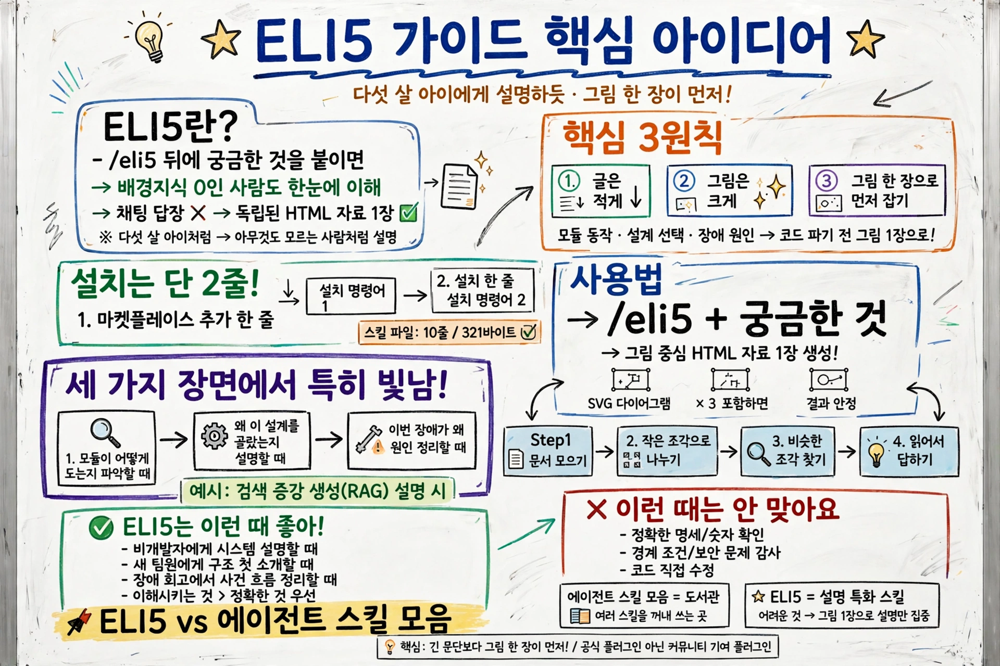
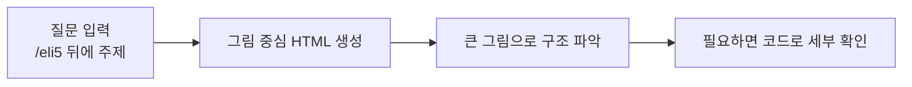

# ELI5: 어려운 기술, 글로 설명하지 말고 그림 한 장으로 보여줍니다

> **Summary**
> ELI5 스킬은 /eli5 명령으로 어려운 기술을 글보다 큰 그림 중심의 독립형 HTML 자료로 설명해 줍니다. 모듈의 동작, 설계 선택, 장애 원인을 빠르게 파악하고 비전문가나 새 팀원에게 설명하는 데 유용하지만, 정확한 명세·경계 조건·보안 감사·코드 수정에는 적합하지 않으므로 그림으로 개요를 잡은 뒤 공식 문서와 코드로 세부 내용을 확인해야 합니다.

---

- `/eli5` 뒤에 궁금한 것을 붙이면, 배경지식이 전혀 없는 사람도 한눈에 이해할 수 있는 그림 중심 HTML 자료 한 장이 나옵니다.
- 글은 줄이고 그림을 키우는 것이 핵심입니다. 모듈 동작, 설계 선택, 장애 원인까지 코드 파기 전에 그림 한 장으로 먼저 잡습니다.
- 설치는 마켓플레이스 추가 한 줄과 설치 한 줄, 딱 두 명령어면 끝납니다. 스킬 파일 자체는 10줄, 321바이트에 불과합니다.


팀에 새로 합류한 동료가 물었습니다. "이 모듈이 어떻게 도는 거예요?" 코드를 열고 함수부터 따라가려다가, 문득 이런 생각이 들었습니다. 설명을 듣는 사람 머릿속에 그림이 먼저 그려져야 하지 않을까요? 긴 문단보다 그림 한 장이 먼저 필요한 순간이 있습니다!

🎥 [동영상 보기](https://www.youtube.com/watch?v=fOxC44g8vig)

## ELI5가 뭘까요?

"ELI5"는 "다섯 살 아이에게 설명하듯"이라는 뜻입니다. 클로드 코드에서 `/eli5` 뒤에 궁금한 것을 붙이면, 채팅 답장이 아니라 독립된 HTML 자료 한 장이 만들어집니다. 대상은 배경지식이 전혀 없는 사람입니다. 출력은 세 가지 제약을 지킵니다. 첫째, 형식은 채팅 답장이 아니라 독립된 HTML 자료입니다. 둘째, 정보 밀도는 "글은 적게"입니다. 셋째, 표현 방식은 "그림은 크게"입니다. 구조는 글로 서술하지 않고 그림으로 보여줍니다.

여기서 한 가지 재미있는 차이가 있습니다. 스킬 설명란에는 "다섯 살 아이처럼"이라고 적혀 있는데, 실제 지시문은 "이 주제에 대해 아무것도 모르는 사람처럼 설명하라"고 적혀 있습니다. 말 그대로 다섯 살 어휘에 맞추면 설명 정확도가 떨어지기 때문입니다. 전제 지식을 걷어내는 것이 목표지, 어린아이 말투로 바꾸는 것이 목표가 아닙니다!



## 어떻게 설치하고 쓸까요?

설치는 두 명령어면 끝납니다. 먼저 커뮤니티 마켓플레이스를 추가하고, 그다음 스킬을 설치합니다.

```bash
claude plugin marketplace add anthropics/claude-plugins-community
claude plugin install eli5@claude-community
```

설치가 잘 됐는지 확인하려면 플러그인 목록을 봅니다. 버전 1.0.0으로 표시되면 준비가 끝난 것입니다. 사용법은 단순합니다. `/eli5` 뒤에 궁금한 것을 그대로 붙이면 됩니다.

```plain text
/eli5 how does RAG actually work
/eli5 how does auth work in this project
/eli5 why is the sky blue
```

그림이 생각보다 적게 나올 때가 있습니다. 이럴 때는 "SVG 다이어그램을 최소 3개 포함해달라"는 조건을 덧붙이면 결과가 훨씬 안정적입니다!

## 어디에 쓰면 좋을까요?

세 가지 장면에서 특히 빛납니다. 첫째, 이 모듈이 어떻게 도는지 파악할 때입니다. 둘째, 왜 이 설계를 골랐는지 설명할 때입니다. 셋째, 이번 장애가 왜 났는지 원인을 정리할 때입니다. 코드 파기 전에 그림 한 장으로 전체를 먼저 잡는 식입니다.

실제 사용 예시도 있습니다. 검색 증강 생성(RAG)을 설명해달라고 하자, 네 단계로 압축된 그림이 나왔습니다. 문서를 모으고, 작은 조각으로 나누고, 질문과 비슷한 조각을 찾고, 읽어서 답하는 순서입니다. 질문에서 출발해 문서를 찾고 읽어서 답한다는 흐름이 한눈에 들어왔습니다. 다만 이 자료는 "어떤 원리인지"를 파악하는 입구일 뿐, 정확한 명세가 아니라는 점을 분명히 했습니다.


## 어디까지 믿으면 될까요?

이 스킬은 "이해시키는 것"을 "정확한 것"보다 앞에 둡니다. 그래서 세 가지 용도에는 잘 맞습니다. 비개발자에게 시스템을 설명할 때, 새 팀원에게 구조를 처음 보여줄 때, 장애 회고에서 사건의 흐름을 정리할 때입니다. 그림으로 바꿀 수 없는 부분은 아직 이해하지 못한 부분이라는 신호로도 쓸 수 있습니다!

반대로 네 가지는 맞지 않습니다. 정확한 명세나 숫자 확인, 경계 조건 검토, 보안 문제 감사, 코드 직접 수정입니다. 이런 작업은 그림으로 전체를 잡은 뒤, 일반 지시나 공식 문서로 세부 사항을 확인하는 것이 순서입니다. 한 가지 더 짚을 점이 있습니다. 이 스킬은 공식 플러그인이 아니라 커뮤니티 기여 플러그인입니다. 사내에서 널리 쓰인다고 해서 공식 지원이 보장되는 것은 아닙니다.

## 스킬은 도구가 아니라, 설명의 순서입니다

에이전트 스킬을 한데 모아 관리하는 방식과는 역할이 다릅니다. 그쪽이 여러 스킬을 꺼내 쓰는 도서관이라면, ELI5는 그중에서도 "설명" 하나에만 집중한 스킬입니다. 지식을 쌓는 것이 아니라, 아는 것을 남에게 건네는 방식을 바꾸는 것입니다. 어려운 기술을 만났을 때, 글부터 쓰지 말고 그림 한 장부터 그려보시는 건 어떨까요?

