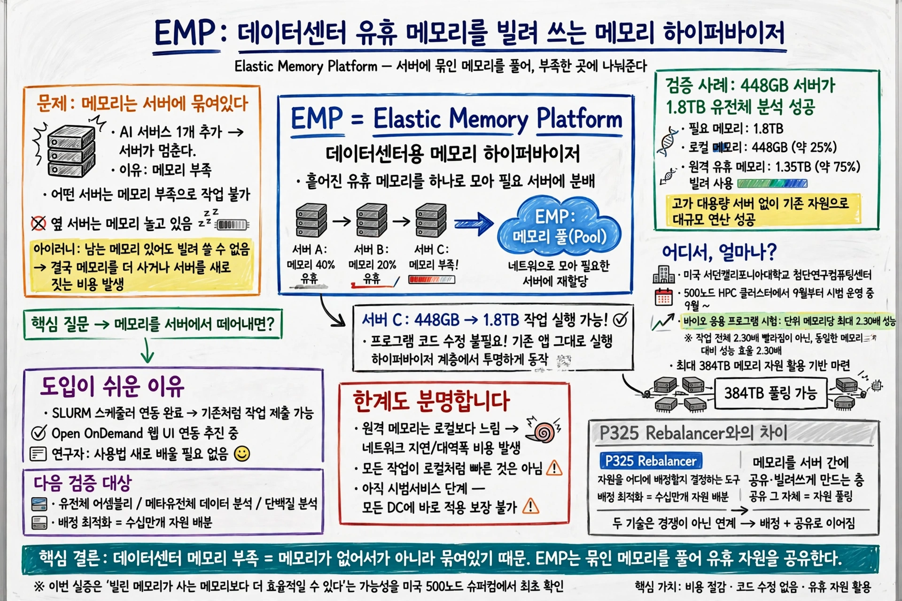
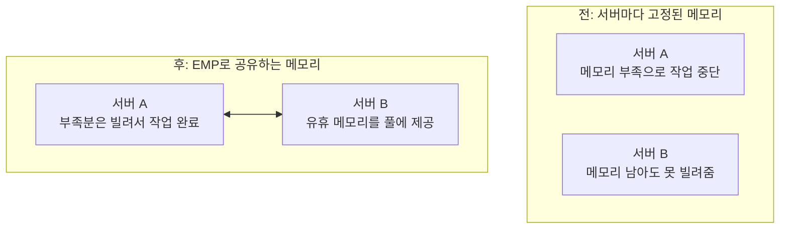

# EMP: 448GB 서버가 1.8TB 작업을 돌립니다. 남는 메모리를 빌려 쓰면 됩니다

> **Summary**
> EMP는 데이터센터의 유휴 메모리를 모아 메모리가 부족한 서버에 빌려주는 하이퍼바이저로, 코드 수정 없이 대규모 작업을 실행할 수 있습니다. 미국 500노드 슈퍼컴퓨터 클러스터에서 448GB 서버로 1.8TB 유전체 분석을 수행했고, 단위 메모리당 성능은 최대 2.30배를 기록했습니다. 다만 원격 메모리는 로컬 메모리보다 느리며, 기술은 아직 시범 운영 단계입니다.

---

- 448GB짜리 서버가 1.8TB가 필요한 유전체 분석을 돌렸습니다. 모자란 메모리는 옆 서버에서 빌려 썼습니다.
- `EMP`는 데이터센터 안에 흩어진 유휴 메모리를 모아 필요한 서버에 나눠주는 메모리 하이퍼바이저입니다. 프로그램 코드도 고칠 필요가 없습니다.
- 미국 대학의 500노드 슈퍼컴퓨터 클러스터에서 시범 운영 중이고, 단위 메모리당 성능이 최대 2.30배까지 나왔습니다. 다만 원격 메모리는 로컬보다 느리다는 한계도 있습니다.

AI 서비스를 하나 더 올릴 때마다 서버가 멈춘다고요? 메모리가 모자라서 그렇습니다. 생성형 AI가 퍼지면서 서버 메모리 수요가 빠르게 늘었고, 메모리 값도 따라 올랐습니다. 그런데 데이터센터를 들여다보면 아이러니한 장면이 있습니다. 어떤 서버는 메모리가 모자라 작업을 못 돌리는데, 옆 서버의 메모리는 놀고 있습니다. 왜 빌려 쓰지 못할까요?

메모리 때문입니다. 서버 한 대의 메모리는 그 서버에만 묶여 있습니다. 옆 서버에 남는 메모리가 있어도, 내 서버는 쓸 수 없습니다. 그래서 그동안의 해법은 하나였습니다. 메모리를 더 사거나, 더 큰 서버를 새로 짓는 것. 돈이 드는 해법이었죠.

🎥 [동영상 보기](https://www.youtube.com/watch?v=WnbWsA3lzGc)

## 메모리를 서버에서 떼어내면 어떻게 될까요?

국내 한 연구팀이 만든 `EMP`는 이 질문에 대한 답입니다. `EMP`는 `Elastic Memory Platform`의 줄임말로, 데이터센터용 메모리 하이퍼바이저입니다. 하이퍼바이저라고 하면 가상 머신을 떠올리기 쉽지만, 여기서는 메모리를 가상으로 관리하는 층이라고 보시면 됩니다.

원리는 단순합니다. 데이터센터 안에 흩어진 서버들의 유휴 메모리를 하나로 모아, 메모리가 부족한 서버에 나눠주는 것입니다. 메모리가 모자란 서버는 초고속 네트워크인 `InfiniBand`로 연결된 다른 서버의 메모리를 빌려 씁니다. 서버의 물리적 메모리 용량을 넘어서는 작업도 돌릴 수 있게 됩니다!

## 448GB 서버가 1.8TB 작업을 돌렸습니다

숫자가 먼저 말해줍니다. 성능 검증에서 약 1.8TB의 메모리가 필요한 유전체 분석 작업을, 로컬 메모리가 448GB인 서버에서 실행하는 데 성공했습니다. 서버 자체 메모리는 필요 용량의 약 25%에 불과했습니다. 나머지 75%는 다른 서버의 유휴 메모리를 빌려 채웠습니다.

고가의 대용량 메모리 서버를 새로 짓지 않고, 이미 있는 서버와 유휴 자원으로 대규모 연산을 해낸 셈입니다! 더 반가운 점도 있습니다. 기존 응용 프로그램의 소스코드를 수정하지 않고도 기술을 적용할 수 있습니다. 연구자가 코드를 뜯어고칠 필요가 없다는 뜻입니다.

## 어디서, 얼마나 검증됐을까요?

실증 무대는 미국 서던캘리포니아대학교의 첨단연구컴퓨팅센터, 500노드 규모의 고성능컴퓨팅 클러스터입니다. 지난 9월부터 시범서비스를 운영하고 있습니다. 국내 연구팀이 개발한 시스템 소프트웨어가 미국 대규모 슈퍼컴퓨터 운영환경에 들어가 실제 서비스로 돌아간다는 점이 먼저 눈에 띕니다.

성과도 있습니다. 해당 센터가 요구한 바이오 응용 프로그램을 대상으로 한 시험에서, 기존 시스템보다 단위 메모리당 최대 2.30배 높은 성능을 기록했습니다. 여기서 숫자 하나를 정확히 짚고 넘어가야 합니다. 2.30배는 작업 전체가 2.30배 빨라졌다는 뜻이 아닙니다. 같은 메모리 용량으로 얼마나 잘 해내느냐를 잰 수치입니다. 그래도 유휴 메모리를 빌려 쓰는 방식이 기존보다 낫다는 것을 보여주는 결과입니다.

이 실증을 통해 해당 클러스터에서는 최대 384TB 규모의 메모리 자원을 `EMP`로 활용할 수 있는 기반도 마련됐습니다. 384TB면 서버 수백 대의 메모리를 한데 모은 규모입니다!

## 연구자는 사용법을 새로 배울 필요가 없습니다

도입의 문턱도 낮췄습니다. 고성능컴퓨팅 분야의 표준 작업 스케줄러인 `SLURM`과의 연동이 이미 끝났습니다. 연구자는 기존과 같은 방식으로 연산 작업을 제출하고, 필요할 때 확장된 메모리를 쓰면 됩니다. 웹 기반 고성능컴퓨팅 사용자 인터페이스인 `Open OnDemand`와의 연동도 추진 중입니다.

앞으로의 검증 범위도 정해져 있습니다. 유전체 어셈블리, 메타유전체 데이터 분석, 단백질 분석, 기상 예측 같은 대규모 과학계산 응용이 다음 대상입니다. 계산생물학과 지구환경과학, 의과대학 연구진이 함께 참여할 예정입니다.

## 한계도 분명합니다

장밋빛 이야기만 있는 것은 아닙니다. 원격 메모리는 네트워크를 통해 접근하기 때문에, 로컬 메모리보다 지연시간이 생기고 데이터 전송 비용도 듭니다. 모든 작업이 빌린 메모리에서 로컬처럼 빠르게 돌아가는 것은 아닙니다. 그리고 아직 시범서비스 단계입니다. 500노드 클러스터 한 곳에서 돌아가는 기술이, 모든 데이터센터에 그대로 통한다는 보장은 없습니다.

그래서 이 기술을 볼 때 질문 하나가 남습니다. 빌려 쓰는 메모리가, 사는 메모리보다 정말 쌀까요? 이번 실증은 그 질문에 "그럴 수 있다"는 답을 내놓은 단계입니다.

## P325와 무엇이 다를까요?

비슷한 주제를 다룬 글이 하나 더 있습니다. P325에서 다룬 `Rebalancer`는 자원을 어디에 배정할지를 정하는 도구였습니다. 배정 문제를 말로 적으면 수십만 개를 빠르게 나누는 기술이었죠. 이 글의 `EMP`는 배정이 아니라 공유 그 자체입니다. 남는 메모리라는 자원 자체를 서버 사이에서 빌려 쓸 수 있게 만드는 층입니다. 배정을 잘하는 것과, 나눠 쓸 자원을 만드는 것은 다른 일입니다. 두 기술은 겹치는 곳이 아니라 이어지는 곳에 있습니다.

데이터센터의 메모리 부족은, 메모리가 없어서가 아니라 묶여 있어서 생기는 문제일 수 있습니다. 묶인 것을 푸는 기술이, 사는 것보다 먼저 올 수 있지 않을까요? 이번 실증은 그 가능성을 미국 대규모 슈퍼컴퓨터에서 확인한 첫걸음입니다!

