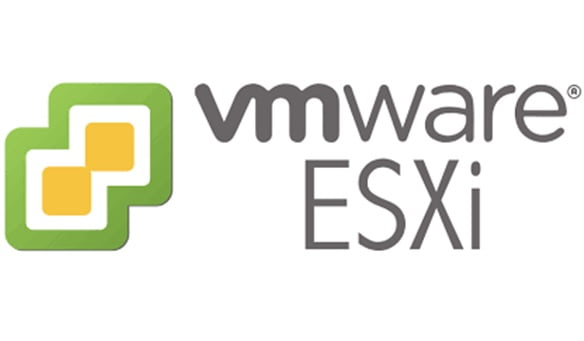

# ESXi무료로 받아보자

> **Summary**
> VMware ESXi 8.0U3e 무료 버전이 출시되었으며, 다운로드는 제공된 링크를 통해 가능하다. 파일 이름, 릴리스 날짜, 빌드 번호 및 해시 값 등의 정보가 포함되어 있다.

---

🔗 [https://svrforum.com/itnews/2301976](https://svrforum.com/itnews/2301976)

## 내 정보 (어처피 SHA있어봤자 의미없을듯)

| 항목 | 내용 |
| **File Name** | VMware-VMvisor-Installer-8.0U3e-24677879.x86_64.iso (618.34 MB) |
| **Release Date** | Apr 10, 2025 |
| **Last Updated** | Apr 07, 2025 |
| **Build Number** | 24677879 |
| **SHA2** | 9782c96ffd01cc56da17ec31573da69f4cba2f9402e67c8b55d05d9472c7376a |
| **MD5** | ddb642eee9635ceaeaeb812ccd813189 |
| **Description** | VMware vSphere Hypervisor (ESXi ISO) image |

