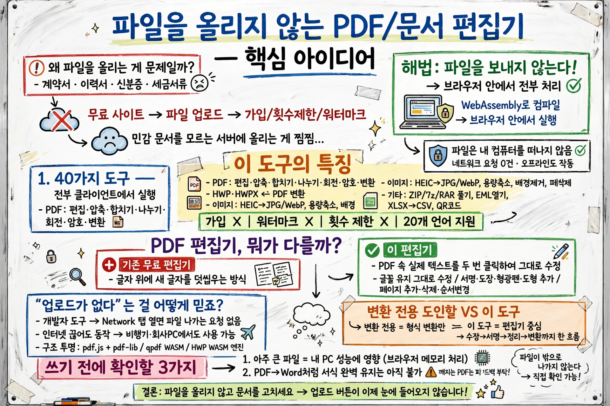
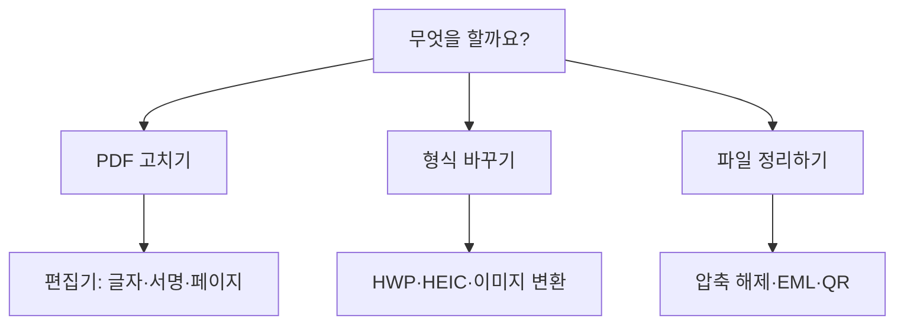

# EZPZ File: 계약서를 모르는 서버에 올리지 마세요. 브라우저 안에서 편집부터 변환까지 끝냅니다

> **Summary**
> 계약서나 이력서를 모르는 서버에 올리지 않고, 브라우저 안에서 PDF를 고치고 변환하는 도구 모음입니다. PDF 편집·압축·합치기부터 HWP·HEIC 변환, 압축 해제까지 40가지 가까운 도구가 전부 클라이언트에서 돌아가며, 가입도 워터마크도 횟수 제한도 없습니다. 파일이 밖으로 나가지 않는다는 건 개발자 도구로 직접 확인할 수 있고, 편집기를 중심에 둔다는 점에서 변환만 하는 도구와 다릅니다.

---

- 계약서나 이력서를 모르는 서버에 올리지 않고, 브라우저 안에서 PDF를 고치고 변환하는 도구 모음입니다.
- PDF 편집·압축·합치기부터 HWP·HEIC 변환, 압축 해제까지 40가지 가까운 도구가 전부 클라이언트에서 돌아갑니다.
- 가입도 워터마크도 횟수 제한도 없습니다. 파일이 밖으로 나가지 않는다는 건 개발자 도구로 직접 확인할 수 있습니다.

계약서 PDF에서 날짜 하나만 바꾸면 되는데, 무료 편집 사이트에 파일을 올리는 순간이 찜찜했던 적 있으시죠? 이력서, 신분증 사진, 세금 서류. 다루는 파일일수록 남의 서버에 맡기기가 꺼려집니다!

🎥 [동영상 보기](https://www.youtube.com/watch?v=_JxAjYMFIQ0)

## 왜 파일을 올리는 게 문제일까요?

무료 변환 사이트의 순서는 대개 비슷합니다. 업로드하고, 가입하고, 횟수 제한에 걸리고, 워터마크가 찍힙니다. 정작 다루는 파일은 계약서나 이력서 같은 민감한 문서입니다. 이런 파일을 모르는 서버에 올리는 게 계속 마음에 걸렸다는 게, 이 도구가 만들어진 이유입니다.

해법은 단순합니다. 파일을 보내지 않는 것입니다. 변환 프로그램 자체를 `WebAssembly`로 컴파일해 브라우저 안에서 돌리면, 파일은 내 컴퓨터를 떠나지 않습니다!

## PDF 편집기, 뭐가 다를까요?

대부분의 무료 PDF 편집기는 기존 글자 위에 새 글자를 덧씌우는 방식입니다. 그런데 이 편집기는 다릅니다. PDF 속 글자를 두 번 누르면 원래 글꼴 그대로 수정할 수 있습니다!

새 글자·서명·도장·형광펜·도형을 추가하는 건 기본이고, 페이지 추가·삭제·순서 변경까지 됩니다. 계약서 오타 하나 때문에 다시 만들 필요가 없어집니다. 이 장면이 저는 가장 인상 깊었습니다. 편집기가 파일을 고치는 게 아니라, 문서 자체를 다루고 있다는 느낌이 들었거든요.

## 40가지 도구, 어떻게 골라 쓸까요?

편집기 하나만 있는 게 아닙니다. 40가지 가까운 도구가 한곳에 모여 있습니다. 종류별로 나눠보면 이렇습니다.

- **PDF**: 압축, 합치기, 나누기, 회전, 암호 걸기·풀기, `Word`·`Excel`·`JPG` 변환
- **HWP·HWPX**: `HWP`→`PDF`, `PDF`→`HWP`·`HWPX`, `HWPX`→`HWP` 변환. 한컴오피스가 없는 맥이나 회사 PC에서도 됩니다.
- **이미지**: `HEIC`→`JPG`, `WebP` 변환, 용량·크기 줄이기, 배경 제거, 사진 위치정보(`EXIF`) 삭제
- **기타**: `ZIP`·`7z`·`RAR` 풀기, `EML` 열기, `XLSX`→`CSV`, QR 코드
가입도 워터마크도 횟수 제한도 없습니다. 20개 언어를 지원합니다. 도구 하나를 쓸 때마다 새 사이트를 찾을 필요가 없다는 게, 모음집의 진짜 가치입니다!

## "업로드가 없다"는 말, 어떻게 믿을까요?

말만 믿을 필요는 없습니다. 직접 확인할 수 있습니다. 개발자 도구 `Network` 탭을 켜고 변환해 보면, 파일이 나가는 요청이 없습니다. 도구를 한 번 열어두면 인터넷을 끊어도 동작합니다. 비행기 안에서도, 설치가 막힌 회사 PC에서도 같은 결과가 나옵니다.

동작 방식도 투명합니다. 편집기는 `pdf.js` + `pdf-lib`, 암호는 `qpdf`의 `WASM` 빌드, `HWP`는 `WASM`으로 돌리는 전용 엔진이 맡습니다. 예외는 딱 하나, 휴대폰에서 PC로 파일을 보내는 기능뿐입니다. 이 기능은 서버를 거치지만, 브라우저에서 먼저 암호화하고 키는 URL 조각에만 두기 때문에 서버는 내용을 볼 수 없습니다. 사이트 자체는 분석 도구를 쓰지만, 파일 내용은 페이지 밖으로 나가지 않습니다.

개발자라면 `MCP` 서버도 쓸 수 있습니다. AI 에이전트가 PDF·이미지 변환을 로컬에서 바로 호출하는 방식입니다. 패키지 이름은 `ezpzfile-mcp`입니다.

## 변환만 하는 도구와 뭐가 다를까요?

비슷해 보이는 도구가 많습니다. 변환만 전문으로 하는 도구도 있습니다. 그런데 이 도구의 중심은 변환이 아니라 편집입니다!

변환 전용 도구는 파일을 한 형식에서 다른 형식으로 바꾸는 데 집중합니다. 이 도구는 그 전에, 문서를 직접 고치는 편집기를 중심에 둡니다. 합친 PDF를 열자마자 오타를 고치고 서명하고 페이지를 빼는 흐름이 한 번에 이어집니다. 변환은 그 주변을 채우는 40가지 도구 중 하나일 뿐입니다. 무엇을 고를까요? 고치는 일이 많으면 편집기 중심 도구가, 바꾸는 일만 있으면 변환 전용 도구가 맞습니다!

## 쓰기 전에 확인할 3가지

첫째, 아주 큰 파일은 내 컴퓨터 성능에 달렸습니다. 모든 처리가 브라우저 메모리 안에서 돌아가기 때문입니다. 둘째, 서식을 완벽하게 유지한 채 `PDF`를 `Word`로 바꾸는 무거운 작업은 아직 범위를 벗어납니다. 셋째, 편집기에서 깨지거나 안 열리는 PDF가 있으면 피드백을 남기는 게 도움이 됩니다. 혼자 만드는 도구라, 피드백 하나하나가 큰 힘이 됩니다.

파일을 올리지 않고 문서를 고치는 방법, 한 번 써보시면 그다음부터는 업로드 버튼이 먼저 눈에 들어오지 않으실 겁니다.

