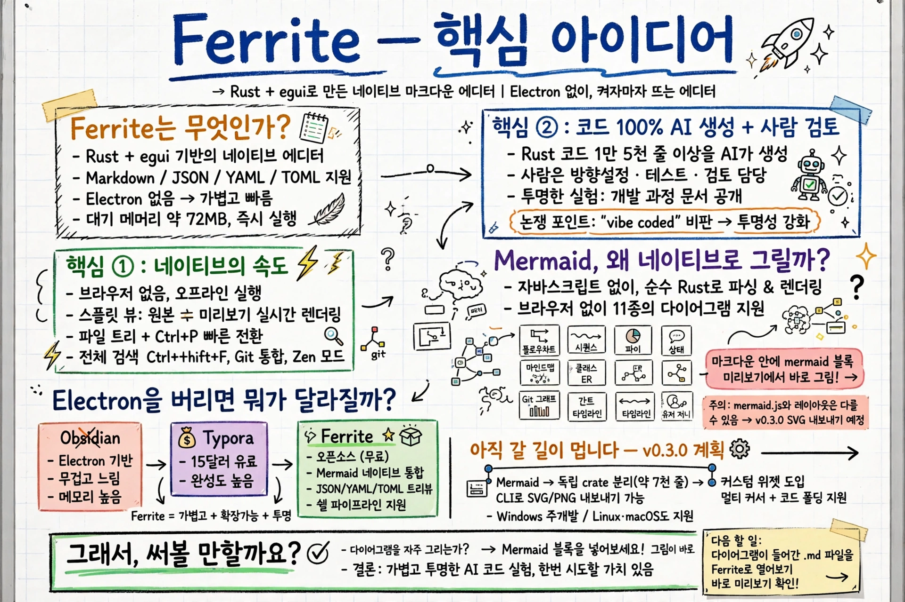
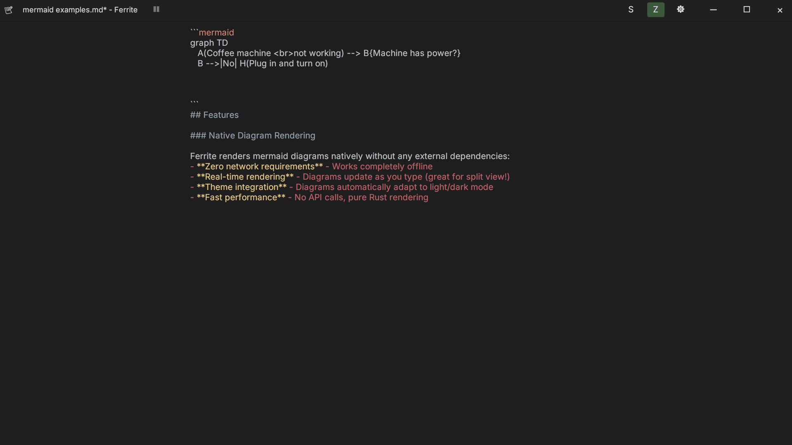
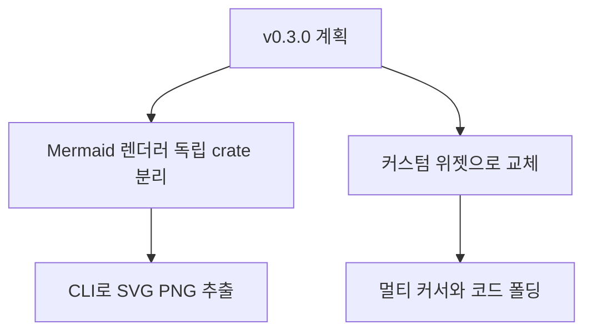
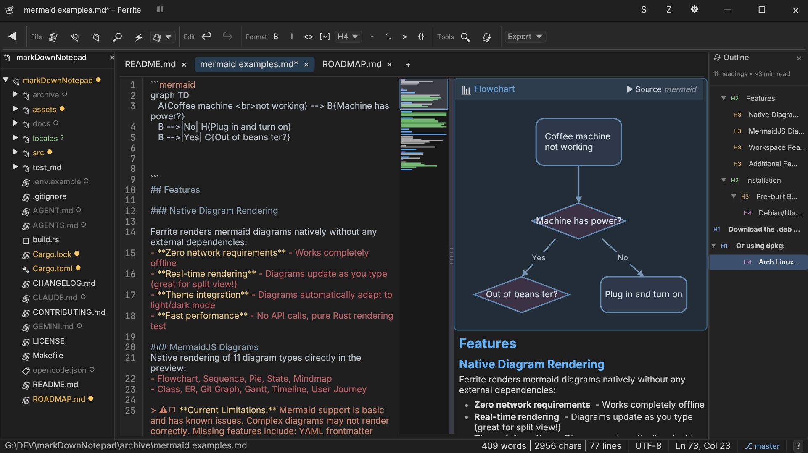

# Electron 없이 Mermaid를 네이티브로 그리는 마크다운 에디터

> **Summary**
> Ferrite는 Rust와 egui로 만든 가벼운 네이티브 마크다운 에디터로, 브라우저 없이 Mermaid 다이어그램 11종을 렌더링합니다. 코드 전체가 AI로 생성되고 사람이 검토한 투명한 실험이며, 멀티 커서·코드 폴딩과 SVG·PNG 내보내기 등을 추가할 계획입니다.

---

- Ferrite는 Rust와 egui로 만든 네이티브 마크다운 에디터로, Electron 없이 켜자마자 뜨고 Mermaid 다이어그램 11종을 브라우저 없이 그립니다.
- 핵심은 두 가지입니다. 네이티브의 속도, 그리고 코드 100%를 AI가 만들고 사람이 검토하는 투명한 실험입니다.
- 아직 갈 길이 멉니다. v0.3.0에서 Mermaid를 독립 crate로 떼어내고, 커스텀 위젯으로 멀티 커서와 코드 폴딩을 풀 계획입니다.

마크다운 에디터, 다들 뭐 쓰세요? 무거운 노트 앱을 오래 쓰다 보면, 가끔 이런 생각이 듭니다. "좀 더 가볍고, 딱 필요한 것만 있는 에디터는 없을까?" 하고요. 그런데 이건 조금 달랐습니다. 다이어그램을 그리는 방식이요! 공개 직후 해커뉴스 첫 페이지에 올랐고, 댓글도 160개 넘게 달렸습니다.

🎥 [동영상 보기](https://www.youtube.com/watch?v=oiVy7NDm-WM)

## Ferrite, 도대체 뭘까요?

Ferrite는 Markdown, JSON, YAML, TOML을 다루는 빠른 텍스트 에디터입니다. Rust와 egui로 만들었습니다. Electron이 없습니다. 그래서 켜자마자 뜹니다. 대기 상태 메모리도 72MB 정도입니다. 가볍습니다.

WYSIWYG 미리보기가 있고, 실시간으로 렌더링됩니다. 스플릿 뷰로 원본과 미리보기를 나란히 볼 수 있고, 두 쪽 다 편집됩니다. 워크스페이스 모드로 폴더를 열고, 파일 트리와 빠른 전환(`Ctrl+P`), 전체 검색(`Ctrl+Shift+F`)을 씁니다. Git 통합으로 변경 상태를 눈으로 확인하고, 세션을 복원하고, Zen 모드로 집중합니다. 기본기는 이미 갖췄습니다.

## Mermaid, 왜 네이티브로 그릴까요?

이게 핵심입니다! Ferrite는 Mermaid 다이어그램을 네이티브로 렌더링합니다. 자바스크립트 없이, 순수 Rust로 Mermaid 문법을 파싱하고 그립니다. 브라우저를 띄우지 않습니다. 종류는 11가지입니다. 플로우차트, 시퀀스, 파이, 상태, 마인드맵, 클래스, ER, Git 그래프, 간트, 타임라인, 유저 저니까지요.

요즘 LLM이 구조화된 텍스트와 다이어그램을 많이 뽑아냅니다. 그 흐름과 딱 맞습니다. 마크다운 안에 다이어그램 코드를 적으면, 미리보기에서 바로 그림이 됩니다. 다만 한 가지, 네이티브 렌더링은 mermaid.js와 레이아웃이 완전히 같진 않습니다. 공유할 땐 다르게 보일 수 있어요. 그래서 v0.3.0에 SVG 내보내기를 넣을 계획입니다.

## Electron을 버리면 뭐가 달라질까요?

Obsidian 같은 노트 앱이 Electron 기반이라는 건, 다들 아실 겁니다. Ferrite는 그 반대편에 섰습니다. 네이티브 앱입니다. 실행이 빠르고, 가볍고, 오프라인으로 돕니다.

비교 대상이 있습니다. Typora는 15달러짜리 유료 에디터입니다. Ferrite는 비슷한 완성도를 노리면서, Mermaid 통합과 JSON/YAML/TOML 트리 뷰어, 쉘 파이프라인까지 얹었습니다. 게다가 오픈소스입니다. "돈을 내고 쓰는 것과 뭐가 다를까요?" 이 질문에 답하는 게 Ferrite의 숙제입니다!

## 코드 100% AI 생성, 이거 괜찮을까요?

여기가 가장 논쟁적인 부분입니다. Ferrite의 Rust 코드 1만 5천 줄 이상이 전부 AI로 생성됐습니다. 사람은 방향을 정하고, 테스트하고, 검토했습니다. 개발 과정 문서까지 공개했습니다. 투명하게요.

그런데 고지 문구는 처음부터 있었던 게 아닙니다. 일부 사용자가 "AI 사용 사실을 숨겼다"고 지적한 뒤에야 추가됐습니다. "vibe coded"라는 비판도 나왔습니다. 공개 당시 커밋이 열 개 남짓이라는 지적도 있었습니다. AI가 만든 코드를 사람이 끝까지 책임지는 실험, 그 자체가 이 프로젝트의 본질이니까요!

## 아직 갈 길이 멉니다

v0.3.0 계획이 이미 나와 있습니다. 약 7천 줄짜리 Mermaid 렌더러를 독립 crate로 떼어냅니다. 그러면 빠른 CLI 도구로 SVG, PNG를 뽑을 수 있게 됩니다. egui의 `TextEdit`은 코드 에디터용이 아니라서, 멀티 커서와 코드 폴딩이 안 됩니다. 그래서 커스텀 위젯으로 교체합니다. Windows에서 주로 개발됐고, Linux와 macOS에서도 돕니다.

## 그래서, 써볼 만할까요?

기준은 하나입니다. 다이어그램을 자주 그리는 분이라면, 한번 깔아보고 Mermaid 블록 하나를 넣어보는 겁니다. 그 그림이 미리보기에서 바로 뜨면, 이 에디터의 매력을 아실 겁니다!

