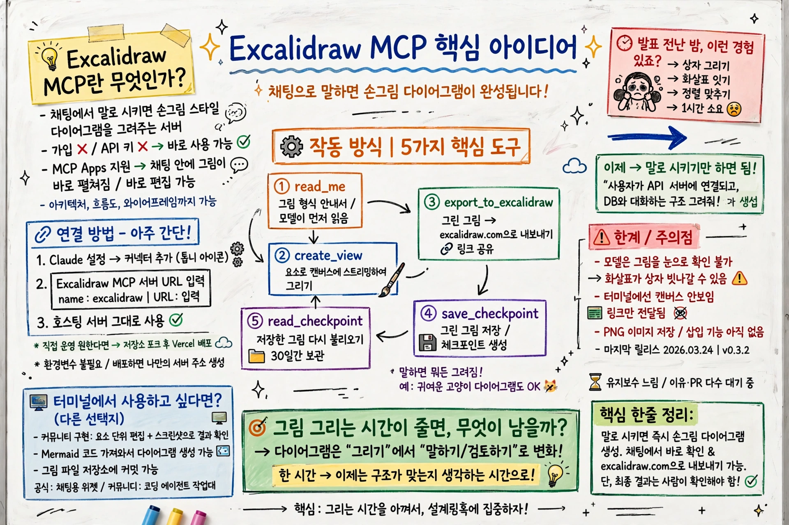
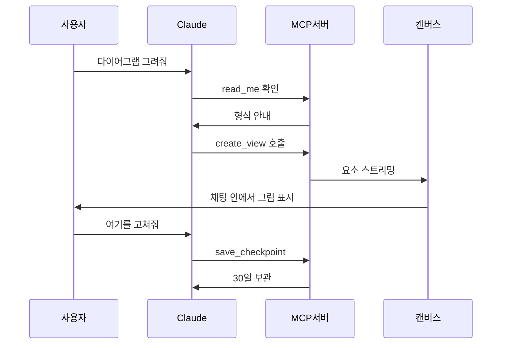
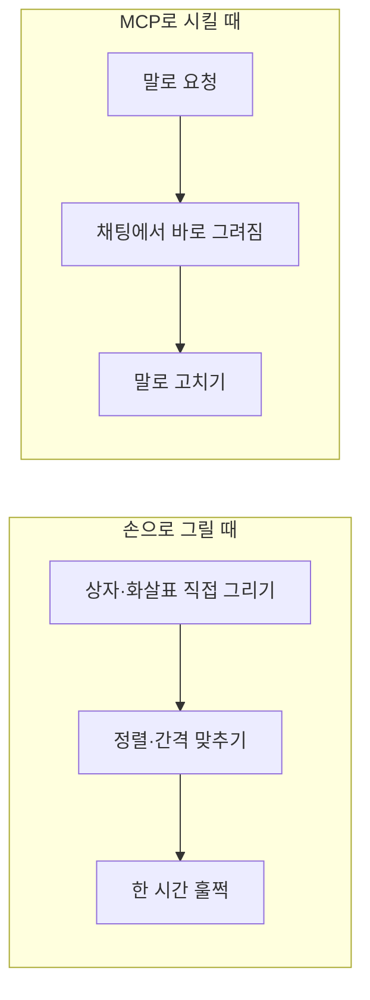

# Excalidraw MCP: 다이어그램은 이제 그리는 게 아니라 말로 시키는 겁니다

> **Summary**
> Excalidraw MCP는 말로 요청하면 채팅 안에서 손그림 스타일 다이어그램을 실시간으로 만들고 편집할 수 있는 공식 서버로, 가입이나 API 키가 필요 없습니다. 다만 모델이 결과를 직접 확인하지 못하고 터미널에서는 캔버스가 보이지 않는 등 한계가 있어, 용도에 맞게 활용해야 합니다.

---

- Excalidraw 공식 MCP는 채팅에서 말로 시키면 손그림 스타일 다이어그램을 그려주는 서버입니다. 가입도, API 키도 필요 없습니다.
- 그림은 채팅 안에 바로 펼쳐지고, 다 그린 뒤에는 `excalidraw.com`으로 내보내 계속 편집할 수 있습니다.
- 단, 터미널에서는 캔버스가 안 보이고 링크만 받고, 모델은 그린 결과를 눈으로 못 봐서 화살표가 빗나가는 일도 있습니다.


## 발표 전날 밤, 아키텍처 그림 그리느라 늦어본 적 있으시죠?

발표 전날 밤입니다. 아키텍처 그림 하나가 남았습니다. 상자를 그리고, 화살표를 잇고, 글자를 맞추고, 정렬이 삐뚤어져서 다시 맞춥니다. 그림 하나 그리는 데 한 시간이 훌쩍 갑니다. 이런 적 있으시죠?

그런데 이제 그림을 그릴 필요가 없습니다. 말로 시키면 됩니다!

🎥 [동영상 보기](https://www.youtube.com/watch?v=ufW78Amq5qA)

## Excalidraw MCP, 도대체 뭘까요?

Excalidraw MCP는 Excalidraw 공식 MCP 서버입니다. 채팅에서 말로 다이어그램을 시키면, 손그림 스타일 그림을 그려줍니다. 아키텍처 설계도, 흐름도, 와이어프레임까지 그립니다.

비결은 MCP Apps라는 확장입니다. 보통 MCP 서버는 텍스트만 돌려주는데, MCP Apps를 지원하는 서버는 채팅 안에 직접 화면을 띄웁니다. 그림이 채팅 안에서 펼쳐지고, 거기서 바로 편집할 수 있습니다. 카메라가 부드럽게 움직이면서 그려지는 모습이 보이고, 전체화면으로 열어 고칠 수도 있습니다!

이 장면이 저는 가장 인상 깊었습니다. 그림이 파일이 아니라 대화의 일부가 된다는 점입니다. 설명하고, 그리고, 고치는 일이 한 화면에서 이어지니까요!

## 연결은 어떻게 할까요?

연결은 간단합니다. Claude 설정에서 커넥터를 추가하고, Excalidraw MCP 서버 URL을 입력하면 됩니다. 이름은 `excalidraw`, URL은 아래 주소입니다.

```javascript
https://mcp.excalidraw.com/mcp
```

터미널에서는 명령 한 줄로 연결합니다.

```bash
claude mcp add --transport http excalidraw https://mcp.excalidraw.com/mcp
```

가입도, API 키도 필요 없습니다. 호스팅된 서버를 그대로 쓰면 됩니다. 직접 운영하고 싶으면 저장소를 포크해서 Vercel에 올리는 방법도 있습니다. 환경 변수는 필요 없고, 배포하면 나만의 서버 주소가 생깁니다. 로컬에서 쓰고 싶으면 확장 파일(`.mcpb`)을 받아 더블클릭으로 설치하거나, 소스에서 직접 빌드해서 설정 파일에 등록합니다.

## 말하면 그려집니다, 어떻게 돌아갈까요?

사용법은 말 한 마디입니다. "사용자가 API 서버에 연결되고, API 서버가 데이터베이스와 대화하는 아키텍처 다이어그램을 그려줘"라고 하면 됩니다. 귀여운 고양이 그림을 그려달라고 해도 됩니다.

서버가 가진 도구는 다섯 개입니다. `read_me`는 그림 형식을 알려주는 안내서이고, 모델이 가장 먼저 읽습니다. `create_view`는 요소를 캔버스에 하나씩 스트리밍하면서 그립니다. `export_to_excalidraw`는 그린 그림을 암호화해서 `excalidraw.com`에 올리고 공유 링크를 돌려줍니다. `save_checkpoint`와 `read_checkpoint`는 그린 그림을 저장하고, 필요할 때 다시 불러옵니다. 체크포인트는 30일 동안 보관됩니다.


## 아쉬운 점은 없을까요?

좋은 점만 있는 건 아닙니다. 모델은 그린 결과를 눈으로 보지 못합니다. 화살표가 상자를 빗나갔는지, 글자가 겹쳤는지 알 수 없습니다. 그림이 이상해도 모델은 모릅니다. 사람이 보고 고쳐야 합니다!

터미널에서는 캔버스도 안 보입니다. MCP Apps를 지원하지 않는 클라이언트에서는 링크만 받습니다. 그림 파일로 바로 저장하는 기능도 없습니다. 이미지 삽입이나 PNG 내보내기도 아직 없습니다.

유지보수도 느린 편입니다. 마지막 릴리스는 2026년 2월 9일 버전 0.3.2이고, 마지막 커밋은 2026년 3월 24일입니다. 열린 이슈와 PR이 수십 개 쌓여 있습니다. 지금은 잘 돌아가지만, 기능이 당분간 그대로일 가능성이 큽니다.



## 터미널에서 쓴다면, 다른 선택지도 있습니다

공식 서버는 채팅용입니다. 터미널에서 코딩 에이전트와 함께 쓰고 싶으면 커뮤니티에서 만든 다른 구현이 있습니다. 요소 단위로 그림을 고치고, 스크린샷으로 그린 결과를 직접 확인하고, Mermaid를 가져와서 그리는 방식입니다. 그림 파일을 저장소에 커밋할 수도 있습니다. 공식 서버가 "말하면 그려주는 채팅 위젯"이라면, 이쪽은 "코딩 에이전트의 그림 작업대"에 가깝습니다. 용도에 맞게 고르면 됩니다.



## 그림 그리는 시간이 줄면, 무엇이 남을까요?

다이어그램은 이제 그리는 게 아니라 말로 시키는 일입니다. 그림 그리는 데 쓰던 한 시간이, 그림이 맞는지 생각하는 시간으로 바뀝니다. 상자를 어디에 둘지가 아니라, 구조가 맞는지 묻는 데 시간을 쓰면 됩니다!

