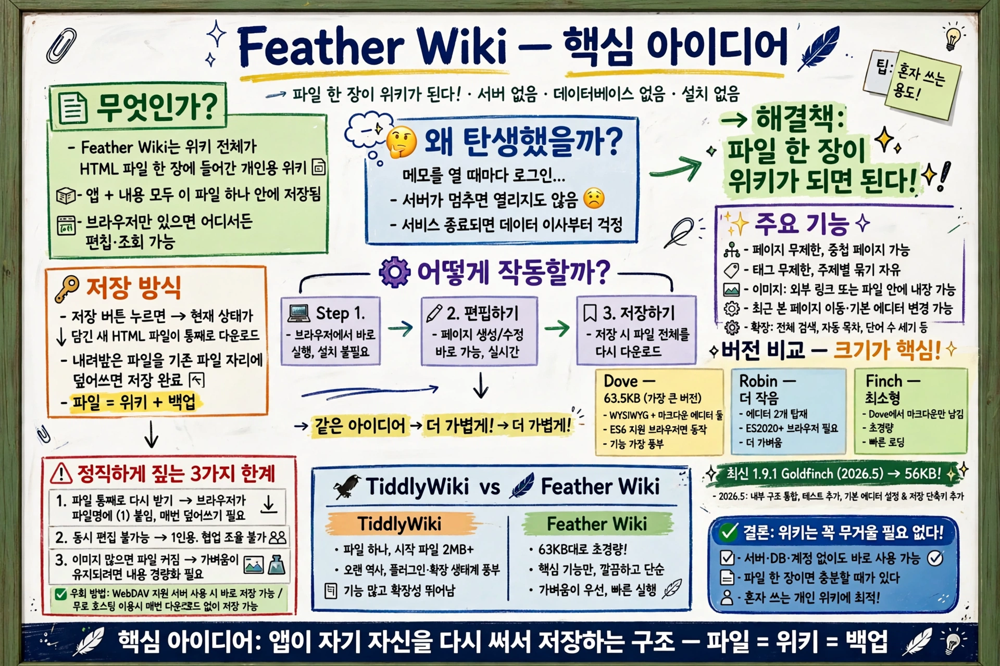
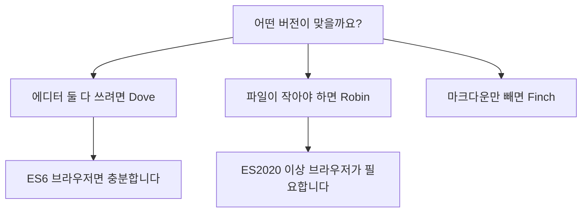
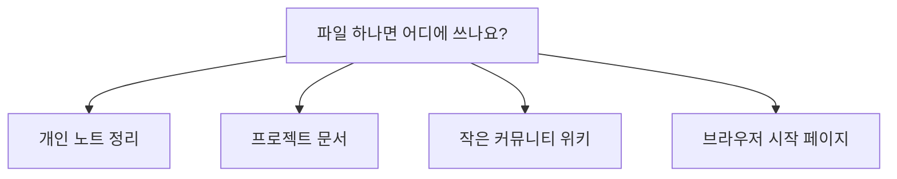

# Feather Wiki: 위키 하나가 HTML 파일 한 장이면, 서버도 DB도 필요 없습니다

> **Summary**
> Feather Wiki는 앱과 내용을 통째로 담은 HTML 파일 한 장으로 돌아가는 개인용 위키입니다. 브라우저만 있으면 어디서든 고칠 수 있고, 저장은 고친 파일을 다시 내려받아 교체하는 방식이라 서버도 데이터베이스도 계정도 필요 없습니다. 가장 큰 버전도 63.5KB, 최신 버전은 56KB라 가벼움이 무기이지만, 파일 통째로 다시 받는 저장 방식과 동시 편집 불가라는 한계는 알고 써야 합니다.

---

- Feather Wiki는 위키 전체가 HTML 파일 한 장에 들어가는 개인용 위키입니다. 앱도 내용도 그 파일 안에 있습니다.
- 브라우저만 있으면 어디서든 고칠 수 있고, 저장은 고친 파일을 다시 내려받아 교체하는 방식입니다.
- 가장 큰 버전도 63.5KB라, 서버도 데이터베이스도 없이 파일 하나만 올리면 위키가 됩니다.

메모를 열 때마다 로그인부터 하셨던 적 있으시죠? 노트는 분명 내 것인데, 서버가 멈추면 열리지도 않고, 서비스가 문을 닫으면 이사부터 걱정해야 합니다. 그래서 노트를 파일로 갖고 싶어 하는 사람들이 있습니다. 그런데 파일로 가져오면 위키의 편한 연결 기능이 사라지지 않을까요? 이 도구는 그 질문에 "파일 한 장이 위키가 되면 됩니다"라고 답합니다!

🎥 [동영상 보기](https://www.youtube.com/watch?v=ZMGpAW0z_Bo)

### 위키가 파일 한 장이라고요?

Feather Wiki는 브라우저에서 바로 돌아가는 작은 위키 도구입니다. 앱 자체가 HTML 파일 하나에 들어 있고, 그 파일 안에 내가 쓴 내용까지 함께 저장됩니다. 파일을 열면 브라우저가 뜨고, 거기서 바로 페이지를 만들고 고칩니다. 설치 과정이 없습니다. 서버도 없습니다. 데이터베이스도 없습니다!

이 구조를 한마디로 설명하면, 앱이 자기 자신을 다시 써서 저장하는 방식입니다. 저장 버튼을 누르면 지금 상태가 담긴 새 버전의 파일이 통째로 내려옵니다. 그 파일을 기존 파일 자리에 덮어쓰면 저장이 끝납니다. 파일이 곧 위키이자 백업인 셈입니다. 그래서 공개하고 싶으면 그 파일 하나만 웹 서버에 올리면 됩니다.

### 뭐가 들어 있나요?

작다고 아무것도 없는 건 아닙니다. 페이지는 개수 제한 없이 만들 수 있고, 페이지 안에 중첩 페이지를 넣을 수도 있습니다. 태그도 무제한이라 주제별로 묶기가 자유롭습니다. 이미지는 외부 주소로 연결하거나 파일 안에 직접 넣을 수 있고, 최근에 본 페이지를 따라가 주는 기능도 있습니다.

설정 화면에서는 위키 이름부터 기본 에디터까지 바꿀 수 있습니다. 확장 기능을 더하면 전체 검색, 자동 목차, 단어 수 세기 같은 기능도 붙습니다. 게임 디자인 문서를 쓰거나, 프로젝트를 정리하거나, 작은 커뮤니티 위키를 운영하는 용도까지, 개인용 정리 도구로는 충분한 구성입니다.

### 버전은 왜 이렇게 많나요?

버전 이름이 전부 새 이름인 점이 재미있습니다. 가장 큰 버전은 `Dove`로 63.5KB입니다. WYSIWYG 에디터와 마크다운 에디터가 둘 다 들어 있고, ES6를 지원하는 브라우저면 돌아갑니다. `Robin`은 더 작습니다. 에디터가 2개 들어 있지만, ES2020 이상을 지원하는 브라우저가 필요합니다. `Finch`는 `Dove`에서 마크다운 에디터만 뺀 버전입니다. 그 밖에 `Sparrow`, `Chickadee`, `Hummingbird` 같은 더 작은 버전도 있습니다.

버전을 고르는 기준은 단순합니다. 에디터를 둘 다 쓰고 싶으면 큰 버전을, 파일 크기가 우선이면 작은 버전을 고르면 됩니다. 참고로 이 글의 클립이 처음 소개된 2022년에는 `Dove`가 63.5KB였는데, 지금 최신 버전인 1.9.1 `Goldfinch`는 56KB까지 줄었습니다. 2026년 5월 나온 1.9.0에서는 내부 구조를 하나로 통합하고 테스트를 추가했고, 기본 에디터를 고르는 설정과 저장 단축키까지 들어갔습니다.

### 그럼 TiddlyWiki랑 뭐가 다를까요?

이 도구의 영감은 TiddlyWiki에서 왔습니다. TiddlyWiki도 파일 하나로 돌아가는 위키인데, 시작 파일이 2MB를 넘습니다. Feather Wiki는 같은 아이디어를 63KB대로 줄인 것입니다. 가벼움의 대가는 기능입니다. TiddlyWiki에는 오랜 시간 쌓인 플러그인과 확장 생태계가 있지만, 이 도구는 핵심만 남겼습니다. 그래서 선택은 취향의 문제입니다. 확장이 우선이면 큰 도구가 맞고, 가벼움이 우선이면 작은 도구가 맞습니다.

### 어디까지 믿고 써도 될까요?

정직하게 짚을 점이 세 가지 있습니다. 첫째, 저장은 파일 통째로 다시 받는 방식이라, 브라우저가 새 파일 이름에 `(1)`을 붙이는 일이 생깁니다. 내려받은 파일을 제자리에 옮기는 손길이 매번 필요합니다. 둘째, 여러 사람이 동시에 고치는 협업에는 맞지 않습니다. 파일 하나를 주고받는 구조라 동시 편집을 조율할 방법이 없습니다. 셋째, 이미지를 많이 넣으면 파일이 그만큼 커집니다. 가벼움은 내용이 가벼울 때 유지됩니다.

다만 우회로가 있습니다. 무료 호스팅 서비스를 쓰면 매번 내려받지 않고 바로 저장할 수 있고, WebDAV를 지원하는 서버에 두면 저장 버튼이 서버에 직접 올려줍니다. 혼자 쓰는 개인 위키라면 이 정도면 충분합니다!

위키는 꼭 무거울 필요가 없습니다. 서버를 세우고, 데이터베이스를 깔고, 계정을 만들고 나서야 쓸 수 있는 도구가 전부는 아닙니다. 파일 한 장이면 충분할 때가 있습니다. 노트 몇 장을 정리하고 싶으시다면, 이 가벼운 위키부터 열어보시는 건 어떨까요?

