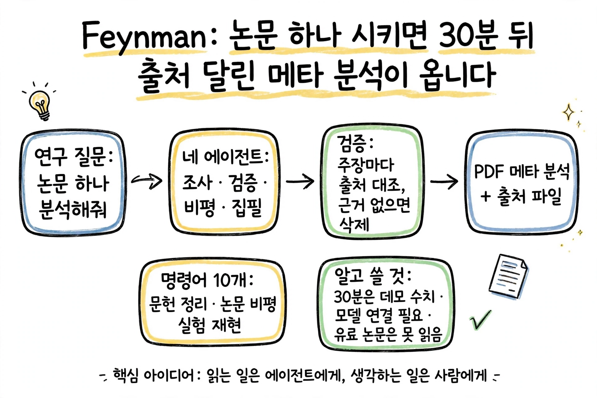
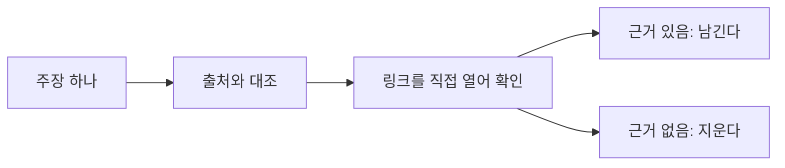

# Feynman: 논문 하나 시키면 30분 뒤 출처 달린 메타 분석이 옵니다

> **Summary**
> Feynman은 논문 조사·검증·비평·집필을 네 에이전트가 나눠 수행해 출처가 확인된 연구 분석을 만드는 무료 오픈소스 도구입니다. 다양한 문헌 검색과 PDF 분석을 지원하지만, 모델 연결은 별도로 필요하고 유료 논문은 열 수 없습니다. AI 검증도 완벽하지 않으므로 결과는 사람이 확인해야 합니다.

---

- Feynman은 논문 하나를 맡기면 30분 뒤 출처가 달린 메타 분석을 돌려주는 오픈소스 연구 에이전트입니다.
- 조사·검증·비평·집필 네 에이전트가 역할을 나눠 일하고, 검증 에이전트가 마지막에 출처와 링크를 직접 확인합니다.
- 무료 오픈소스이지만 모델 연결은 따로 필요하고, 유료 논문은 열지 못한다는 점은 알고 써야 합니다.


논문 서너 편만 읽어도 하루가 훌쩍 갑니다. 읽다 보면 참고문헌이 꼬리를 물고, 정작 내 질문에 대한 답은 저 멀리에 있습니다. 이런 적 있으시죠?

🎥 [동영상 보기](https://www.youtube.com/watch?v=o8YKulqsvbQ)

## 논문 하나, 30분, 출처 달린 분석?

데모는 이렇게 흘러갔습니다. 터미널에 논문 한 편 분석을 시키자 에이전트가 움직였고, 30분 뒤에는 출처가 달린 메타 분석 PDF가 돌아왔습니다. 제목은 `Scaling Laws in AI: Paper Guide and Qualitative Meta-Analysis`였습니다. 스케일링 법칙을 다룬 논문들을 모아 핵심만 정리하고, 읽을 만한 논문 목록까지 붙였습니다!

이 장면이 인상적인 이유는 속도보다 형식 때문입니다. 그냥 요약이 아니라 출처가 붙은 분석이었습니다. 어디서 가져온 주장인지, 어떤 논문이 근거인지 따라갈 수 있게 만들었습니다.

프로젝트는 2026년 3월 19일에 공개됐습니다. 2026년 11월 22일 기준으로 별 10,147개, 포크 1,113개가 모였습니다. MIT 라이선스라 무료로 쓸 수 있습니다.

## 네 명이 나눠 일합니다?

Feynman의 핵심은 역할 나누기입니다. 에이전트 한 명이 전부 하는 게 아닙니다. 네 에이전트가 각자 맡은 일을 합니다.


조사 에이전트가 논문을 찾고 읽습니다. 검증 에이전트가 주장마다 출처를 대조하고, 죽은 링크를 걸러냅니다. 집필 에이전트가 근거 있는 내용만으로 초안을 씁니다. 비평 에이전트는 문제점을 심각도별로 나눠 지적합니다. 이 구조가 바로 이 도구의 주장입니다. 한 명이 쓰고 한 명이 검수하면, 혼자 쓰는 것보다 틀릴 확률이 줄어듭니다!

결과는 `outputs/` 폴더에 저장되고, 초안은 `papers/` 폴더에 따로 모입니다. `/lit`, `/deepresearch`, `/recipe`를 쓰면 출처 목록과 검증 내역을 적은 파일도 함께 나옵니다. 어디서 왔는지 모르는 문장은, 없는 문장이나 마찬가지니까요.

## 명령어 열 개, 뭐가 다르죠?

Feynman은 질문 형태에 따라 명령어가 갈립니다. 열 개나 됩니다. 다 외울 필요는 없습니다. 자주 쓰는 것만 골라 쓰면 됩니다.

```mermaid
flowchart TD
    Q[무엇을 하고 싶나요?] --> A[문헌을 정리하고 싶다]
    Q --> B[논문 하나를 따지고 싶다]
    Q --> C[실험까지 이어가고 싶다]
    A --> A1["`/lit` 합의·이견·미해결 질문 정리"]
    A --> A2["`/deepresearch` 병렬 조사 + 출처 검증"]
    A --> A3["`/compare` 출처 비교표"]
    B --> B1["`/review` 심각도별 비평 + 수정 계획"]
    B --> B2["`/audit` 주장과 공개 코드 대조"]
    C --> C1["`/replicate` 재현 계획, 환경은 직접 선택"]
    C --> C2["`/recipe` 학습 레시피 순위 + 데이터·코드"]
    C --> C3["`/autoresearch` 벤치마크 기반 실험 루프"]
```

논문을 찾는 출처도 넓습니다. `alphaXiv`, `Semantic Scholar`, `OpenAlex`, `arXiv`, `PubMed`, `Europe PMC`, `bioRxiv`, `medRxiv`, `Crossref`, 웹, `Hugging Face`까지 훑습니다. 내 컴퓨터에 있는 PDF도 직접 읽습니다. 무료 키를 등록하면 공용 속도 제한을 피할 수 있습니다.

## 검증은 누가 하나요?

출처가 달렸다고 다 믿을 수는 없습니다. 그래서 검증 단계가 따로 있습니다. 흐름은 이렇습니다.



검증 에이전트는 주장을 출처에 대조하고 URL을 직접 열어 확인한 뒤, 근거 없는 주장은 지웁니다. 이게 없으면 출처 달린 요약도 그냥 그럴듯한 글이 될 뿐입니다! 물론 검증 에이전트도 AI라 완벽하지는 않습니다. 최종 판단은 사람이 하는 구조입니다. 그 점은 써보면서 감을 잡아야 합니다.

설치는 한 줄입니다.

```bash
curl -fsSL https://feynman.is/install | bash
```

`npm`으로 전역 설치하는 방법도 있습니다. 설치 뒤에는 `feynman setup`으로 모델 제공자에 로그인합니다. 호스팅 모델도 되고, 로컬 모델도 연결할 수 있습니다.

## 쓰기 전에 알아둘 것

세 가지는 알고 쓰는 게 좋습니다.

첫째, 30분은 데모에서 나온 시간입니다. 주제가 어렵거나 논문이 많으면 더 걸릴 수 있습니다. 속도 약속이 아니라 흐름의 예시로 읽는 게 맞습니다.

둘째, 도구 자체는 무료지만 모델 이용료는 별개입니다. 모델 제공자 계정으로 로그인해야 돌아갑니다. 로컬 모델을 연결하면 이 부분도 줄일 수 있습니다.

셋째, 유료 논문은 열지 못합니다. 공개된 저장소의 논문만 가져옵니다. 닫힌 논문이 핵심이라면, 이 도구만으로는 부족합니다!

그리고 한 가지 더 있습니다. 사용 데이터를 익명으로 수집하는 기능이 켜져 있습니다. 명령어, 토큰 수, 오류 같은 정보만 보내고, 질문이나 논문 내용은 보내지 않는다고 설명돼 있습니다. 끄고 싶으면 `FEYNMAN_TELEMETRY=off`로 설정하면 됩니다.

논문 읽는 일이 줄면, 읽은 뒤 생각하는 일이 늘어납니다! 그 시간을 벌어주는 도구가, 지금 연구실에서 가장 필요한 도구 아닐까요?

