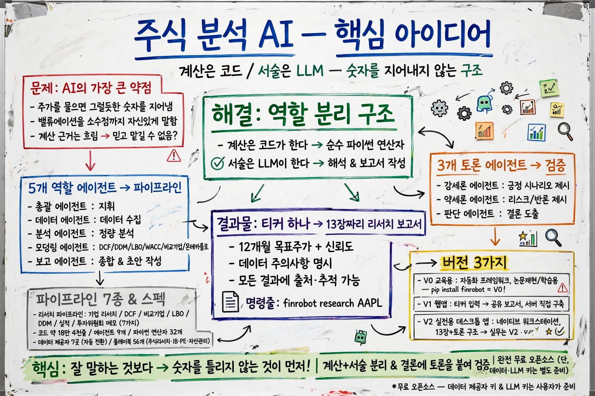
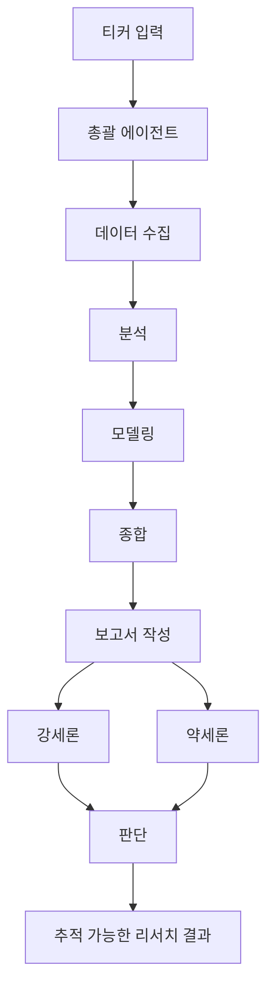
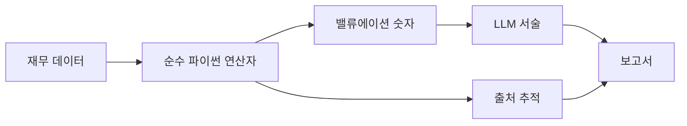

# FinRobot: AI 주식 분석 로봇, 숫자는 코드가 계산하고 결론은 토론이 정합니다

> **Summary**
> 이 플랫폼은 주식 분석에서 숫자를 지어내는 문제를 막기 위해 계산은 파이썬 코드가, 해석과 보고서 작성은 LLM이 맡도록 역할을 분리합니다. 다섯 개 분석 에이전트와 세 개 토론 에이전트가 협력해 출처를 추적할 수 있는 13장짜리 리서치 보고서를 만들며, 교육용·웹 앱·실전용 데스크톱 버전으로 제공됩니다. 오픈소스이지만 데이터 제공자와 LLM 사용을 위한 별도 키가 필요합니다.

---

- 주식 분석 AI의 가장 큰 약점은 숫자를 지어내는 겁니다. 이 플랫폼은 그 약점을 구조로 막았습니다.
- 계산은 코드가 하고, 서술은 LLM이 합니다. 숫자는 순수 파이썬 연산자가 만들고, LLM은 그 숫자를 읽어 이야기를 씁니다.
- 다섯 개 역할 에이전트가 분석을 만들고, 세 개 토론 에이전트가 결론을 검증합니다. 티커 하나를 넣으면 13장짜리 리서치 보고서가 나옵니다.

주가를 물어봤는데, AI가 그럴듯한 숫자를 술술 읊는 걸 본 적 있으시죠? 밸류에이션 값을 물었더니 소수점 둘째 자리까지 자신 있게 답하는데, 계산 과정을 물으면 말이 흐려집니다. 숫자까지 지어내는 AI, 믿고 투자 결정을 맡길 수 있을까요?

🎥 [동영상 보기](https://www.youtube.com/watch?v=ed1GVEPfURM)

## 금융 AI, 왜 숫자를 믿기 어려울까요?

언어 모델은 말을 잘합니다. 그런데 계산은 약합니다. 밸류에이션 숫자를 말로 만들어내면 틀릴 수밖에 없습니다. 그래서 이 플랫폼은 역할을 나눴습니다. 계산은 코드가, 서술은 LLM이 맡습니다!

DCF, DDM, LBO, WACC, 비교기업 분석, 몬테카를로 시뮬레이션. 전부 순수 파이썬 연산자가 계산합니다. LLM은 계산된 숫자를 읽고 해석과 보고서 작성만 합니다. 모든 결과에는 출처가 따라붙습니다. 숫자가 어디서 왔는지 끝까지 추적할 수 있습니다.

숫자는 코드가 만들고 말은 LLM이 쓴다는 구분, 이게 저는 가장 인상 깊었습니다. AI가 숫자를 지어낼 틈이 구조적으로 없으니까요!

## 에이전트 아홉 명이 한 팀으로 일합니다?

총괄 에이전트가 지휘합니다. 데이터, 분석, 모델링, 종합, 보고. 다섯 개 역할 에이전트가 파이프라인으로 이어져 일합니다. 그리고 나서 토론이 붙습니다. 강세론 에이전트와 약세론 에이전트가 맞서고, 판단 에이전트가 결론을 내립니다. 한 가지 주장에 반론이 붙는 구조입니다!

티커 하나를 넣으면 13장짜리 리서치 보고서가 나옵니다. 12개월 목표 주가와 신뢰도, 데이터 주의사항까지 담깁니다.

## 숫자로 보는 규모는?

코드 약 18만 4천 줄, 에이전트 9개, 리서치 파이프라인 7개, 순수 파이썬 연산자 32개, 데이터 제공자 7곳, 애널리스트 플레이북 56개. 파이프라인은 기업 리서치, DCF, 비교기업 분석, LBO, DDM, 실적, 투자위원회 메모까지 7가지입니다. 플레이북은 주식 리서치, 투자은행, 사모펀드, 자산관리 분야를 가릅니다. 데이터 제공자는 장애가 생기면 자동으로 다른 곳으로 전환됩니다. 숫자가 말해주는 건 하나입니다. 취미용 데모가 아니라 실제 리서치 업무를 겨냥하고 있다는 것!

명령줄도 있습니다. `finrobot research AAPL` 한 줄이면 13장짜리 리서치 보고서가 나옵니다. DCF만 따로 뽑거나, 경쟁사 비교나 투자위원회 메모도 명령 하나로 실행됩니다. 티커를 넣고 기다리면 보고서가 나온다는 점에서는, 쓰는 쪽의 일은 단순합니다.

## 버전이 세 개? 어떤 걸 쓰면 될까요?

버전이 세 개라서 헷갈릴 수 있습니다. 용도가 다릅니다. V0은 교육용입니다. 원래 자동화 프레임워크 기반이고, 논문 재현과 학습용으로 남겨뒀습니다. V1은 웹 앱입니다. 티커를 넣으면 공유 가능한 보고서가 나옵니다. 직접 서버에 올려 씁니다. V2는 실전용 데스크톱 앱입니다. 네이티브 리서치 워크스테이션으로, 13장 보고서와 토론 구조까지 갖춘 버전입니다. 실무에 쓸 거면 V2가 정답입니다.

한 가지는 조심해야 합니다. `pip install finrobot`으로 받는 패키지는 V0입니다. 설치할 때 버전을 확인하지 않으면 교육용을 받게 됩니다.

## 무료인데, 준비할 건 없나요?

완전 무료 오픈소스입니다. 다만 데이터와 LLM 키는 따로 준비해야 합니다. V1 설정 파일에 데이터 제공자 키와 LLM 키를 넣는 방식입니다. 코드가 무료라고 해서 드는 비용이 아예 없는 건 아닙니다. 이 점은 시작하기 전에 알고 있는 게 좋습니다.

## 맺음말

AI가 주식 분석을 맡으려면, 잘 말하는 것보다 숫자를 틀리지 않는 것이 먼저입니다. 계산과 서술을 나누고, 결론에 토론을 붙인 구조가 그 답입니다!

