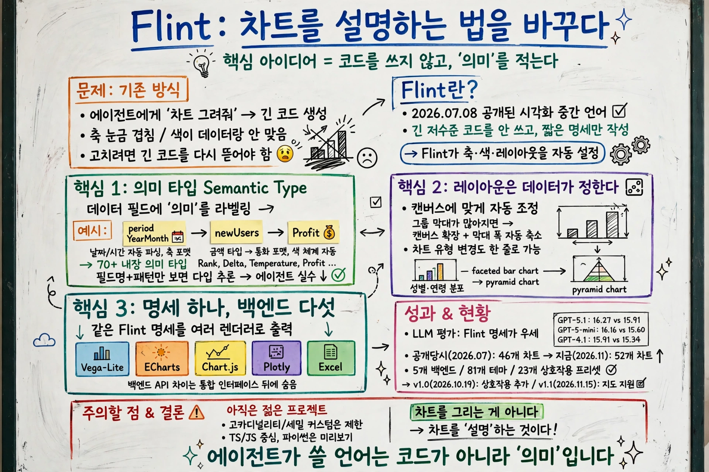
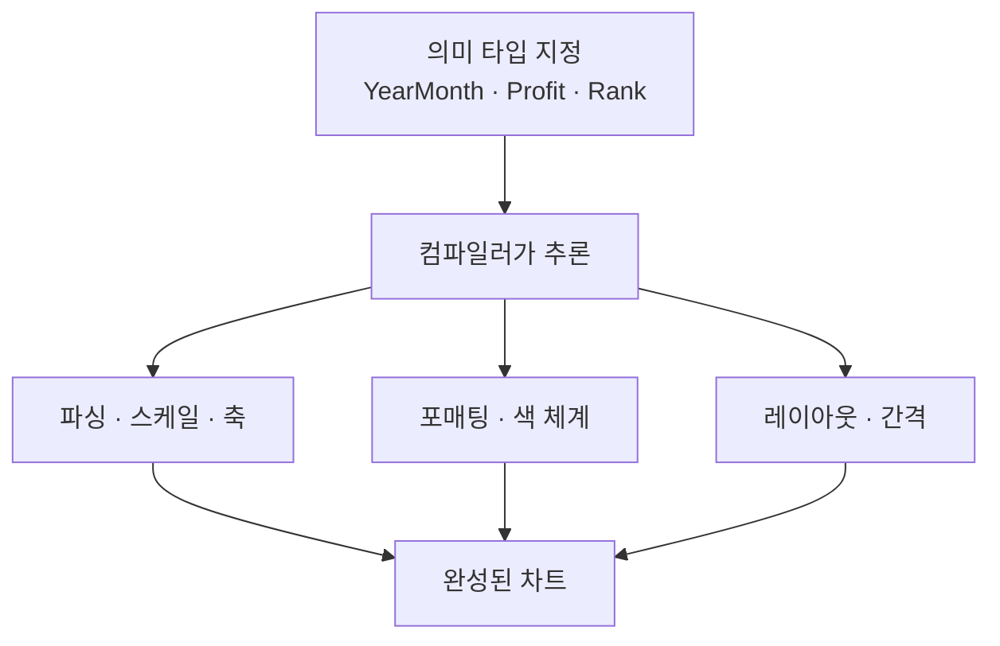
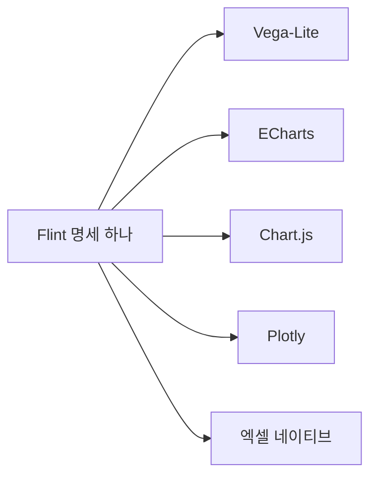

# Flint: 에이전트에게 차트 코드를 맡기지 마세요. 의미를 적으면 컴파일러가 그립니다

> **Summary**
> Flint는 에이전트가 긴 차트 코드를 직접 쓰게 하지 않고, 짧은 명세로 차트의 의미를 적게 하는 시각화 중간 언어입니다. 데이터 필드의 의미를 의미 타입으로 적으면 컴파일러가 축·색·레이아웃 같은 세부 설정을 알아서 채우고, 명세 하나를 Vega-Lite·ECharts·Chart.js·Plotly·엑셀로 바꿔 그릴 수 있습니다. 공개 당시 46개였던 차트 유형은 지금 52개까지 늘었고 상호작용과 지도까지 들어왔지만, 아직 젊은 프로젝트라 고카디널리티 데이터나 세밀한 커스텀에는 한계가 있습니다.

---

- Flint는 에이전트에게 긴 차트 코드를 쓰게 하지 않고, 짧은 명세를 적게 하는 시각화 중간 언어입니다.
- 데이터의 의미를 `의미 타입`으로 적으면, 컴파일러가 축·색·레이아웃 같은 세부 설정을 알아서 채웁니다.
- 명세 하나를 여러 백엔드로 바꿔 그릴 수 있고, 공개 당시 46개였던 차트 유형은 지금 52개까지 늘었습니다.

에이전트한테 "이 데이터로 차트 하나 그려줘"라고 시켜본 적 있으시죠? 코드는 길게 나오는데, 차트는 어딘가 어색합니다. 축 눈금이 겹치고, 색은 데이터랑 안 맞고, 고치려면 그 긴 코드를 다시 뜯어야 합니다. 왜 그럴까요?

🎥 [동영상 보기](https://www.youtube.com/watch?v=xFWhiWe91BE)

## 차트를 그리는 게 아니라, 차트의 의미를 적습니다

Flint는 2026년 7월 8일에 공개된 연구 프로젝트의 시각화 중간 언어입니다. 에이전트가 차트를 만들 때 긴 저수준 명세를 직접 쓰게 하지 않습니다. 대신 짧고 사람이 고칠 수 있는 명세를 쓰게 합니다.

명세는 세 조각으로 이뤄집니다. 데이터, `의미 타입`, 차트 명세입니다. 예를 들어 월별 신규 사용자를 보여주는 히트맵에서는 `period`를 `YearMonth`, `newUsers`를 `Profit`이라고 적습니다. 그리고 히트맵에서 `period`를 x축, `newUsers`를 색에 바인딩합니다. 이게 끝입니다!

### 의미 타입이 뭐길래요?

`의미 타입`은 데이터 필드가 무슨 뜻인지 적는 칸입니다. `Rank`, `YearMonth`, `Delta`, `Temperature`, `Profit`처럼 내장 타입이 70개가 넘습니다. 타입 하나가 파싱·스케일·축·포매팅·색 체계까지 통째로 정합니다.

에이전트에게 의미 타입을 추론시키는 일은, 수십 줄의 축·색 설정을 직접 쓰게 하는 일보다 훨씬 쉽습니다. 필드 이름과 값 패턴만 보면 날짜인지, 가격인지, 순위인지 알 수 있으니까요. 그래서 에이전트의 실수가 줄어듭니다.

이 대목이 저는 가장 와닿았습니다. 에이전트에게 코드를 맡기면 고치는 일까지 맡기게 되는데, 의미를 적게 하면 고치는 일은 사람이 직접 할 수 있으니까요!

## 레이아웃은 데이터가 정합니다

차트가 캔버스에 안 맞는 문제는 누가 해결할까요? Flint에서는 컴파일러가 해결합니다. 탄력적 레이아웃 모델과 뱅킹 원칙으로 크기·간격·배치를 동적으로 관리합니다.

그룹 막대 차트 수가 늘어나면 캔버스를 늘리고 막대 폭을 줄여서, 조밀한 버전도 캔버스에 맞춥니다. 사용자가 따로 설정하지 않아도 됩니다.

차트 설계를 바꾸는 일도 가벼워집니다. 2000년 미국 인구조사의 성별·연령별 인구 분포를 faceted bar chart에서 pyramid chart로 바꿀 때, 사용자는 차트 유형만 바꿉니다. 나머지는 컴파일러가 처리합니다.

## 명세 하나, 백엔드 다섯

Flint 명세는 특정 렌더러에 묶이지 않습니다. 같은 명세를 Vega-Lite, ECharts, Chart.js, Plotly, 엑셀 네이티브 차트로 바꿔 그릴 수 있습니다. 백엔드마다 API가 달라도, 그 차이는 통합 인터페이스 뒤에 숨습니다.

Vega-Lite에 네이티브 sunburst가 없을 때는 ECharts로 전환하면 됩니다. 계층 구조를 보여주는 데는 그룹 막대보다 sunburst가 낫다는 판단까지, 명세는 그대로 두고 백엔드만 바꾸면 됩니다.

에이전트 워크플로에서는 MCP 서버로 씁니다. 채팅이나 코딩 환경에서 차트를 만들고, 검증하고, 렌더링까지 할 수 있습니다. 데이터는 인라인으로 넣거나 로컬 파일을 읽게 할 수 있습니다.

## 숫자로 보면요?

연구 평가에서는 직접 Vega-Lite 명세를 쓰게 한 기준보다 Flint 명세가 앞섰습니다. LLM 심판 점수 기준으로 GPT-5.1은 16.27 대 15.91, GPT-5-mini는 16.16 대 15.60, GPT-4.1은 15.91 대 15.34였습니다. 큰 격차는 아니지만, 방향은 분명합니다.

공개 당시에는 46개 차트 유형과 83개 갤러리 예제, 3개 백엔드였습니다. 지금은 52개 차트 유형, 5개 백엔드, 81개 테마, 23개 상호작용 프리셋까지 늘었습니다. 1.0(2026년 10월 19일)에서 상호작용이 들어왔고, 1.1(2026년 11월 15일)에서는 지도까지 지원합니다.

다만 정직하게 짚을 점도 있습니다. 아직 젊은 프로젝트입니다. 고카디널리티 데이터나 세밀한 커스텀 레이아웃은 컴파일러가 다 못 다룹니다. 핵심 라이브러리는 TypeScript와 JavaScript 중심이고, 파이썬 이식은 미리보기 단계입니다. 상호작용도 1.0에서야 들어왔습니다.

차트 그리는 법을 바꾸는 게 아닙니다. 차트를 설명하는 법을 바꾸는 겁니다. 에이전트가 쓸 언어는 코드가 아니라 의미입니다!

