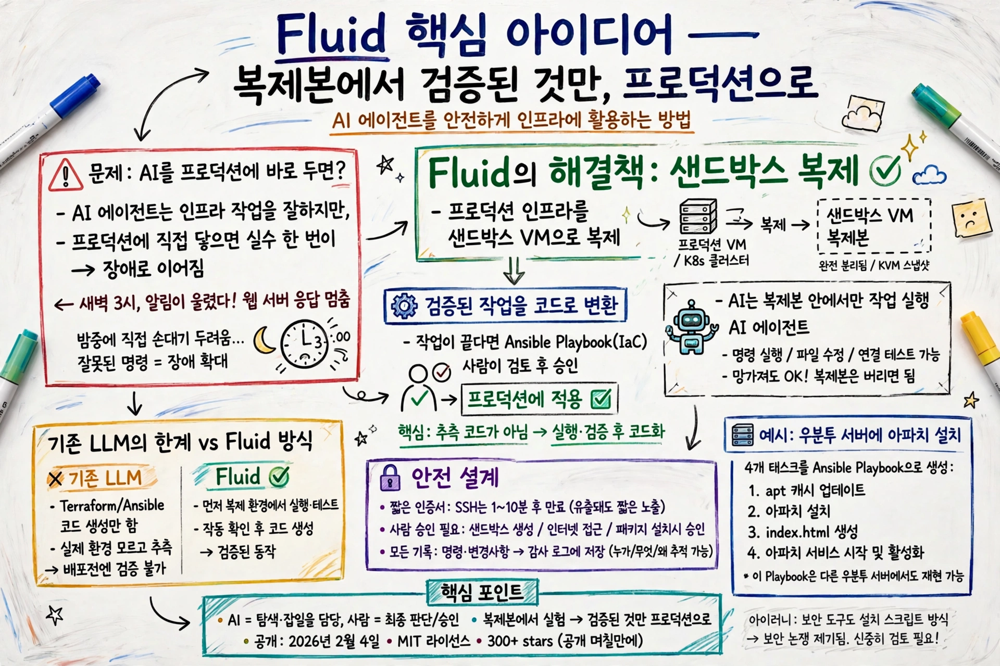
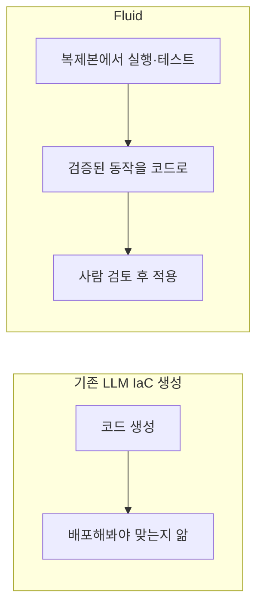
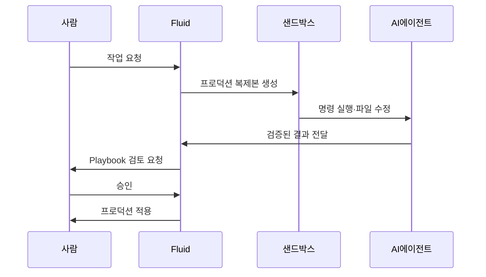

# Fluid: AI가 인프라를 만지게 하려면, 진짜가 아니라 복제본을 줘야 합니다

> **Summary**
> Fluid는 프로덕션 인프라를 격리된 샌드박스에 복제해 AI가 안전하게 명령을 실행하고 변경 사항을 검증하도록 합니다. 검증된 결과는 Ansible Playbook으로 생성되며, 사람의 검토와 승인을 거쳐 프로덕션에 적용됩니다. 짧은 수명의 SSH 인증서, 승인 절차, 감사 로그로 안전성을 강화합니다.

---

- AI 에이전트는 인프라 작업을 잘하지만, 프로덕션에 직접 닿게 두면 실수 한 번이 장애로 이어집니다.
- Fluid는 프로덕션 인프라를 샌드박스 VM으로 복제해, AI가 그 안에서만 명령을 실행하고 파일을 고치게 합니다.
- 검증이 끝난 작업은 Ansible Playbook으로 뽑아 사람이 검토한 뒤에야 프로덕션에 적용합니다.

## 새벽 3시, 알림이 울렸는데 손댈 엄두가 안 난다면?

새벽 3시에 알림이 울렸습니다. 웹 서버가 응답을 멈췄습니다. 원인은 대충 짐작이 가는데, 밤중에 직접 손대기가 두렵습니다. 명령 하나를 잘못 치면 장애가 더 커지니까요. 이런 적 있으시죠?

AI에게 맡기면 어떨까요? 요즘 AI 에이전트는 명령 실행부터 파일 수정까지 척척 해냅니다. 그런데 문제가 하나 있습니다. AI에게 프로덕션 서버를 통째로 맡기는 건, 아무리 유능해도 선뜻 안 되는 일입니다!

🎥 [동영상 보기](https://www.youtube.com/watch?v=ZSUBGXNTz34)

## Fluid, 프로덕션을 복제해서 AI에게 건네줍니다

Fluid는 인프라를 위한 터미널 에이전트입니다. 핵심 아이디어는 단순합니다. AI에게 진짜 인프라를 주지 않고, 복제본을 주는 것입니다!

프로덕션 VM이나 쿠버네티스 클러스터를 샌드박스로 통째로 복제합니다. AI 에이전트는 그 복제본 안에서 명령을 실행하고, 연결을 테스트하고, 파일을 고칩니다. 다 망가져도 괜찮습니다. 복제본은 버리면 그만이니까요.

작업이 끝나면 결과만 코드로 뽑아냅니다. Ansible Playbook 형태의 IaC입니다. 사람이 검토한 뒤에 프로덕션에 적용합니다. AI는 탐색과 잡일을 하고, 최종 판단은 사람이 하는 구조입니다.

## 코드를 만들어주는 게 아니라, 실행하고 검증한 뒤에 코드로 만듭니다

LLM은 Terraform이나 Ansible 코드를 잘 만듭니다. 그런데 한계가 있습니다. 실제 프로덕션 환경이 어떻게 동작하는지 정확히 알지 못한다는 점입니다. 추측으로 쓴 코드는 배포해보기 전에는 맞는지 알 수 없습니다.

Fluid는 순서를 바꿨습니다. 먼저 복제된 환경에서 명령을 실행하고 테스트합니다. 되는 걸 확인한 뒤에야 그 결과를 코드로 만듭니다. 추측이 아니라 검증된 동작이 코드가 되는 셈입니다.

## 안전 설계: 짧은 인증서, 사람의 승인, 모든 기록

"AI에게 루트 권한을 준다고요?"라는 질문이 나올 만합니다. 답은 샌드박스 안에만 준다는 것입니다. 복제본 VM은 KVM 스냅샷으로 빠르게 만들고, 네트워크도 분리됩니다. 프로덕션과는 하드웨어 수준으로 떨어져 있습니다!

접속도 일회성입니다. SSH 인증서는 1~10분 뒤에 만료되는 짧은 수명으로 발급됩니다. 인증서가 유출돼도 노출 시간이 짧습니다.

사람의 승인도 있습니다. 메모리가 부족한 호스트에서 샌드박스를 만들 때, 인터넷에 접근할 때, 패키지를 설치할 때는 사람의 승인을 거쳐야 합니다. 그리고 모든 명령과 변경 사항은 감사 로그에 남습니다. 나중에 누가, 무엇을, 왜 했는지 추적할 수 있습니다.

## 숫자·근거: 우분투 서버에 아파치를 올린 4개 태스크

예시를 보면 흐름이 더 잘 보입니다. 우분투 22.04 환경에서 아파치 웹 서버를 설치하고 실행하는 작업입니다. 샌드박스에서 아파치를 설치한 뒤, 로컬 요청으로 동작을 확인합니다. 그리고 플레이북을 생성합니다.

생성된 플레이북에는 4개의 태스크가 들어갑니다. apt 캐시 업데이트, 아파치 설치, `index.html` 생성, 아파치 서비스 시작 및 활성화입니다. 이 플레이북은 다른 우분투 서버에서도 같은 설정을 재현합니다.

공개는 2026년 2월 4일, MIT 라이선스입니다. 공개 며칠 만에 300개가 넘는 스타를 모았습니다. 인프라에 AI를 들이는 일에 얼마나 많은 사람이 관심을 두는지 보여주는 숫자입니다!

아이러니한 지적도 있었습니다. 보안을 내세우는 도구가 설치 스크립트를 받아 바로 실행하는 방식을 안내한다는 점입니다. 보안 도구가 보안 논쟁의 한가운데에 서 있는 셈입니다. 이 부분은 짚고 넘어갈 만합니다.

## 복제본에서 검증된 것만, 프로덕션으로

AI에게 인프라를 맡기는 일, 무섭지 않으려면 방법이 필요합니다. 진짜를 직접 만지게 하지 말고, 복제본에서 실컷 실험하게 한 뒤 검증된 결과만 코드로 받는 것. Fluid가 제시하는 답은 그겁니다!

