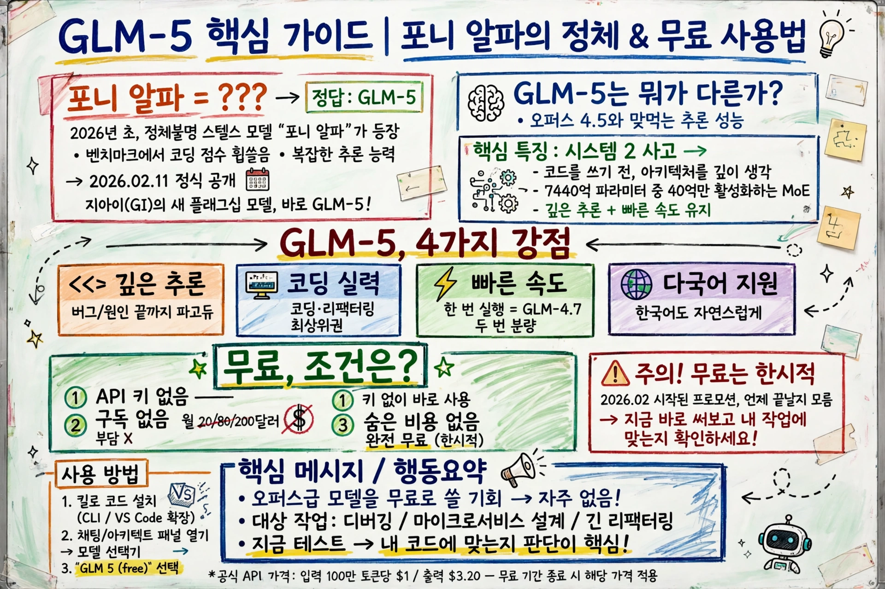
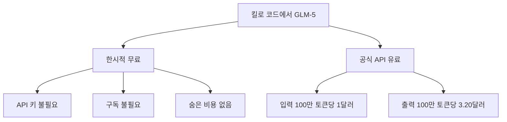
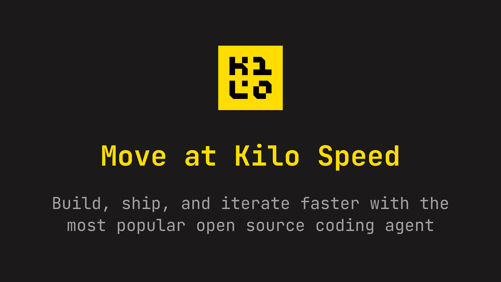

# GLM-5: 오퍼스급 추론이 무료라면, 일단 써보고 판단하면 됩니다

> **Summary**
> GLM-5는 정체불명 스텔스 모델 포니 알파의 정체로, 오퍼스 4.5와 맞먹는 추론 성능을 가진 지아이의 새 플래그십 모델입니다. 킬로 코드가 이 모델을 한시적으로 무료로 풀었습니다. API 키도, 구독도, 숨은 비용도 없이 CLI와 VS Code 확장 어디서든 쓸 수 있습니다. 무료는 영원하지 않으므로, 기간이 끝나기 전에 직접 써보고 내 작업에 맞는지 확인하는 게 핵심입니다.

---

- GLM-5는 정체불명 스텔스 모델 "포니 알파"의 정체로, 오퍼스 4.5와 맞먹는 추론 성능을 가진 지아이의 새 플래그십 모델입니다.
- 킬로 코드가 이 모델을 한시적으로 무료로 풀었습니다. API 키도, 구독도, 숨은 비용도 없이 CLI와 VS Code 확장 어디서든 쓸 수 있습니다.
- 무료는 영원하지 않습니다. 기간이 끝나기 전에 직접 써보고, 내 작업에 맞는지 확인하는 게 핵심입니다.

## 오퍼스급 모델, 써보고 싶은데 구독료가 부담되시죠?

최신 코딩 모델을 써보고 싶습니다. 그런데 플래그십 모델 구독료는 만만치 않습니다. 월 20달러, 80달러, 200달러까지. 성능은 탐나는데 지갑이 먼저 망설여집니다. 이런 적 있으시죠?

그런데 오퍼스급 모델을 무료로 쓸 수 있는 기회가 왔습니다!

🎥 [동영상 보기](https://www.youtube.com/watch?v=v0oimxCfx8g)

## 포니 알파, 정체가 뭐였을까요?

2026년 초, AI 업계에서 "포니 알파"라는 정체불명 모델이 화제였습니다. 벤치마크에서 코딩 점수를 휩쓸고, 복잡한 문제를 깊이 생각하는 추론을 보여주는데 정체가 밝혀지지 않았습니다. 커뮤니티에서는 온갖 추측이 돌았습니다.

정답은 GLM-5였습니다. 지아이의 새 플래그십 모델이 스텔스 이름으로 돌아다니고 있었던 겁니다. 2026년 2월 11일, GLM-5가 정식 공개되면서 미스터리가 풀렸습니다.

이 장면이 저는 가장 인상 깊었습니다. 익명의 모델이 벤치마크를 휩쓸던 이유가, 그냥 신제품이었기 때문이라니요!

## GLM-5, 뭐가 다른가요?

GLM-5는 "시스템 2"식 사고, 그러니까 코드를 쓰기 전에 아키텍처를 깊이 생각하는 능력을 내세웁니다. 공개된 사양에 따르면 7,440억 개 파라미터 중 40억 개만 활성화하는 MoE 구조로, 추론 속도를 유지하면서 깊은 추론을 합니다.

킬로 코드 쪽 설명을 정리하면 네 가지 강점이 있습니다. 깊은 추론, 코딩 실력, 빠른 속도, 다국어 지원입니다. 코딩·버그 수정·리팩터링에서 최상위권에 들고, 여러 작업에서 오퍼스 4.5와 맞먹는다고 합니다. 오픈 웨이트 모델이라 파일을 받아 직접 돌릴 수도 있습니다.

가격은 어떨까요? GLM-5 공식 API 가격은 입력 100만 토큰당 1달러, 출력 3.20달러 수준입니다. 이전 GLM 모델보다 2배 비싸졌지만, 한 번의 실행으로 두 번 분량의 일을 끝내면 오히려 싸진다는 평가도 있습니다. 실제로 한 테스트에서는 "GLM-5 한 번이 GLM-4.7 두 번을 대신한다"는 결론이 나왔습니다.

## 무료, 조건이 뭐죠?

킬로 코드가 GLM-5를 한시적으로 무료로 풀었습니다. 조건은 세 가지로 단순합니다. API 키가 필요 없고, 구독이 필요 없고, 숨은 비용이 없습니다. CLI와 VS Code 확장, 클라우드 에이전트까지 모든 모드에서 쓸 수 있습니다!

쓰는 방법도 간단합니다. 킬로 코드를 내려받고, 채팅이나 아키텍트 패널을 연 뒤, 모델 선택기에서 GLM 5 (free)를 고르면 됩니다. 복잡한 설정은 없습니다! VS Code 확장은 마켓플레이스에서 70만 회 넘게 내려받았고, CLI는 1.0으로 올라가면서 오픈코드를 포크한 버전입니다. 킬로 코드 안에서 쓸 수 있는 모델은 500개가 넘습니다.

단, 한 가지는 분명히 짚고 넘어가야 합니다. 무료는 한시적입니다. 2026년 2월에 시작된 프로모션이라, 지금도 무료인지는 모델 선택기에서 직접 확인해야 합니다. 무료 기간이 끝나면 공식 API 가격으로 돌아갑니다.

## 어디서, 어떻게 쓰면 될까요?

이미 킬로 코드를 쓰고 있다면 모델 선택기에서 바로 GLM-5를 고르면 됩니다. 처음이라면 내려받고 채팅 패널을 열어 모델을 선택하는 순서입니다. 킬로 코드를 쓰는 개발자는 500만 명이 넘습니다.

어떤 작업에 써보면 좋을까요? 디버깅처럼 원인을 끝까지 파고들어야 하는 일, 마이크로서비스 구조를 처음부터 설계하는 일, 긴 리팩터링처럼 맥락을 오래 유지해야 하는 일에 잘 맞습니다. 깊은 추론이 강점인 모델이니까요.

## 맺음말

오퍼스급 모델을 무료로 써볼 기회는 자주 오지 않습니다. 한시적이라는 말의 무게를 생각하면, 일단 써보고 내 작업에 맞는지 확인하는 게 먼저입니다!

