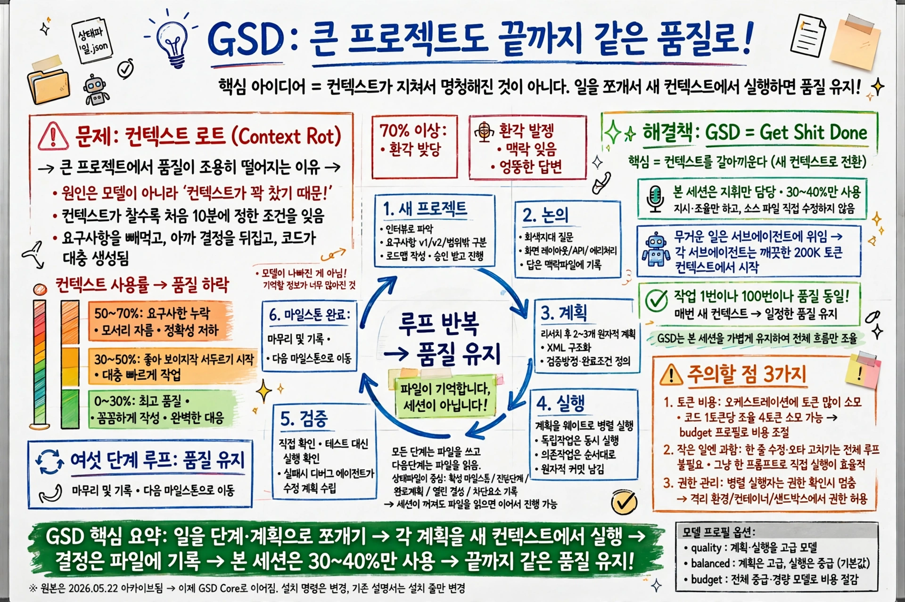
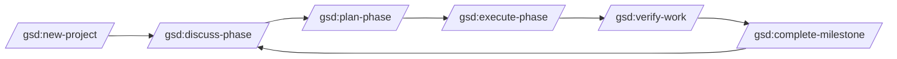
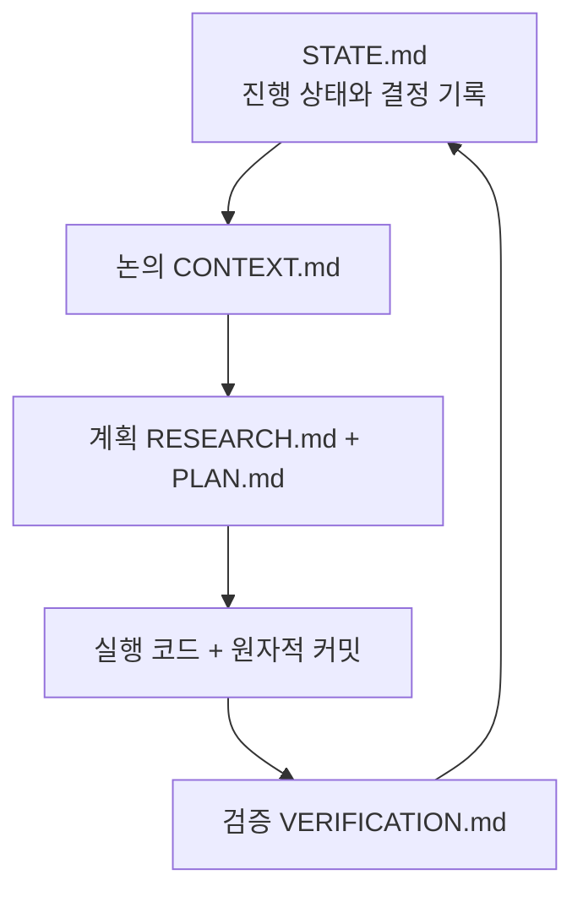

# GSD: 큰 프로젝트에서 Claude가 멍청해진다면, 컨텍스트를 갈아끼우면 됩니다

> **Summary**
> GSD는 대규모 Claude Code 작업에서 컨텍스트가 가득 차며 품질이 저하되는 문제를 단계별 계획과 새 컨텍스트의 서브에이전트 실행으로 줄입니다. 논의·계획·실행·검증의 과정을 파일로 기록해 세션이 바뀌어도 진행 상황과 결정이 유지되며, 작은 작업에는 간단한 방식으로 대응하고 토큰 비용과 권한 설정에도 주의해야 합니다. 원본 저장소는 아카이브됐고 프로젝트는 GSD Core로 이어집니다.

---

- 큰 프로젝트에서 Claude Code가 중간부터 멍청해지는 이유는 모델이 아니라 컨텍스트가 꽉 찼기 때문입니다.
- GSD는 일을 단계와 계획으로 쪼개서, 각 계획을 새 컨텍스트에서 실행하게 합니다. 본 세션은 30~40%만 씁니다.
- 논의→계획→실행→검증, 여섯 단계 루프를 돌리면 품질이 처음부터 끝까지 유지됩니다.

큰 프로젝트를 Claude Code에 맡겼는데, 처음 3~4개 작업은 완벽하다가 어느 순간부터 엉뚱한 답이 나오기 시작하지 않으셨나요? 요구사항을 까먹고, 아까 정한 결정을 뒤집고, 코드는 점점 대충 짜집니다. 모델이 갑자기 멍청해진 걸까요?

🎥 [동영상 보기](https://www.youtube.com/watch?v=QgL-Z6YlHeA)

## 컨텍스트 로트, 조용히 찾아오는 품질 저하?

긴 세션에서 품질이 떨어지는 현상에는 이름이 있습니다. 컨텍스트 로트입니다. 컨텍스트가 찰수록 모델은 처음 10분에 정한 조건을 잊습니다. 스택 트레이스와 파일 읽기 기록이 쌓이면서, 아까 동의한 결정을 뒤집고 요구사항을 빼먹습니다. 조용히 찾아오기 때문에 더 무섭습니다. 에러가 나는 게 아니라, 대충 만든 코드가 쌓입니다!

컨텍스트 사용률에 따라 품질은 이렇게 달라집니다.

- 0~30%: 최고 품질, 꼼꼼하게 만듭니다.
- 30~50%: 좋아 보이지만 서두르기 시작합니다.
- 50~70%: 요구사항을 빼먹고 모서리를 자릅니다.
- 70% 이상: 환각이 나오고, 맥락을 잊어버립니다.
모델이 나빠진 게 아닙니다. 기억할 게 너무 많아진 겁니다!

## GSD의 답은? 컨텍스트를 갈아끼운다

GSD는 Get Shit Done의 줄임말입니다. 메타 프롬프팅, 컨텍스트 엔지니어링, 스펙 주도 개발 시스템으로, Claude Code 위에 얹는 명령어 묶음입니다. 모델을 똑똑하게 만드는 게 아닙니다. 일하는 순서를 바꾸는 겁니다.

핵심은 하나입니다. 본 세션은 지휘만 하고, 소스 파일을 직접 고치지 않습니다. 무거운 일은 전부 서브에이전트에게 넘깁니다. 각 서브에이전트는 깨끗한 200K 토큰 컨텍스트에서 시작합니다. 본 세션은 30~40%만 쓰면서 조율만 합니다. 매번 새 컨텍스트에서 일하니, 작업 1번이나 100번이나 품질이 같습니다!

## 여섯 단계 루프, 어떻게 도나요?

GSD는 여섯 단계 사이클을 돕니다. 새 프로젝트 → 논의 → 계획 → 실행 → 검증 → 마일스톤 완료, 순서입니다.

`/gsd:new-project`로 시작합니다. 인터뷰로 프로젝트를 파악하고, 병렬로 리서치하고, 요구사항을 v1·v2·범위 밖으로 나눈 뒤 로드맵을 만듭니다. `PROJECT.md`, `REQUIREMENTS.md`, `ROADMAP.md`, `STATE.md`가 생깁니다. 로드맵은 승인받고 넘어갑니다.

`/gsd:discuss-phase`는 가장 많이 건너뛰는 단계인데, 건너뛰면 안 됩니다. 화면 레이아웃, API 응답 형식, 에러 처리 같은 회색 지대를 질문으로 정합니다. 답은 `CONTEXT.md`에 적혀 계획과 실행으로 이어집니다. 이 단계를 빼면 모델이 마음대로 가정하고 만듭니다.

`/gsd:plan-phase`는 리서치 후 2~3개의 원자적 계획을 XML 구조로 만듭니다. 파일, 할 일, 검증 방법, 완료 조건까지 적혀 있습니다. 계획은 요구사항과 대조해 통과할 때까지 고칩니다.

`/gsd:execute-phase`는 계획을 웨이브로 묶어 병렬로 실행합니다. 독립적인 작업은 동시에, 의존적인 작업은 뒤에 돕니다. 작업마다 원자적 커밋이 하나씩 남습니다.

`/gsd:verify-work`는 테스트가 아니라 직접 확인입니다. "이메일로 로그인할 수 있나요?"처럼 해볼 수 있는 항목을 하나씩 짚어봅니다. 실패하면 디버그 에이전트가 원인을 찾고 수정 계획을 만듭니다.

`/gsd:complete-milestone`으로 마무리하고, 다음 마일스톤으로 넘어갑니다.

## 파일이 기억합니다, 세션이 아니라

GSD의 모든 단계는 파일을 쓰고, 다음 단계는 그 파일을 읽습니다. 그게 전부입니다. `STATE.md`가 중심입니다. 활성 마일스톤, 진행 중인 단계, 끝난 계획, 열린 결정과 차단 요소를 기록합니다. 세션이 꺼져도, 파일을 읽으면 이어서 갑니다. 에이전트는 기억이 아니라 파일에 의존합니다.

각 단계가 남기는 파일은 정해져 있습니다. 초기화는 `PROJECT.md`·`REQUIREMENTS.md`·`ROADMAP.md`·`STATE.md`, 논의는 `CONTEXT.md`, 계획은 `RESEARCH.md`와 `PLAN.md`, 검증은 `VERIFICATION.md`입니다. 검토하는 사람이 파일을 읽으면, 왜 이렇게 만들었는지 바로 보입니다.

## 설치와 시작, 한 줄이면 됩니다

설치는 한 줄입니다. `npx get-shit-done-cc@latest`를 실행하면 런타임과 설치 위치를 묻습니다. Claude Code, OpenCode, Gemini CLI, Codex 등에서 고릅니다. 설치가 끝나면 `/gsd:help`로 명령어 목록을 확인합니다.

모델 프로필로 비용을 조절합니다. `quality`는 계획·실행을 고급 모델로, `balanced`는 기본값으로 계획은 고급, 실행은 중급으로, `budget`은 전부 중급·경량 모델로 돕니다. 작은 일에는 `/gsd:quick`을 씁니다. 전체 루프 없이 원자적 커밋과 상태 추적만 가져갑니다.

## 주의할 점 세 가지, 알고 쓰면 좋습니다

첫째, 토큰 비용입니다. 오케스트레이션에 토큰이 많이 듭니다. 코드 1토큰당 조율에 4토큰이 들었다는 보고도 있습니다. 월 20달러 요금제 한도가 빨리 닳을 수 있습니다. `budget` 프로필로 조절합니다.

둘째, 작은 일에는 과합니다. 한 줄 수정이나 오타 고치기에 전체 루프를 돌리는 건 낭비입니다. 한 프롬프트로 끝나는 일은 그냥 직접 시키는 게 낫습니다.

셋째, 권한입니다. 병렬 실행자는 권한 확인을 매번 받으면 멈춥니다. 권한을 통째로 여는 건 격리 환경, 컨테이너나 가상머신, 샌드박스 안에서만 씁니다. 대화형 모드와 자동 모드를 섞는 중간 길도 있습니다.

## 지금 상태는? 원본은 아카이브, GSD Core로 이어집니다

한 가지는 꼭 짚고 넘어가야 합니다. 원본 저장소는 2026년 5월 22일 공지 이후 아카이브됐습니다. 유지보수자와 4월 1일부터 연락이 닿지 않았기 때문입니다. 프로젝트는 GSD Core로 이어집니다. 설치 명령도 `npx @opengsd/gsd-core@latest`로 바뀝니다. 명령어 이름은 그대로라, 기존 설명서는 설치 줄만 바꾸면 됩니다.

오래된 설치 줄은 더 이상 지원되지 않는 패키지를 가리킵니다. 별 개수가 많은 쪽이 최신이 아니라는 점, 설치 전에 꼭 확인하셔야 합니다!

## 맺음말

모델이 멍청해진 게 아닙니다. 컨텍스트가 지친 겁니다. 일을 쪼개고, 새 컨텍스트에서 실행하고, 결정은 파일에 적어두면, 큰 프로젝트도 끝까지 같은 품질로 갑니다!

