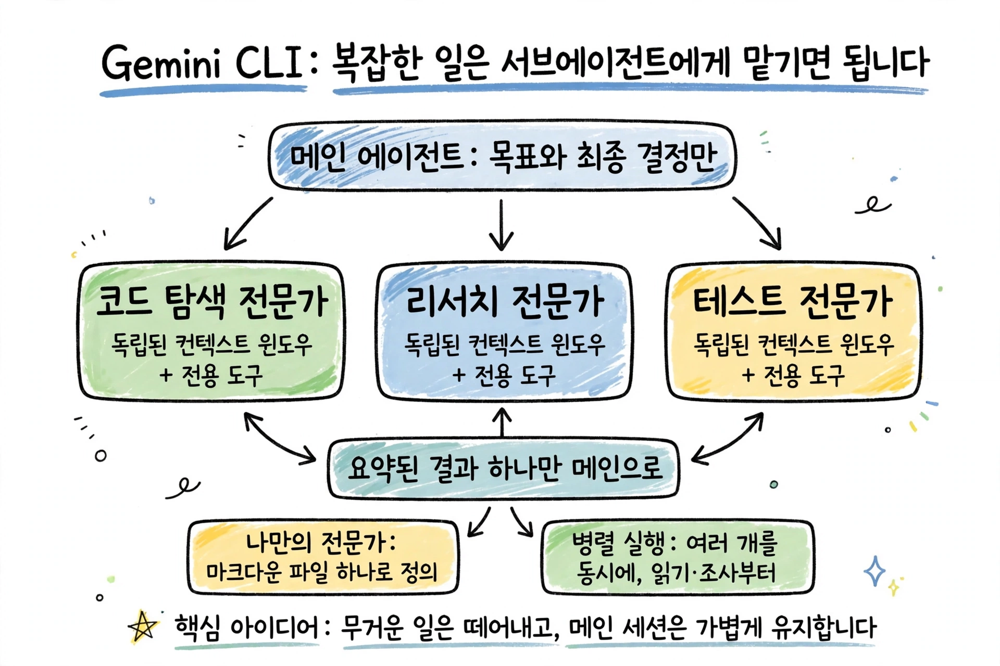
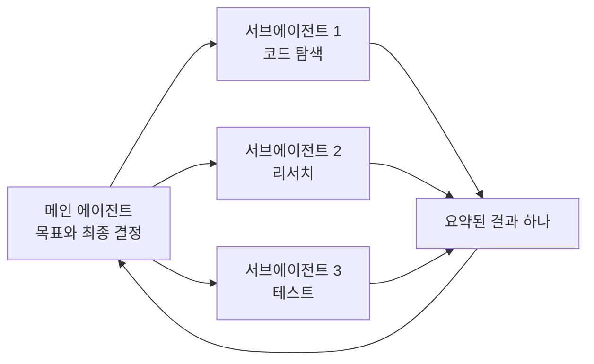
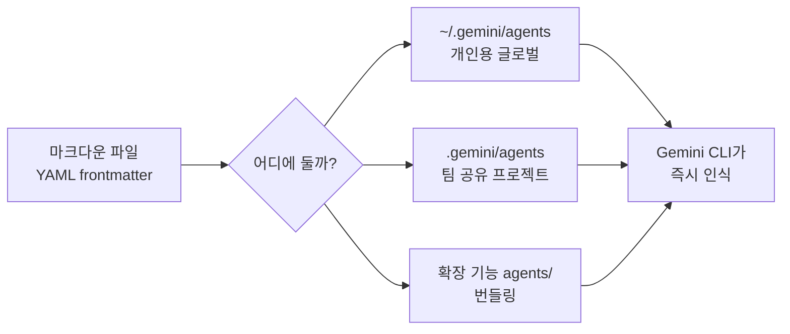
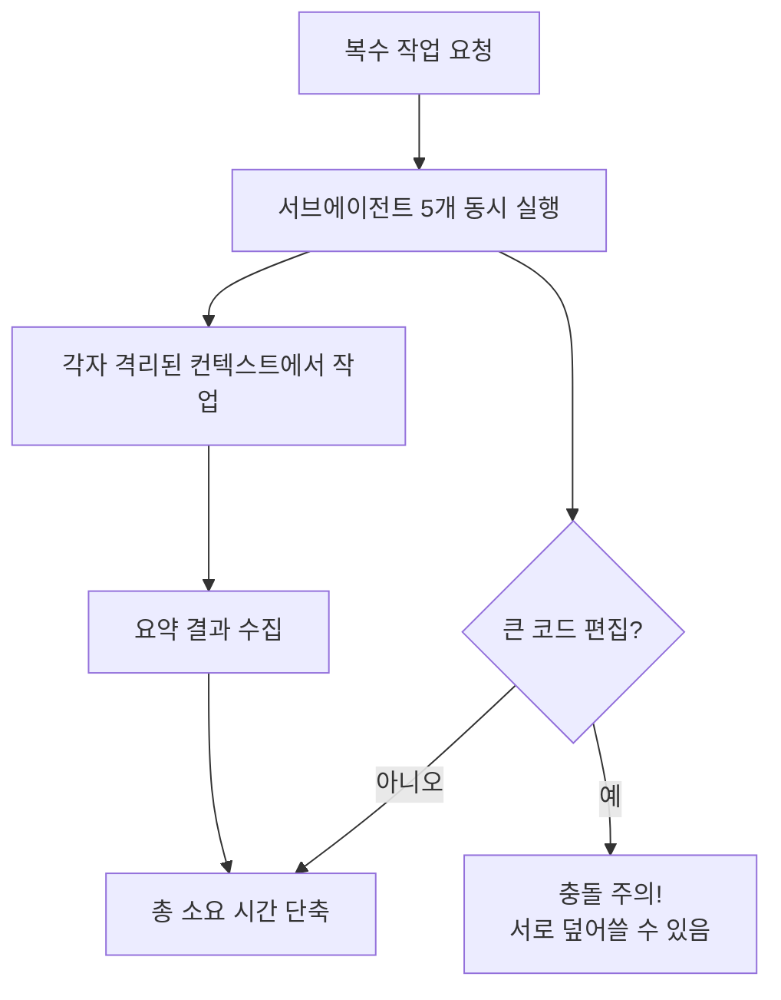

# Gemini CLI: 복잡한 일은 서브에이전트에게 맡기면, 메인 세션은 가볍게 남습니다

> **Summary**
> Gemini CLI에 서브에이전트가 들어왔습니다. 복잡하고 반복적인 일은 독립된 컨텍스트 윈도우에서 도는 전문가 에이전트에게 맡기고, 메인 세션은 전체 목표와 최종 결정에만 집중합니다. 마크다운 파일 하나로 나만의 전문가를 만들 수 있고 여러 개를 병렬로 돌릴 수도 있지만, 큰 코드 편집을 병렬로 돌리면 충돌이 날 수 있어 주의가 필요합니다.

---

- Gemini CLI에 서브에이전트가 들어왔습니다. 복잡하고 반복적인 일은 전문가 에이전트에게 맡기고, 메인 세션은 전체 목표와 최종 결정에만 집중합니다.
- 각 서브에이전트는 독립된 컨텍스트 윈도우와 전용 도구, 커스텀 지침을 가진 채 격리되어 돌고, 일의 결과만 요약해서 돌려줍니다.
- 마크다운 파일 하나로 나만의 전문가를 만들 수 있고, 여러 개를 병렬로 돌릴 수도 있습니다. 단, 큰 코드 편집을 병렬로 돌리면 충돌이 날 수 있습니다.


터미널에서 AI에게 큰 리팩토링을 맡겼는데, 중간 과정이 끝없이 쌓이면서 컨텍스트가 차오르고, 나중에는 처음 지시가 뭐였는지 AI가 까먹는 걸 본 적 있으시죠? 긴 작업일수록 메인 대화가 무거워지는 게 문제였습니다. 이제는 그 무거운 일을 따로 떼어내는 방법이 생겼습니다!

🎥 [동영상 보기](https://www.youtube.com/watch?v=GE0C8QygPV8)

## 서브에이전트, 도대체 뭘까요?

서브에이전트는 메인 세션과 함께 도는 전문가 에이전트입니다. 복잡한 작업이 들어오면 Gemini CLI가 전략적 오케스트레이터가 되어, 가장 잘 맞는 전문가에게 일을 나눠줍니다. 전문가가 일을 끝내면 결과만 정리해서 메인 에이전트에게 돌려주고요.

핵심은 격리입니다! 각 서브에이전트는 자기만의 컨텍스트 윈도우, 커스텀 시스템 인스트럭션, 전용 도구 세트를 갖고, 완전히 따로 떨어진 환경에서 돕니다. 수십 번의 도구 호출과 파일 검색, 테스트 실행이 아무리 길어도 메인 세션에는 요약된 응답 하나만 도착합니다.



## 왜 메인 세션이 가벼워지나?

이 구조가 좋은 이유는 세 가지입니다.

첫째, 메인 에이전트가 전체 목표에만 집중할 수 있습니다. 중간 과정의 잡다한 기록이 메인 컨텍스트를 차지하지 않으니까요. 둘째, 리서치와 코드 탐색, 분석과 테스트를 여러 전문가에게 나눠서 병렬로 돌리면 작업이 빨라집니다. 셋째, 서브에이전트가 요약이나 정해진 형식의 응답만 돌려주기 때문에 메인 세션의 컨텍스트 오염을 막을 수 있습니다.

수십 번의 도구 호출이 하나의 요약으로 접혀 들어온다는 점이 저는 가장 인상 깊었습니다. 긴 작업을 맡길수록 이 차이가 크게 느껴지니까요!

## 내장 전문가 세 명, 어떻게 부를까요?

Gemini CLI에는 기본으로 세 명의 서브에이전트가 들어 있습니다.

- `generalist`: 모든 도구에 접근하는 범용 에이전트입니다. 배치 리팩토링이나 출력이 많은 명령 실행처럼 턴이 많이 드는 일에 어울립니다.
- `cli_help`: Gemini CLI 자체의 전문가입니다. 기능이나 설정이 궁금할 때 공식 문서를 직접 뒤져서 답해줍니다.
- `codebase_investigator`: 코드베이스 탐색과 아키텍처 매핑, 버그의 근본 원인 분석에 특화됐습니다.
메인 에이전트는 각 에이전트의 설명을 보고 자동으로 일을 나눠줍니다. 직접 지목하고 싶으면 `@` 뒤에 이름을 붙이면 됩니다. `@codebase_investigator` 인증 플로우를 그려달라고 하면, 그 전문가의 격리된 컨텍스트 안에서 작업이 처리됩니다. 지금 설치된 에이전트 목록은 `/agents` 명령으로 확인할 수 있습니다. 참고로, 이후 업데이트에서는 웹 브라우저를 직접 다루는 브라우저 에이전트도 네 번째 내장 에이전트로 추가됐습니다. 기본값은 꺼져 있습니다.

## 나만의 전문가는 파일 하나로 만듭니다

커스텀 서브에이전트는 마크다운 파일에 YAML frontmatter를 붙여서 정의합니다.

```yaml
---
name: frontend-specialist
description: 고성능 웹 앱을 만드는 프론트엔드 전문가
tools:
  - read_file
  - grep_search
  - glob
model: inherit
---
```

파일을 `~/.gemini/agents`에 두면 개인용 글로벌 에이전트가 되고, 저장소의 `.gemini/agents`에 커밋하면 팀과 공유하는 프로젝트 에이전트가 됩니다. 확장 기능의 `agents/` 디렉토리에 넣어 번들링할 수도 있습니다.

예시로 나온 `frontend-specialist`는 모듈형 아키텍처와 성능 최적화, 접근성 준수를 원칙으로 삼고, 분석과 개선 제안만 하고 직접 코드를 고치지 않습니다. 이처럼 역할과 경계를 파일에 적어두면, 에이전트가 자기 일을 어디까지 할지 스스로 압니다.



## 병렬로 돌리면, 뭐가 달라질까요?

여러 서브에이전트를 동시에 디스패치할 수 있습니다. 다섯 가지 주제를 따로 리서치하거나 여러 컴포넌트를 각각 리팩토링할 때, 총 소요 시간이 크게 줄어듭니다. 같은 에이전트의 인스턴스를 여러 개 띄우는 것도 가능합니다.



단, 조심할 점이 두 가지 있습니다. 대규모 코드 편집을 병렬로 돌리면 여러 에이전트가 같은 파일을 건드려 충돌이 나고, 서로의 코드를 덮어쓸 수 있습니다. 그리고 요청이 동시에 나가기 때문에 사용량 제한에 더 빨리 도달합니다. 병렬은 읽기·조사·분석처럼 서로 간섭이 없는 일에 먼저 써보는 게 안전합니다!

정리하면, 서브에이전트는 일을 잘게 쪼개 전문가에게 맡기고 메인 세션을 가볍게 유지하는 방법입니다. 큰 작업을 앞두고 있다면, 어떤 부분을 전문가에게 떼어줄지부터 정해보는 게 어떨까요?

