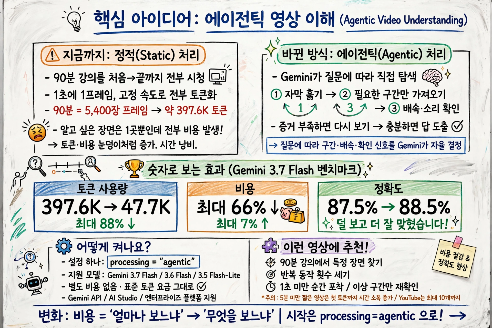
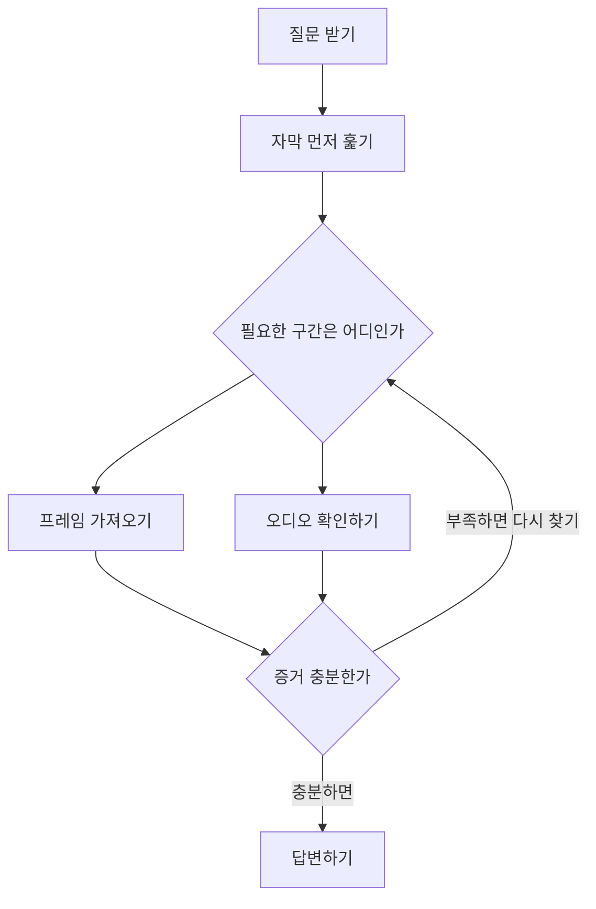
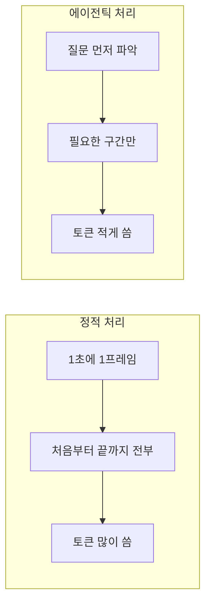
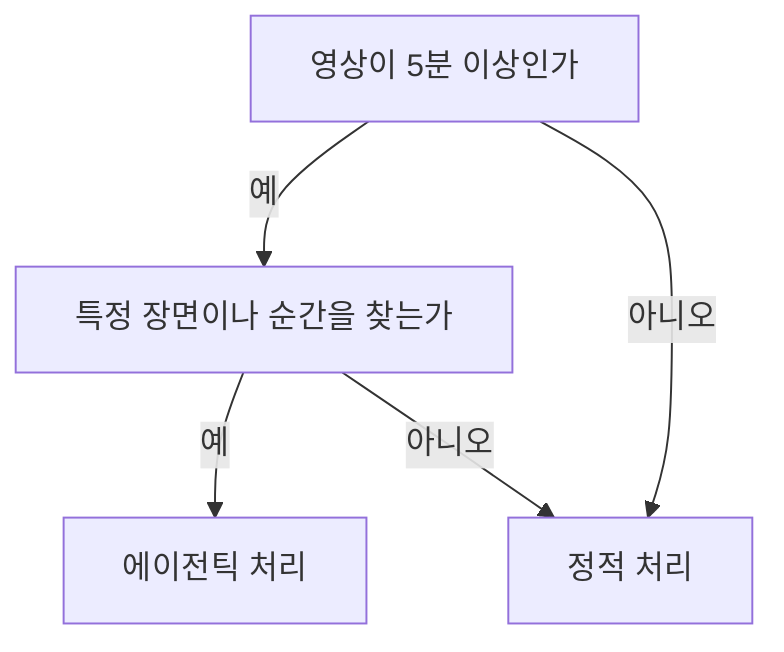

# Gemini 영상 이해: 90분 강의도 필요한 장면만 골라 봅니다

> **Summary**
> Gemini의 에이전틱 영상 이해는 자막·프레임·오디오를 활용해 질문에 필요한 구간만 찾아 분석합니다. 긴 영상의 토큰 사용량과 비용을 줄이면서 정확도를 높이며, processing 설정을 agentic으로 바꾸면 사용할 수 있습니다. 짧은 영상이나 전체를 빠짐없이 분석해야 하는 작업에는 기존 정적 처리가 더 적합합니다.

---

- 90분 강의를 통째로 볼 필요는 없습니다. Gemini가 질문에 따라 볼 구간, 배속, 확인할 신호를 직접 정합니다.
- 긴 영상에서 토큰 사용량은 최대 88%, 비용은 최대 66% 줄었고, 정확도는 최대 7% 올랐습니다.
- `processing`을 `agentic`으로 바꾸는 설정 하나면 됩니다. 별도 요금은 없습니다.

90분짜리 강의 영상을 본 적 있으시죠? 알고 싶은 장면은 딱 한 곳인데, 타임라인을 이리저리 끌면서 찾아 헤맨 경험 말입니다. 자막을 켜고, 배속을 올리고, 그래도 원하는 대목은 좀처럼 안 나옵니다. 결국 처음부터 끝까지 훑어보게 되죠. AI에게 영상을 맡겨도 사정은 비슷했습니다. 지금까지는 말입니다!

🎥 [동영상 보기](https://www.youtube.com/watch?v=7Z5Vy9JBANs)

## 지금까지는 어떻게 봤을까요?

기존 방식은 정적 처리입니다. 영상을 1초에 1프레임씩, 고정된 속도로 처음부터 끝까지 삼킵니다. 90분 강의면 5,400장의 프레임을 전부 토큰으로 바꾸는 식입니다. 초당 약 100토큰이 쌓이니, 긴 영상일수록 비용이 눈덩이처럼 불어났습니다. 알고 싶은 건 한 장면인데, 나머지를 다 보는 셈입니다.

> 알고 싶은 장면은 하나인데, 왜 영상 전체를 다 봐야 할까요?

## 무엇이 달라졌을까요?

2026년 9월 1일, Gemini에 에이전틱 영상 이해가 추가됐습니다. 모델이 영상을 통째로 삼키는 대신, 직접 찾아다니는 방식으로 바뀐 겁니다. 질문을 받으면 모델이 세 가지 도구를 씁니다. `get_transcript`로 자막을 먼저 훑고, `get_frames`로 필요한 구간만 원하는 배속으로 가져오고, `get_audio`로 필요한 구간의 소리만 확인합니다. 생각하고, 가져오고, 확인하는 고리를 돕니다. 증거가 부족하면 다시 봅니다. 충분하면 답을 냅니다.

이 부분이 저는 가장 인상 깊었습니다. 모델이 영상을 '보는' 게 아니라, 영상을 '찾아다니는' 방식으로 바뀐 거니까요!

## 숫자로 보면 어떨까요?

공식 벤치마크에서 Gemini 3.7 Flash 기준입니다.

- 1H-VideoQA(긴 영상 질의응답): 397.6K → 47.7K 토큰, 정확도 87.5% → 88.5%
- LVBench(긴 영상): 300.3K → 36.0K 토큰, 정확도 85.1% → 88.6%
- Minerva(복잡한 추론): 80.9K → 33.6K 토큰, 정확도 73.7% → 79.0%
토큰은 최대 88% 줄었고, 비용은 최대 66% 줄었고, 정확도는 최대 7% 올랐습니다. 덜 보고 더 잘 맞힌 겁니다!

다만 한 가지, 숫자를 그대로 믿기 전에 짚을 점이 있습니다. 토큰은 88% 줄었는데 비용은 66%만 줄었습니다. 공식 자료는 그 차이를 따로 설명하지 않았습니다. 탐색에 드는 추론 토큰이 별도로 계산된다는 점이 단서입니다. 그래도 방향은 분명합니다. 덜 보고, 더 싸게, 더 정확하게!

## 어떻게 켜면 될까요?

설정 하나면 됩니다. 영상 입력의 `processing` 필드를 `agentic`으로 바꾸면 됩니다. 지원 모델은 Gemini 3.7 Flash, 3.6 Flash, 3.5 Flash-Lite입니다. 개발자 문서에는 3.8 Flash도 나와 있습니다. 업로드한 파일과 공개 YouTube 영상 모두 됩니다. 별도 기능 요금은 없고, 표준 토큰 요금 그대로입니다. Gemini API와 AI Studio, 엔터프라이즈 에이전트 플랫폼에서 바로 쓸 수 있습니다.

## 어떤 영상에 쓰면 좋을까요?

긴 영상에서 한 장면 찾기, 빠른 동작을 몇 번 반복했는지 세기, 1초보다 짧은 순간 잡기, 이상한 구간만 다시 보기. 이런 일에 잘 맞습니다. 90분 강의에서 특정 대목만 찾을 때가 대표적입니다.

조심할 점도 있습니다. 5분이 안 되는 짧은 영상은 첫 토큰까지 시간이 조금 늘어날 수 있습니다. 탐색에 한 번 더 왕복하기 때문입니다. 한 번에 YouTube 영상은 최대 10개까지입니다. 상태를 저장하지 않는 방식에서는 이미 본 구간 정보를 다음 요청에 다시 넘겨야 합니다. 짧은 영상이나 전체를 빠짐없이 봐야 하는 작업에는 기존 정적 방식이 여전히 낫습니다.

영상 이해의 비용은 이제 '얼마나 보느냐'가 아니라 '무엇을 보느냐'로 바뀌었습니다. 긴 영상을 자주 다루는 분이라면, 설정 하나 바꿔 보는 것부터 시작해 보시면 됩니다.

