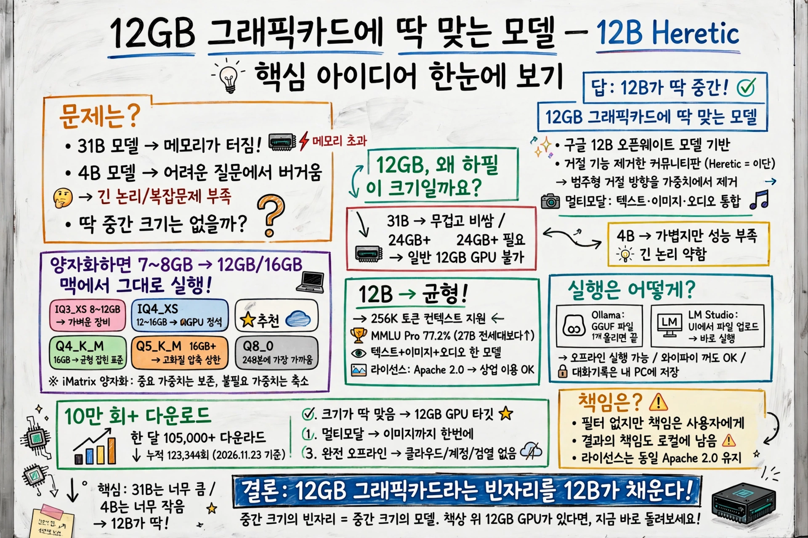
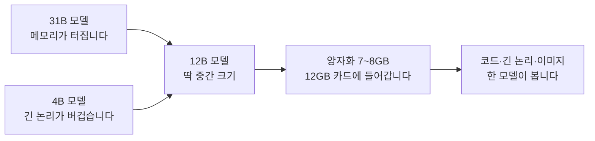
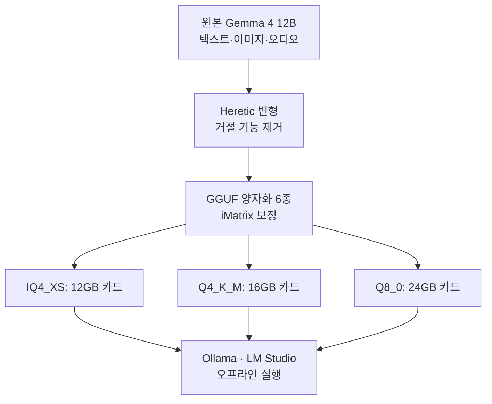

# Gemma 4 12B Heretic: 12GB 그래픽카드면 됩니다. 한 달 10만 명이 고른 로컬 모델입니다

> **Summary**
> Gemma 4 12B Heretic은 양자화하면 7~8GB로 줄어 12GB 그래픽카드나 16GB 맥에서 실행할 수 있는 로컬 멀티모달 모델입니다. 코드·긴 논리·이미지를 처리하며 Ollama나 LM Studio에서 오프라인으로 사용할 수 있지만, 거절 기능 제거에 대한 주장은 모델 제작자의 설명으로 보고 다운로드 수가 적합성을 보장하지 않는다는 점도 유의해야 합니다.

---

- 12GB 그래픽카드에 딱 맞는 모델이 있습니다. 구글의 12B 오픈 웨이트 모델을 바탕으로, 거절 기능을 빼고 만든 커뮤니티판입니다.
- 양자화하면 7~8GB라 12GB 그래픽카드나 16GB 맥에서 그대로 돕니다. 코드부터 긴 논리, 이미지까지 한 모델이 봅니다.
- 한 달에 10만 5천 회 넘게 내려받았습니다. 실행은 `Ollama`나 `LM Studio`에 파일 하나 올리면 끝입니다.

그래픽카드 12GB짜리 컴퓨터 앞에 앉아 있습니다. 31B 모델은 메모리가 터지고, 4B 모델은 어려운 질문에서 버겁습니다. 딱 중간 크기는 없을까요?

🎥 [동영상 보기](https://www.youtube.com/watch?v=U6_ZbW97-GY)

## 12GB, 왜 하필 이 크기일까요?

크기는 타협이 아닙니다. 31B는 보통 그래픽카드에 그대로 올리기 버겁고, 4B는 어려운 긴 논리에서 힘이 달립니다. 12B는 그 사이 빈자리입니다. 게시물에서도 바로 이 지점을 짚었습니다. 31B는 메모리가 터지고, 4B는 고난도 긴 논리를 버거워한다는 겁니다.

원본 모델 자체도 로컬을 노리고 나왔습니다. 구글의 12B 오픈 웨이트 모델은 텍스트·이미지·오디오를 한 몸으로 받는 통합형 멀티모달 모델입니다. 별도 인코더 없이 이미지 조각을 그대로 이해하고, 문맥은 최대 256K 토큰까지 봅니다. 공개 가이드 기준 `MMLU Pro` 77.2%로, 전 세대 27B 모델보다 높게 나왔습니다. 라이선스는 `Apache 2.0`이라 상업 이용까지 열려 있습니다.

이쯤에서 질문이 하나 생깁니다. 왜 하필 12GB 그래픽카드일까요? 게이밍 그래픽카드에서 가장 흔한 메모리 용량이 12GB이기 때문입니다. 4060, 4070, 맥 16GB 같은 보급형 장비가 바로 이 구간에 있습니다. 비싼 워크스테이션 카드가 아니라, 이미 책상 위에 있는 컴퓨터가 기준입니다!

## 거절 기능, 어떻게 뺐을까요?

이 모델의 이름에 붙은 `Heretic`은 "이단"이라는 뜻입니다. 모델 카드의 설명을 그대로 옮기면, 구글 원본에서 범주형 거절 문장을 방향 소거 방식으로 제거한 변형입니다. 거절이 모델 내부의 한 방향으로 실려 있다는 점에 착안해, 그 방향을 가중치에서 빼내는 방식입니다.

개념은 여기까지만 짚겠습니다. 소거를 직접 하는 도구나 절차, 명령어는 이 글에서 다루지 않습니다. 이 글의 주제는 소거 방법이 아니라, 이미 공개된 오픈 웨이트 모델이 내 컴퓨터에서 어떻게 돌아가는지입니다.

한 가지 분명히 할 점이 있습니다. "완전 무검열"이라는 말은 모델 카드의 표현이지, 검증된 사실이 아닙니다. 거절이 줄었다는 것과 모든 질문에 답한다는 것은 다른 이야기입니다. 만든 쪽의 설명은 만든 쪽의 설명으로 읽는 것이 맞습니다.

## 어떤 파일을 받아야 할까요?

이 모델의 저장소는 양자화 파일 6종을 한 번에 제공합니다. 그래픽카드 크기에 맞춰 고르면 됩니다.

- `IQ3_XS`: 8~12GB, 가벼운 장비·노트북용입니다.
- `IQ4_XS`: 12~16GB, 12GB 그래픽카드의 정석입니다.
- `Q4_K_M`: 16GB, 균형 잡힌 표준입니다.
- `Q5_K_M`: 16GB 이상, 고화질 압축의 상한입니다.
- `Q6_K`: 20~24GB, 거의 손실 없는 수준입니다.
- `Q8_0`: 24GB, 기준이 되는 원본에 가장 가깝습니다.
양자화할 때 흔히 생기는 문제가 있습니다. 비트를 줄이면 추론에 중요한 가중치까지 뭉개져 말이 꼬이기 시작합니다. 이 저장소는 중요도 행렬(`iMatrix`)로 양자화했습니다. 추론에 민감한 가중치는 지키고, 배경 언어 가중치는 과감히 줄이는 방식입니다. 3~4비트에서도 말이 풀리지 않게 붙잡아 두는 장치입니다.

이미지를 함께 쓰려면 본체 파일 하나만으로는 부족합니다. 비전 어댑터 파일(`mmproj`)을 같이 올려야 이미지를 읽습니다. 저장소 안에 함께 들어 있으니, 비전을 쓸 계획이면 두 파일을 같이 받으면 됩니다.

## 실행은 어떻게 하나요?

방법은 단순합니다. `GGUF` 파일을 내려받아 `Ollama`나 `LM Studio`에 올리면 됩니다. 화면이 편하면 `LM Studio`, 명령줄이 편하면 `Ollama`입니다. 다운로드가 끝나면 와이파이를 꺼도 그대로 돕니다. 대화 기록은 내 컴퓨터 안에 남습니다.

문맥 설정은 한 번 확인하는 것이 좋습니다. 실행기 기본 문맥은 4K 토큰으로 잡혀 있는 경우가 많습니다. 긴 문서를 넣을 계획이면 문맥 길이를 넉넉히 올려야 합니다. 모델이 256K까지 본다고 실행기가 자동으로 올려주지는 않습니다!

## 10만 회 다운로드, 왜 몰렸을까요?

게시물에서는 한 달에 10만 5천 회를 넘겼다고 소개했습니다. 저장소의 전체 다운로드 수는 2026년 11월 23일 기준 12만 3,344회로 확인됩니다. 별다른 홍보 없이 입소문만으로 이 숫자가 나왔습니다.

왜 이렇게 몰렸을까요? 이유를 세 가지로 정리할 수 있습니다. 첫째, 크기가 딱 맞습니다. 둘째, 멀티모달입니다. 셋째, 오프라인입니다. 클라우드 요금도, 계정도, 검열 서버도 없습니다. 12GB 그래픽카드 유저가 "내 컴퓨터에 둘 만한 똑똑한 모델"을 찾았을 때, 선택지가 마침 거기 있었던 겁니다.

다만 인기는 정답이 아닙니다. 다운로드 수는 "많이 받았다"는 사실만 보여줄 뿐, "내 일에 맞다"는 보장은 없습니다. 직접 돌려보고 내 질문에 어떻게 답하는지 확인하는 것이 가장 빠릅니다!

## 책임은 어디에 있을까요?

필터가 없다고 책임까지 사라지는 건 아닙니다. 로컬에서 돌리면 대화 기록은 내 컴퓨터 안에 남지만, 만든 결과의 책임도 함께 남습니다. 라이선스도 거절을 뺐다고 바뀌지 않습니다. 원본과 같은 `Apache 2.0` 조건이 그대로 적용됩니다.

각도 구분을 분명히 하겠습니다. 앞선 글들이 무검열 모델 7종 목록, 로컬 구축 과정, 클라우드 GPU를 로컬 API로 쓰는 방법을 다뤘다면, 이 글은 12B Heretic이라는 모델 하나를 깊게 다뤘습니다. 12GB 그래픽카드라는 빈자리에 이 모델이 왜 들어맞는지, 그 한 가지 질문에 답하는 글입니다.

12GB 그래픽카드가 이미 책상 위에 있다면, 이 모델은 한 번 돌려볼 만합니다. 중간 크기의 빈자리는, 결국 중간 크기의 모델이 채웁니다!

