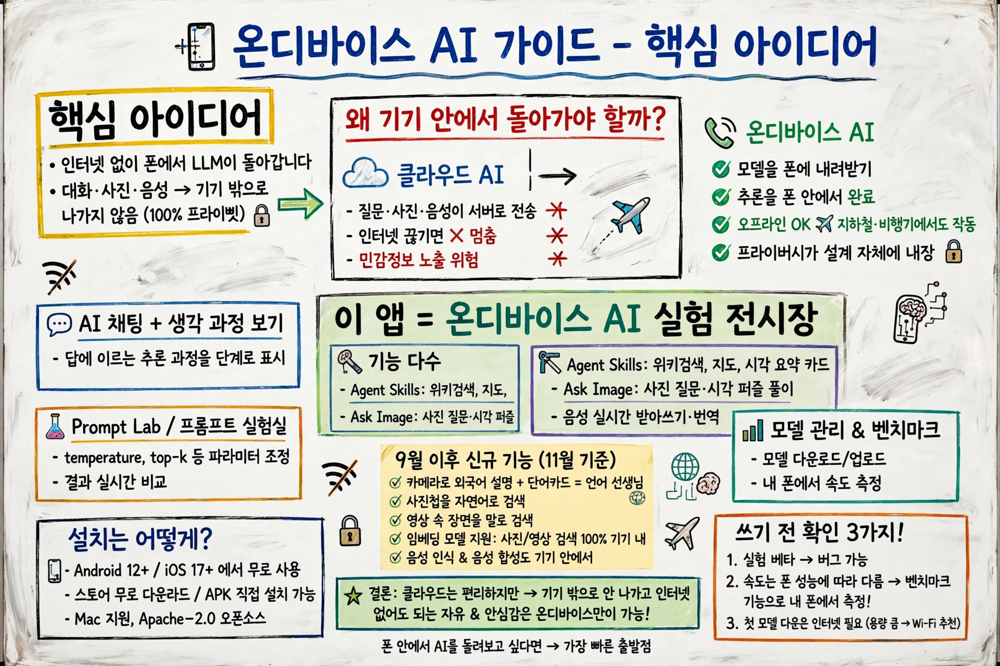
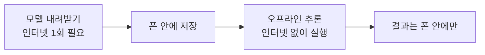
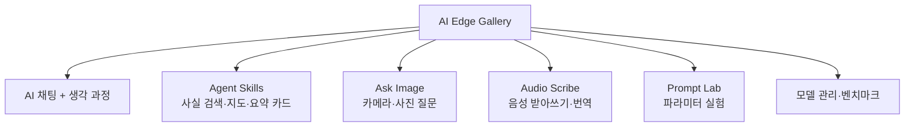

# Google AI Edge Gallery: 인터넷 없이 폰에서 LLM이 돌아갑니다. 대화는 기기 밖으로 안 나갑니다

> **Summary**
> 인터넷 없이 폰에서 LLM이 돌아갑니다. 대화·사진·음성이 기기 밖으로 나가지 않습니다. 채팅만 있는 앱이 아닙니다. 생각 과정 보기, 이미지 질문, 음성 받아쓰기, 프롬프트 실험실까지 한 앱에 모였습니다. 안드로이드 12+, 아이폰 iOS 17+에서 무료로 쓸 수 있고, 소스도 공개돼 있습니다. 실험 베타라 속도는 폰 성능에 따라 달라집니다.

---

- 인터넷 없이 폰에서 LLM이 돌아갑니다. 대화·사진·음성이 기기 밖으로 나가지 않습니다.
- 채팅만 있는 앱이 아닙니다. 생각 과정 보기, 이미지 질문, 음성 받아쓰기, 프롬프트 실험실까지 한 앱에 모였습니다.
- 안드로이드 12+, 아이폰 iOS 17+에서 무료로 쓸 수 있고, 소스도 공개돼 있습니다. 실험 베타라 속도는 폰 성능에 따라 달라집니다.

지하철에서 AI한테 뭘 물어보려는데, 신호가 끊겼습니다. 이런 적 있으시죠? 클라우드 AI는 인터넷이 끊기면 그냥 멈춥니다. 그런데 모델 자체를 폰 안에 넣어두면 어떨까요? 신호가 없어도, 비행기 안에서도, AI가 돌아갑니다!

🎥 [동영상 보기](https://www.youtube.com/watch?v=i7cDQDttOq0)

## 왜 기기 안에서 돌아가야 할까요?

클라우드 AI는 질문할 때마다 서버로 내용이 날아갑니다. 민감한 메모, 사진, 음성 녹음까지 말이죠. 온디바이스 AI는 방향이 다릅니다. 모델을 폰에 내려받아서, 추론을 폰 안에서 끝냅니다. 인터넷이 아예 없어도 돌아가고, 프롬프트가 서버로 나갈 일이 없습니다. 프라이버시가 구조 자체에 박혀 있는 셈입니다!

이 앱은 그 온디바이스 AI를 이것저것 시험해 보는 전시장 같은 앱입니다. 오픈소스 대형 언어 모델을 폰에서 직접 돌려보면서, 어떤 모델이 내 폰에서 얼마나 빠른지까지 재볼 수 있습니다.

## 뭐가 들어 있을까요?

채팅만 있는 앱이 아닙니다. 기능이 꽤 많습니다. 하나씩 살펴보겠습니다.

**AI 채팅**이 기본입니다. 여기에 **Thinking Mode**가 붙었습니다. 모델이 답을 내기까지 어떤 순서로 생각했는지, 단계별 추론 과정을 눈으로 확인할 수 있습니다. 답이 틀렸을 때 어디서 삐끗했는지 짚어보기가 훨씬 쉽습니다.

**Agent Skills**는 채팅을 비서로 바꿉니다. 위키백과에서 사실을 찾아오고, 지도를 띄우고, 시각 요약 카드를 만들어줍니다. 스킬은 URL에서 모듈식으로 불러올 수 있고, 커뮤니티에서 공유된 스킬도 찾아볼 수 있습니다.

**Ask Image**는 카메라와 사진첩을 쓰는 멀티모달 기능입니다. 물건을 비추면 무엇인지 알려주고, 시각 퍼즐도 풀고, 사진에 대해 자세히 설명해줍니다. **Audio Scribe**는 음성을 실시간으로 글로 받아쓰고 번역까지 해줍니다.

**Prompt Lab**은 프롬프트 실험실입니다. `temperature`, `top-k` 같은 파라미터를 세밀하게 조정하면서 같은 프롬프트의 결과가 어떻게 달라지는지 바로 비교해볼 수 있습니다. 프롬프트를 다듬는 연습용으로 딱입니다.

**Mobile Actions**와 **Tiny Garden**은 작은 모델 한 개로 움직이는 실험 기능입니다. 기기 제어를 오프라인으로 자동화하거나, 말로 정원을 가꾸는 미니게임을 돌려봅니다. 가볍지만 온디바이스 AI가 어디까지 가는지 보여주는 사례입니다.

**Model Management & Benchmark**도 있습니다. 모델을 내려받고, 내 모델을 직접 올리고, 내 폰 하드웨어에서 각 모델이 얼마나 빠른지 벤치마크로 재볼 수 있습니다. 경량 런타임과 모델 허브 연동으로 모델 탐색까지 한곳에서 끝냅니다.

## 9월 이후 뭐가 새로 생겼을까요?

수집 시점인 9월 말에는 `Gemma 4` 패밀리 지원과 위 기능들이 중심이었습니다. 그런데 11월 현재, 앱은 더 커졌습니다. 카메라를 비추면 외국어로 설명해주고 단어 카드를 만들어주는 언어 선생님 기능이 생겼고, 사진첩을 자연어로 검색하는 기능과 영상 속 장면을 말로 찾는 기능도 추가됐습니다. 새로 나온 임베딩 모델 지원으로 사진·영상 검색이 폰 안에서 100% 돌아갑니다. 음성 인식과 음성 합성도 기기 안에서 돌아가게 됐습니다!

## 설치는 어떻게 할까요?

안드로이드 12 이상, 아이폰 iOS 17 이상에서 돌아갑니다. 스토어에서 무료로 받을 수 있고, 스토어 접근이 안 되는 환경에서는 릴리스 페이지에서 APK를 직접 받아 설치할 수도 있습니다. 맥에서도 내려받아 쓸 수 있습니다. 라이선스는 `Apache-2.0`이라 상업 이용에도 열려 있고, 소스도 공개돼 있습니다.

## 쓰기 전에 확인할 것 3가지가 있습니다

첫째, 이 앱은 **실험 베타**입니다. 정식 제품이 아니라 개발자와 애호가를 위한 전시장이라, 기능이 바뀌거나 덜 다듬어진 부분이 있을 수 있습니다.

둘째, 속도는 폰 성능에 따라 크게 달라집니다. 같은 모델도 최신 폰과 몇 년 된 폰에서 체감이 다릅니다. 벤치마크 기능으로 내 폰에서 직접 재보는 것이 순서입니다!

셋째, 모델을 처음 내려받을 때는 인터넷이 필요합니다. 한 번 받아두면 그 뒤로는 오프라인이지만, 모델 파일 용량이 작지 않으니 와이파이에서 받는 것이 좋습니다.

클라우드 AI가 편한 것은 맞습니다. 그런데 질문이 기기 밖으로 나가지 않는다는 안심감, 인터넷이 없어도 돌아간다는 자유로움은 클라우드가 줄 수 없는 가치입니다. 폰 안에서 AI를 돌려보고 싶으시다면, 이 앱이 가장 빠른 출발점입니다!

