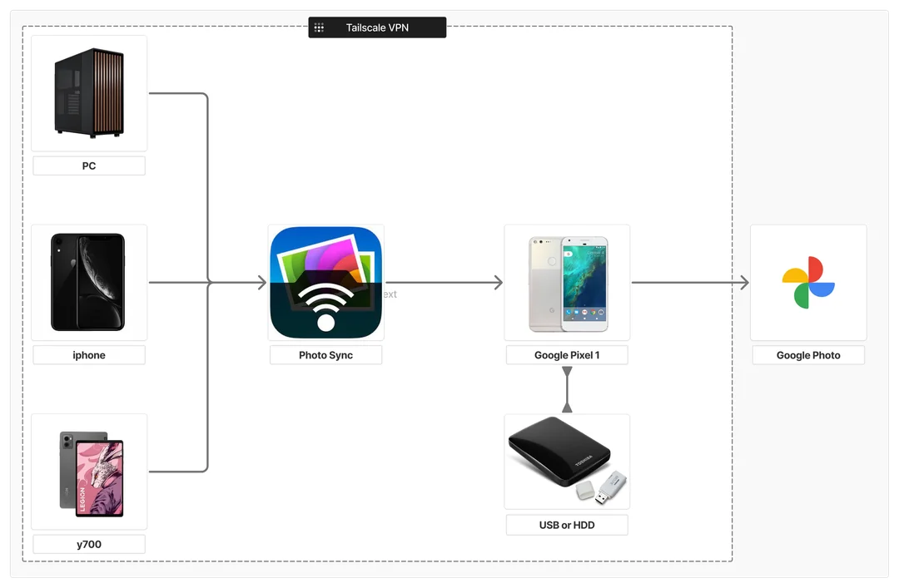
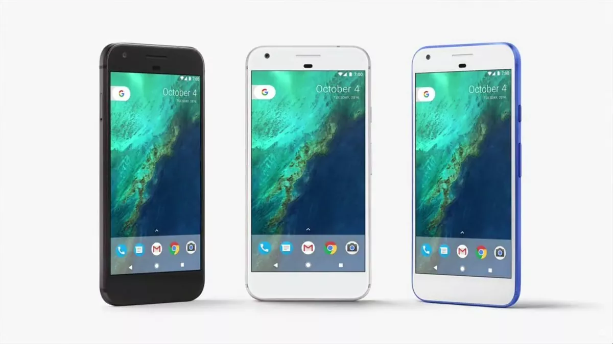

# Google Pixel 1 무제한 업로드 그 외 대안들

> **Summary**
> Google Pixel 1은 무제한 원본 화질 이미지 업로드를 지원하며, 배터리 성능 저하로 전원 공급을 안정화하기 위한 방법과 FTP 서버 운영, 외장 USB 저장소 마운트, 클라이언트와의 네트워크 연결 방법을 설명합니다. 또한 JPEG 인코딩, RAW 파일 업로드, Android 에뮬레이터 사용, Revanced Manager 패치 등 다양한 대안 방법들이 제안됩니다. 다른 사용자들이 제안한 방법으로는 싱글보드컴퓨터 활용, P2P 동기화, 오픈소스 서버 호스팅 등이 있습니다.

---

# 이건 내가 작성한 글

🔗 [https://www.reddit.com/r/homelab/comments/1m04ix4/android_service_for_unlimited_google_photos/](https://www.reddit.com/r/homelab/comments/1m04ix4/android_service_for_unlimited_google_photos/)





```plain text
	•	Google Pixel 1은 무제한 원본 화질 이미지 업로드를 지원합니다.
	•	기기가 출시된 지 거의 10년이 되어 배터리 성능이 저하되어, 배터리를 제거하고 12 V→3.8 V DC 컨버터를 설치해 안정적으로 전원을 공급했습니다.
	•	CX File Explorer를 이용해 FTP 서버를 실행했습니다.
	•	Android ADB를 통해 외장 USB 저장소를 마운트해 용량 한계를 극복했습니다.
	•	Tailscale VPN으로 클라이언트와 Pixel 1 서버를 하나의 네트워크로 연결했습니다.
	•	클라이언트 측에서는 사진 동기화 툴을 Pixel의 FTP 주소에 맞춰 업로드를 자동화했습니다.
	•	발열 관리를 위해 써멀 패드와 구리판을 부착했으며, 이후 전용 냉각 챔버와 인클로저를 제작할 예정입니다.
	•	현재 안정적으로 운영 중입니다. HomeLab을 즐겨봅시다!
```

# 그리고 유저들이 제안한 그 외 방법들

### **JPEG로 인코딩 후 업로드 (u/assidiou)**

- **방법**: 업로드할 모든 파일을 미리 JPEG로 변환하여 Google Photos가 “사진”으로 인식하게끔 함.
- **핵심**: Google Photos는 JPEG 이미지는 별도 용량 계산 없이 백업하므로, 파일을 강제로 사진으로 둔갑시켜 무제한 업로드를 노립니다.
### **RAW 파일 업로드 (iJeff)**

- **방법**: 원본 DSLR·미러리스 촬영 파일(RAW 포맷)을 그대로 업로드.
- **핵심**: Google이 일반 사진(.jpg)과 달리 RAW 파일은 재인코딩하지 않는다는 점을 활용해, 그대로 원본 품질로 저장합니다.
### **Nox 에뮬레이터 + Pixelfy (u/Automatic_Still_6278)**

- **방법**: PC용 Android 에뮬레이터(Nox)를 설치하고, 루팅 후 Pixelfy 모듈로 디바이스 ID를 픽셀로 스푸핑.
- **핵심**: 에뮬레이터 내부에서 Google Photos를 실행하되, 디바이스 정보를 Pixel 1로 위조해 백업 제한을 회피합니다.
### **Revanced Manager 패치 (u/Firebirdflame)**

- **방법**: Revanced Manager로 공식 Google Photos APK를 불러와 “Spoof Unlimited Photos Backup” 패치를 적용 후 재설치.
- **핵심**: 루트·커스텀롬 없이도 GmsCore를 통해 Google Play 서비스를 제공받아, Pixel 전용 무제한 백업 기능을 활성화합니다.
### **Pixel 하드웨어 에뮬레이션 (u/webvictim)**

- **방법**: Proxmox VM이나 Android x86 커스텀 롬으로 픽셀 환경을 가상으로 구성.
- **핵심**: 실제 Pixel 1 하드웨어 없이도, 소프트웨어 차원에서 Pixel 기기로 인식시켜 Unlimited Original Quality 업로드를 시도합니다.
### **싱글보드컴퓨터(SBC) + Magisk 모듈 (u/thatfrostyguy)**

- **방법**: 라즈베리파이 등 SBC에 Android 설치 후, Magisk 모듈로 기기 모델을 속여 업로드.
- **핵심**: 저전력·저가형 장치에서 Pixel처럼 동작하도록 스푸핑해, SBC를 사진 전용 홈랩 장비로 활용합니다.
### **Resilio Sync P2P 동기화 (u/Chanw11)**

- **방법**: iOS나 기타 기기에서 Resilio Sync를 이용해 Pixel 1의 로컬 폴더와 직접 동기화.
- **핵심**: 클라우드 대신 P2P로 사진을 전송하므로, Google Photos에 올라간 사진을 간접적으로 백업 없이 동기화할 수 있습니다.
### **Immich 셀프호스트 (u/nstern2)**

- **방법**: Docker/Kubernetes 위에 Immich 서버를 설치하고, 모바일 앱으로 자동 백업 설정.
- **핵심**: 오픈소스 사진·비디오 관리 플랫폼을 자체 서버에 호스팅해, Google Photos 대안으로 무제한·프라이빗 백업을 구현합니다.
### **저가 오브젝트 스토리지 이용 (u/mishrashutosh)**

- **방법**: Hetzner, Backblaze B2, Cloudflare R2 등의 S3 호환 스토리지에 직접 업로드 스크립트를 작성.
- **핵심**: Google 대신 저렴한 클라우드 스토리지를 활용해, 페이-애즈-유-고 방식으로 대용량 이미지 보관을 실현합니다.
### **pixel-backup-gang 스크립트 (u/Xerloq)**

- **방법**: GitHub pixel-backup-gang 리포의 스크립트를 이용해 외장 드라이브를 adoptable storage로 마운트.
- **핵심**: USB·SD 외장 저장소를 시스템 내장처럼 동작시켜, 사진을 직접 Pixel 1의 내부 경로로 올릴 수 있도록 만듭니다. (이러면 마모된 내부 저장소도 우회할 수 있다고함)
```plain text
NoEntrepreneur7008
•
4m ago
you can also do this with newer android phones you just need to root it and use an xposed module to spoof the device to a pixel xl for the photos app
```

```plain text
u/bkj512 avatar
bkj512
•
4h ago
FYI: you can root or ROM any android device and install a module that spoofs your device as a pixel. I've been doing this with my Oneplus and am able to abuse photos for a while. I'm impressed many aren't aware about this.

https://github.com/VehanRajintha/Free-Unlimited-Google-Cloud-Backup-Magisk-Module
```

```plain text
ppeatrick
•
12h ago
What a truly fantastic product. I purchased a gently used OG Pixel XL a handful of years ago and had a decent little setup with Syncthing Fork in the past, which might have been based on this old post: https://www.reddit.com/r/GooglePixel/comments/njk5b3/og_pixel_unlimited_photos_storage_syncthing_guide/

Never migrated the system over when i upgraded devices a couple/few years back, would love to revisit this project in the coming months. Outstanding content.
```

```plain text
technologiq
•
8h ago
Pixel 9 Pro user here. Had a 3,6, and 8 too. Not sure you need to go to these lengths.

I still have unlimited storage for Original Quality in Google Photos. I have three Google Workspace (Legacy, not paid) accounts that offer unlimited original quality storage. The only one that doesn't is my actual gmail.com account (which has 2TB of storage).


---

과거 Google은 'G Suite legacy free edition'이라는 이름으로 개인이나 소규모 기업에게 무료 Google Workspace(구 G Suite) 계정을 제공했습니다. 이 무료 계정 중 일부는 Google 드라이브(그리고 Google 포토)의 무제한 저장 공간 혜택을 포함하고 있었습니다. Google은 이 무료 레거시 플랜을 2022년에 유료 플랜으로 전환하거나 폐지했지만, 일부 사용자들은 여전히 이 '무료' 레거시 계정을 유지하고 있습니다.

이 댓글 작성자는 자신이 이미 여러 경로(오래된 픽셀 폰 혜택, 그리고 특히 3개의 무료 Google Workspace 레거시 계정)를 통해 원본 화질의 Google 포토 무제한 저장 공간을 가지고 있기 때문에, 원 게시물 작성자가 복잡하게 오래된 폰을 홈랩으로 설정해서 무제한 저장 공간을 얻으려는 노력이 자신에게는 필요 없다고 말하는 것입니다.
```

```plain text
Its_Billy_Bitch
•

You might be able to use a Raspberry Pi and install Lineage OS or Emteria. Then have your photos sync from that. Can use an Android automation or pull the “p(i)hone” into Home Assistant and go wild.

I have a few configured like this for recessed dashboards on our walls (proud of these models I created that got me to 0.4mm protrusion from the wall, so seriously recessed and extremely flush…and single low voltage PoE cables to each. They play Apple Aerial views with overlay text “Homo Sweet Homo” etc. etc. When motion is detected in its vicinity, it wakes up to the Home Assistant dashboard (or whatever automation workflow of your choosing). Also useful for notifications and your exact type of proposed automation.

Comment Image
It’s kinda like your setup without the spicy pillow workaround 😜 the ingenuity though…you’re cooking with fire. I wanna see what you make next!

With all that said, if you wanna get super manual about it, you create your own service. I’ve mainly worked with the GCP API endpoints, but these are very similarly structured (thank you, REST).

https://developers.google.com/photos/library/guides/upload-media

The link above goes into how to leverage the API to upload photos. If you get it working in Postman or something, it wouldn’t be difficult to sequence it into an automation workflow.

If none of those work, you could also (this feels so dirty)…use Selenium. I know. 🤮 I’m sorry. But it technically is an option as well lol.

Edit: I still don’t know if it’s be possible using Emteria or Lineage OS - just tossing that out there as a potential option.

---

핵심 제안: "라즈베리 파이(Raspberry Pi)에 커스텀 안드로이드 OS(Lineage OS 등)를 설치해서 당신이 한 것과 비슷한 시스템을 만들 수도 있다."

의도: OP가 구글 픽셀폰을 사용한 것처럼, 더 범용적이고 커스터마이징이 쉬운 라즈베리 파이를 활용하는 대안을 제시하고 있습니다. 이는 '홈랩(homelab)' 커뮤니티의 정신과 잘 맞습니다.

Google Photos API 활용: 구글이 공식적으로 제공하는 API를 사용하여 사진을 업로드하는 '정석적인' 방법을 제안합니다. 개발자 문서를 링크하며, 자동화에 적용할 수 있다고 설명합니다.

Selenium 활용: 웹 브라우저 자체를 자동화하는 '셀레니움(Selenium)'을 사용하는 방법을 '더러운 방법(so dirty)'이라며 농담처럼 제안합니다. 이는 API보다 불안정하고 비효율적이라 개발자들이 최후의 수단으로 여기기 때문이며, 기술적인 유머에 해당합니다.

의도: 하드웨어 조작 외에도, 순수하게 소프트웨어만으로 이 문제를 해결할 수 있는 더 전문적인 방법을 공유하며 논의의 깊이를 더하고 있습니다.
```

```plain text

Google photos app says "free back ups with storage saver", but Google photos websites indicates original quality on all my backups.

Google photos app shows as version 7.35.0.778148202

Build is RQ3A.211001.001 PixelExperience_river-11.0-20211014-0551-OFFICIAL
```


