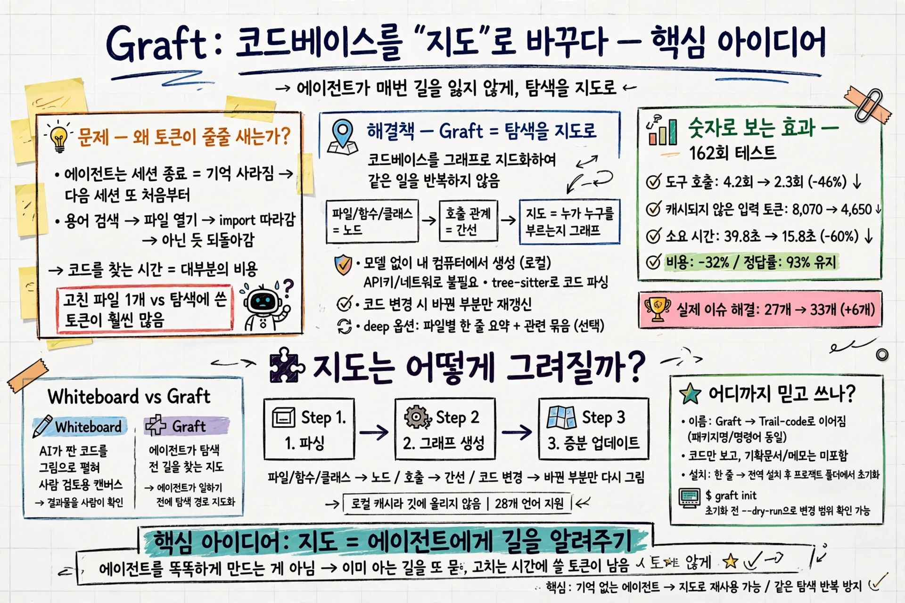
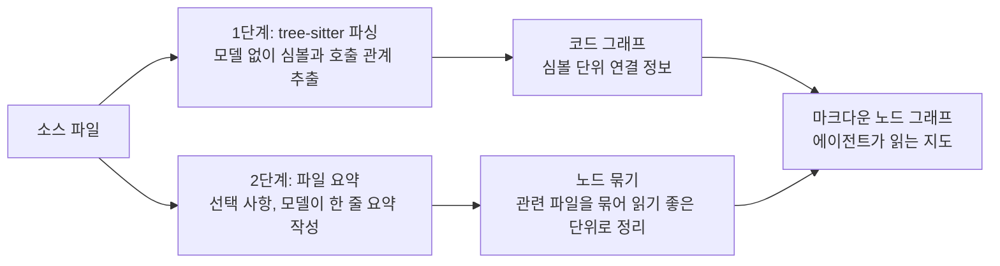
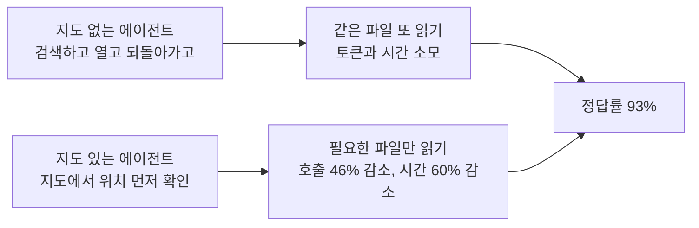

# Graft: 에이전트에게 코드 지도를 주면, 탐색이 46% 줄고 답은 그대로입니다

> **Summary**
> Graft(현재 Trail-code의 일부)는 코드베이스를 파일·함수·호출 관계로 구성한 로컬 코드 지도로 에이전트의 반복 탐색을 줄입니다. 자체 측정에서 도구 호출은 46%, 토큰은 42%, 작업 시간은 60% 감소했고 정답률은 유지됐으며, 실제 이슈 해결 과제는 27개에서 33개로 늘었습니다. 지도는 코드 변경분만 갱신되며 훅, MCP, CLI로 사용할 수 있지만, 지원 언어와 코드 중심이라는 한계가 있습니다.

---

- 코딩 에이전트는 세션이 바뀔 때마다 코드베이스를 처음부터 다시 뒤집니다. Graft는 그 탐색을 지도로 바꿔 같은 일을 반복하지 않게 합니다.
- 지도는 파일과 함수, 누가 누구를 부르는지를 그래프로 엮은 것입니다. 모델 없이 내 컴퓨터에서 만들고, 코드가 바뀌면 바뀐 부분만 다시 그립니다.
- 자체 측정에서는 도구 호출 46%, 시간 60%가 줄었고 정답률은 그대로였습니다. 실제 이슈 해결 과제에서는 맞힌 개수가 27개에서 33개로 늘었습니다.

에이전트에게 파일 하나 고쳐달라고 했는데, 엉뚱한 파일을 잔뜩 읽고 토큰이 줄줄 새는 걸 본 적 있으시죠? 고친 파일은 하나인데, 찾는 데 쓴 토큰이 고치는 데 쓴 토큰보다 많습니다. 왜 그럴까요?

🎥 [동영상 보기](https://www.youtube.com/watch?v=j7ED8Irjp0o)

## 에이전트는 왜 매번 길을 잃을까요?

사람은 코드베이스에 한 번 익숙해지면 다음부터 길을 압니다. 에이전트는 다릅니다. 세션이 끝나면 기억이 사라집니다. 다음 세션은 또 처음부터 검색합니다. 용어를 검색하고, 파일을 열고, 임포트를 따라가다가, 아닌 줄 알고 되돌아옵니다.

이 반복이 비용의 대부분입니다. 코드를 짜는 시간이 아니라, 코드를 찾는 시간이 토큰을 먹습니다. 코드베이스가 클수록 찾는 길은 더 깁니다. 그런데 찾는 방법은 매번 똑같습니다. 지도가 있으면 달라지지 않을까요?

## 지도는 어떻게 그려질까요?

Graft는 코드베이스를 읽어 그래프로 만듭니다. 파일과 함수, 클래스 같은 심볼이 노드가 되고, 누가 누구를 부르는지가 간선이 됩니다. 이걸 **코드 맵**이라고 부릅니다.

만드는 방법은 두 겹입니다. 첫째 겹은 `tree-sitter`로 코드를 파싱합니다. 모델도, API 키도, 네트워크도 필요 없습니다. 내 컴퓨터에서 돌아갑니다. 둘째 겹은 선택 사항입니다. `--deep` 옵션을 켜면 모델이 파일마다 한 줄 요약을 달고, 관련 있는 것끼리 묶어 읽기 좋은 노드로 정리합니다. 큰 저장소도 수십 개 안팎의 노드로 압축됩니다.

지도는 한 번 그리고 끝이 아닙니다. 코드가 바뀌면 바뀐 부분만 다시 그립니다. 조회할 때마다 작업 폴더를 먼저 확인하고, 달라진 것이 있으면 그 부분만 갱신합니다. 커밋하지 않은 수정도 반영됩니다. 그래서 에이전트가 보는 지도는 지금 코드와 어긋나지 않습니다.

에이전트는 이 지도를 어떻게 쓸까요? 세 가지 길이 있습니다. 프롬프트마다 맞는 파일과 함수를 붙여주는 훅 방식, 필요할 때만 물어보는 MCP 서버 방식, 그리고 사람이 직접 검색하는 CLI 방식입니다. 어떤 길이든 핵심은 같습니다. 파일을 통째로 읽는 대신, 지도에서 위치를 먼저 찾는 것입니다!

## 숫자로 보면 어떨까요?

주장만 믿고 쓰면 안 됩니다. 측정 결과를 봐야 합니다. 프로젝트에서 공개한 자체 측정부터 봅시다.

같은 에이전트, 같은 과제를 162번 돌렸습니다. 지도가 없는 에이전트와 지도가 있는 에이전트를 비교했습니다. 결과는 이렇습니다. 도구 호출은 4.2번에서 2.3번으로, **46% 줄었습니다!** 캐시되지 않은 입력 토큰은 8,070개에서 4,650개로, **42% 줄었습니다!** 걸린 시간은 39.8초에서 15.8초로, **60% 줄었습니다!** 비용은 32% 낮아졌습니다. 정답률은 93%로 같았습니다.

속도만 좋아진 것이 아닙니다. 실제 이슈를 푸는 과제에서도 결과가 달라졌습니다. 공식 평가 과제 50개 중, 지도가 없는 에이전트는 27개를 풀었습니다. 지도가 있는 에이전트는 **33개를 풀었습니다!** 토큰은 23% 적게 썼습니다. 틀린 파일을 고치고 이웃 파일을 놓치는 실수가 줄었기 때문입니다.

물론 이 숫자는 프로젝트 측 측정입니다. 독립 검증 영상에서는 작은 프로젝트에서 토큰이 39~50% 줄었고, 큰 프로젝트에서는 탐색이 많은 과제에서만 27% 줄었다고 나왔습니다. 내 코드베이스에서 얼마나 줄지는 직접 재보는 것이 순서입니다. 그래도 방향은 분명합니다. 찾는 일을 줄이면 남는 토큰으로 더 많은 일을 할 수 있습니다.

## 지도를 보는 것과 그림으로 검토하는 것, 뭐가 다를까요?

비슷해 보이는 도구와 헷갈리기 쉽습니다. 구분을 분명히 해두겠습니다. P313에서 다룬 Whiteboard는 AI가 짠 코드를 그림으로 펼쳐놓고 사람이 검토하는 캔버스입니다. 사람이 보는 화면이 중심입니다.

Graft는 반대 방향입니다. 사람이 보는 그림이 아니라, **에이전트가 탐색하는 지도**입니다. 에이전트가 파일을 찾기 전에 지도를 읽고, 어디를 봐야 할지 정합니다. 검토 캔버스는 결과물을 사람이 확인하는 도구이고, 코드 지도는 에이전트가 일하기 전에 길을 찾는 도구입니다. 둘 다 그림을 쓰지만, 쓰는 주체와 쓰는 시점이 다릅니다.

## 어디까지 믿고 쓰면 될까요?

몇 가지 주의할 점도 있습니다. 첫째, 이름이 바뀌었습니다. Graft는 이제 Trail-code라는 이름으로 이어지고, 코드 지도는 그 안의 한 부분입니다. 예전 명령어와 패키지 이름은 그대로 쓸 수 있으니, 옛날 글에 나온 설치 방법이 갑자기 안 되는 일은 없습니다.

둘째, 지도는 코드만 봅니다. 기획 문서나 메모 같은 코드 밖 문서는 지도에 들어가지 않습니다. 그런 자료는 여전히 예전 방식으로 읽어야 합니다.

셋째, 지원하는 언어는 28개입니다. 타입스크립트와 파이썬, 고, 자바 같은 언어는 호출 관계까지 정밀하게 잡고, 러스트와 C++, C# 같은 언어는 넓게 잡습니다. 내 프로젝트 언어가 목록에 있는지 먼저 확인하는 것이 좋습니다.

넷째, 지도는 내 컴퓨터에 머뭅니다. 그래프 파일은 로컬 캐시라 깃에 올리지 않습니다. 팀과 나누는 것은 학습 기록 쪽입니다. 익명 사용 통계는 끌 수 있습니다.

설치는 한 줄입니다. 패키지 매니저로 전역 설치한 뒤, 프로젝트 폴더에서 초기화를 실행하면 됩니다. 초기화 전에 `--dry-run`으로 어떤 파일을 건드릴지 먼저 확인할 수 있습니다. 무엇을 바꿀지 모른 채 실행하지 않는 것이 좋습니다.

에이전트에게 지도를 주는 일은, 에이전트를 똑똑하게 만드는 일이 아닙니다. 에이전트가 이미 아는 길을 또 묻지 않게 만드는 일입니다. 찾는 시간을 줄이면, 고치는 시간에 쓸 토큰이 남습니다. 그게 이 도구가 하는 일의 전부입니다.

